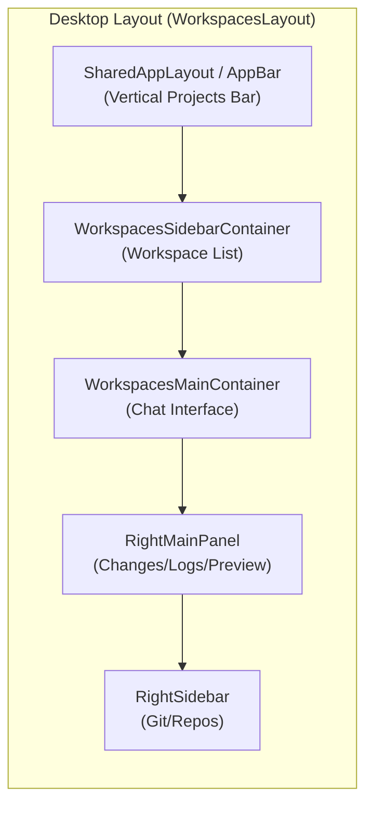
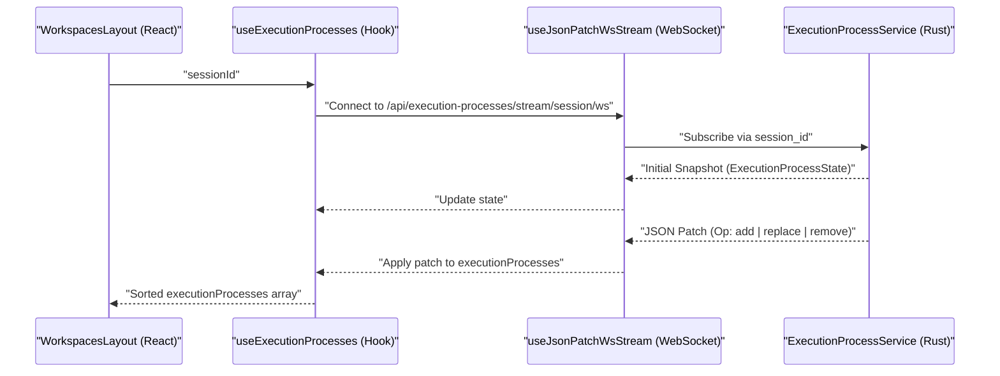
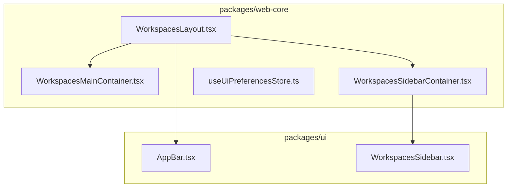

# Workspaces Layout and Views

Relevant source files

The following files were used as context for generating this wiki page:

- [packages/remote-web/src/app/layout/RemoteAppBarUserPopoverContainer.tsx](packages/remote-web/src/app/layout/RemoteAppBarUserPopoverContainer.tsx)
- [packages/remote-web/src/app/layout/RemoteDesktopNavbar.tsx](packages/remote-web/src/app/layout/RemoteDesktopNavbar.tsx)
- [packages/ui/src/components/Navbar.tsx](packages/ui/src/components/Navbar.tsx)
- [packages/ui/src/components/WorkspacesSidebar.tsx](packages/ui/src/components/WorkspacesSidebar.tsx)
- [packages/web-core/src/pages/kanban/KanbanIssuePanelContainer.tsx](packages/web-core/src/pages/kanban/KanbanIssuePanelContainer.tsx)
- [packages/web-core/src/pages/kanban/kanban-issue-panel-state.ts](packages/web-core/src/pages/kanban/kanban-issue-panel-state.ts)
- [packages/web-core/src/pages/root/RootRedirectPage.tsx](packages/web-core/src/pages/root/RootRedirectPage.tsx)
- [packages/web-core/src/pages/workspaces/ChangesPanelContainer.tsx](packages/web-core/src/pages/workspaces/ChangesPanelContainer.tsx)
- [packages/web-core/src/pages/workspaces/FileTreeContainer.tsx](packages/web-core/src/pages/workspaces/FileTreeContainer.tsx)
- [packages/web-core/src/pages/workspaces/RightSidebar.tsx](packages/web-core/src/pages/workspaces/RightSidebar.tsx)
- [packages/web-core/src/pages/workspaces/WorkspacesLayout.tsx](packages/web-core/src/pages/workspaces/WorkspacesLayout.tsx)
- [packages/web-core/src/pages/workspaces/WorkspacesSidebarContainer.tsx](packages/web-core/src/pages/workspaces/WorkspacesSidebarContainer.tsx)
- [packages/web-core/src/shared/command-bar/actions/pages.ts](packages/web-core/src/shared/command-bar/actions/pages.ts)
- [packages/web-core/src/shared/components/ui-new/containers/NavbarContainer.tsx](packages/web-core/src/shared/components/ui-new/containers/NavbarContainer.tsx)
- [packages/web-core/src/shared/components/ui-new/containers/SharedAppLayout.tsx](packages/web-core/src/shared/components/ui-new/containers/SharedAppLayout.tsx)
- [packages/web-core/src/shared/hooks/useAllOrganizationProjects.ts](packages/web-core/src/shared/hooks/useAllOrganizationProjects.ts)
- [packages/web-core/src/shared/hooks/useExecutionProcesses.ts](packages/web-core/src/shared/hooks/useExecutionProcesses.ts)
- [packages/web-core/src/shared/hooks/useUiPreferencesScratch.ts](packages/web-core/src/shared/hooks/useUiPreferencesScratch.ts)
- [packages/web-core/src/shared/hooks/useWorkspaceSidebarPreviewController.ts](packages/web-core/src/shared/hooks/useWorkspaceSidebarPreviewController.ts)
- [packages/web-core/src/shared/lib/firstProjectDestination.ts](packages/web-core/src/shared/lib/firstProjectDestination.ts)
- [packages/web-core/src/shared/stores/useOrganizationStore.ts](packages/web-core/src/shared/stores/useOrganizationStore.ts)
- [packages/web-core/src/shared/stores/useUiPreferencesStore.ts](packages/web-core/src/shared/stores/useUiPreferencesStore.ts)

## Purpose and Scope

This document describes the layout system for the workspaces view in Vibe Kanban, including panel management, responsive behavior, and state persistence. The workspaces layout provides a multi-panel interface for viewing workspace lists, chat interfaces, changes, logs, and git operations. It details how the frontend organizes the conversation history and handles complex UI requirements like scroll synchronization and virtualization.

For information about workspace creation flow, see [5.3](). For session chat interface details, see [5.4](). For kanban board views, see [5.6]().

## Layout Architecture

The workspaces view uses a flexible panel-based layout system that adapts between desktop and mobile devices. The layout is managed by the `WorkspacesLayout` component [packages/web-core/src/pages/workspaces/WorkspacesLayout.tsx:47-47]() and controlled by per-workspace state stored in `useUiPreferencesStore` [packages/web-core/src/shared/stores/useUiPreferencesStore.ts:51-54]().

### Desktop Layout Structure

The desktop view utilizes a multi-column approach, often integrated with IDE-like features. It uses `react-resizable-panels` [packages/web-core/src/pages/workspaces/WorkspacesLayout.tsx:9-9]() to allow users to customize their workspace.

**Sources:** [packages/web-core/src/pages/workspaces/WorkspacesLayout.tsx:9-30](), [packages/web-core/src/shared/components/ui-new/containers/SharedAppLayout.tsx:55-173](), [packages/web-core/src/pages/workspaces/RightSidebar.tsx:1-10]()

### Global Navigation and AppBar

The `SharedAppLayout` serves as the root wrapper for the application, providing the `AppBar` which manages navigation between different projects and organizations.

- **Organization Management**: The `useOrganizationStore` tracks the `selectedOrgId` [packages/web-core/src/shared/components/ui-new/containers/SharedAppLayout.tsx:105-106]().
- **Project Navigation**: The `AppBar` renders a list of projects fetched via `useShape` from the `PROJECTS_SHAPE` [packages/web-core/src/shared/components/ui-new/containers/SharedAppLayout.tsx:127-134]().
- **Remote Hosts**: It displays connected remote environments (hosts) and their statuses (online, offline, unpaired) via `useRemoteCloudHostsAppBarModel` [packages/web-core/src/shared/components/ui-new/containers/SharedAppLayout.tsx:75-75]().

**Sources:** [packages/web-core/src/shared/components/ui-new/containers/SharedAppLayout.tsx:99-138](), [packages/web-core/src/shared/stores/useOrganizationStore.ts:1-10]()

## Workspace Sidebar and Filtering

The `WorkspacesSidebar` provides the primary interface for switching between development environments. It supports two layout modes: `flat` and `accordion` [packages/ui/src/components/WorkspacesSidebar.tsx:20-20]().

### Sidebar Organization
Workspaces are categorized into three main sections in the sidebar:
1.  **Raised Hand**: Workspaces requiring user intervention (e.g., `hasPendingApproval`) [packages/ui/src/components/WorkspacesSidebar.tsx:30-30]().
2.  **Running**: Workspaces with active execution processes [packages/ui/src/components/WorkspacesSidebar.tsx:28-28]().
3.  **Not Running**: Idle workspaces.

The sidebar state (collapsed sections, search queries) is persisted using keys defined in `PERSIST_KEYS` [packages/web-core/src/shared/stores/useUiPreferencesStore.ts:232-239](). Users can filter workspaces by project IDs or Pull Request status (`all`, `has_pr`, `no_pr`) via the `WorkspacesFilterDialog` [packages/web-core/src/pages/workspaces/WorkspacesSidebarContainer.tsx:166-191]().

**Sources:** [packages/ui/src/components/WorkspacesSidebar.tsx:169-216](), [packages/web-core/src/pages/workspaces/WorkspacesSidebarContainer.tsx:73-152](), [packages/web-core/src/pages/workspaces/WorkspacesSidebarContainer.tsx:154-210]()

## Changes Panel and Diff View

The `ChangesPanelContainer` provides a rich interface for reviewing code modifications. It uses `@pierre/diffs` for high-performance diff rendering and virtualization [packages/web-core/src/pages/workspaces/ChangesPanelContainer.tsx:9-13]().

### Diff Rendering and Interaction
- **Virtualization**: The `Virtualizer` is used to handle large diffs efficiently [packages/web-core/src/pages/workspaces/ChangesPanelContainer.tsx:11-13]().
- **Worker Pool**: A `WorkerPoolContextProvider` manages web workers for off-main-thread diff computation [packages/web-core/src/pages/workspaces/ChangesPanelContainer.tsx:55-59]().
- **Inline Comments**: Users can add feedback directly to lines of code. These are handled as `CommentAnnotation` objects [packages/web-core/src/pages/workspaces/ChangesPanelContainer.tsx:39-41]().
- **GitHub Integration**: If a PR is linked, comments from GitHub can be toggled via `useShowGitHubComments` and rendered inline using `GitHubCommentRenderer` [packages/web-core/src/pages/workspaces/ChangesPanelContainer.tsx:25-27](), [packages/web-core/src/pages/workspaces/ChangesPanelContainer.tsx:51-51]().

**Sources:** [packages/web-core/src/pages/workspaces/ChangesPanelContainer.tsx:1-86]()

## State Management and Persistence

UI preferences, including panel sizes and visibility, are managed through a combination of `Zustand` and a "Scratch" persistence layer.

### UI Preferences Store
The `useUiPreferencesStore` tracks the following layout states:
- `isLeftSidebarVisible`: Global toggle for the workspace list [packages/web-core/src/shared/stores/useUiPreferencesStore.ts:242-242]().
- `rightMainPanelMode`: Determines if the right panel shows `CHANGES`, `LOGS`, or `PREVIEW` [packages/web-core/src/shared/stores/useUiPreferencesStore.ts:6-10]().
- `paneSizes`: A record of panel dimensions persisted by key [packages/web-core/src/shared/stores/useUiPreferencesStore.ts:244-245]().

### Scratch Syncing
The `useUiPreferencesScratch` hook synchronizes the local `Zustand` store with the backend `Scratch` service. It converts camelCase store properties to snake_case for storage using `storeToScratchData` [packages/web-core/src/shared/hooks/useUiPreferencesScratch.ts:35-94](). The syncing ensures that layout preferences persist across different devices and sessions [packages/web-core/src/shared/hooks/useUiPreferencesScratch.ts:30-30]().

**Sources:** [packages/web-core/src/shared/stores/useUiPreferencesStore.ts:51-120](), [packages/web-core/src/shared/hooks/useUiPreferencesScratch.ts:121-178](), [packages/web-core/src/shared/hooks/useUiPreferencesScratch.ts:35-94]()

## Mobile Layout

On mobile devices, the layout switches to a tab-based system defined in `WorkspacesLayout`. Visibility is toggled using CSS `hidden` classes instead of conditional rendering to preserve WebSocket connections and scroll positions [packages/web-core/src/pages/workspaces/WorkspacesLayout.tsx:208-210]().

### Mobile Tab Navigation

| Tab | Store Key | Description |
| :--- | :--- | :--- |
| `workspaces` | `workspaces` | Workspace list and project selector. |
| `chat` | `chat` | The primary agent interaction view. |
| `changes` | `changes` | File diffs and code changes. |
| `logs` | `logs` | Detailed execution process logs. |
| `preview` | `preview` | Integrated browser preview. |
| `git` | `git` | Repository and branch management. |

**Sources:** [packages/web-core/src/pages/workspaces/WorkspacesLayout.tsx:211-249](), [packages/web-core/src/shared/stores/useUiPreferencesStore.ts:17-23]()

## Execution Processes and Live Updates

The layout integrates real-time execution data via the `useExecutionProcesses` hook. This hook establishes a WebSocket connection to stream updates for active sessions [packages/web-core/src/shared/hooks/useExecutionProcesses.ts:24-40]().

**Sources:** [packages/web-core/src/shared/hooks/useExecutionProcesses.ts:24-60]()

## Sidebar Preview System

For desktop users who collapse the left sidebar, a "hover to preview" system is implemented. The `useWorkspaceSidebarPreviewController` manages a transient state where the sidebar slides out when the user hovers near the left edge of the screen or over the `WorkspacesSidebarReopenTag` [packages/web-core/src/shared/hooks/useWorkspaceSidebarPreviewController.ts:5-12]().

- **Trigger**: Hovering the `AppBar` or the `WorkspacesSidebarReopenTag` [packages/web-core/src/shared/hooks/useWorkspaceSidebarPreviewController.ts:63-67]().
- **Delay**: A 120ms delay (`PREVIEW_CLOSE_DELAY_MS`) is used to prevent flickering when moving the mouse between the trigger and the sidebar content [packages/web-core/src/shared/hooks/useWorkspaceSidebarPreviewController.ts:3-3]().

**Sources:** [packages/web-core/src/shared/hooks/useWorkspaceSidebarPreviewController.ts:84-113](), [packages/ui/src/components/WorkspacesSidebar.tsx:99-129]()

## Monorepo Context

The frontend layout components are distributed across the monorepo packages. Core logic and page definitions reside in `packages/web-core`, while reusable UI primitives are located in `packages/ui`.

**Sources:** [packages/web-core/src/pages/workspaces/WorkspacesLayout.tsx:9-30](), [packages/ui/src/components/WorkspacesSidebar.tsx:169-193]()