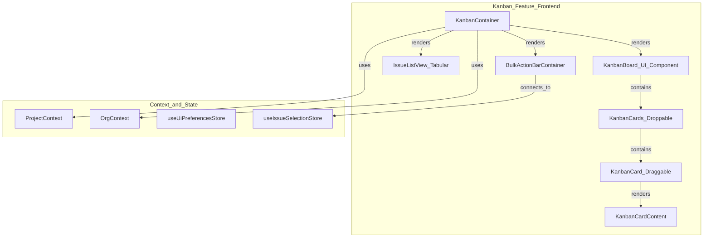
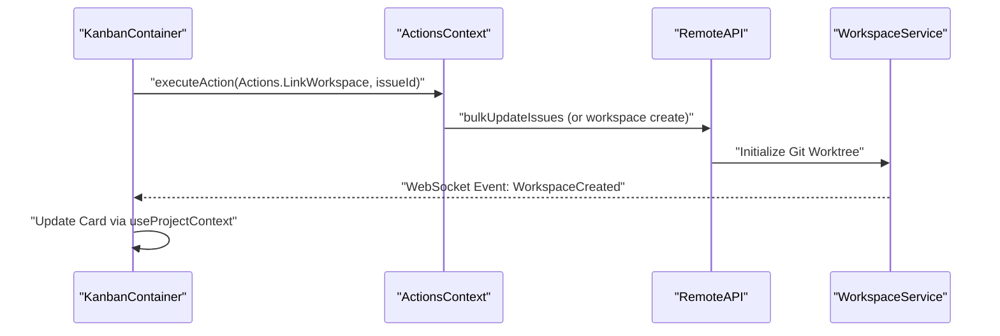

# Kanban Board and Issue Management

Relevant source files

The following files were used as context for generating this wiki page:

- [docs/cloud/issues.mdx](docs/cloud/issues.mdx)
- [docs/cloud/kanban-board.mdx](docs/cloud/kanban-board.mdx)
- [docs/cloud/list-view.mdx](docs/cloud/list-view.mdx)
- [docs/configuration-customisation/keyboard-shortcuts.mdx](docs/configuration-customisation/keyboard-shortcuts.mdx)
- [mobile-testing.md](mobile-testing.md)
- [packages/remote-web/src/routes/hosts.$hostId.workspaces.tsx](packages/remote-web/src/routes/hosts.$hostId.workspaces.tsx)
- [packages/ui/src/components/BulkActionBar.tsx](packages/ui/src/components/BulkActionBar.tsx)
- [packages/ui/src/components/Command.tsx](packages/ui/src/components/Command.tsx)
- [packages/ui/src/components/ContextBar.tsx](packages/ui/src/components/ContextBar.tsx)
- [packages/ui/src/components/IssueListRow.tsx](packages/ui/src/components/IssueListRow.tsx)
- [packages/ui/src/components/IssueListSection.tsx](packages/ui/src/components/IssueListSection.tsx)
- [packages/ui/src/components/IssueListView.tsx](packages/ui/src/components/IssueListView.tsx)
- [packages/ui/src/components/KanbanBoard.tsx](packages/ui/src/components/KanbanBoard.tsx)
- [packages/ui/src/components/KanbanCardContent.tsx](packages/ui/src/components/KanbanCardContent.tsx)
- [packages/ui/src/components/KanbanFilterBar.tsx](packages/ui/src/components/KanbanFilterBar.tsx)
- [packages/ui/src/components/WorkspacesMain.tsx](packages/ui/src/components/WorkspacesMain.tsx)
- [packages/web-core/src/app/styles/new/index.css](packages/web-core/src/app/styles/new/index.css)
- [packages/web-core/src/features/kanban/ui/BulkActionBarContainer.tsx](packages/web-core/src/features/kanban/ui/BulkActionBarContainer.tsx)
- [packages/web-core/src/features/kanban/ui/KanbanContainer.tsx](packages/web-core/src/features/kanban/ui/KanbanContainer.tsx)
- [packages/web-core/src/pages/kanban/LocalProjectKanban.tsx](packages/web-core/src/pages/kanban/LocalProjectKanban.tsx)
- [packages/web-core/src/pages/kanban/ProjectKanban.tsx](packages/web-core/src/pages/kanban/ProjectKanban.tsx)
- [packages/web-core/src/pages/kanban/ProjectSunsetPage.tsx](packages/web-core/src/pages/kanban/ProjectSunsetPage.tsx)
- [packages/web-core/src/shared/dialogs/settings/settings/RelaySettingsSection.tsx](packages/web-core/src/shared/dialogs/settings/settings/RelaySettingsSection.tsx)
- [packages/web-core/src/shared/keyboard/useIssueShortcuts.ts](packages/web-core/src/shared/keyboard/useIssueShortcuts.ts)

The Kanban board is the primary visual interface for managing development tasks and issues within Vibe Kanban. It provides a drag-and-drop environment for tracking work items through their lifecycle, from initial creation to completion or cancellation.

## Overview

The Kanban system serves as the orchestration layer between high-level project goals and low-level AI agent execution. While the session chat interface focuses on individual workspace interactions, the Kanban board provides the bird's-eye view of all work across a project.

Key capabilities include:
- **Visual Workflow**: Multi-column board for status tracking using `@hello-pangea/dnd` [packages/ui/src/components/KanbanBoard.tsx:51-60](), [packages/ui/src/components/KanbanBoard.tsx:96-96]().
- **List View**: Tabular representation for bulk operations and managing hidden statuses [packages/ui/src/components/IssueListView.tsx:33-46]().
- **Issue Lifecycle**: Creation, assignment, prioritization, and tagging via a unified panel [packages/web-core/src/features/kanban/ui/KanbanContainer.tsx:165-196]().
- **Agent Integration**: Direct linking between issues and development workspaces through `IssueWorkspaceCard` [packages/web-core/src/features/kanban/ui/KanbanContainer.tsx:55-58]().
- **Multi-Selection**: Bulk actions for status, priority, and assignee updates [packages/web-core/src/features/kanban/ui/BulkActionBarContainer.tsx:11-52]().

**Sources:** [packages/web-core/src/features/kanban/ui/KanbanContainer.tsx:125-156](), [packages/ui/src/components/KanbanBoard.tsx:51-60](), [packages/ui/src/components/IssueListView.tsx:33-46](), [packages/web-core/src/features/kanban/ui/BulkActionBarContainer.tsx:11-52]()

## Architecture and Data Flow

The Kanban board is implemented as a React container (`KanbanContainer`) that synchronizes local UI state with the remote database via the `ProjectContext` and `OrgContext`.

### Component Hierarchy

**Sources:** [packages/web-core/src/features/kanban/ui/KanbanContainer.tsx:125-223](), [packages/ui/src/components/KanbanBoard.tsx:56-60](), [packages/web-core/src/features/kanban/ui/BulkActionBarContainer.tsx:11-15](), [packages/ui/src/components/KanbanCardContent.tsx:143-160]()

### Real-Time Synchronization

The board maintains consistency across clients using a combination of REST API calls for mutations and WebSocket events for updates.
1. **Mutations**: Actions like dragging a card trigger `bulkUpdateIssues` or specific issue update endpoints [packages/web-core/src/features/kanban/ui/KanbanContainer.tsx:32-34]().
2. **State Resolution**: The `resolveRelationshipsForIssue` utility merges issue data with related workspaces and pull requests [packages/web-core/src/features/kanban/ui/KanbanContainer.tsx:59-59]().
3. **Optimistic UI**: Drag-and-drop interactions use `@hello-pangea/dnd` for immediate visual feedback before the backend confirms the move [packages/ui/src/components/KanbanBoard.tsx:12-19]().

**Sources:** [packages/web-core/src/features/kanban/ui/KanbanContainer.tsx:32-34](), [packages/web-core/src/features/kanban/ui/KanbanContainer.tsx:59-59](), [packages/ui/src/components/KanbanBoard.tsx:12-19]()

## Issue Management

### Data Model and Statuses

Issues follow a workflow categorized by `statusId`. Common statuses include "To do", "In progress", "In review", and "Done" [docs/cloud/kanban-board.mdx:23-31](). The UI handles hidden statuses like "Backlog" or "Cancelled" via specific tabs [docs/cloud/kanban-board.mdx:32-32]().

### Issue Creation and Editing

Issues are managed through the `KanbanIssueComposer` and the `KanbanContainer` logic [packages/web-core/src/features/kanban/ui/KanbanContainer.tsx:165-178]().
- **Quick Create**: Using the `+` button on a column header pre-fills the status via `onAddTask` [packages/ui/src/components/KanbanBoard.tsx:206-244]().
- **Rich Text Preview**: The `KanbanCardContent` component generates a preview of the issue description, stripping markdown syntax while preserving labels for code blocks and images [packages/ui/src/components/KanbanCardContent.tsx:69-122]().
- **Workspace Linkage**: Users can enable "Create draft workspace immediately" during creation to bridge the gap between a task and an AI agent session [docs/cloud/issues.mdx:96-98]().

**Sources:** [packages/web-core/src/features/kanban/ui/KanbanContainer.tsx:165-178](), [packages/ui/src/components/KanbanBoard.tsx:206-244](), [packages/ui/src/components/KanbanCardContent.tsx:69-122](), [docs/cloud/issues.mdx:96-98]()

## UI Views

### Kanban Board View
The board view uses `KanbanBoard`, `KanbanCards`, and `KanbanCard` components. Each card displays:
- **ID & Title**: Human-readable identifiers (e.g., `TASK-123`) and task summary [packages/ui/src/components/KanbanCardContent.tsx:212-214]().
- **Workspaces**: Indicators for linked active workspaces via `IssueWorkspaceCard` [packages/web-core/src/features/kanban/ui/KanbanContainer.tsx:55-58]().
- **Metadata**: Priority icons, assignee avatars, and tag badges [packages/ui/src/components/KanbanCardContent.tsx:179-191]().

**Sources:** [packages/ui/src/components/KanbanCardContent.tsx:212-214](), [packages/web-core/src/features/kanban/ui/KanbanContainer.tsx:55-58](), [packages/ui/src/components/KanbanCardContent.tsx:179-191]()

### List View
The `IssueListView` provides a dense, grouped representation of issues. It is useful for managing large backlogs where visual column-based tracking is less efficient [packages/ui/src/components/IssueListView.tsx:33-46]().

**Sources:** [packages/ui/src/components/IssueListView.tsx:33-46]()

## Selection and Bulk Actions

Vibe Kanban supports advanced multi-selection for managing large volumes of issues.

### Selection Logic
The `useIssueSelectionStore` manages the `Set<string>` of selected issue IDs [packages/web-core/src/shared/keyboard/useIssueShortcuts.ts:32-34]().
- **Keyboard Selection**: Users can extend selection using `Shift + J/K` or `Cmd/Ctrl + A` [docs/configuration-customisation/keyboard-shortcuts.mdx:52-54]().
- **Toggling**: The `X` key toggles selection for the currently focused issue [docs/configuration-customisation/keyboard-shortcuts.mdx:51-51]().

### Bulk Action Bar
When multiple issues are selected, the `BulkActionBarContainer` renders the `BulkActionBar` component [packages/web-core/src/features/kanban/ui/BulkActionBarContainer.tsx:11-52]().
- **Status Change**: Triggers `bulkUpdateIssues` for all selected IDs [packages/web-core/src/features/kanban/ui/KanbanContainer.tsx:32-34]().
- **Priority/Assignee Change**: Triggers batch updates via the `useActions` hook [packages/web-core/src/features/kanban/ui/KanbanContainer.tsx:199-204]().

**Sources:** [docs/configuration-customisation/keyboard-shortcuts.mdx:51-54](), [packages/web-core/src/features/kanban/ui/BulkActionBarContainer.tsx:11-52](), [packages/web-core/src/shared/keyboard/useIssueShortcuts.ts:32-34]()

## Keyboard Shortcuts

The Kanban board implements extensive keyboard navigation using `useIssueShortcuts` [packages/web-core/src/shared/keyboard/useIssueShortcuts.ts:23-23]().

| Shortcut | Action | Scope |
| :--- | :--- | :--- |
| `C` | Create new task | `KANBAN` |
| `D` | Delete selected issue(s) | `KANBAN` |
| `X` | Toggle selection | `KANBAN` |
| `J` / `K` | Move focus down/up | `GLOBAL` |
| `H` / `L` | Move focus left/right | `GLOBAL` |
| `⌘/Ctrl + A` | Select all visible issues | `KANBAN` |
| `i > s` | Change status of selection | `KANBAN` |
| `i > p` | Change priority of selection | `KANBAN` |

**Sources:** [docs/configuration-customisation/keyboard-shortcuts.mdx:18-55](), [packages/web-core/src/shared/keyboard/useIssueShortcuts.ts:125-185]()

## Workspace Integration Details

The Kanban board directly integrates with the workspace lifecycle. Each issue card can show the status of its associated workspace (Active, Idle, or Completed).

**Sources:** [packages/web-core/src/features/kanban/ui/KanbanContainer.tsx:181-190](), [packages/web-core/src/features/kanban/ui/KanbanContainer.tsx:132-151](), [packages/web-core/src/shared/keyboard/useIssueShortcuts.ts:174-177]()