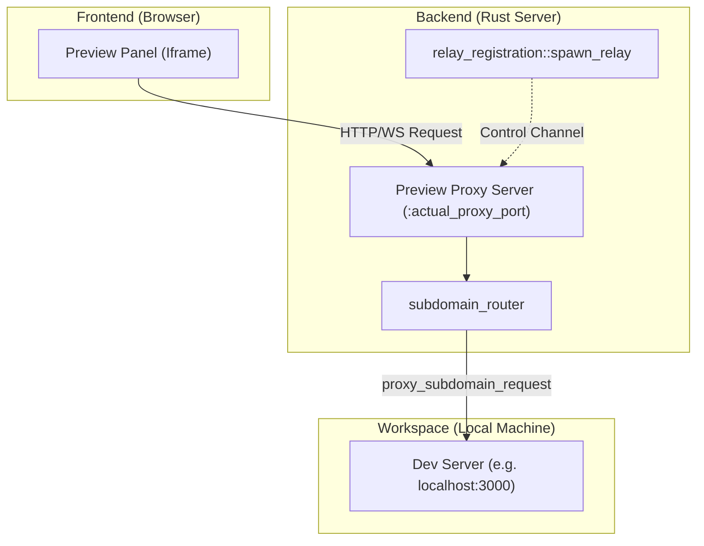
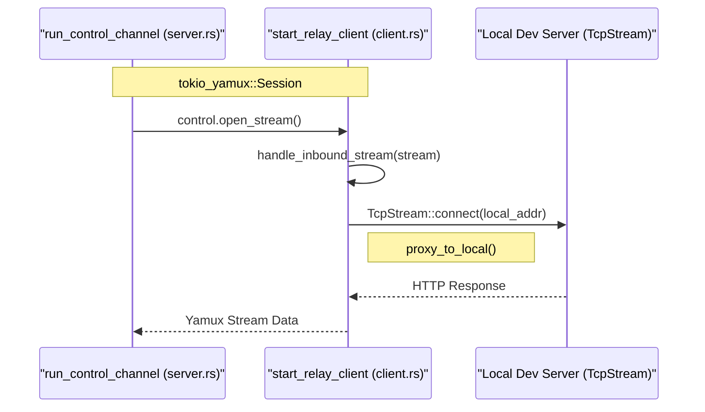

# Browser Testing and Preview

Relevant source files

The following files were used as context for generating this wiki page:

- [crates/client-info/Cargo.toml](crates/client-info/Cargo.toml)
- [crates/client-info/src/lib.rs](crates/client-info/src/lib.rs)
- [crates/desktop-bridge/Cargo.toml](crates/desktop-bridge/Cargo.toml)
- [crates/embedded-ssh/Cargo.toml](crates/embedded-ssh/Cargo.toml)
- [crates/preview-proxy/Cargo.toml](crates/preview-proxy/Cargo.toml)
- [crates/preview-proxy/src/lib.rs](crates/preview-proxy/src/lib.rs)
- [crates/relay-hosts/Cargo.toml](crates/relay-hosts/Cargo.toml)
- [crates/relay-tunnel-core/Cargo.toml](crates/relay-tunnel-core/Cargo.toml)
- [crates/relay-tunnel-core/src/client.rs](crates/relay-tunnel-core/src/client.rs)
- [crates/relay-tunnel-core/src/lib.rs](crates/relay-tunnel-core/src/lib.rs)
- [crates/relay-tunnel-core/src/server.rs](crates/relay-tunnel-core/src/server.rs)
- [crates/relay-ws/Cargo.toml](crates/relay-ws/Cargo.toml)
- [crates/server/src/main.rs](crates/server/src/main.rs)
- [crates/server/src/routes/preview.rs](crates/server/src/routes/preview.rs)
- [crates/server/src/runtime/relay_registration.rs](crates/server/src/runtime/relay_registration.rs)
- [crates/server/src/startup.rs](crates/server/src/startup.rs)

The Browser Testing and Preview system in Vibe Kanban provides an integrated environment for testing web applications directly within the workspace. It features a dedicated proxy server to handle traffic between the frontend preview pane and local development servers running inside isolated workspace environments.

## Overview and Architecture

Vibe Kanban utilizes a dual-server architecture to facilitate previews. While the main server handles API requests and application state, a secondary **Preview Proxy** server is dedicated to routing traffic to dev servers (e.g., Vite, Webpack) running on arbitrary ports within the user's workspace.

### Core Components
- **Main Server**: The primary Axum router that serves the Vibe Kanban UI and management APIs [crates/server/src/main.rs:142-142]().
- **Preview Proxy Server**: A separate Axum instance that handles subdomain-based or path-based routing to local workspace ports [crates/server/src/main.rs:161-162]().
- **Relay Tunnel**: A mechanism using `tokio-yamux` to multiplex requests over a single connection, allowing remote clients to access local dev servers through the relay [crates/relay-tunnel-core/src/lib.rs:13-19]().
- **Client Info Service**: Manages the state of assigned ports and addresses for the running deployment [crates/client-info/src/lib.rs:1-5]().

### Connection Data Flow
The following diagram illustrates how a request from the Browser Preview UI reaches a local development server running on port 3000.

**Preview Request Routing**

Sources: [crates/server/src/main.rs:120-131](), [crates/server/src/routes/preview.rs:19-23](), [crates/server/src/runtime/relay_registration.rs:1-5](), [crates/relay-tunnel-core/src/client.rs:27-30]()

## Preview Proxy Implementation

The preview proxy is initialized during server startup in `main.rs`. It binds to a random free port (or a configured `PREVIEW_PROXY_PORT`) and is tracked via the `client_info` service [crates/server/src/main.rs:110-140]().

### Subdomain and Path Routing
The system supports two methods for accessing previews:
1.  **Path-based**: Requests to `/preview/{target_port}/{tail}` are routed by the `api_router` [crates/server/src/routes/preview.rs:13-17]().
2.  **Subdomain-based**: Handled by the `subdomain_router`, which falls back to `subdomain_proxy_request` for any unmatched routes [crates/server/src/routes/preview.rs:19-23]().

The `forward_preview_ws` function specifically handles WebSocket upgrades, ensuring that Hot Module Replacement (HMR) and other real-time features of modern dev servers function correctly within the preview pane [crates/server/src/routes/preview.rs:67-110]().

| Function | File | Description |
| :--- | :--- | :--- |
| `subdomain_router` | `crates/server/src/routes/preview.rs` | Defines the router for the preview proxy instance [crates/server/src/routes/preview.rs:19-23](). |
| `proxy_preview_request` | `crates/server/src/routes/preview.rs` | Extracts target port from URL path and proxies the request [crates/server/src/routes/preview.rs:46-65](). |
| `forward_preview_ws` | `crates/server/src/routes/preview.rs` | Bridges browser WebSockets to the local dev server [crates/server/src/routes/preview.rs:67-110](). |
| `proxy_api_request` | `crates/preview-proxy/src/lib.rs` | Low-level logic for forwarding HTTP parts via `preview-proxy` crate [crates/preview-proxy/src/lib.rs:1-10](). |

Sources: [crates/server/src/routes/preview.rs:13-140](), [crates/preview-proxy/Cargo.toml:1-16]()

## Relay Tunnel System

For remote deployments or cases where the browser cannot directly reach the local port, Vibe Kanban uses a Relay Tunnel. This system is built on `tokio-yamux` for multiplexing and `tokio-tungstenite` for the WebSocket transport [crates/relay-tunnel-core/Cargo.toml:15-17]().

### Tunnel Lifecycle
1.  **Connection**: The `start_relay_client` function establishes a WebSocket connection to the relay server using a bearer token [crates/relay-tunnel-core/src/client.rs:30-46]().
2.  **Session Negotiation**: A `tokio_yamux::Session` is created over the WebSocket, providing a virtual stream interface [crates/relay-tunnel-core/src/client.rs:48-50]().
3.  **Request Proxying**: When a request arrives at the server, it calls `control.open_stream()`. The client receives this stream via `session.next()` and dials the local `SocketAddr` [crates/relay-tunnel-core/src/client.rs:63-72]().
4.  **Bidirectional Copy**: Data is copied between the remote stream and the local `TcpStream` using `tokio::io::copy_bidirectional` for upgraded connections [crates/relay-tunnel-core/src/client.rs:152-158]().

**Relay Tunnel Code Entity Mapping**

Sources: [crates/relay-tunnel-core/src/server.rs:24-47](), [crates/relay-tunnel-core/src/client.rs:78-92](), [crates/relay-tunnel-core/src/client.rs:103-115]()

## Technical Details

### Yamux Configuration
To handle large assets and potential latency in web previews, the system overrides default `yamux` settings in `yamux_config`:
- `max_stream_window_size`: Increased to 1 MB (from 256 KB) [crates/relay-tunnel-core/src/lib.rs:15-15]().
- `connection_write_timeout`: Increased to 30 seconds (from 10s) [crates/relay-tunnel-core/src/lib.rs:16-16]().

### WebSocket Bridging
The `ws-bridge` crate provides utility functions like `bridge_axum_ws` to pipe messages between the Axum-managed frontend WebSocket and the upstream dev server WebSocket [crates/server/src/routes/preview.rs:105-107](). This is critical for tools like Vite that rely on a persistent WebSocket for dev server communication. The system also handles protocol negotiation via `sec-websocket-protocol` headers [crates/server/src/routes/preview.rs:83-102]().

Sources: [crates/relay-tunnel-core/src/lib.rs:9-19](), [crates/server/src/routes/preview.rs:67-110](), [crates/relay-tunnel-core/Cargo.toml:19-19]()