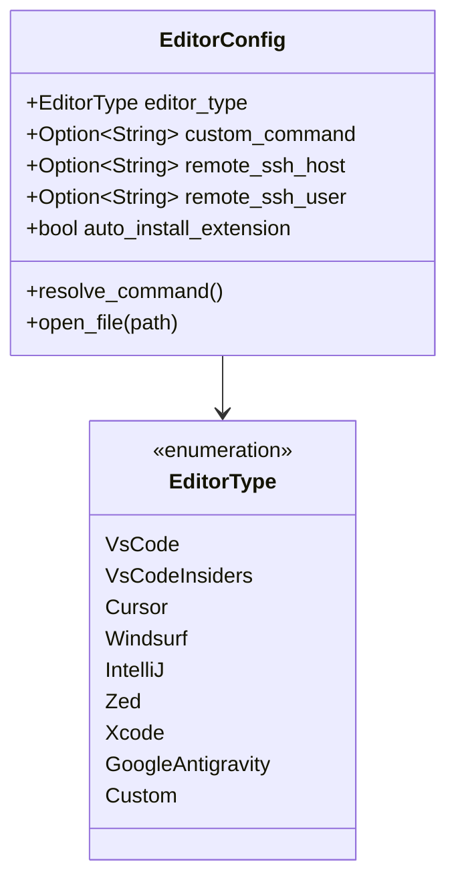
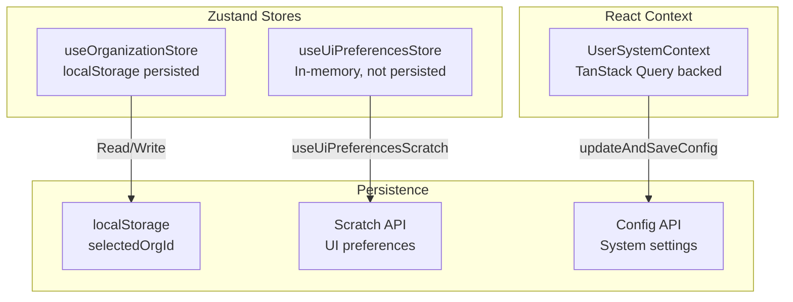
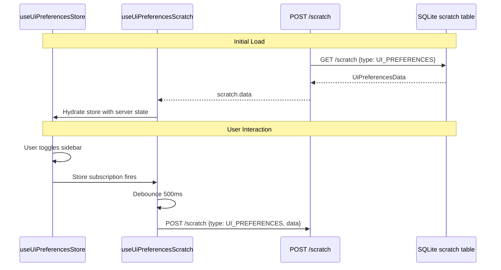

# Settings and Configuration UI

<details>
<summary>Relevant source files</summary>

The following files were used as context for generating this wiki page:

- [crates/services/src/services/config/editor/mod.rs](crates/services/src/services/config/editor/mod.rs)
- [mobile-testing.md](mobile-testing.md)
- [packages/local-web/src/app/providers/ConfigProvider.tsx](packages/local-web/src/app/providers/ConfigProvider.tsx)
- [packages/remote-web/src/app/providers/RemoteUserSystemProvider.tsx](packages/remote-web/src/app/providers/RemoteUserSystemProvider.tsx)
- [packages/remote-web/src/routes/hosts.$hostId.workspaces.tsx](packages/remote-web/src/routes/hosts.$hostId.workspaces.tsx)
- [packages/ui/src/components/AppBar.tsx](packages/ui/src/components/AppBar.tsx)
- [packages/ui/src/components/Command.tsx](packages/ui/src/components/Command.tsx)
- [packages/ui/src/components/ContextBar.tsx](packages/ui/src/components/ContextBar.tsx)
- [packages/ui/src/components/KanbanCardContent.tsx](packages/ui/src/components/KanbanCardContent.tsx)
- [packages/ui/src/components/KanbanFilterBar.tsx](packages/ui/src/components/KanbanFilterBar.tsx)
- [packages/ui/src/components/WorkspacesMain.tsx](packages/ui/src/components/WorkspacesMain.tsx)
- [packages/web-core/src/app/styles/new/index.css](packages/web-core/src/app/styles/new/index.css)
- [packages/web-core/src/shared/dialogs/settings/settings/RelaySettingsSection.tsx](packages/web-core/src/shared/dialogs/settings/settings/RelaySettingsSection.tsx)
- [packages/web-core/src/shared/hooks/useUserSystem.ts](packages/web-core/src/shared/hooks/useUserSystem.ts)

</details>


This document describes the settings and configuration system in Vibe Kanban, covering how system settings, executor profiles, and UI preferences are managed, persisted, and synchronized between the backend and frontend. This includes the backend API routes, frontend state management, and the bidirectional sync between client state and server-side scratch storage.

For information about the executor configuration schemas and profile definitions, see [3.2](). For details about workspace-specific panel state and layout modes, see [5.5]().

---

## System Architecture

The settings and configuration system operates on three layers: system configuration (global settings like Git preferences and analytics), executor profiles (per-agent configurations), and UI preferences (transient UI state). System configuration and executor profiles are stored in JSON files on disk, while UI preferences are stored in a server-side scratch table and synced bidirectionally with the frontend state store.

### Configuration Data Flow

```mermaid
graph TB
    subgraph "Backend Storage"
        ConfigFile["config.json<br/>~/.cache/vibe-kanban"]
        ProfilesFile["executor_profiles.json<br/>~/.cache/vibe-kanban"]
        ScratchDB[("SQLite scratch table<br/>UI preferences")]
        McpJSON["default_mcp.json<br/>crates/executors/default_mcp.json"]
    end
    
    subgraph "Backend API"
        ConfigRoutes["/api/config/*<br/>routes/config.rs"]
        GetInfo["GET /info<br/>get_user_system_info()"]
        UpdateConfig["PUT /config<br/>update_config()"]
        ProfilesAPI["GET/PUT /profiles"]
        McpAPI["GET/POST /mcp-config"]
    end
    
    subgraph "Frontend State Management"
        UserSystemCtx["UserSystemContext<br/>Config, Profiles, Capabilities"]
        UiPrefsStore["useUiPreferencesStore<br/>Zustand store"]
        OrgStore["useOrganizationStore<br/>Zustand + localStorage"]
        ScratchSync["useUiPreferencesScratch<br/>Bidirectional sync hook"]
    end
    
    subgraph "UI Components"
        SettingsDialog["SettingsDialog"]
        AppBar["AppBar + SharedAppLayout"]
        Preferences["UI Preference Controls"]
    end
    
    ConfigFile -->|Read on startup| GetInfo
    ProfilesFile -->|Read on startup| GetInfo
    ScratchDB -->|Read on startup| GetInfo
    McpJSON -->|PRECONFIGURED_MCP_SERVERS| McpAPI
    
    GetInfo -->|UserSystemInfo| UserSystemCtx
    
    UpdateConfig -->|Write| ConfigFile
    ProfilesAPI -->|Read/Write| ProfilesFile
    McpAPI -->|Read/Write agent configs| ConfigFile
    
    UserSystemCtx -->|updateAndSaveConfig()| UpdateConfig
    
    UiPrefsStore -->|Debounced writes| ScratchSync
    ScratchSync -->|POST /scratch| ScratchDB
    ScratchDB -->|Initial load| UiPrefsStore
    
    OrgStore -->|setSelectedOrgId()| UiPrefsStore
    UiPrefsStore -->|scratch payload| ScratchSync
    
    SettingsDialog -->|User edits| UserSystemCtx
    AppBar -->|User edits| OrgStore
    Preferences -->|Toggle/select| UiPrefsStore
```

**Sources:** `crates/server/src/routes/config.rs:42-59`(), `packages/web-core/src/shared/hooks/useUserSystem.ts:11-59`(), `crates/services/src/services/config/mod.rs:47-55`(), `crates/services/src/services/config/mod.rs:58-65`()

---

## Editor Integration

Vibe Kanban supports deep integration with various external editors. This is managed via the `EditorConfig` struct, which defines the editor type, custom commands, and remote SSH settings.

### Editor Configuration Model

The system supports a variety of editors including VS Code, Cursor, Windsurf, and Zed. For editors like VS Code and Cursor, the system can automatically install the Vibe Kanban extension.



The `EditorConfig` implementation handles the resolution of editor binaries via `resolve_command()` [crates/services/src/services/config/editor/mod.rs:113-135]() and provides logic for opening files locally or via remote SSH URLs [crates/services/src/services/config/editor/mod.rs:164-201]().

**Sources:** `crates/services/src/services/config/editor/mod.rs:35-61`(), `crates/services/src/services/config/editor/mod.rs:113-135`(), `crates/services/src/services/config/editor/mod.rs:175-201`()

---

## Relay and Remote Access UI

The settings interface provides controls for configuring the Relay Tunnel system, allowing for remote control of local workspaces. This is handled by the `RelaySettingsSectionContent` component [packages/web-core/src/shared/dialogs/settings/settings/RelaySettingsSection.tsx:45-64]().

### Local vs. Remote Relay Configuration
The UI logic branches based on the application runtime:
- **Local Runtime**: Provides `LocalRelaySettingsSectionContent` [packages/web-core/src/shared/dialogs/settings/settings/RelaySettingsSection.tsx:188-240](). It allows the user to act as a "Host" (allowing remote control) or a "Client" (controlling another device). It manages pairing via enrollment codes [packages/web-core/src/shared/dialogs/settings/settings/RelaySettingsSection.tsx:206-211]().
- **Remote Runtime**: Provides `RemoteRelaySettingsSectionContent` [packages/web-core/src/shared/dialogs/settings/settings/RelaySettingsSection.tsx:59-63](), focusing on managing connections to available hosts.

**Sources:** `packages/web-core/src/shared/dialogs/settings/settings/RelaySettingsSection.tsx:45-64`(), `packages/web-core/src/shared/dialogs/settings/settings/RelaySettingsSection.tsx:188-240`()

---

## Agent Profiles & Configuration

The **Settings → Agents** interface uses a finder-style two-column layout to manage agent configurations.

### Configuration Parameters
Agents are configured with various safety and performance parameters:
- **Planning Mode**: Forces the agent to create a plan before execution.
- **Permission Prompts**: Controls whether the agent asks before destructive actions (`dangerously_skip_permissions`).
- **Approval Levels**: Options include `untrusted`, `on-failure`, `on-request`, and `never`.
- **Reasoning Effort**: Controls computational effort for thinking models.

**Sources:** `crates/services/src/services/config/mod.rs:35-45`(), `packages/web-core/src/shared/hooks/useUserSystem.ts:16-17`()

---

## Backend Configuration API

The backend exposes a REST API for configuration management through the `/api/config` route group. All endpoints return `ApiResponse<T>` wrapper types for consistent error handling.

### API Routes

| Route | Method | Handler | Purpose |
|-------|--------|---------|---------|
| `/info` | GET | `get_user_system_info` | Returns complete system state (config, profiles, capabilities, login status) |
| `/config` | PUT | `update_config` | Updates and persists system configuration |
| `/sounds/{sound}` | GET | `get_sound` | Serves notification sound files |
| `/profiles` | GET | `get_profiles` | Returns executor profiles JSON content |
| `/profiles` | PUT | `update_profiles` | Updates and persists executor profiles |

**Sources:** `crates/server/src/routes/config.rs:42-59`()

---

## Frontend State Management

The frontend uses a layered state management approach with specialized stores for different concerns.

### State Store Architecture



**Sources:** `packages/local-web/src/app/providers/ConfigProvider.tsx:13-25`(), `packages/remote-web/src/app/providers/RemoteUserSystemProvider.tsx:12-32`()

---

## User System Context

The `UserSystemContext` provides global access to system configuration, executor profiles, and capabilities. It is implemented via `UserSystemProvider` in local deployments [packages/local-web/src/app/providers/ConfigProvider.tsx:13-14]() and `RemoteUserSystemProvider` for remote ones [packages/remote-web/src/app/providers/RemoteUserSystemProvider.tsx:12-14]().

### Configuration Syncing
In the local provider, the configuration is synced with the `i18n` system whenever the language setting changes [packages/local-web/src/app/providers/ConfigProvider.tsx:32-36](). It also manages the remote API base URL for self-hosting scenarios [packages/local-web/src/app/providers/ConfigProvider.tsx:29-29]().

**Sources:** `packages/local-web/src/app/providers/ConfigProvider.tsx:13-47`(), `packages/remote-web/src/app/providers/RemoteUserSystemProvider.tsx:12-47`()

---

## UI Preferences Synchronization

UI preferences are synchronized bidirectionally between the frontend Zustand store and the server-side scratch table.

### Bidirectional Sync Architecture



The `useUiPreferencesScratch` hook manages this synchronization, converting between camelCase store state and snake_case scratch data.

**Sources:** `packages/local-web/src/app/providers/ConfigProvider.tsx:32-36`(), `packages/remote-web/src/app/providers/RemoteUserSystemProvider.tsx:27-32`()