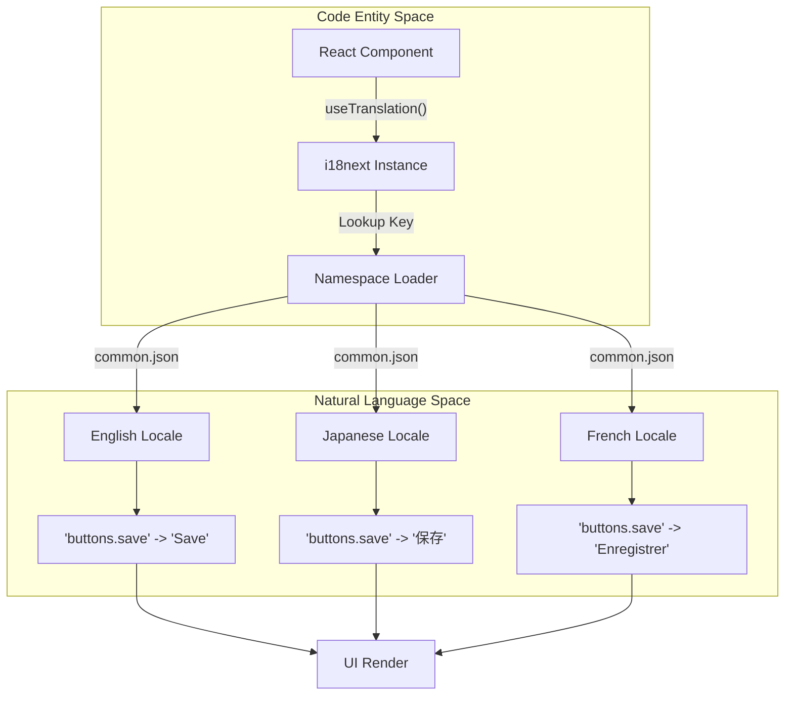
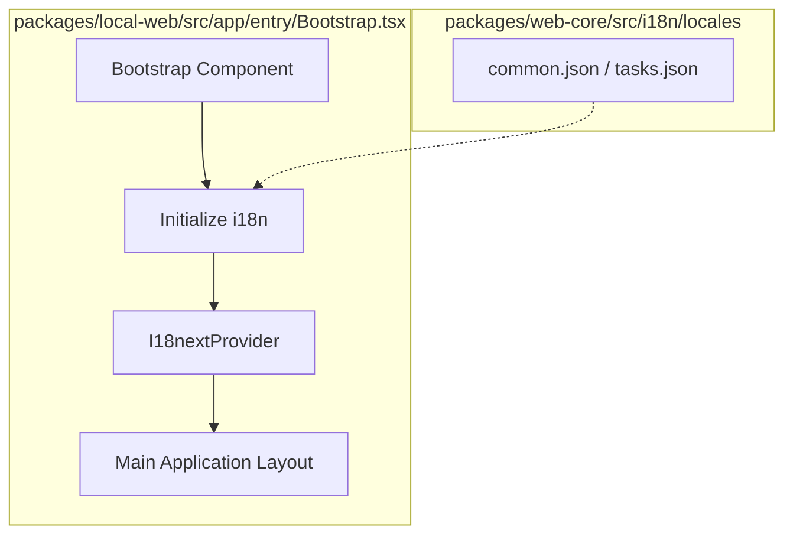

# Internationalization (i18n)

Relevant source files

The following files were used as context for generating this wiki page:

- [packages/local-web/src/app/entry/Bootstrap.tsx](packages/local-web/src/app/entry/Bootstrap.tsx)
- [packages/ui/src/components/CrashScreen.tsx](packages/ui/src/components/CrashScreen.tsx)
- [packages/web-core/src/i18n/locales/en/common.json](packages/web-core/src/i18n/locales/en/common.json)
- [packages/web-core/src/i18n/locales/en/tasks.json](packages/web-core/src/i18n/locales/en/tasks.json)
- [packages/web-core/src/i18n/locales/es/common.json](packages/web-core/src/i18n/locales/es/common.json)
- [packages/web-core/src/i18n/locales/es/tasks.json](packages/web-core/src/i18n/locales/es/tasks.json)
- [packages/web-core/src/i18n/locales/fr/common.json](packages/web-core/src/i18n/locales/fr/common.json)
- [packages/web-core/src/i18n/locales/fr/tasks.json](packages/web-core/src/i18n/locales/fr/tasks.json)
- [packages/web-core/src/i18n/locales/ja/common.json](packages/web-core/src/i18n/locales/ja/common.json)
- [packages/web-core/src/i18n/locales/ja/tasks.json](packages/web-core/src/i18n/locales/ja/tasks.json)
- [packages/web-core/src/i18n/locales/ko/common.json](packages/web-core/src/i18n/locales/ko/common.json)
- [packages/web-core/src/i18n/locales/ko/tasks.json](packages/web-core/src/i18n/locales/ko/tasks.json)
- [packages/web-core/src/i18n/locales/zh-Hans/common.json](packages/web-core/src/i18n/locales/zh-Hans/common.json)
- [packages/web-core/src/i18n/locales/zh-Hans/tasks.json](packages/web-core/src/i18n/locales/zh-Hans/tasks.json)
- [packages/web-core/src/i18n/locales/zh-Hant/common.json](packages/web-core/src/i18n/locales/zh-Hant/common.json)
- [packages/web-core/src/i18n/locales/zh-Hant/tasks.json](packages/web-core/src/i18n/locales/zh-Hant/tasks.json)
- [packages/web-core/src/shared/lib/zoom.ts](packages/web-core/src/shared/lib/zoom.ts)

The Vibe Kanban frontend uses a structured internationalization system to support multiple languages across its various user interface components. The implementation relies on a centralized repository of locale files and a standardized key-value mapping for translations.

## Architecture Overview

The i18n system is primarily housed within the `web-core` package, which serves as the foundational library for both the local and remote web applications. Translations are organized into namespaces (e.g., `common`, `tasks`) and subdivided by language codes.

### Supported Languages
The system currently supports the following locales:
*   **English (en)**: Default locale. [packages/web-core/src/i18n/locales/en/common.json:1-10]()
*   **Spanish (es)**: [packages/web-core/src/i18n/locales/es/common.json:1-10]()
*   **French (fr)**: [packages/web-core/src/i18n/locales/fr/common.json:1-10]()
*   **Japanese (ja)**: [packages/web-core/src/i18n/locales/ja/common.json:1-10]()
*   **Korean (ko)**: [packages/web-core/src/i18n/locales/ko/common.json:1-10]()
*   **Simplified Chinese (zh-Hans)**: [packages/web-core/src/i18n/locales/zh-Hans/common.json:1-10]()
*   **Traditional Chinese (zh-Hant)**: [packages/web-core/src/i18n/locales/zh-Hant/common.json:1-10]()

### Data Flow Diagram: Translation Resolution
This diagram illustrates how a UI component requests a translation and how the system resolves it through the locale files.

Title: i18n Translation Resolution Flow

**Sources:** [packages/web-core/src/i18n/locales/ja/common.json:37-37](), [packages/web-core/src/i18n/locales/fr/common.json:6-6](), [packages/web-core/src/i18n/locales/zh-Hans/common.json:6-6]()

## Locale File Structure

Translations are stored in JSON files located in `packages/web-core/src/i18n/locales/{lang}/`. Each language directory contains multiple namespaces to keep translation files manageable.

### 1. `common.json`
Contains general UI elements used across the entire application.
*   **Buttons**: Standard actions like `save`, `cancel`, `edit`, and `retry`. [packages/web-core/src/i18n/locales/es/common.json:24-43]()
*   **Workspaces**: Strings for workspace lifecycle, including archiving, renaming, and deletion confirmation messages. [packages/web-core/src/i18n/locales/ko/common.json:110-156]()
*   **OAuth**: Messaging for authentication flows with GitHub and Google. [packages/web-core/src/i18n/locales/zh-Hans/common.json:81-96]()
*   **Conversation**: High-level agent states like `thinking` and tool execution summaries. [packages/web-core/src/i18n/locales/fr/common.json:35-53]()

### 2. `tasks.json`
Focuses on the Kanban board, agent task execution, and Git integration.
*   **Git Operations**: Complex workflows such as `forcePushDialog`, `rebase`, and `mergeDialog`. [packages/web-core/src/i18n/locales/zh-Hant/tasks.json:125-187]()
*   **Preview System**: Controls for the built-in browser preview and dev server management. [packages/web-core/src/i18n/locales/en/tasks.json:47-83]()
*   **Process Monitoring**: Details for execution processes, including logs, exit codes, and start/completion times. [packages/web-core/src/i18n/locales/ja/tasks.json:208-237]()

### Interpolation and Pluralization
The system utilizes `i18next` syntax for dynamic content:
*   **Pluralization**: Handled via suffix keys like `_one` and `_other`. For example, `filesChanged_one` vs `filesChanged_other`. [packages/web-core/src/i18n/locales/en/tasks.json:85-86]()
*   **Variable Injection**: Uses `{{variableName}}` to insert dynamic data into strings, such as `{{count}} review comments`. [packages/web-core/src/i18n/locales/fr/tasks.json:169-170]()
*   **Tool Context**: Describing specific file paths or queries in agent tool summaries. [packages/web-core/src/i18n/locales/ko/common.json:54-61]()

## Implementation Details

The application initializes the i18n context during the bootstrap phase. This ensures that the user's preferred language (or the browser default) is applied before the main UI renders.

### Bootstrap and Initialization
The `Bootstrap` component in the `local-web` package is responsible for setting up the application environment, including the i18n provider.

Title: Application Bootstrap and i18n Context

**Sources:** [packages/local-web/src/app/entry/Bootstrap.tsx:1-15](), [packages/web-core/src/i18n/locales/en/common.json:1-10]()

### Key Translation Sections Reference

| Namespace | Key Path | Example (English) | Usage |
| :--- | :--- | :--- | :--- |
| `common` | `workspaces.rename` | `Rename Workspace` | Dialog for changing workspace names [packages/web-core/src/i18n/locales/zh-Hans/common.json:131-138]() |
| `common` | `folderPicker` | `Select Path` | Repository and directory selection [packages/web-core/src/i18n/locales/es/common.json:5-12]() |
| `tasks` | `git.status` | `Ahead / Behind` | Git branch synchronization status [packages/web-core/src/i18n/locales/ko/tasks.json:131-138]() |
| `tasks` | `conversation.actions` | `Approve / Request Changes` | Agent workflow approval system [packages/web-core/src/i18n/locales/en/tasks.json:133-150]() |

## Quality Assurance and Maintenance

The codebase includes mechanisms to ensure translation parity across all supported languages.

1.  **Key Synchronization**: Developers are expected to add keys to all `common.json` and `tasks.json` files when introducing new UI strings.
2.  **Missing Key Fallbacks**: If a key is missing in a specific locale (e.g., `es`), the system typically falls back to the `en` (English) version.
3.  **Verification Scripts**: The repository contains scripts to scan for missing keys or mismatched interpolation variables across the JSON files in `packages/web-core/src/i18n/locales/`.

**Sources:** [packages/web-core/src/i18n/locales/en/tasks.json:1-10](), [packages/web-core/src/i18n/locales/zh-Hans/tasks.json:1-10]()