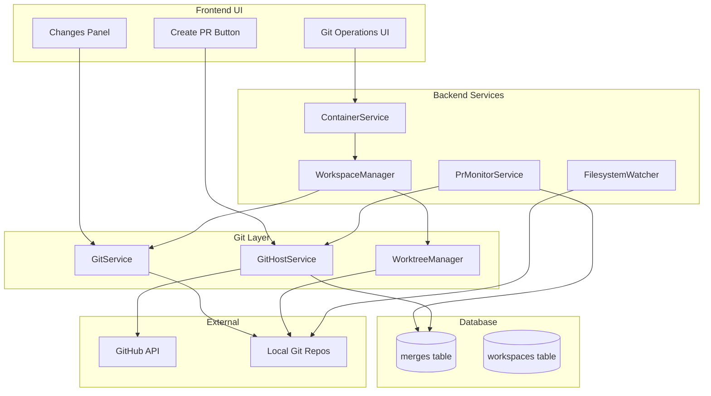
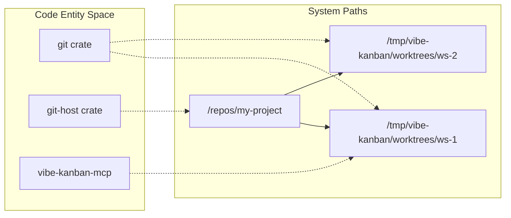

# Git and GitHub Integration

Relevant source files

The following files were used as context for generating this wiki page:

- [crates/git-host/Cargo.toml](crates/git-host/Cargo.toml)
- [crates/git/Cargo.toml](crates/git/Cargo.toml)
- [crates/mcp/Cargo.toml](crates/mcp/Cargo.toml)

Vibe Kanban integrates deeply with Git version control and Git hosting platforms (GitHub, GitLab, Azure Repos) to enable isolated workspace development, automated PR creation, and status monitoring. This document covers the Git service layer, pull request management workflows, and multi-repository workspace support.

For information about git worktrees used for workspace isolation, see [Git Worktree Management](#2.4). For the workspace execution lifecycle, see [Workspaces and Execution Lifecycle](#2.3). For UI operations related to git, see [Git and GitHub Integration](#6).

---

## Git Service Architecture

The Git integration is structured in three layers: the low-level `git` crate for Git operations [crates/git/Cargo.toml:2](), the `git-host` crate for platform-specific API interactions [crates/git-host/Cargo.toml:2](), and the `services` layer that orchestrates Git workflows for workspaces.

Title: "Git Integration Layer Overview"

**Sources:** [crates/git/Cargo.toml:1-23](), [crates/git-host/Cargo.toml:1-21]()

---

## Git Service and Operations

### GitService

The `GitService` is the core abstraction for Git operations, leveraging the `git2` library [crates/git/Cargo.toml:13](). It provides methods for branch operations, commit management, and remote synchronization. It uses `chrono` for timestamping commits and `ts-rs` for exporting types to the frontend [crates/git/Cargo.toml:11,18]().

**Path Normalization and Relativization**

To ensure Git operations work correctly across different environments (especially macOS), the system uses robust path utilities. Paths are converted to worktree-relative formats to maintain consistency across the backend and the executor environments.

**Filesystem Watching**

The system monitors Git repositories for changes. This watcher is configured to respect `.gitignore` files and always ignores internal directories like `.git` and `node_modules` to ensure performance and prevent recursive loops.

For details, see [Git Service and Operations](#6.1).

**Sources:** [crates/git/Cargo.toml:1-23](), [crates/git-host/Cargo.toml:1-21]()

### Worktree Management for Isolation

Each workspace gets isolated Git worktrees to prevent conflicts. This allows multiple agents or users to work on different branches or tasks simultaneously without polluting the main repository checkout.

Title: "Workspace Path and Worktree Mapping"

Each worktree:
- Has its own checked-out branch.
- Shares the `.git` object database with the main repository.
- Is automatically cleaned up when the workspace is archived.
- Utilizes platform-specific temporary directories for storage using the `tempfile` crate [crates/git/Cargo.toml:15]().

**Sources:** [crates/git/Cargo.toml:1-23](), [crates/git-host/Cargo.toml:1-21]()

---

## Pull Request Management

### Creating Pull Requests

Pull requests are created through the `GitHostService` (defined in the `git-host` crate [crates/git-host/Cargo.toml:2]()), which abstracts platform-specific APIs. When a PR is created, it is recorded in the local database via the `db` crate dependency [crates/git-host/Cargo.toml:10]().

**PR Creation Flow:**
1. User commits changes in workspace via the `git` crate operations.
2. User triggers PR creation in the UI.
3. The `git-host` service communicates with the remote provider (GitHub/Azure) using `reqwest` and `url` parsing [crates/git-host/Cargo.toml:19]().
4. The system records the PR metadata and associates it with the workspace.

For details, see [Pull Request Management](#6.2).

### PR Monitor Service

The `PrMonitorService` runs as a background task, polling open PRs to update their status. It utilizes `enum_dispatch` for efficient handling of different Git hosts [crates/git-host/Cargo.toml:11]().

**Key behaviors:**
1. **Polling interval**: Periodically checks for updates on Git hosts using `tokio` runtimes [crates/git-host/Cargo.toml:16]().
2. **Status updates**: Updates database when PRs are merged or closed.
3. **Workspace archiving**: When a PR is merged, the service may trigger workspace archiving to clean up local resources.

For details, see [Pull Request Management](#6.2).

**Sources:** [crates/git-host/Cargo.toml:1-21](), [crates/git/Cargo.toml:1-23]()

---

## Multi-Repository Support

Workspaces can manage multiple repositories simultaneously, enabling cross-repo development workflows.

### Multi-Repo Architecture

- A workspace has `N` repositories attached.
- Each repository gets its own worktree managed by the `git` crate.
- Coding agents (configured via the `executors` crate and exposed through the `mcp` crate [crates/mcp/Cargo.toml:17]()) can read/write files across all repositories.
- Git operations can target specific repos or all repos.
- The `mcp` (Model Context Protocol) server allows external AI tools to interact with these repositories via defined tools and schemas [crates/mcp/Cargo.toml:8,26-27]().

For details, see [Multi-Repository Support](#6.3).

**Sources:** [crates/mcp/Cargo.toml:1-33](), [crates/git/Cargo.toml:1-5]()

---

## Azure Repos Integration

Vibe Kanban supports Azure Repos alongside GitHub through a unified `git-host` abstraction layer. This allows the same PR management and monitoring workflows to function across different enterprise hosting environments. The implementation relies on `async-trait` for the abstraction [crates/git-host/Cargo.toml:7]() and `backon` for exponential backoff and retry logic during API calls [crates/git-host/Cargo.toml:8]().

For details, see [Azure Repos Integration](#6.4).

**Sources:** [crates/git-host/Cargo.toml:1-21]()