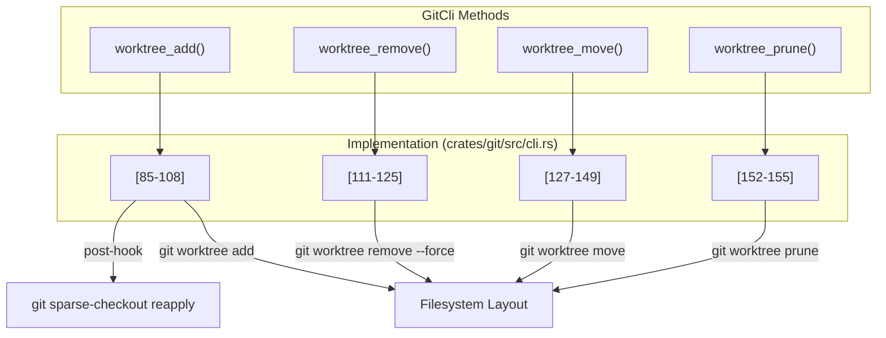

# Git Service and Operations

<details>
<summary>Relevant source files</summary>

The following files were used as context for generating this wiki page:

- [.github/actions/setup-jsign/action.yml](.github/actions/setup-jsign/action.yml)
- [crates/git-host/src/azure/cli.rs](crates/git-host/src/azure/cli.rs)
- [crates/git-host/src/github/cli.rs](crates/git-host/src/github/cli.rs)
- [crates/git/Cargo.toml](crates/git/Cargo.toml)
- [crates/git/src/cli.rs](crates/git/src/cli.rs)
- [crates/git/src/lib.rs](crates/git/src/lib.rs)
- [crates/git/tests/git_ops_safety.rs](crates/git/tests/git_ops_safety.rs)
- [crates/git/tests/git_workflow.rs](crates/git/tests/git_workflow.rs)
- [crates/review/src/github.rs](crates/review/src/github.rs)
- [crates/services/src/services/diff_stream.rs](crates/services/src/services/diff_stream.rs)
- [crates/services/src/services/qa_repos.rs](crates/services/src/services/qa_repos.rs)
- [crates/tauri-app/msi-template.wxs](crates/tauri-app/msi-template.wxs)
- [crates/utils/src/diff.rs](crates/utils/src/diff.rs)
- [packages/web-core/src/shared/hooks/useDiffStream.ts](packages/web-core/src/shared/hooks/useDiffStream.ts)
- [scripts/build-tauri-msi.js](scripts/build-tauri-msi.js)

</details>


The Git service provides low-level version control operations for managing repositories, branches, commits, and worktrees within Vibe Kanban. It is the foundation for workspace isolation, enabling each workspace to operate in its own git worktree with independent branches and commits.

Vibe Kanban employs a hybrid approach: it uses the **Git CLI** for destructive or working-tree mutations (rebase, merge, checkout, add/commit) to ensure safety and sparse-checkout correctness, while using **libgit2** for read-only graph queries and credentialed network operations [crates/git/Cargo.toml:13-13](), [crates/git/src/lib.rs:7-7](), [crates/git/src/cli.rs:1-17]().

---

## Git Service Architecture

The system architecture bridges natural language task requests to concrete Git entities through a layered service model.

### Code Entity Mapping: Git Service
The following diagram maps high-level Git concepts to their specific implementations in the Rust codebase.

```mermaid
graph TB
    subgraph "Core Service Logic"
        ["GitService (struct)"] -- "defined in" --> GitService_File["crates/git/src/lib.rs"]
        ["GitCli (struct)"] -- "defined in" --> GitCli_File["crates/git/src/cli.rs"]
    end
    
    subgraph "External Tooling"
        ["'git' executable"]
        ["'gh' executable (GitHub CLI)"]
        ["'az' executable (Azure CLI)"]
    end

    subgraph "Data Models"
        ["Commit (struct)"] -- "defined in" --> Commit_File["crates/git/src/lib.rs"]
        ["StatusDiffEntry (struct)"] -- "defined in" --> StatusDiffEntry_File["crates/git/src/cli.rs"]
        ["Diff (struct)"] -- "defined in" --> Diff_File["crates/utils/src/diff.rs"]
    end

    ["GitService (struct)"] --> ["GitCli (struct)"]
    ["GitCli (struct)"] -- "shell execution" --> ["'git' executable"]
    ["GitCli (struct)"] -- "produces" --> ["StatusDiffEntry (struct)"]
    ["GitService (struct)"] -- "wraps Oid" --> ["Commit (struct)"]
```
**Sources:** [crates/git/src/lib.rs:58-60](), [crates/git/src/cli.rs:44-45](), [crates/git/src/cli.rs:61-66](), [crates/utils/src/diff.rs:11-25]()

---

## Core Git Operations

### Repository State and Diffs
The system provides sophisticated diffing capabilities to track changes within a workspace compared to a base branch.

*   **Diff Generation**: `GitService` computes line change counts and generates unified diffs using the `similar` crate [crates/utils/src/diff.rs:4-5](), [crates/utils/src/diff.rs:44-58]().
*   **Status Diffs**: `GitCli::diff_status` uses a temporary index file via `GIT_INDEX_FILE` environment variable to accurately track renames and untracked files without dirtying the main index [crates/git/src/cli.rs:174-184]().
*   **Diff Streaming**: The `DiffStreamManager` monitors the filesystem and periodically reconciles the git state to stream real-time diff updates to the frontend via WebSockets [crates/services/src/services/diff_stream.rs:169-190](), [packages/web-core/src/shared/hooks/useDiffStream.ts:28-32]().
*   **Stats Calculation**: `compute_diff_stats` aggregates files changed, lines added, and lines removed for a workspace by comparing worktrees against their target branches [crates/services/src/services/diff_stream.rs:43-92]().

### Unified Diff Processing
The system normalizes diffs into a standard format for the UI.

| Function | Purpose |
| :--- | :--- |
| `create_unified_diff` | Generates a full unified diff with headers for a specific file [crates/utils/src/diff.rs:61-64](). |
| `extract_unified_diff_hunks` | Parses a raw diff string into individual `@@` hunks [crates/utils/src/diff.rs:79-104](). |
| `fix_hunk_headers` | Ensures hunk headers have valid range information (e.g., `@@ -1,5 +1,6 @@`) [crates/utils/src/diff.rs:147-191](). |
| `concatenate_diff_hunks` | Outputs git-diff format with `diff --git` prefixes for downstream parsers [crates/utils/src/diff.rs:198-219](). |
| `normalize_unified_diff` | Wrapper to ensure a diff string matches the format expected by the frontend viewer [crates/utils/src/diff.rs:222-225](). |

**Sources:** [crates/utils/src/diff.rs:44-225](), [crates/services/src/services/diff_stream.rs:43-208]()

---

## Worktree Management

Git worktrees allow multiple checkouts of the same repository. Vibe Kanban uses this to provide isolated environments for AI agents.

### Worktree Operations in Code
The `GitCli` implementation manages the worktree lifecycle through direct CLI calls.



*   **Isolation**: Each workspace is assigned a unique `worktree_path` [crates/services/src/services/diff_stream.rs:155-167]().
*   **Validation**: The system checks if a named worktree is registered in the repository via `validate_worktree` [crates/git/src/lib.rs:183-190]().
*   **Safety**: The system checks `is_worktree_clean` before performing destructive operations [crates/git/tests/git_workflow.rs:160-161]().
*   **Cleanliness**: `has_changes` uses `git status --porcelain` to detect staged or unstaged modifications in a worktree [crates/git/src/cli.rs:158-164]().

**Sources:** [crates/git/src/cli.rs:85-164](), [crates/git/src/lib.rs:183-190]()

---

## Git Host Integrations

Beyond local operations, the system integrates with GitHub and Azure DevOps through their respective CLI tools for PR management and repository discovery.

*   **GitHub Integration**: `GhCli` wraps the `gh` tool for operations like `repo view` and `pr create` [crates/git-host/src/github/cli.rs:135-230](). It also supports fetching PR info via the GitHub API as a fallback [crates/review/src/github.rs:108-144]().
*   **Azure Integration**: `AzCli` wraps `az repos` to fetch organization and project metadata, supporting both HTTPS and SSH remote URL matching [crates/git-host/src/azure/cli.rs:127-216]().
*   **QA Repositories**: For testing, the system can bypass normal discovery and clone hardcoded "QA repos" (e.g., `internal-qa-1`) from `https://github.com/BloopAI/` into a persistent temporary directory [crates/services/src/services/qa_repos.rs:15-41]().

**Sources:** [crates/git-host/src/github/cli.rs:135-230](), [crates/git-host/src/azure/cli.rs:127-242](), [crates/services/src/services/qa_repos.rs:1-105](), [crates/review/src/github.rs:108-144]()

---

## Path Normalization and Safety

Git operations often involve complex path resolutions, especially on macOS or when dealing with symlinks.

*   **Safe Commits**: `ensure_cli_commit_identity` checks for `user.name` and `user.email` in the repository config, providing a fallback ("Vibe Kanban" <noreply@vibekanban.com>) if they are missing to prevent CLI commit failures [crates/git/src/lib.rs:208-219]().
*   **Fallback Signatures**: For `libgit2` operations, `signature_with_fallback` ensures a valid signature is always available for commits [crates/git/src/lib.rs:222-231]().
*   **Large Diff Handling**: To prevent UI crashes, file contents are omitted from diffs if they exceed `MAX_INLINE_DIFF_BYTES` (~2MB) [crates/git/src/lib.rs:61-63](). The `DiffStreamManager` also tracks a `MAX_CUMULATIVE_DIFF_BYTES` (200MB) limit [crates/services/src/services/diff_stream.rs:95-95]().

**Sources:** [crates/git/src/lib.rs:61-231](), [crates/services/src/services/diff_stream.rs:95-95]()