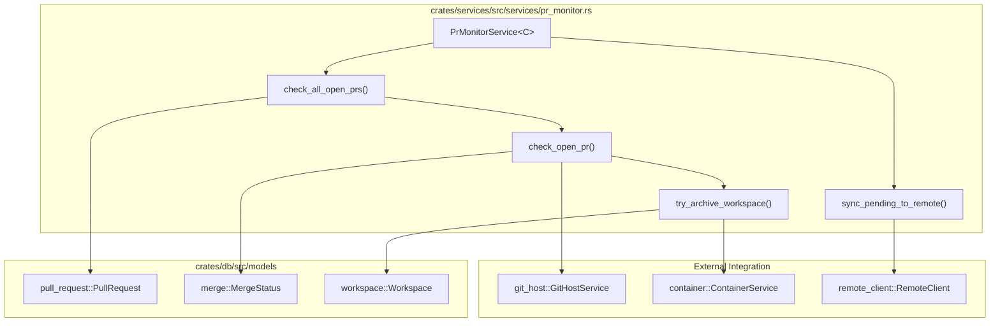
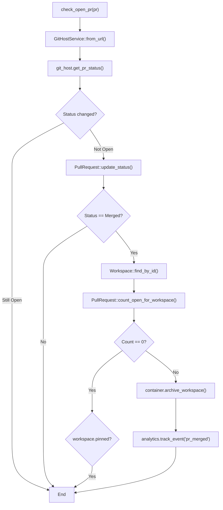
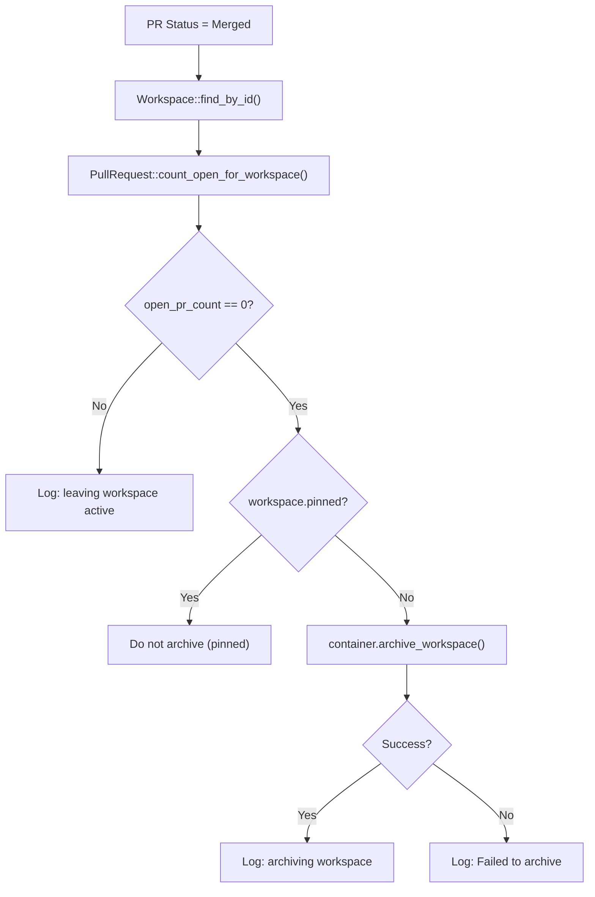

# Pull Request Management

<details>
<summary>Relevant source files</summary>

The following files were used as context for generating this wiki page:

- [crates/api-types/src/issue_relationship.rs](crates/api-types/src/issue_relationship.rs)
- [crates/api-types/src/pull_request.rs](crates/api-types/src/pull_request.rs)
- [crates/db/src/models/merge.rs](crates/db/src/models/merge.rs)
- [crates/remote/src/db/workspaces.rs](crates/remote/src/db/workspaces.rs)
- [crates/remote/src/routes/pull_requests.rs](crates/remote/src/routes/pull_requests.rs)
- [crates/server/src/routes/remote/issue_relationships.rs](crates/server/src/routes/remote/issue_relationships.rs)
- [crates/server/src/routes/remote/mod.rs](crates/server/src/routes/remote/mod.rs)
- [crates/server/src/routes/remote/pull_requests.rs](crates/server/src/routes/remote/pull_requests.rs)
- [crates/services/src/services/pr_monitor.rs](crates/services/src/services/pr_monitor.rs)

</details>


This document describes how Vibe Kanban tracks and monitors pull requests created from workspaces. The PR management system maintains the status of pull requests in the database, automatically polls for updates, and manages workspace lifecycle based on PR state changes.

For information about Git operations and repository management, see [6.1 Git Service and Operations](). For workspace creation and lifecycle details, see [2.3 Workspaces and Execution Lifecycle]().

---

## Purpose and Scope

The pull request management system serves two primary functions:

1.  **Tracking**: Records pull requests associated with workspaces and issues in the `pull_requests` table [crates/api-types/src/pull_request.rs:18-32]().
2.  **Monitoring**: Continuously polls Git hosting providers (GitHub, Azure Repos) to detect PR status changes and automatically updates workspace state [crates/services/src/services/pr_monitor.rs:49-56]().

When a workspace creates a pull request, the system records it and begins monitoring it via the `PrMonitorService`. When the PR is merged or closed, the system updates the database and may automatically archive the workspace to free up resources [crates/services/src/services/pr_monitor.rs:157-163]().

**Sources:**
- [crates/services/src/services/pr_monitor.rs:48-56]()
- [crates/db/src/models/merge.rs:37-45]()
- [crates/api-types/src/pull_request.rs:18-32]()

---

## Data Model

### Merge Types

The system supports two types of merges, represented by the `Merge` enum [crates/db/src/models/merge.rs:21-24]():

| Type | Description | Use Case |
|------|-------------|----------|
| `Direct` | Direct merge to target branch | When changes are pushed directly without PR [crates/db/src/models/merge.rs:27-34]() |
| `Pr` | Pull request merge | When changes are submitted via a Git host PR [crates/db/src/models/merge.rs:38-45]() |

### PR Status States

Pull requests can be in one of three primary states defined in `PullRequestStatus` [crates/api-types/src/pull_request.rs:11-15]():

| Status | Description |
|--------|-------------|
| `open` | PR is open and awaiting review/merge |
| `merged` | PR has been merged into the target branch |
| `closed` | PR was closed without merging |

### Database Schema

**Pull Request Entity Relationship:**

```mermaid
erDiagram
    "pull_requests" {
        uuid "id" PK
        uuid "workspace_id" FK
        uuid "project_id" FK
        text "url"
        int "number"
        text "status" "PullRequestStatus"
        text "target_branch_name"
        datetime "merged_at"
        text "merge_commit_sha"
        datetime "updated_at"
        datetime "created_at"
    }
    
    "workspaces" {
        uuid "id" PK
        bool "pinned"
        bool "archived"
    }

    "pull_request_issues" {
        uuid "id" PK
        uuid "pull_request_id" FK
        uuid "issue_id" FK
    }
    
    "pull_requests" }o--|| "workspaces" : "belongs_to"
    "pull_request_issues" }o--|| "pull_requests" : "links"
```

The system manages PRs through a link table `pull_request_issues` [crates/api-types/src/pull_request.rs:35-39](), allowing a single PR to be associated with multiple issues. The `Merge` enum acts as a wrapper to unify direct commits and PRs for UI display and history tracking [crates/db/src/models/merge.rs:66-72]().

**Sources:**
- [crates/api-types/src/pull_request.rs:8-39]()
- [crates/db/src/models/merge.rs:9-54]()
- [crates/remote/src/routes/pull_requests.rs:145-150]()

---

## PR Monitor Service Architecture

### Component Overview

The `PrMonitorService` is a background worker that integrates multiple backend components to keep the workspace state in sync with the upstream Git host.

**PrMonitorService Code Entity Space:**



The `PrMonitorService` [crates/services/src/services/pr_monitor.rs:49-56]() is generic over a `ContainerService` implementation to allow different deployment strategies (e.g., local vs. remote). It also listens to a `sync_notify` channel for external triggers [crates/services/src/services/pr_monitor.rs:94-96]().

**Sources:**
- [crates/services/src/services/pr_monitor.rs:49-77]()
- [crates/db/src/models/merge.rs:9-17]()

---

## Monitoring Loop

### Service Initialization and Execution

The PR monitor service is spawned as a Tokio background task via the `spawn` method [crates/services/src/services/pr_monitor.rs:59-77]().

**Service Lifecycle Diagram:**

```mermaid
sequenceDiagram
    participant Server
    participant Spawn["tokio::spawn"]
    participant Service["PrMonitorService::start"]
    participant Interval["tokio::time::interval"]
    participant DB["PullRequest::get_open"]
    participant GitHost["GitHostService::get_pr_status"]
    
    Server->>Spawn: spawn(db, analytics, container, remote_client, sync_notify)
    Spawn->>Service: start()
    Service->>Interval: Duration::from_secs(60)
    
    loop "Monitoring Loop"
        alt "Interval Tick OR Notify"
            Service->>Service: check_all_open_prs()
            Service->>DB: get_open(&pool)
            DB-->>Service: Vec&lt;PullRequest&gt;
            
            loop "For each open PR"
                Service->>Service: check_open_pr(pr)
                Service->>GitHost: get_pr_status(pr_url)
                GitHost-->>Service: status
                Service->>DB: update_status(...)
                
                alt "PR was merged"
                    Service->>Service: try_archive_workspace(workspace_id)
                end
            end
        end
        Service->>Service: sync_pending_to_remote()
    end
```

**Key implementation details:**

-   **Poll Interval**: Defaults to 60 seconds [crates/services/src/services/pr_monitor.rs:68]().
-   **External Trigger**: Can be woken up via `sync_notify.notified()` to perform an immediate check [crates/services/src/services/pr_monitor.rs:94]().
-   **Error Handling**: Environmental errors (e.g., Git CLI issues) are logged as warnings; database or logic errors are logged as errors [crates/services/src/services/pr_monitor.rs:113-122]().

**Sources:**
- [crates/services/src/services/pr_monitor.rs:59-100]()
- [crates/services/src/services/pr_monitor.rs:103-126]()

---

## PR Status Detection and Updates

### Status Check Process

The `check_open_pr` function uses the `GitHostService` to resolve the correct provider (GitHub or Azure) based on the PR URL and fetch its current state [crates/services/src/services/pr_monitor.rs:130-131]().

**PR Status Update Flow:**



### Database Update Operations

The system updates the `pull_requests` table when status changes via `PullRequest::update_status` [crates/services/src/services/pr_monitor.rs:148-155]().

The update operation sets:
-   `status`: New status value (Merged, Closed, etc.).
-   `merge_commit_sha`: Commit SHA if merged.
-   `merged_at`: Timestamp from Git host or current time if missing [crates/services/src/services/pr_monitor.rs:142-146]().

**Sources:**
- [crates/services/src/services/pr_monitor.rs:129-168]()
- [crates/api-types/src/pull_request.rs:18-32]()

---

## Workspace Lifecycle Integration

### Automatic Archival Logic

When a PR is merged, the system evaluates whether to archive the associated workspace [crates/services/src/services/pr_monitor.rs:171-211](). This prevents "workspace leak" where development environments remain active long after their code has been integrated.

**Archival Decision Tree:**



**Sources:**
- [crates/services/src/services/pr_monitor.rs:171-211]()

---

## Remote and Cloud Integration

### Remote Synchronization

In distributed deployments, the local service periodically synchronizes PR status changes to the central remote server via `sync_pending_to_remote` [crates/services/src/services/pr_monitor.rs:214-257]().

**Remote Sync Logic:**
1.  Query PRs where `synced_at IS NULL OR synced_at < updated_at`.
2.  For each pending PR, call `remote_client.upsert_pull_request()` [crates/services/src/services/pr_monitor.rs:240]().
3.  Update local `synced_at` timestamp upon successful remote update [crates/services/src/services/pr_monitor.rs:248-251]().

### API Endpoints

The system provides several endpoints for PR management across local and remote routers:

| Endpoint | Method | Description |
|----------|--------|-------------|
| `/pull-requests` | `GET` | Lists PRs for an issue [crates/server/src/routes/remote/pull_requests.rs:22-29]() |
| `/pull-requests/link` | `POST` | Tracks a PR in the local database for monitoring [crates/server/src/routes/remote/pull_requests.rs:41-56]() |
| `/v1/pull_requests` | `PUT` | Upserts PR data on the remote server [crates/remote/src/routes/pull_requests.rs:59]() |

**Sources:**
- [crates/server/src/routes/remote/pull_requests.rs:16-20]()
- [crates/remote/src/routes/pull_requests.rs:53-61]()

---

## Error Handling

### Error Classification

The `PrMonitorError` enum [crates/services/src/services/pr_monitor.rs:27-35]() classifies errors into git-related, workspace-related, or database-related. The `is_environmental` method [crates/services/src/services/pr_monitor.rs:37-46]() identifies errors that are outside the service's control.

**Environmental Errors:**
- `GitHostError::CliNotInstalled`: The underlying git provider CLI (like `gh` or `az`) is missing.
- `GitHostError::NotAGitRepository`: The target directory is no longer a valid repository.

**Sources:**
- [crates/services/src/services/pr_monitor.rs:27-46]()
- [crates/services/src/services/pr_monitor.rs:113-122]()