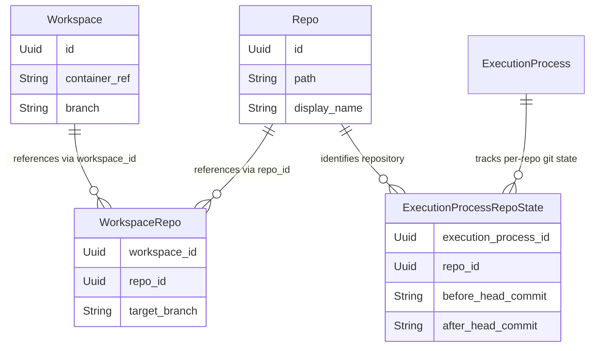
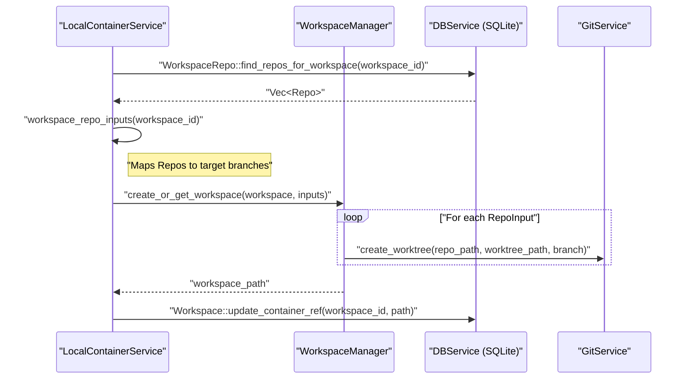

# Multi-Repository Support

<details>
<summary>Relevant source files</summary>

The following files were used as context for generating this wiki page:

- [crates/workspace-manager/Cargo.toml](crates/workspace-manager/Cargo.toml)
- [crates/worktree-manager/Cargo.toml](crates/worktree-manager/Cargo.toml)
- [docs/images/workspaces-slash-commands.png](docs/images/workspaces-slash-commands.png)
- [docs/images/workspaces-writing-messages.png](docs/images/workspaces-writing-messages.png)
- [docs/workspaces/chat-interface.mdx](docs/workspaces/chat-interface.mdx)
- [docs/workspaces/git-operations.mdx](docs/workspaces/git-operations.mdx)
- [docs/workspaces/multi-repo-sessions.mdx](docs/workspaces/multi-repo-sessions.mdx)
- [docs/workspaces/slash-commands.mdx](docs/workspaces/slash-commands.mdx)

</details>


Vibe Kanban supports workspaces that span multiple repositories, enabling coding agents to work across service boundaries, monorepo packages, or related codebases simultaneously. Each repository in a workspace operates with its own git worktree, target branch, and execution state tracking.

For information about git worktree mechanics, see [Git Worktree Management](2.4). For git operations and service APIs, see [Git Service and Operations](6.1).

---

## Data Model

Multi-repository workspaces are managed through relationships between workspaces, repositories, and workspace-repo associations.

### Core Types

The `WorkspaceRepo` model links repositories to workspaces with per-repo configuration:

| Field | Type | Description |
|-------|------|-------------|
| `id` | `Uuid` | Unique identifier [crates/db/src/models/workspace_repo.rs:18-18]() |
| `workspace_id` | `Uuid` | Associated workspace [crates/db/src/models/workspace_repo.rs:19-19]() |
| `repo_id` | `Uuid` | Repository reference [crates/db/src/models/workspace_repo.rs:20-20]() |
| `target_branch` | `String` | Base branch for this repo in this workspace [crates/db/src/models/workspace_repo.rs:21-21]() |

The `Repo` model stores repository metadata and configuration for automation:

| Field | Type | Description |
|-------|------|-------------|
| `id` | `Uuid` | Repository identifier [crates/db/src/models/repo.rs:17-17]() |
| `path` | `String` | Filesystem path to repository [crates/db/src/models/repo.rs:18-18]() |
| `display_name` | `String` | User-facing name [crates/db/src/models/repo.rs:21-21]() |
| `setup_script` | `Option<String>` | Script to run on workspace creation [crates/db/src/models/repo.rs:22-22]() |
| `cleanup_script` | `Option<String>` | Script to run after agent execution [crates/db/src/models/repo.rs:23-23]() |

Sources: [crates/db/src/models/workspace_repo.rs:17-25](), [crates/db/src/models/repo.rs:16-30]()

### Relationship Diagram

This diagram bridges the high-level concept of a multi-repo workspace to the underlying `sqlx` models and database schema.



Sources: [crates/db/src/models/workspace.rs:42-54](), [crates/db/src/models/workspace_repo.rs:17-25](), [crates/db/src/models/execution_process_repo_state.rs:11-20]()

---

## Workspace Initialization Flow

When a workspace is activated, the `LocalContainerService` coordinates the setup of multiple repositories. It uses the `WorkspaceManager` to handle the physical filesystem layout and git operations.

### Multi-Repo Setup Sequence

The system resolves all repositories associated with a workspace and prepares them for the coding agent.



Sources: [crates/local-deployment/src/container.rs:160-190](), [crates/local-deployment/src/container.rs:192-205](), [crates/db/src/models/workspace.rs:139-154]()

---

## Worktree Organization

Each repository in a multi-repo workspace is checked out into a dedicated subdirectory within the workspace root. This structure allows the coding agent to see all relevant codebases in a single directory tree.

### Directory Structure

The `container_ref` in the `Workspace` model points to the root of this structure [crates/db/src/models/workspace.rs:45-45]().

```
/path/to/vibe-kanban/workspaces/{workspace_id}/
├── repo_name_a/         # Git Worktree for Repository A
│   ├── .git             # Git worktree file
│   └── [source files]
└── repo_name_b/         # Git Worktree for Repository B
    ├── .git
    └── [source files]
```

Sources: [crates/local-deployment/src/container.rs:192-205](), [crates/workspace-manager/Cargo.toml:1-16](), [crates/worktree-manager/Cargo.toml:1-16]()

---

## Cross-Repo Execution Tracking

When an agent executes a task (an `ExecutionProcess`), the system captures the git state for *every* repository in the workspace. This is handled via the `ExecutionProcessRepoState` model.

### State Capture Logic

1.  **Before Execution**: The system queries the current HEAD commit for every repo in the workspace and stores it in `before_head_commit` [crates/db/src/models/execution_process_repo_state.rs:16-16]().
2.  **After Execution**: Once the agent completes its work, the system again queries the HEAD of every repo and updates `after_head_commit` [crates/db/src/models/execution_process_repo_state.rs:17-17]().

This allows the UI to identify exactly which repositories were modified during a specific agent session [crates/db/src/models/execution_process.rs:148-181]().

Sources: [crates/db/src/models/execution_process_repo_state.rs:11-20](), [crates/db/src/models/execution_process.rs:148-181](), [crates/local-deployment/src/container.rs:12-26]()

---

## UI and Workflow Implementation

The frontend facilitates multi-repo workflows by providing specialized panels for repository management and cross-repo context.

### Repository Panel and Actions
The UI displays a dedicated repository panel showing the status of all repos in the workspace, including current branch, target branch, and uncommitted change counts [docs/workspaces/multi-repo-sessions.mdx:39-50](). Users can perform git operations like PR creation or rebasing on a per-repository basis via the Command Bar [docs/workspaces/multi-repo-sessions.mdx:51-62]().

### Cross-Repo Agent Interaction
Agents like Claude Code or Codex are provided with the full file context across all repositories. Users can reference specific files in any repository using the `@` file mention feature [docs/workspaces/chat-interface.mdx:67-79]().

### Practical Workflow Example: Full-Stack Features
1. **Workspace Creation**: A user adds both `frontend` and `backend` repos to a single workspace [docs/workspaces/multi-repo-sessions.mdx:121-123]().
2. **Coordinated Implementation**: The agent reads code from both repositories to ensure the frontend component matches the backend API endpoint [docs/workspaces/multi-repo-sessions.mdx:136-138]().
3. **Unified Review**: Changes from all repos are visible in a unified diff view before PR creation [docs/workspaces/multi-repo-sessions.mdx:37-37]().

Sources: [docs/workspaces/multi-repo-sessions.mdx:12-62](), [docs/workspaces/multi-repo-sessions.mdx:116-156](), [docs/workspaces/chat-interface.mdx:67-79]()

---

## API and Integration

### Container and Context Resolution
The backend provides endpoints to resolve the full multi-repo context for a given workspace reference. This is used by the frontend and external tools (like the VSCode extension) to understand the workspace layout.

- `GET /containers/attempt-context`: Resolves a `WorkspaceContext` which includes the `Workspace` record and all associated `RepoWithTargetBranch` entries [crates/server/src/routes/containers.rs:37-48]().

### Executor Options Discovery
When an agent is running in a multi-repo workspace, the `ContainerService` determines the appropriate working directory. If a session has a specific `agent_working_dir`, it is joined with the workspace root; otherwise, the root containing all repo subdirectories is used [crates/services/src/services/container.rs:134-138]().

Sources: [crates/server/src/routes/containers.rs:37-48](), [crates/db/src/models/workspace.rs:117-136](), [crates/services/src/services/container.rs:101-150]()