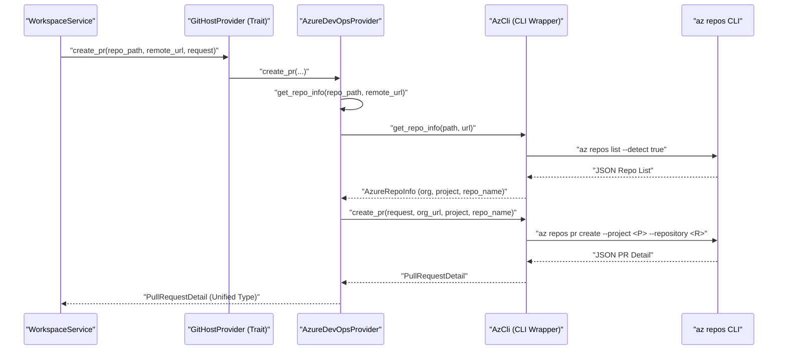
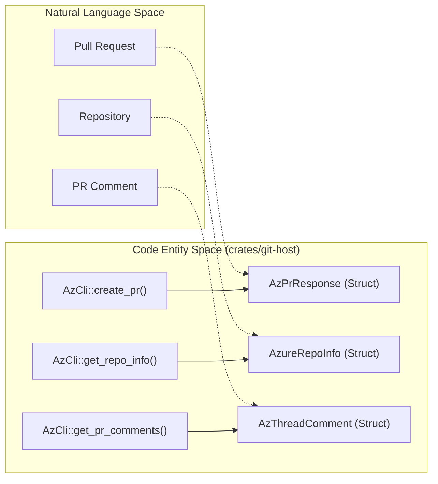

# Azure Repos Integration

Relevant source files

The following files were used as context for generating this wiki page:

- [.github/actions/setup-jsign/action.yml](.github/actions/setup-jsign/action.yml)
- [crates/git-host/Cargo.toml](crates/git-host/Cargo.toml)
- [crates/git-host/src/azure/cli.rs](crates/git-host/src/azure/cli.rs)
- [crates/git-host/src/github/cli.rs](crates/git-host/src/github/cli.rs)
- [crates/git/src/cli.rs](crates/git/src/cli.rs)
- [crates/mcp/Cargo.toml](crates/mcp/Cargo.toml)
- [crates/review/src/github.rs](crates/review/src/github.rs)
- [crates/services/src/services/qa_repos.rs](crates/services/src/services/qa_repos.rs)
- [crates/tauri-app/msi-template.wxs](crates/tauri-app/msi-template.wxs)
- [scripts/build-tauri-msi.js](scripts/build-tauri-msi.js)

Vibe Kanban provides native integration with Azure Repos (Azure DevOps) alongside its GitHub support. This integration allows AI coding agents to create and manage pull requests directly within Azure DevOps environments. The system uses a specialized `git-host` abstraction layer to provide a unified interface for different version control providers.

## The Git Host Abstraction Layer

Vibe Kanban does not communicate with Azure Repos or GitHub directly from the core logic. Instead, it uses a provider-agnostic trait system defined in the `git-host` crate. This allows the application to handle pull request creation, commenting, and status monitoring regardless of whether the repository is hosted on GitHub or Azure DevOps.

### Provider Detection and Selection
When a workspace is initialized, the system detects the appropriate provider by inspecting the repository's remote URLs.
*   **GitHub**: Detected via `github.com` or configured enterprise hostnames [crates/git-host/src/github/cli.rs:27-32]().
*   **Azure Repos**: Detected by matching remote URLs against Azure DevOps patterns using the `az repos list` command with the `--detect true` flag [crates/git-host/src/azure/cli.rs:188-191]().

The `GitHostService` (implemented in the `git-host` crate) manages the lifecycle of these connections, ensuring that the correct CLI wrapper is instantiated based on the repository's origin.

### Data Flow: Pull Request Creation
The following diagram illustrates how a request to create a PR flows through the abstraction layer to the Azure CLI.

**Diagram: Pull Request Creation Flow**

Sources: [crates/git-host/src/azure/cli.rs:127-135](), [crates/git-host/src/azure/cli.rs:183-191](), [crates/git-host/src/azure/cli.rs:21-27]()

## Azure CLI Integration (`az repos`)

The Azure integration is implemented via the `AzureDevOpsProvider` which wraps the `AzCli` struct [crates/git-host/src/azure/cli.rs:127-135](). Unlike GitHub which often uses REST APIs, the Azure integration relies heavily on the `az` command-line interface with the `azure-devops` extension. This ensures that the system respects the user's local authentication state (via `az login`).

### Key Implementation Details

| Component | Entity in Code | Responsibility |
| :--- | :--- | :--- |
| **Provider** | `AzureDevOpsProvider` | Implements `GitHostProvider` trait and handles logic mapping. |
| **CLI Wrapper** | `AzCli` | Executes `az` commands and parses JSON output [crates/git-host/src/azure/cli.rs:140-144](). |
| **Error Handling** | `AzCliError` | Maps CLI exit codes and stderr to types like `AuthFailed` or `NotAvailable` [crates/git-host/src/azure/cli.rs:115-124](). |
| **Repo Info** | `AzureRepoInfo` | Stores organization URL, project ID, and repository ID [crates/git-host/src/azure/cli.rs:21-27](). |

### PR Comment Threading
Azure Repos uses a "Thread" model for comments. The system fetches these threads via the CLI, parsing the `AzThreadsResponse` [crates/git-host/src/azure/cli.rs:58-60](). These are then transformed from the internal `AzThreadComment` [crates/git-host/src/azure/cli.rs:83-89]() into the `UnifiedPrComment` format [crates/git-host/src/azure/cli.rs:18]() used by the Vibe Kanban UI.

Sources: [crates/git-host/src/azure/cli.rs:58-95](), [crates/git-host/src/azure/cli.rs:169-182]()

## Comparison of Git Host Implementations

Vibe Kanban maintains parity between GitHub and Azure Repos by mapping provider-specific concepts to a unified internal representation.

| Feature | GitHub Implementation (`GhCli`) | Azure Implementation (`AzCli`) |
| :--- | :--- | :--- |
| **CLI Tool** | `gh` [crates/git-host/src/github/cli.rs:154]() | `az` [crates/git-host/src/azure/cli.rs:146]() |
| **Auth Detection** | Exit code 4 or string match [crates/git-host/src/github/cli.rs:173-180]() | String matching on "az login" [crates/git-host/src/azure/cli.rs:170-179]() |
| **Repo Metadata** | `GitHubRepoInfo` [crates/git-host/src/github/cli.rs:27-32]() | `AzureRepoInfo` [crates/git-host/src/azure/cli.rs:21-27]() |
| **JSON Response** | `GhPrResponse` [crates/git-host/src/github/cli.rs:105-120]() | `AzPrResponse` [crates/git-host/src/azure/cli.rs:31-43]() |

Sources: [crates/git-host/src/github/cli.rs:1-10](), [crates/git-host/src/azure/cli.rs:1-10]()

## Technical Data Flow: Code Entities

This diagram bridges the gap between the high-level Azure Repos concepts and the specific Rust structs and functions that handle the data.

**Diagram: Mapping Concepts to Code Entities**

Sources: [crates/git-host/src/azure/cli.rs:31-43](), [crates/git-host/src/azure/cli.rs:21-27](), [crates/git-host/src/azure/cli.rs:83-89]()

## Working Tree vs. Remote Operations
While the `git-host` crate handles remote operations (PRs, comments), the actual file mutations and branch management are handled by the core `git` service which prefers the Git CLI over `libgit2` for safety and correctness [crates/git/src/cli.rs:1-17]().

1.  **Local Changes**: The backend manages worktrees and branch creation using `GitCli::worktree_add` [crates/git/src/cli.rs:85-91]().
2.  **Pushing**: The system pushes the local branch to the Azure remote using the Git CLI.
3.  **PR Management**: Once pushed, the `AzCli` is invoked to wrap that branch into an Azure DevOps Pull Request [crates/git-host/src/azure/cli.rs:1-10]().
4.  **Status Tracking**: The system monitors `MergeStatus` [crates/git-host/src/azure/cli.rs:13]() to determine if the PR has been merged or closed.

Sources: [crates/git/src/cli.rs:1-17](), [crates/git/src/cli.rs:85-108](), [crates/git-host/src/azure/cli.rs:1-10]()