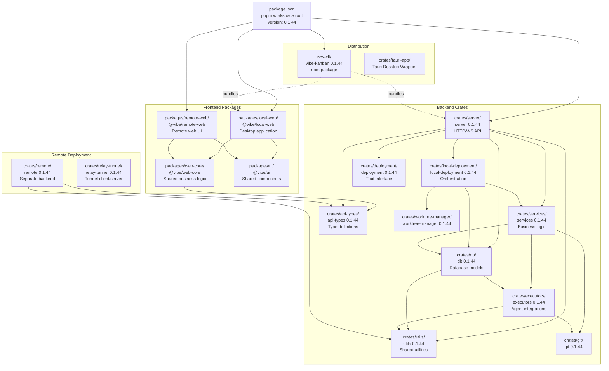
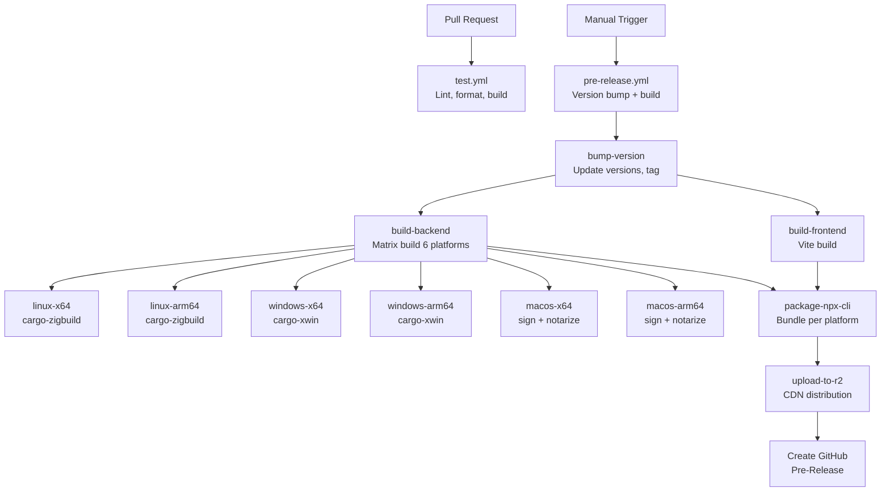
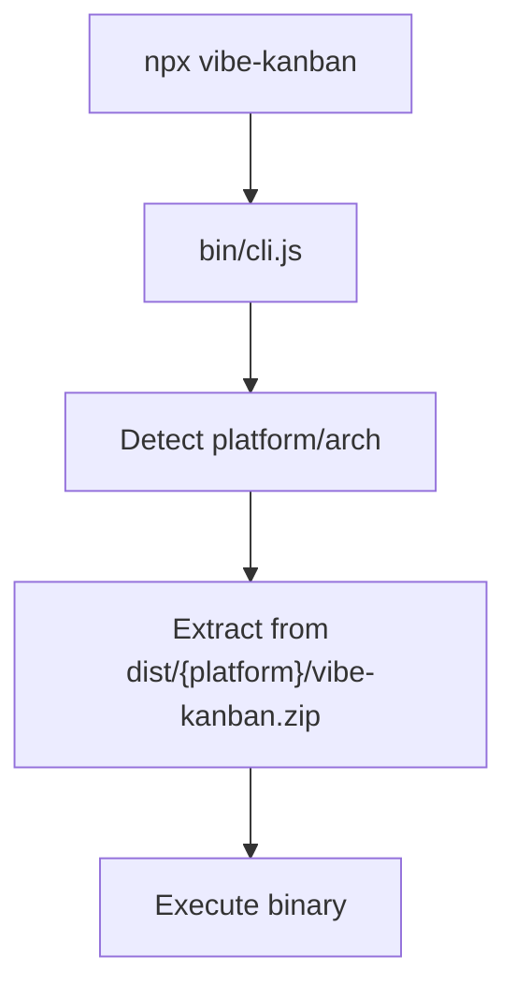
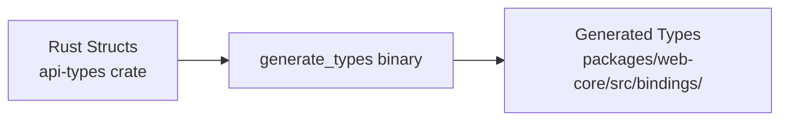

# Development and Deployment

<details>
<summary>Relevant source files</summary>

The following files were used as context for generating this wiki page:

- [.github/actions/cargo-checks-common-setup/action.yml](.github/actions/cargo-checks-common-setup/action.yml)
- [.github/actions/setup-node/action.yml](.github/actions/setup-node/action.yml)
- [.github/workflows/pre-release.yml](.github/workflows/pre-release.yml)
- [.github/workflows/publish.yml](.github/workflows/publish.yml)
- [.github/workflows/relay-deploy-dev.yml](.github/workflows/relay-deploy-dev.yml)
- [.github/workflows/relay-deploy-prod.yml](.github/workflows/relay-deploy-prod.yml)
- [.github/workflows/relay-release.yml](.github/workflows/relay-release.yml)
- [.github/workflows/remote-deploy-dev.yml](.github/workflows/remote-deploy-dev.yml)
- [.github/workflows/remote-deploy-prod.yml](.github/workflows/remote-deploy-prod.yml)
- [.github/workflows/remote-release.yml](.github/workflows/remote-release.yml)
- [.github/workflows/test.yml](.github/workflows/test.yml)
- [AGENTS.md](AGENTS.md)
- [CLAUDE.md](CLAUDE.md)
- [Cargo.lock](Cargo.lock)
- [crates/db/Cargo.toml](crates/db/Cargo.toml)
- [crates/deployment/Cargo.toml](crates/deployment/Cargo.toml)
- [crates/executors/Cargo.toml](crates/executors/Cargo.toml)
- [crates/local-deployment/Cargo.toml](crates/local-deployment/Cargo.toml)
- [crates/remote/AGENTS.md](crates/remote/AGENTS.md)
- [crates/review/Cargo.toml](crates/review/Cargo.toml)
- [crates/server/Cargo.toml](crates/server/Cargo.toml)
- [crates/services/Cargo.toml](crates/services/Cargo.toml)
- [crates/utils/Cargo.toml](crates/utils/Cargo.toml)
- [npx-cli/package.json](npx-cli/package.json)
- [package.json](package.json)

</details>


This document covers the development workflow, build process, and deployment mechanisms for Vibe Kanban. It explains the monorepo structure, development environment setup, CI/CD pipelines, npm distribution via npx, type generation system, and remote service deployment architecture.

---

## Monorepo Structure

Vibe Kanban uses a **pnpm workspace** monorepo that combines TypeScript/React frontend packages with Rust backend crates. The workspace is managed by the root `package.json` [package.json:1-69]().

### Workspace Organization



**Sources:** [package.json:1-69](), [crates/server/Cargo.toml:1-68](), [crates/services/Cargo.toml:1-55](), [crates/executors/Cargo.toml:1-50](), [crates/db/Cargo.toml:1-21](), [crates/utils/Cargo.toml:1-35](), [crates/local-deployment/Cargo.toml:1-41](), [crates/deployment/Cargo.toml:1-28]()

### Version Synchronization

All workspace packages share the same version number (`0.1.44`), which is synchronized across:

| File | Field | Purpose |
|------|-------|---------|
| `package.json` | `version` | Root workspace version [package.json:3]() |
| `npx-cli/package.json` | `version` | Distribution package version [npx-cli/package.json:4]() |
| All `Cargo.toml` files | `version` | Rust crate versions [crates/server/Cargo.toml:3]() |

Version bumping is automated by the CI/CD pipeline using `cargo set-version` and `npm version` [.github/workflows/pre-release.yml:125-127]().

**Sources:** [package.json:3](), [npx-cli/package.json:4](), [crates/server/Cargo.toml:3](), [.github/workflows/pre-release.yml:125-127]()

### Package Manager Configuration

The monorepo uses **pnpm 10.13.1** as specified in the `packageManager` field [package.json:68](). Key configuration:

- **Node version**: `>=20` required [package.json:65]()
- **Lockfile**: `pnpm-lock.yaml` tracks all dependencies across the workspace

**Sources:** [package.json:65-68]()

---

## Development Environment Setup

### Prerequisites

The development environment requires specific toolchains:

| Tool | Version | Purpose |
|------|---------|---------|
| **Node.js** | `>=20` | Frontend development and build [package.json:65]() |
| **pnpm** | `10.13.1` | Package manager [package.json:68]() |
| **Rust** | `nightly-2025-12-04` | Backend compilation [.github/workflows/pre-release.yml:29]() |

**Sources:** [package.json:65-68](), [.github/workflows/pre-release.yml:29]()

### Development Scripts

The root `package.json` defines comprehensive development scripts [package.json:12-53]():

| Script | Command | Purpose |
|--------|---------|---------|
| `dev` | `concurrently "pnpm run backend:dev:watch" "pnpm run local-web:dev"` | Start local development environment [package.json:16]() |
| `backend:dev:watch` | `cargo watch -w crates -x 'run --bin server'` | Watch mode for backend with hot reload [package.json:33]() |
| `local-web:dev` | `cd packages/local-web && pnpm run dev` | Frontend development server [package.json:22]() |
| `lint` | Runs linting for all packages | Code quality checks [package.json:13]() |
| `format` | Runs formatters (cargo fmt, prettier) | Code formatting [package.json:14]() |
| `generate-types` | `cargo run --bin generate_types` | Generate TypeScript types from Rust [package.json:35]() |
| `tauri:dev` | `cargo tauri dev` | Start Tauri desktop app in dev mode [package.json:51]() |

**Sources:** [package.json:12-53]()

### Starting the Development Environment

The primary development workflow uses the `dev` script [package.json:16]():

```bash
pnpm run dev
```

This script:

1. **Allocates ports**: Uses `scripts/setup-dev-environment.js` to find available ports for `FRONTEND_PORT`, `BACKEND_PORT`, and `PREVIEW_PROXY_PORT` [package.json:16]().
2. **Sets environment variables**: Configures `VK_ALLOWED_ORIGINS` and `VITE_VK_SHARED_API_BASE` for cross-origin communication [package.json:16]().
3. **Starts concurrent processes**:
   - Backend: `cargo watch` runs the `server` binary with `DISABLE_WORKTREE_CLEANUP=1` and `RUST_LOG=debug` [package.json:33]().
   - Frontend: Vite dev server with HMR for `@vibe/local-web` [package.json:22]().

**Sources:** [package.json:16](), [package.json:33]()

---

## Build and Release Pipeline

### CI/CD Workflow Overview



**Sources:** [.github/workflows/pre-release.yml:1-166](), [.github/workflows/test.yml:1-196]()

### Pre-Release Workflow

The `pre-release.yml` workflow [.github/workflows/pre-release.yml:1-166]() is manually triggered with a version type parameter.

#### Version Bump Strategy

The version bump process [.github/workflows/pre-release.yml:72-138]():
1. Fetches latest npm version and compares with repo version.
2. Bumps version based on type (patch/minor/major/prerelease).
3. Updates `package.json` in root, `npx-cli`, and `packages/local-web` [.github/workflows/pre-release.yml:113-123]().
4. Updates all Cargo.toml files with `cargo set-version --workspace` [.github/workflows/pre-release.yml:125]().
5. Updates `tauri.conf.json` version [.github/workflows/pre-release.yml:127-133]().
6. Commits changes and creates a git tag [.github/workflows/pre-release.yml:150-161]().

**Sources:** [.github/workflows/pre-release.yml:72-162]()

---

## NPX Distribution and CLI

### Package Structure

The `npx-cli` package [npx-cli/package.json:1-35]() provides the npm distribution wrapper:

```json
{
  "name": "vibe-kanban",
  "version": "0.1.44",
  "bin": {
    "vibe-kanban": "bin/cli.js"
  }
}
```

**Sources:** [npx-cli/package.json:1-35]()

### Binary Distribution Architecture



The `bin/cli.js` script is bundled from `src/cli.ts` using `esbuild` [npx-cli/package.json:10](). It utilizes `adm-zip` for binary extraction and `cac` for command-line argument parsing [npx-cli/package.json:28-30]().

**Sources:** [npx-cli/package.json:10](), [npx-cli/package.json:28-30]()

---

## Type Generation and Synchronization

TypeScript types are kept in sync with Rust structs using the `generate_types` binary [package.json:35]().



Rust structs in the `api-types` crate are annotated with `#[derive(TS)]` from the `ts-rs` library [crates/api-types/Cargo.toml:246](). The synchronization is verified in CI via the `generate-types:check` script [package.json:36]().

**Sources:** [package.json:35-36](), [Cargo.lock:246]()

---

## Remote Service Architecture

The remote deployment architecture is designed for cloud environments, involving separate build processes for the `remote` crate [package.json:37-38]().

- **Infrastructure**: Utilizes PostgreSQL and S3-compatible storage instead of local SQLite.
- **Development Deployment**: Triggered via docker-compose scripts for local testing of remote features [package.json:46-48]().
- **Relay Tunnel**: The server integrates `relay-client` and `relay-tunnel-core` to facilitate communication between local instances and remote services [crates/server/Cargo.toml:26-29]().

**Sources:** [package.json:46-48](), [crates/server/Cargo.toml:26-29]()

---

## Tauri Desktop Application

Vibe Kanban includes a Tauri-based desktop wrapper located in `crates/tauri-app`. It provides:
- **Native OS Integration**: System tray and native notifications.
- **Platform Builds**: Integrated into the release pipeline for Windows, macOS, and Linux [package.json:52]().
- **Development**: The `tauri:dev` script handles port mapping and environment setup for the desktop environment [package.json:51]().

**Sources:** [package.json:51-52]()

---

**For more details, see:**
- [Monorepo Structure](#7.1) — Overview of the pnpm workspace structure and package organization
- [Development Environment Setup](#7.2) — Setting up a development environment with prerequisites, dependencies, and running the dev server
- [Build and Release Pipeline](#7.3) — The GitHub Actions workflows for building, testing, and releasing across platforms
- [NPX Distribution and CLI](#7.4) — How the npx-cli package is built and distributed for easy installation
- [Type Generation and Synchronization](#7.5) — The generate_types binary and workflow for keeping TypeScript and Rust types in sync
- [Remote Service Architecture](#7.6) — Architecture of the remote/cloud deployment including PostgreSQL, S3, ElectricSQL sync, and billing
- [Tauri Desktop Application](#7.7) — The Tauri-based desktop wrapper for Vibe Kanban, including platform-specific notifications and native OS integration
- [Self-Hosting Guide](#7.8) — How to self-host Vibe Kanban Cloud using Docker Compose, including configuration, OAuth setup, and deployment to a Linux server