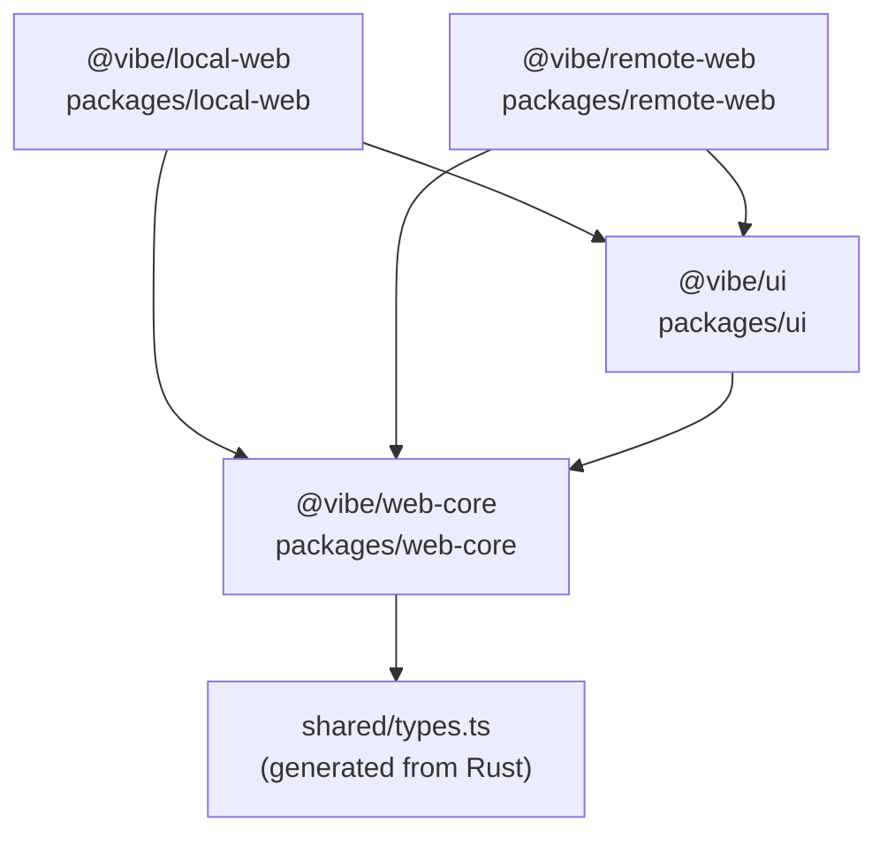
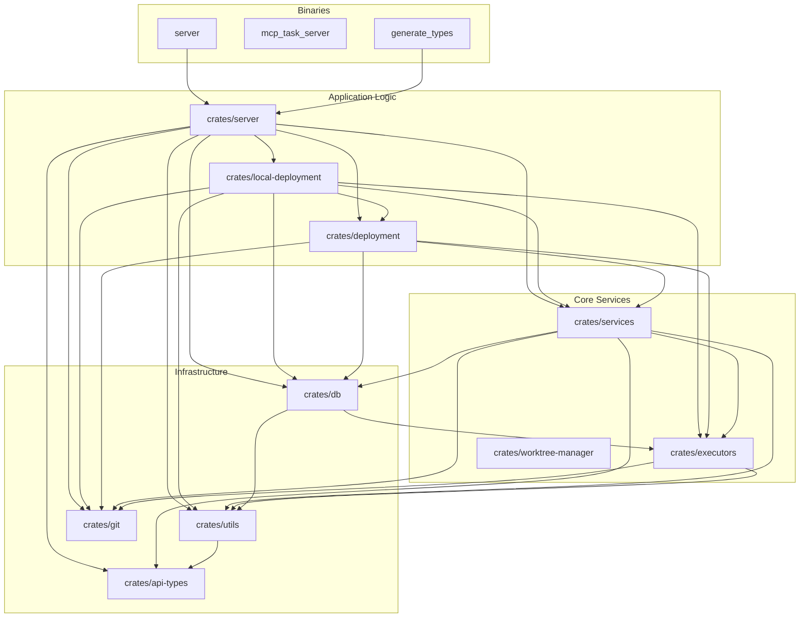
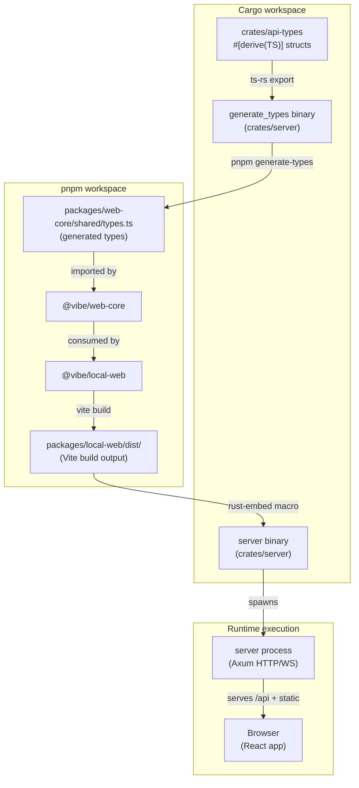

# Monorepo Structure

<details>
<summary>Relevant source files</summary>

The following files were used as context for generating this wiki page:

- [Cargo.lock](Cargo.lock)
- [crates/db/Cargo.toml](crates/db/Cargo.toml)
- [crates/deployment/Cargo.toml](crates/deployment/Cargo.toml)
- [crates/executors/Cargo.toml](crates/executors/Cargo.toml)
- [crates/local-deployment/Cargo.toml](crates/local-deployment/Cargo.toml)
- [crates/review/Cargo.toml](crates/review/Cargo.toml)
- [crates/server/Cargo.toml](crates/server/Cargo.toml)
- [crates/services/Cargo.toml](crates/services/Cargo.toml)
- [crates/utils/Cargo.toml](crates/utils/Cargo.toml)
- [npx-cli/package.json](npx-cli/package.json)
- [package.json](package.json)
- [packages/local-web/package.json](packages/local-web/package.json)

</details>


This page describes the physical layout of the vibe-kanban repository: how the JavaScript/TypeScript packages are organized under a pnpm workspace, how the Rust crates are organized under a Cargo workspace, what lives in the `scripts/` and `npx-cli/` directories, and how all of these relate to each other.

---

## Top-Level Layout

The repository root acts as the coordinator for two independent but interconnected build systems: a **pnpm workspace** for TypeScript/JavaScript and a **Cargo workspace** for Rust.

```
vibe-kanban/
├── package.json              # pnpm workspace root, top-level scripts
├── pnpm-lock.yaml            # pnpm lockfile for JS dependencies
├── Cargo.toml                # Cargo workspace root
├── Cargo.lock                # Cargo lockfile for Rust dependencies
├── crates/                   # All Rust crates
├── packages/                 # All JS/TS packages
├── npx-cli/                  # npm-published CLI wrapper
├── scripts/                  # Node.js and shell utility scripts
├── .github/workflows/        # CI/CD GitHub Actions
└── local-build.sh            # Local release build script
```

Sources: [package.json:1-69](), [Cargo.lock:1-4]()

---

## pnpm Workspace

The root `package.json` declares the monorepo as a pnpm workspace managed by `pnpm@10.13.1`, requiring Node `>=20` [package.json:63-68](). Package filter targets like `--filter @vibe/local-web` delegate commands to individual packages.

### Package Overview

| Package (filter name) | Path | Purpose |
|---|---|---|
| `@vibe/local-web` | `packages/local-web` | React frontend served for the local (self-hosted) deployment [packages/local-web/package.json:2]() |
| `@vibe/remote-web` | `packages/remote-web` | React frontend for the optional remote/cloud deployment [package.json:24]() |
| `@vibe/ui` | `packages/ui` | Shared UI component library (shadcn-based primitives) [package.json:27-28]() |
| `@vibe/web-core` | `packages/web-core` | Shared frontend utilities, hooks, and i18n [package.json:20-21]() |
| `vibe-kanban` (root) | `npx-cli/` | npm-published package; the CLI entry point for `npx vibe-kanban` [npx-cli/package.json:2-8]() |

Sources: [package.json:1-69](), [packages/local-web/package.json:1-5](), [npx-cli/package.json:1-35]()

### Frontend Package Relationships

**Frontend dependency diagram**



Sources: [packages/local-web/package.json:60-61](), [package.json:13-35]()

`packages/local-web` and `packages/remote-web` are the two deployable frontends. They both consume `@vibe/ui` for component primitives and `@vibe/web-core` for shared logic and the auto-generated API type bindings.

### Root-Level pnpm Scripts

The root `package.json` provides convenience scripts that coordinate frontend and backend together:

| Script | What it does |
|---|---|
| `dev` | Allocates ports, then runs `backend:dev:watch` and `local-web:dev` concurrently [package.json:16]() |
| `dev:qa` | Like `dev` but enables the `qa-mode` Cargo feature flag [package.json:34]() |
| `lint` | Runs ESLint on `local-web` + `ui`, then Clippy on the Rust workspace [package.json:13]() |
| `format` | Runs `cargo fmt --all` and Prettier across all frontend packages [package.json:14]() |
| `check` | Type-checks `local-web`, `ui`, and runs `cargo check` [package.json:15]() |
| `generate-types` | Runs the `generate_types` Cargo binary to regenerate TypeScript bindings [package.json:35]() |
| `generate-types:check` | CI gate: verifies TypeScript types are up-to-date without writing [package.json:36]() |
| `prepare-db` | Runs `scripts/prepare-db.js` to initialize or migrate the SQLite database [package.json:39]() |
| `build:npx` | Runs `local-build.sh` to produce a release binary bundle [package.json:42]() |
| `remote:dev` | Starts the optional remote stack via Docker Compose [package.json:46]() |

Sources: [package.json:12-53]()

---

## Cargo Workspace

All Rust code lives under `crates/`. Every crate carries the same version as the top-level npm package (currently `0.1.44`) [crates/server/Cargo.toml:3]().

### Crate Inventory

**Cargo workspace crate dependency diagram**



Sources: [crates/server/Cargo.toml:11-34](), [crates/services/Cargo.toml:13-20](), [crates/executors/Cargo.toml:7-8](), [crates/utils/Cargo.toml:1-35](), [crates/db/Cargo.toml:7-8](), [crates/local-deployment/Cargo.toml:7-25](), [crates/deployment/Cargo.toml:7-12]()

### Crate Roles

| Crate | Purpose |
|---|---|
| `crates/server` | HTTP + WebSocket API server; entry point for `server` and `generate_types` binaries [crates/server/Cargo.toml:1-5]() |
| `crates/local-deployment` | Implements the `Deployment` trait for local/self-hosted execution [crates/local-deployment/Cargo.toml:1-10]() |
| `crates/deployment` | Defines the `Deployment` trait abstraction used by the server to initialize services [crates/deployment/Cargo.toml:1-12]() |
| `crates/services` | Core logic for `ContainerService`, `GitService`, and `EventService` [crates/services/Cargo.toml:1-20]() |
| `crates/executors` | AI coding agent executor implementations and the `StandardCodingAgentExecutor` trait [crates/executors/Cargo.toml:1-39]() |
| `crates/db` | SQLite database schema, migrations, and model queries [crates/db/Cargo.toml:1-14]() |
| `crates/api-types` | Shared Rust structs that generate the TypeScript API contract [Cargo.lock:238-249]() |
| `crates/utils` | Shared logging, process management, and common helper functions [crates/utils/Cargo.toml:1-35]() |
| `crates/review` | CLI tool for code review workflows [crates/review/Cargo.toml:1-9]() |

### Cargo Feature Flags

Feature flags are used to toggle testing and deployment-specific logic:

| Flag | Affected crates | Effect |
|---|---|---|
| `qa-mode` | `server`, `services`, `executors` | Enables mock executors and test-specific API routes [crates/server/Cargo.toml:78](), [crates/services/Cargo.toml:9]() |
| `cloud` | `services` | Enables cloud-specific integration paths [crates/services/Cargo.toml:8]() |

---

## npx-cli Package

`npx-cli/` is the directory published to npm as the `vibe-kanban` package [npx-cli/package.json:2](). It is a thin Node.js wrapper that manages the lifecycle of the Rust binary.

| File | Role |
|---|---|
| `npx-cli/src/cli.ts` | Source for the CLI wrapper; handles platform detection and binary execution [npx-cli/package.json:10]() |
| `npx-cli/bin/cli.js` | Bundled entry point; downloads/caches the Rust binary and executes it [package.json:6](), [npx-cli/package.json:7-10]() |
| `npx-cli/package.json` | Declares dependencies like `adm-zip` and `cac` for the wrapper [npx-cli/package.json:27-30]() |

The root `package.json` declares `"bin": { "vibe-kanban": "npx-cli/bin/cli.js" }` so that the workspace root itself is also a valid npm-runnable entry point during development [package.json:5-7]().

---

## scripts/ Directory

The `scripts/` directory contains Node.js and shell utility scripts invoked by the root pnpm scripts.

| Script | Purpose |
|---|---|
| `scripts/setup-dev-environment.js` | Allocates free port numbers for `FRONTEND_PORT` and `BACKEND_PORT` [package.json:16]() |
| `scripts/prepare-db.js` | Initializes or migrates the local SQLite database [package.json:39]() |
| `scripts/build-bippy-bundle.mjs` | Bundles React devtools helpers for embedding in the frontend [package.json:41]() |
| `scripts/check-legacy-frontend-paths.sh` | Verifies frontend code adheres to the monorepo structure [package.json:19]() |
| `scripts/check-unused-i18n-keys.mjs` | Linting for translation keys in `packages/web-core/src/i18n` [package.json:13]() |

---

## Cross-Workspace Integration

The Rust and JavaScript build systems share artifacts primarily through type generation and binary embedding.

**Cross-workspace artifact flow**



The type-generation step (`pnpm generate-types`) must be run whenever Rust API structs change to keep the frontend's TypeScript types in sync [package.json:35](). The built frontend (`packages/local-web/dist/`) is embedded directly into the `server` binary at compile time using `rust-embed` [crates/server/Cargo.toml:62]().

Sources: [package.json:16-52](), [crates/server/Cargo.toml:11-62](), [Cargo.lock:238-249]()