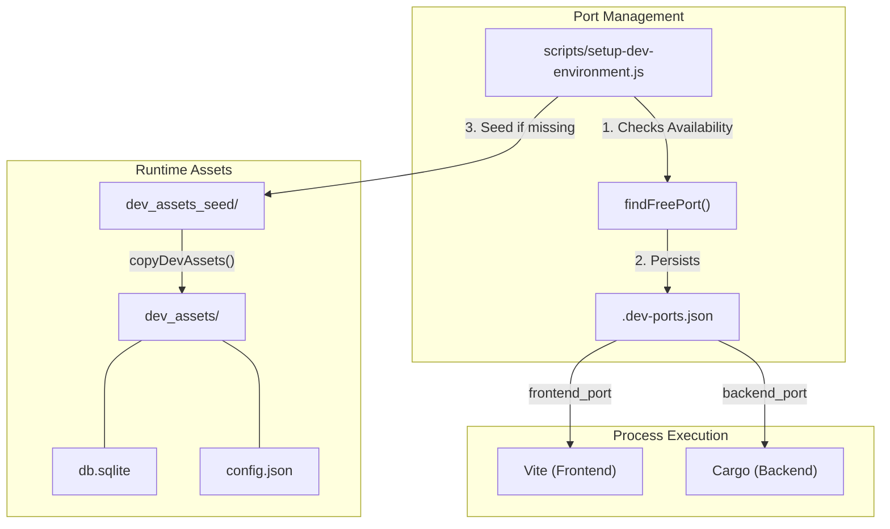
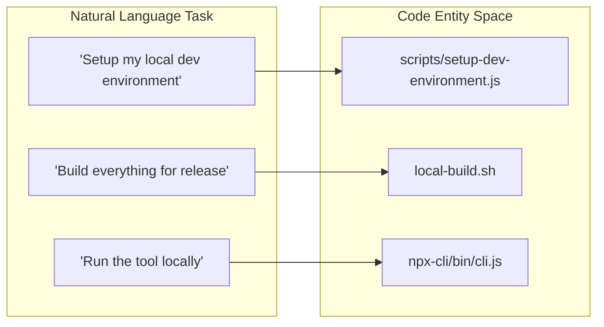

# Development Environment Setup

<details>
<summary>Relevant source files</summary>

The following files were used as context for generating this wiki page:

- [dev_assets_seed/config.json](dev_assets_seed/config.json)
- [dev_assets_seed/db.sqlite](dev_assets_seed/db.sqlite)
- [docs/configuration-customisation/agent-configurations.mdx](docs/configuration-customisation/agent-configurations.mdx)
- [docs/configuration-customisation/global-settings.mdx](docs/configuration-customisation/global-settings.mdx)
- [docs/core-features/completing-a-task.mdx](docs/core-features/completing-a-task.mdx)
- [docs/core-features/reviewing-code-changes.mdx](docs/core-features/reviewing-code-changes.mdx)
- [docs/core-features/subtasks.mdx](docs/core-features/subtasks.mdx)
- [docs/getting-started.mdx](docs/getting-started.mdx)
- [docs/index.mdx](docs/index.mdx)
- [docs/integrations/github-integration.mdx](docs/integrations/github-integration.mdx)
- [docs/integrations/vscode-extension.mdx](docs/integrations/vscode-extension.mdx)
- [local-build.sh](local-build.sh)
- [scripts/setup-dev-environment.js](scripts/setup-dev-environment.js)

</details>


This page provides detailed instructions for setting up a local development environment for Vibe Kanban. It covers prerequisite software installation, dependency management, database initialization, development server configuration, and build processes. For information about the CI/CD build pipeline and multi-platform releases, see [7.3 Build and Release Pipeline](). For information about the monorepo package structure, see [7.1 Monorepo Structure]().

## Prerequisites

Vibe Kanban requires the following software to be installed on your development machine:

| Software | Minimum Version | Installation |
|----------|----------------|--------------|
| Rust | 1.84+ (Edition 2024) | [rustup.rs](https://rustup.rs/) |
| Node.js | 20 or higher | [nodejs.org](https://nodejs.org/) |
| pnpm | 10.13.1+ | [pnpm.io](https://pnpm.io/) |

**Sources:** [local-build.sh:6-7](), [scripts/setup-dev-environment.js:1]()

### Development Tools

In addition to the core prerequisites, install the following Rust development tools for enhanced workflow:

```bash
cargo install cargo-watch
cargo install sqlx-cli
```

The `cargo-watch` tool enables automatic rebuilding of the Rust backend when source files change. The `sqlx-cli` tool is used for database preparation and migration verification. The backend relies on `sqlx` with features for SQLite and migrations to manage the schema found in the seed database [dev_assets_seed/db.sqlite:58-64]().

**Sources:** [dev_assets_seed/db.sqlite:58-64]()

## Initial Setup

### Installing Dependencies

After cloning the repository, install all JavaScript and Rust dependencies:

```bash
pnpm i
```

This command uses pnpm's workspace feature to install dependencies for all packages in the monorepo, including the frontend packages in `packages/` and the CLI wrapper in `npx-cli/` [local-build.sh:136]().

**Sources:** [local-build.sh:136]()

### Database and Asset Initialization

The development environment uses SQLite for local data storage. To ensure a consistent starting state, the system uses a seeding mechanism.

The script `scripts/setup-dev-environment.js` manages the initial asset setup by copying the contents of `dev_assets_seed/` to a local `dev_assets/` directory if it does not already exist [scripts/setup-dev-environment.js:168-181](). This seed includes:
- `db.sqlite`: A pre-migrated SQLite database containing essential tables like `projects`, `tasks`, and `execution_processes` [dev_assets_seed/db.sqlite:3-58]().
- `config.json`: Default application configuration including theme, default executor (set to `claude`), and editor preferences [dev_assets_seed/config.json:1-19]().

**Sources:** [scripts/setup-dev-environment.js:168-181](), [dev_assets_seed/db.sqlite:3-58](), [dev_assets_seed/config.json:1-19]()

## Development Workflow

### Development Server Architecture

The development environment coordinates multiple processes to provide a seamless hot-reloading experience. A key component is the port orchestration logic that dynamically assigns free ports to avoid conflicts.

Title: Dev Environment Component Interaction


**Sources:** [scripts/setup-dev-environment.js:28-37](), [scripts/setup-dev-environment.js:133-144](), [scripts/setup-dev-environment.js:168-181]()

### Port Allocation Logic

The `setup-dev-environment.js` script handles port allocation with the following priority [scripts/setup-dev-environment.js:86-154]():
1. **Environment Variables**: If `PORT` is set, it uses `PORT` for frontend, `PORT+1` for backend, and `PORT+2` for the preview proxy.
2. **Persistence**: It attempts to reload ports from `.dev-ports.json` to maintain consistency across restarts.
3. **Dynamic Discovery**: If no ports are saved or they are occupied, it finds the next available ports starting from 3000.

**Sources:** [scripts/setup-dev-environment.js:88-108](), [scripts/setup-dev-environment.js:111-130](), [scripts/setup-dev-environment.js:133-144]()

## Build Processes

### Unified Local Build

The `local-build.sh` script provides a single entry point for building the entire stack for local testing or distribution. It automatically detects the host OS and architecture to target the correct build artifacts [local-build.sh:5-35]().

**Build Steps:**
1. **Frontend**: Builds the React application in `packages/local-web` [local-build.sh:54]().
2. **Rust Binaries**: Compiles the `server`, `vibe-kanban-mcp`, and `review` binaries in release mode [local-build.sh:57-59]().
3. **Packaging**: Zips the binaries into platform-specific directories within `npx-cli/dist/` [local-build.sh:62-78]().
4. **CLI**: Compiles the TypeScript source for the `npx-cli` wrapper [local-build.sh:140]().

**Sources:** [local-build.sh:5-35](), [local-build.sh:54-59](), [local-build.sh:62-78](), [local-build.sh:140]()

### Desktop Application Build

To build the Tauri-based desktop application, pass the `--desktop` flag to the build script:

```bash
./local-build.sh --desktop
```

This triggers `cargo tauri build` and manages the `tauri.conf.json` configuration, specifically injecting dummy updater endpoints for local builds to prevent errors [local-build.sh:106-116]().

**Sources:** [local-build.sh:87-132]()

## Environment Variables

The application behavior can be modified via environment variables, many of which are set automatically during the build or dev process.

| Variable | Source | Description |
|----------|--------|-------------|
| `VK_SHARED_API_BASE` | `local-build.sh` | The base URL for shared API services [local-build.sh:46](). |
| `VITE_VK_SHARED_API_BASE` | `local-build.sh` | Frontend-accessible version of the API base URL [local-build.sh:47](). |
| `CARGO_TARGET_DIR` | `local-build.sh` | Custom directory for Rust build artifacts [local-build.sh:38-40](). |

**Sources:** [local-build.sh:38-47]()

## Summary of Dev Entities

The following diagram maps high-level development tasks to the specific scripts and files responsible for them.

Title: Task to Code Entity Mapping


**Sources:** [scripts/setup-dev-environment.js:1](), [local-build.sh:1](), [local-build.sh:144]()