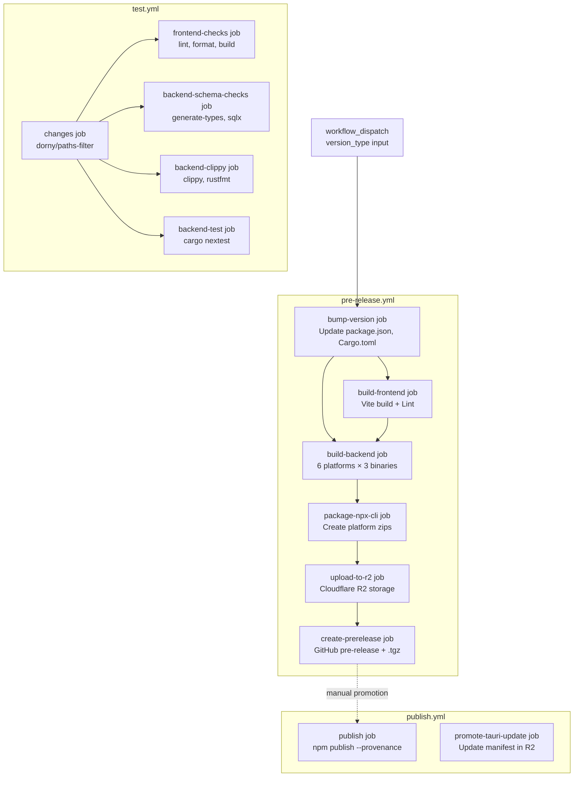
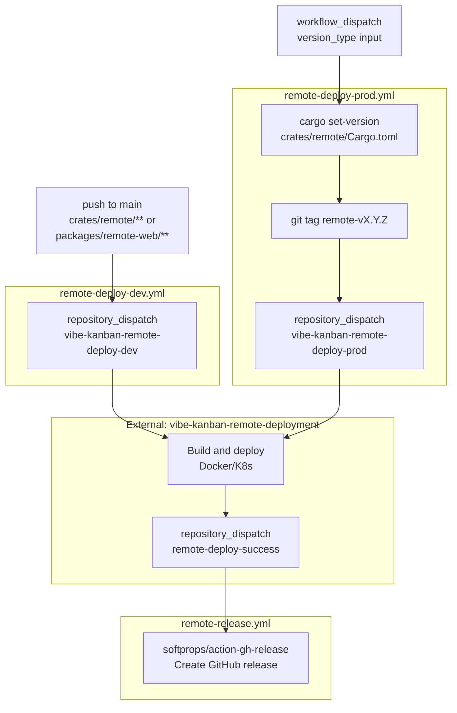
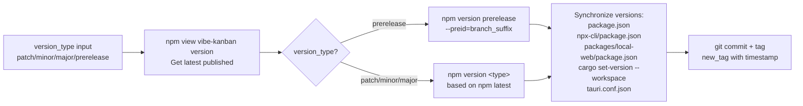
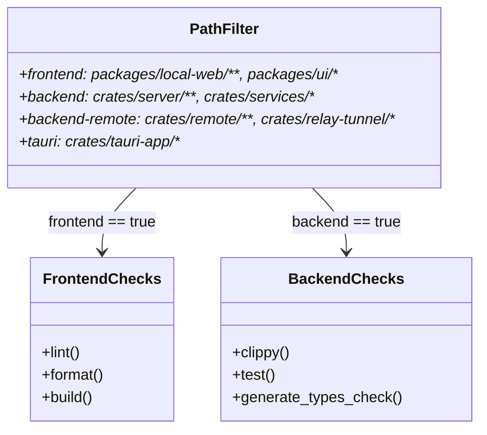

# Build and Release Pipeline

<details>
<summary>Relevant source files</summary>

The following files were used as context for generating this wiki page:

- [.dockerignore](.dockerignore)
- [.github/actions/cargo-checks-common-setup/action.yml](.github/actions/cargo-checks-common-setup/action.yml)
- [.github/actions/setup-node/action.yml](.github/actions/setup-node/action.yml)
- [.github/workflows/pre-release.yml](.github/workflows/pre-release.yml)
- [.github/workflows/publish.yml](.github/workflows/publish.yml)
- [.github/workflows/relay-deploy-dev.yml](.github/workflows/relay-deploy-dev.yml)
- [.github/workflows/relay-deploy-prod.yml](.github/workflows/relay-deploy-prod.yml)
- [.github/workflows/relay-release.yml](.github/workflows/relay-release.yml)
- [.github/workflows/remote-deploy-dev.yml](.github/workflows/remote-deploy-dev.yml)
- [.github/workflows/remote-deploy-prod.yml](.github/workflows/remote-deploy-prod.yml)
- [.github/workflows/remote-release.yml](.github/workflows/remote-release.yml)
- [.github/workflows/test.yml](.github/workflows/test.yml)
- [AGENTS.md](AGENTS.md)
- [CLAUDE.md](CLAUDE.md)
- [Dockerfile](Dockerfile)
- [crates/api-types/src/notification.rs](crates/api-types/src/notification.rs)
- [crates/relay-tunnel/Dockerfile](crates/relay-tunnel/Dockerfile)
- [crates/remote/.sqlx/query-1d612faf67c945cfe22cfd7ab6b6d360fbce8dceb7b64c4d17b4df108434c822.json](crates/remote/.sqlx/query-1d612faf67c945cfe22cfd7ab6b6d360fbce8dceb7b64c4d17b4df108434c822.json)
- [crates/remote/.sqlx/query-1ea6478b8325ce0313727f756715c988d0c03ccb74a87e67325c73c03a5dcc33.json](crates/remote/.sqlx/query-1ea6478b8325ce0313727f756715c988d0c03ccb74a87e67325c73c03a5dcc33.json)
- [crates/remote/.sqlx/query-32388086083c01d21b0d4d052519a08002b82751e45aa59b3ac628cc96be2723.json](crates/remote/.sqlx/query-32388086083c01d21b0d4d052519a08002b82751e45aa59b3ac628cc96be2723.json)
- [crates/remote/.sqlx/query-3ef67cb768d55e4aa8d551401be7daa6c8a9c76a4218ce776d87db6e6d1c890c.json](crates/remote/.sqlx/query-3ef67cb768d55e4aa8d551401be7daa6c8a9c76a4218ce776d87db6e6d1c890c.json)
- [crates/remote/.sqlx/query-8123b99c8d0df1c3a39ae0b2e02b8f95e438dcaa7f85e4ad37a069d962ae2e39.json](crates/remote/.sqlx/query-8123b99c8d0df1c3a39ae0b2e02b8f95e438dcaa7f85e4ad37a069d962ae2e39.json)
- [crates/remote/AGENTS.md](crates/remote/AGENTS.md)

</details>


## Purpose and Scope

This document describes the automated build and release pipeline for vibe-kanban, covering version management, cross-platform compilation, artifact packaging, and distribution. The pipeline orchestrates building the frontend, compiling backend binaries for multiple target platforms, and distributing them via npm and Cloudflare R2.

For local development workflows, see [7.2 Development Environment Setup](). For the npx distribution mechanism, see [7.4 NPX Distribution and CLI](). For type generation processes, see [7.5 Type Generation and Synchronization]().

## Pipeline Architecture

The release pipeline consists of GitHub Actions workflows that coordinate to build, package, and distribute the application across multiple platforms and deployment targets.

### Main Application Release Pipeline

Titled "Create GitHub Pre-Release", this pipeline handles the core application's lifecycle from version bumping to binary distribution.

**Release Pipeline Data Flow**

Sources: [.github/workflows/pre-release.yml:1-32](), [.github/workflows/test.yml:1-26](), [.github/workflows/publish.yml:1-32]()

### Remote and Relay Service Deployment Pipelines

The remote backend (`crates/remote`) and relay tunnel (`crates/relay-tunnel`) use independent deployment flows triggered by specific file changes or manual dispatches.

**Remote/Relay Deployment Logic**

Sources: [.github/workflows/remote-deploy-dev.yml:1-30](), [.github/workflows/remote-deploy-prod.yml:1-113](), [.github/workflows/remote-release.yml:1-23](), [.github/workflows/relay-deploy-prod.yml:1-105]()

## Version Management

The `bump-version` job manages version synchronization across the monorepo's multiple package manifests using `npm version` and `cargo set-version`.

### Version Bump Process

**Version Synchronization Flow**


The version bump logic ensures that:
- **Regular releases** use the higher of the latest npm version or the current repo version as the base to prevent downgrade errors [.github/workflows/pre-release.yml:83-93]().
- **Prereleases** append a branch suffix (last 6 characters of branch name, alphanumeric only) and use a timestamped tag [.github/workflows/pre-release.yml:62-70](), [.github/workflows/pre-release.yml:102-103]().
- **Tauri Config** is updated manually via a Node script to sync the `version` field in `crates/tauri-app/tauri.conf.json` [.github/workflows/pre-release.yml:127-133]().
- **Workspace Sync**: Versions are pushed to `npx-cli`, `packages/local-web`, and the entire Cargo workspace via `cargo set-version --workspace` [.github/workflows/pre-release.yml:113-125]().

Sources: [.github/workflows/pre-release.yml:33-162]()

## Frontend Build Process

The `build-frontend` job produces a static site bundle that gets embedded into the backend binary.

### Build Steps

1. **Environment Setup**: Node.js 22, pnpm 10.13.1 via the composite action `.github/actions/setup-node` [.github/workflows/pre-release.yml:174-175]().
2. **Dependency Installation**: `pnpm install` [.github/workflows/pre-release.yml:178]().
3. **Linting**: `cd packages/local-web && npm run lint` [.github/workflows/pre-release.yml:181]().
4. **Type Checking**: `cd packages/local-web && npx tsc --noEmit` [.github/workflows/pre-release.yml:184]().
5. **Vite Build**: `npm run build` produces the production distribution in `packages/local-web/dist` [.github/workflows/pre-release.yml:187](), [Dockerfile:115]().
6. **Sentry Release**: Source maps and releases are managed via `getsentry/action-release` [.github/workflows/pre-release.yml:211-223]().

Sources: [.github/workflows/pre-release.yml:163-226](), [.github/actions/setup-node/action.yml:1-30](), [Dockerfile:3-33]()

## Backend Cross-Platform Build

The `build-backend` job compiles three Rust binaries (`server`, `mcp_task_server`, `review`) for six target platforms.

### Target Platform Matrix

| Target | Tooling | Runner |
|--------|---------|--------|
| `x86_64-unknown-linux-musl` | `cargo zigbuild` | `ubuntu-24.04` |
| `aarch64-unknown-linux-musl` | `cargo zigbuild` | `ubuntu-24.04` |
| `x86_64-pc-windows-msvc` | `cargo xwin` | `ubuntu-24.04` |
| `aarch64-pc-windows-msvc` | `cargo xwin` | `ubuntu-24.04` |
| `x86_64-apple-darwin` | `cargo build` | `macos-15` |
| `aarch64-apple-darwin` | `cargo build` | `macos-15` |

Sources: [.github/workflows/pre-release.yml:228-451]()

### Windows Cross-Compilation Details

Windows builds are performed on Linux runners using `cargo-xwin` [.github/workflows/pre-release.yml:30]().
- **ARM64 Workaround**: For `aarch64-pc-windows-msvc`, a custom `ring-cc-wrapper.sh` is used to force `clang` for the `ring` crate compilation [.github/workflows/pre-release.yml:316-323]().
- **Code Signing**: Windows binaries are signed using `Jsign` via the `setup-jsign` composite action [.github/workflows/pre-release.yml:333-345]().

Sources: [.github/workflows/pre-release.yml:311-345]()

## Testing and Quality Gates

The `test.yml` workflow enforces quality standards on every pull request.

### Path Filtering Strategy

The `changes` job uses `dorny/paths-filter` to detect which subsystems require testing based on file changes [.github/workflows/test.yml:40-42]().

**Quality Gate Logic**

Sources: [.github/workflows/test.yml:27-161]()

### Key Quality Commands

| Domain | Command | File |
|--------|---------|------|
| Type Sync | `npm run generate-types:check` | [.github/workflows/test.yml:204]() |
| Database | `npm run prepare-db:check` | [.github/workflows/test.yml:207]() |
| Backend | `cargo nextest run --workspace` | [.github/workflows/test.yml:274]() |
| Frontend | `npx concurrently ...` | [.github/workflows/test.yml:179-195]() |

## Containerization

The project uses Docker for both the main application and the relay tunnel service.

### Main Server Dockerfile
The main `Dockerfile` uses a multi-stage build:
1. `fe-builder`: Builds the frontend assets using Node 24 [.Dockerfile:3-33]().
2. `builder`: Compiles the Rust `server` binary, embedding the frontend assets from the first stage [.Dockerfile:35-121]().
3. `runtime`: A slim Debian Bookworm image that runs the `server` binary as `appuser` [.Dockerfile:123-152]().

### Relay Tunnel Dockerfile
The `crates/relay-tunnel/Dockerfile` is specialized for the relay service:
- It copies necessary workspace member manifests to allow Cargo to resolve shared dependencies like `api-types` and `utils` [.crates/relay-tunnel/Dockerfile:17-46]().
- It builds the `relay-server` binary and exposes port `8082` [.crates/relay-tunnel/Dockerfile:53-70]().

Sources: [Dockerfile:1-153](), [crates/relay-tunnel/Dockerfile:1-76]()

## Binary Distribution via Cloudflare R2

Binaries are uploaded to Cloudflare R2 for the NPX CLI to download.

### Manifest and Checksums

The `upload-to-r2` job generates a `version-manifest.json` containing SHA256 checksums and file sizes for every platform-specific ZIP [.github/workflows/pre-release.yml:618-654]().

Sources: [.github/workflows/pre-release.yml:588-681]()

## npm Publication and Tauri Promotion

When a release is finalized (converted from pre-release), `publish.yml` handles public distribution.

### Tauri Update Manifest Promotion

The workflow promotes the tag-specific Tauri update manifest to a fixed endpoint (`binaries/tauri-update/latest.json`) in R2 so existing desktop app users receive update notifications [.github/workflows/publish.yml:147-169]().

```bash
# Promotion command logic
aws s3 cp \
  "s3://$BUCKET/binaries/$TAG/tauri/latest.json" \
  "s3://$BUCKET/binaries/tauri-update/latest.json" \
  --endpoint-url "$ENDPOINT" --content-type "application/json"
```
Sources: [.github/workflows/publish.yml:158-167]()

### npm Publication Flow

The workflow downloads the `.tgz` asset from the GitHub release and publishes it to npm with OIDC provenance [.github/workflows/publish.yml:44-120]().

Sources: [.github/workflows/publish.yml:110-118]()

## Remote and Relay Service Release

Production deployments for remote services follow a bump-tag-dispatch pattern.

### Production Release Flow

1. **Version Bump**: Updates the specific crate's `Cargo.toml` (`crates/remote` or `crates/relay-tunnel`) using `cargo set-version` [.github/workflows/remote-deploy-prod.yml:78](), [.github/workflows/relay-deploy-prod.yml:73]().
2. **Tagging**: Creates a tag prefixed with `remote-v` or `relay-v` [.github/workflows/remote-deploy-prod.yml:74](), [.github/workflows/relay-deploy-prod.yml:69]().
3. **Dispatch**: Triggers a `repository-dispatch` to the deployment repository with the new ref and version [.github/workflows/remote-deploy-prod.yml:102-113](), [.github/workflows/relay-deploy-prod.yml:94-105]().

Sources: [.github/workflows/remote-deploy-prod.yml:47-113](), [.github/workflows/relay-deploy-prod.yml:42-105]()