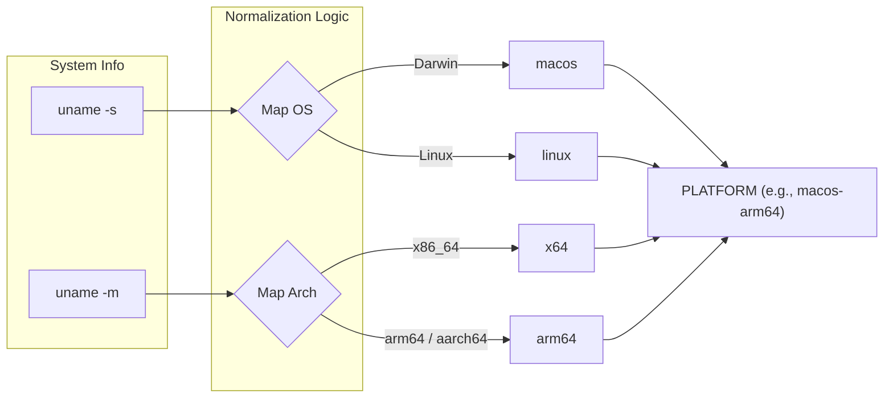
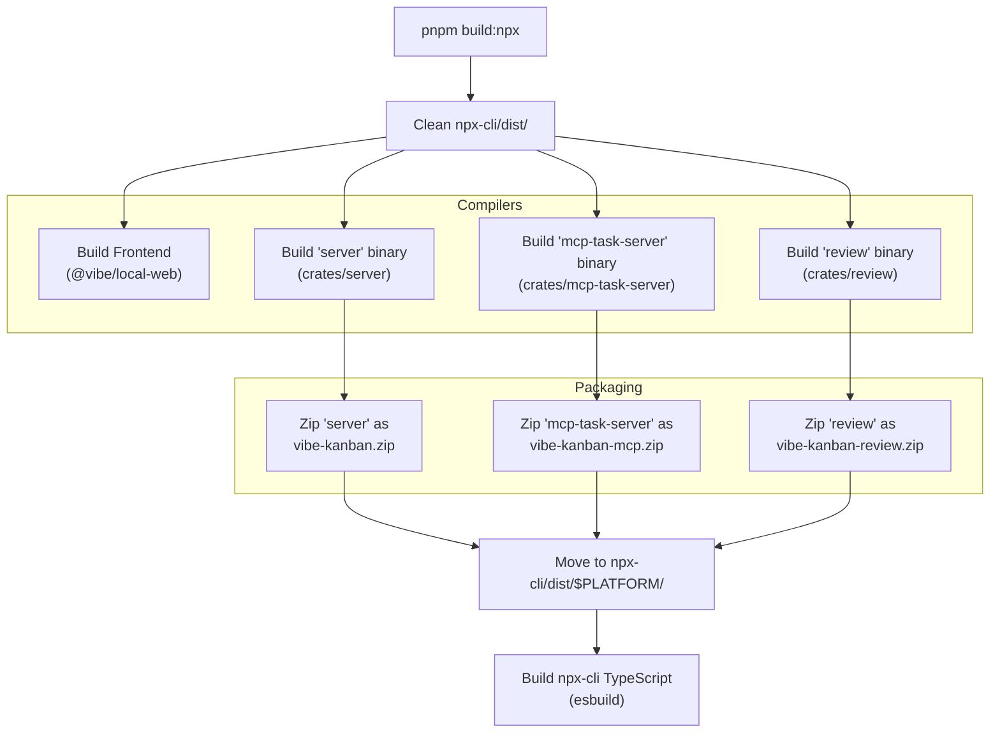
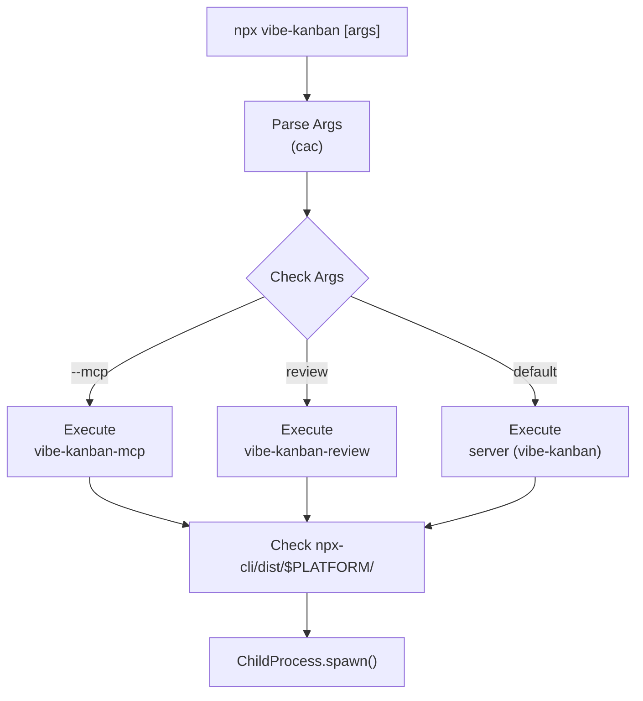

# NPX Distribution and CLI

<details>
<summary>Relevant source files</summary>

The following files were used as context for generating this wiki page:

- [Cargo.lock](Cargo.lock)
- [crates/db/Cargo.toml](crates/db/Cargo.toml)
- [crates/deployment/Cargo.toml](crates/deployment/Cargo.toml)
- [crates/executors/Cargo.toml](crates/executors/Cargo.toml)
- [crates/local-deployment/Cargo.toml](crates/local-deployment/Cargo.toml)
- [crates/review/Cargo.toml](crates/review/Cargo.toml)
- [crates/server/Cargo.toml](crates/server/Cargo.toml)
- [crates/services/Cargo.toml](crates/services/Cargo.toml)
- [crates/utils/Cargo.toml](crates/utils/Cargo.toml)
- [npx-cli/package-lock.json](npx-cli/package-lock.json)
- [npx-cli/package.json](npx-cli/package.json)
- [package.json](package.json)

</details>


This page covers the NPX packaging layer for `vibe-kanban`: how the npm package is structured, how the CLI detects the host platform, manages pre-built Rust binaries, and dispatches into various execution modes. The distribution system ensures that users can run the full AI coding agent environment with a single `npx vibe-kanban` command without needing a local Rust toolchain.

---

## Package Structure

The project uses a monorepo structure where the root `package.json` defines the entry point for the published `vibe-kanban` package, while the `npx-cli` directory contains the source logic for the wrapper.

```
.
├── package.json          ← Root package (defines bin/vibe-kanban)
├── npx-cli/
│   ├── package.json      ← CLI metadata and build scripts
│   ├── src/
│   │   └── cli.ts        ← Source logic for platform detection and binary management
│   ├── bin/
│   │   └── cli.js        ← Bundled CJS output (executable)
│   ├── dist/             ← Local-build-only: pre-built zips (gitignored)
│   │   └── <platform>/
│   │       ├── vibe-kanban.zip
│   │       ├── vibe-kanban-mcp.zip
│   │       └── vibe-kanban-review.zip
│   └── tsconfig.json     ← TypeScript configuration for CLI
```

The root `package.json` maps the `vibe-kanban` command to `npx-cli/bin/cli.js` [package.json:5-7](). The `npx-cli` package depends on `adm-zip` for extracting the Rust binaries and `cac` for command-line argument parsing [npx-cli/package.json:27-30](). It uses `esbuild` to bundle the TypeScript source into the final executable [npx-cli/package.json:10]().

Sources: [package.json:1-11](), [npx-cli/package.json:1-35]()

---

## Platform Detection and Mapping

The build and distribution scripts normalize OS and Architecture strings to match the pre-built binary naming convention used in the Rust compilation stage.

**Title: OS and Architecture Normalization**



The build process determines the target platform to ensure the correct binaries are packaged. The root `package.json` includes scripts like `build:npx` which invokes the local build pipeline [package.json:42](). The CLI is targeted at Node.js version 20 or higher [npx-cli/package.json:19-20]().

Sources: [package.json:42](), [npx-cli/package.json:19-22]()

---

## Build and Distribution Flow

The build pipeline automates the creation of a distributable NPX package by compiling both the web assets and the Rust binaries.

**Title: NPX Distribution Build Pipeline**



The build process targets three primary binaries: the main `server` [crates/server/Cargo.toml:2](), the `mcp-task-server` tool, and the `review` tool [crates/review/Cargo.toml:2-9](). Each is zipped to reduce distribution size before being placed in the platform-specific directory within the `npx-cli` package [npx-cli/package.json:31-34](). The `prepack` script in the root ensures these assets are generated before any `npm publish` [package.json:45]().

Sources: [package.json:41-45](), [npx-cli/package.json:10](), [crates/server/Cargo.toml:1-5](), [crates/review/Cargo.toml:1-9]()

---

## Execution Modes

The CLI (bundled in `npx-cli/bin/cli.js`) acts as a dispatcher. It parses command-line arguments to determine which underlying Rust binary to execute.

**Title: CLI Binary Dispatch Logic**



| Execution Mode | Command Example | Binary Target | Source Crate |
| :--- | :--- | :--- | :--- |
| **Main App** | `npx vibe-kanban` | `vibe-kanban` | `crates/server` [crates/server/Cargo.toml:2]() |
| **MCP Server** | `npx vibe-kanban --mcp` | `vibe-kanban-mcp` | `crates/mcp-task-server` |
| **Review Tool** | `npx vibe-kanban review` | `vibe-kanban-review` | `crates/review` [crates/review/Cargo.toml:2]() |

The `npx-cli` build script uses `esbuild` with a `--banner:js="#!/usr/bin/env node"` flag to ensure the output is a valid Node.js executable [npx-cli/package.json:10](). The `bin` mapping in `npx-cli/package.json` registers the `vibe-kanban` command globally when installed via npm [npx-cli/package.json:6-8]().

Sources: [npx-cli/package.json:6-10](), [npx-cli/package.json:27-30](), [crates/server/Cargo.toml:1-5](), [crates/review/Cargo.toml:1-9]()

---

## Desktop Application Integration

The system also supports building a Tauri-based desktop application, which provides platform-specific installers rather than raw binaries.

1.  **Tauri Build**: The root `package.json` provides a `tauri:build` script that enters the `crates/tauri-app` directory to execute the build [package.json:52]().
2.  **Dev Environment**: For development, `tauri:dev` sets up the environment, including frontend and backend ports, and runs the Tauri dev server [package.json:51]().
3.  **Platform Support**: The build process handles dependencies for various platforms, including `openssl` for Linux builds when cross-compiling for `musl` to satisfy requirements for crates like `codex-protocol` [crates/executors/Cargo.toml:59-60]().

Sources: [package.json:51-52](), [crates/executors/Cargo.toml:52-60]()

---

## Local Development and Testing

For developers working on the CLI or the distribution flow, the root `package.json` provides several verification pathways.

*   **Build**: Run `pnpm run build:npx` to compile all components and package them into `npx-cli/dist` [package.json:42]().
*   **Lint/Check**: Run `pnpm run check:npx-cli` to perform type checking on the CLI source using `tsconfig.json` [package.json:44]().
*   **Test**: The `test:npm` script is available to verify the package integrity [package.json:17]().

The `prepack` script ensures that both the NPX binaries and the CLI wrapper are built before the package is published to a registry [package.json:45]().

Sources: [package.json:17-45](), [npx-cli/package.json:11]()