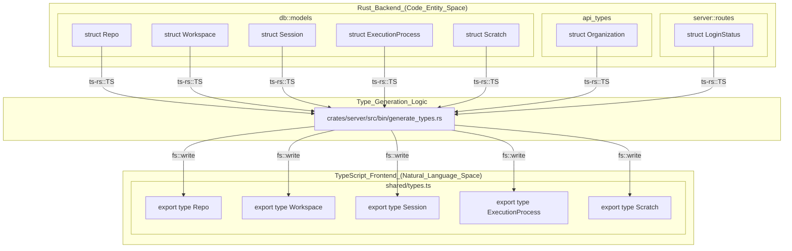
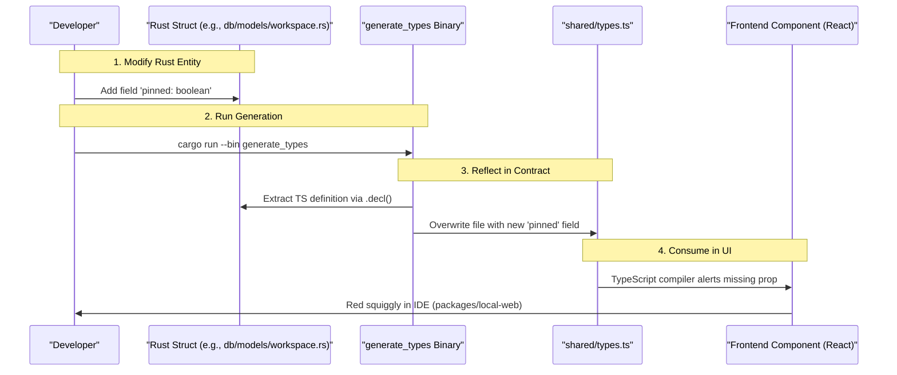

# Type Generation and Synchronization

<details>
<summary>Relevant source files</summary>

The following files were used as context for generating this wiki page:

- [crates/api-types/Cargo.toml](crates/api-types/Cargo.toml)
- [crates/db/src/models/scratch.rs](crates/db/src/models/scratch.rs)
- [crates/server/src/bin/generate_types.rs](crates/server/src/bin/generate_types.rs)
- [shared/types.ts](shared/types.ts)

</details>


## Purpose and Scope

This document describes the type generation system in Vibe Kanban that maintains strict type safety between the Rust backend and TypeScript frontend. The system uses the `ts-rs` library to automatically generate TypeScript type definitions from Rust structs, ensuring the frontend and backend share a common type contract.

The core of this workflow is the `generate_types` binary, which serves as a bridge between the Rust "Code Entity Space" and the TypeScript "Natural Language/UI Space."

---

## System Overview

Vibe Kanban employs a unidirectional type generation system where Rust structs serve as the source of truth for all shared data types. The `ts-rs` crate processes annotated Rust types and generates corresponding TypeScript definitions into the primary contract file: `shared/types.ts` [shared/types.ts:1-1]().

### Type Mapping Architecture

The following diagram bridges the Rust backend entities to the generated TypeScript contracts used by the frontend.

**Type Mapping: Rust Entities to TypeScript Contracts**



**Sources:** [crates/server/src/bin/generate_types.rs:13-134](), [shared/types.ts:7-161]()

---

## The generate_types Binary

The type generation is handled by a dedicated binary located in the server crate.

### Local Type Generation (`crates/server/src/bin/generate_types.rs`)

This binary handles types for the application environment, including database models and executor configurations. It aggregates types from the `db`, `executors`, `services`, `utils`, `api_types`, and `server` crates.

**Key Implementation Details:**
- **Header Generation:** Every file starts with a warning banner defined in the `HEADER` constant to prevent manual edits [crates/server/src/bin/generate_types.rs:9-11]().
- **Type Collection:** The `generate_types_content` function constructs a `Vec<String>` by calling `.decl()` on Rust types that implement the `TS` trait [crates/server/src/bin/generate_types.rs:13-134]().
- **Output Destination:** The generated content is written to `shared/types.ts` [shared/types.ts:1-1]().

**Sources:** [crates/server/src/bin/generate_types.rs:7-134](), [shared/types.ts:1-5]()

---

## Synchronization Workflow

The synchronization process ensures that any change in the Rust backend models is reflected in the frontend TypeScript types.

**Data Flow: From Rust Modification to Frontend Update**



**Sources:** [crates/server/src/bin/generate_types.rs:1-134](), [shared/types.ts:155-155]()

---

## Data Model Synchronization

The system synchronizes several critical data models. Below is a summary of the most important synchronized entities.

| Rust Entity | TypeScript Type | Source Crate | Purpose |
| :--- | :--- | :--- | :--- |
| `Repo` | `Repo` | `db` | Local repository metadata [shared/types.ts:7]() |
| `Workspace` | `Workspace` | `db` | Development environment state [shared/types.ts:155]() |
| `ExecutionProcess` | `ExecutionProcess` | `db` | Agent execution lifecycle [shared/types.ts:161]() |
| `Scratch` | `Scratch` | `db` | UI state and draft persistence [shared/types.ts:149]() |
| `Organization` | `Organization` | `api_types` | Multi-tenancy structure [crates/server/src/bin/generate_types.rs:73]() |

### The Scratch System
A notable use of synchronized types is the `ScratchPayload` [shared/types.ts:145](). This enum-like union allows the Rust backend to store arbitrary UI state (like `UI_PREFERENCES` or `DRAFT_ISSUE`) in a way that the TypeScript frontend can consume with full type safety using discriminated unions [crates/db/src/models/scratch.rs:100-153]().

**Sources:** [shared/types.ts:7-161](), [crates/server/src/bin/generate_types.rs:14-134](), [crates/db/src/models/scratch.rs:21-203]()

---

## Technical Implementation Details

### Type Mapping Logic

The `ts-rs` macros handle the mapping of Rust primitives to TypeScript:
- `uuid::Uuid` typically maps to `string` [crates/db/src/models/scratch.rs:167]().
- `chrono::DateTime<Utc>` maps to `Date` or `string` [shared/types.ts:7-21]().
- `Option<T>` maps to `T | null` [shared/types.ts:11-11]().
- `Vec<T>` maps to `Array<T>` [shared/types.ts:35-35]().
- `i64` or `bigint` types map to `bigint` in TypeScript for precision [shared/types.ts:17-17]().

### Enum Synchronization
Rust enums are generated as TypeScript string literal unions or enums. For example, `SearchMatchType` in Rust becomes:
```typescript
export type SearchMatchType = "FileName" | "DirectoryName" | "FullPath";
```
[shared/types.ts:19-19]()

And `ScratchType` is generated as a TypeScript `enum`:
```typescript
export enum ScratchType { DRAFT_TASK = "DRAFT_TASK", DRAFT_FOLLOW_UP = "DRAFT_FOLLOW_UP", ... }
```
[shared/types.ts:147-147]()

**Sources:** [shared/types.ts:19-147](), [crates/server/src/bin/generate_types.rs:18-42](), [crates/db/src/models/scratch.rs:54-79]()