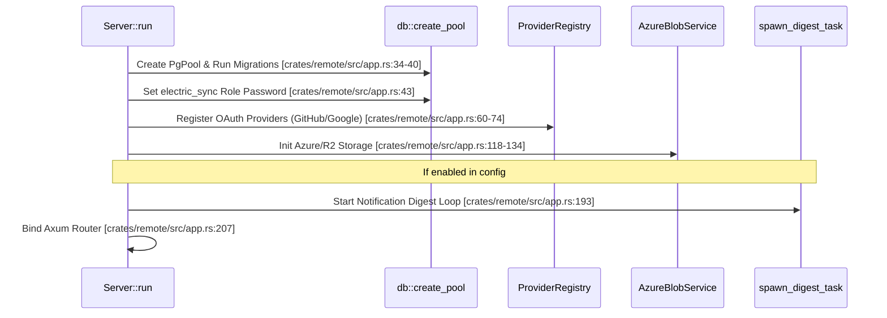
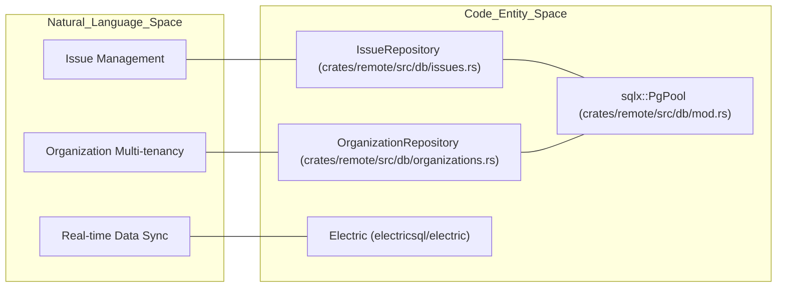

# Remote Service Architecture

<details>
<summary>Relevant source files</summary>

The following files were used as context for generating this wiki page:

- [.github/actions/cargo-checks-common-setup/action.yml](.github/actions/cargo-checks-common-setup/action.yml)
- [.github/actions/setup-node/action.yml](.github/actions/setup-node/action.yml)
- [.github/workflows/pre-release.yml](.github/workflows/pre-release.yml)
- [.github/workflows/publish.yml](.github/workflows/publish.yml)
- [.github/workflows/relay-deploy-dev.yml](.github/workflows/relay-deploy-dev.yml)
- [.github/workflows/relay-deploy-prod.yml](.github/workflows/relay-deploy-prod.yml)
- [.github/workflows/relay-release.yml](.github/workflows/relay-release.yml)
- [.github/workflows/remote-deploy-dev.yml](.github/workflows/remote-deploy-dev.yml)
- [.github/workflows/remote-deploy-prod.yml](.github/workflows/remote-deploy-prod.yml)
- [.github/workflows/remote-release.yml](.github/workflows/remote-release.yml)
- [.github/workflows/test.yml](.github/workflows/test.yml)
- [AGENTS.md](AGENTS.md)
- [CLAUDE.md](CLAUDE.md)
- [crates/remote/AGENTS.md](crates/remote/AGENTS.md)
- [crates/remote/Cargo.lock](crates/remote/Cargo.lock)
- [crates/remote/Cargo.toml](crates/remote/Cargo.toml)
- [crates/remote/Dockerfile](crates/remote/Dockerfile)
- [crates/remote/README.md](crates/remote/README.md)
- [crates/remote/docker-compose.yml](crates/remote/docker-compose.yml)
- [crates/remote/src/analytics.rs](crates/remote/src/analytics.rs)
- [crates/remote/src/app.rs](crates/remote/src/app.rs)
- [crates/remote/src/db/mod.rs](crates/remote/src/db/mod.rs)
- [crates/remote/src/lib.rs](crates/remote/src/lib.rs)
- [crates/remote/src/mail.rs](crates/remote/src/mail.rs)
- [docs/self-hosting/deploy-docker.mdx](docs/self-hosting/deploy-docker.mdx)
- [docs/self-hosting/local-development.mdx](docs/self-hosting/local-development.mdx)

</details>


This page describes the optional cloud/remote service architecture for Vibe Kanban. It covers the `remote` Rust crate, the `remote-web` frontend, the containerized service stack (PostgreSQL, ElectricSQL, Azurite, relay-server), and core services for authentication, billing, and storage.

---

## Overview

The remote service is an Axum-based HTTP server that provides a multi-tenant environment distinct from the local `server` crate. It is designed for team collaboration and persistent cloud hosting.

- **Multi-user Authentication**: Supports OAuth login (GitHub or Google) and a bootstrap local auth for self-hosting [crates/remote/src/app.rs:60-78]().
- **PostgreSQL Storage**: Uses a central PostgreSQL database managed via `sqlx` [crates/remote/Cargo.toml:33-33]().
- **Real-time Synchronization**: Integrates **ElectricSQL** for active logical replication between the database and the browser [crates/remote/docker-compose.yml:52-64]().
- **Cloud Storage**: Pluggable support for Azure Blob Storage or Cloudflare R2 for issue attachments and review artifacts [crates/remote/src/app.rs:118-134]().
- **Relay Tunneling**: A relay server (`crates/relay-tunnel`) enables remote access to local development instances behind NAT [crates/remote/docker-compose.yml:159-180]().
- **Transactional Email**: Integrated with **Loops** for organization invitations, review updates, and activity digests [crates/remote/src/mail.rs:149-234]().

Sources: [crates/remote/src/app.rs:25-210](), [crates/remote/docker-compose.yml:1-186](), [crates/remote/Cargo.toml:1-75]()

---

## Runtime Service Topology

The remote stack is orchestrated via Docker Compose, defining how the Rust backend interacts with specialized infrastructure services.

**Service Topology Diagram**

```mermaid
graph TD
    subgraph "External_Access"
        [Browser_Client]
        [Desktop_App]
    end

    subgraph "Docker_Compose_Services"
        RemoteServer["remote-server (crates/remote)\n:8081"]
        RelayServer["relay-server (crates/relay-tunnel)\n:8082"]
        Electric["electric (electricsql/electric)\n:3000"]
        RemoteDB["remote-db (postgres:16-alpine)\n:5433"]
        Azurite["azurite (azure-storage/azurite)\n:10000"]
    end

    [Browser_Client] -->|"REST API / OAuth"| RemoteServer
    [Desktop_App] -->|"WebSocket Tunnel"| RelayServer
    RelayServer -->|"JWT / User Lookup"| RemoteDB
    RemoteServer -->|"sqlx::PgPool"| RemoteDB
    RemoteServer -->|"AzureBlobService"| Azurite
    Electric -->|"Logical Replication"| RemoteDB
    Electric -->|"Health Check Dependency"| RemoteServer
    [Browser_Client] -->|"ElectricSQL Sync"| Electric
```

Sources: [crates/remote/docker-compose.yml:3-180](), [crates/remote/src/app.rs:34-55]()

### Service Details

| Service | Image / Source | Role |
|---|---|---|
| `remote-server` | `crates/remote/Dockerfile` | Hosts the Axum API, Auth handlers, and serves the `remote-web` static assets [crates/remote/docker-compose.yml:73-157](). |
| `relay-server` | `crates/relay-tunnel/Dockerfile` | Manages secure WebSocket tunnels for the `relay-tunnel` system [crates/remote/docker-compose.yml:159-180](). |
| `remote-db` | `postgres:16-alpine` | Primary data store; configured with `wal_level=logical` for ElectricSQL [crates/remote/docker-compose.yml:4-20](). |
| `electric` | `electricsql/electric:1.4.13` | Sync engine that streams database changes to frontend clients [crates/remote/docker-compose.yml:52-64](). |
| `azurite` | `azure-storage/azurite` | Emulates Azure Blob Storage for local development of attachment features [crates/remote/docker-compose.yml:22-33](). |

Sources: [crates/remote/docker-compose.yml:1-186]()

---

## The `remote` Crate

### Application Initialization

The `Server::run` function in `crates/remote/src/app.rs` is the entry point for the remote backend. It initializes the `AppState` and spawns background tasks.

**Initialization Sequence Diagram**



Sources: [crates/remote/src/app.rs:25-210](), [crates/remote/src/db/mod.rs:1-100]()

---

## Data Model and Repository Pattern

The remote service utilizes a centralized PostgreSQL database. Data access is encapsulated in Repository structs that handle complex queries and transaction management.

### Key Repositories
- **`IssueRepository`**: Handles searching, filtering, and CRUD for `Issue` entities. It supports advanced filtering by `status_ids`, `priority`, and full-text search.
- **`OrganizationRepository`**: Manages multi-tenant organizations, memberships, and roles (`ADMIN` vs `MEMBER`). It automatically creates initial projects and default statuses for new personal organizations.

**Repository to Code Mapping**



Sources: [crates/remote/src/db/mod.rs:1-100](), [crates/remote/src/app.rs:34-55]()

---

## Storage and Attachments

The remote architecture supports both Azure Blob Storage and Cloudflare R2 for different use cases.

- **Azure Blob Storage**: Primary storage for issue attachments. The `AzureBlobService` handles SAS token generation for secure direct-to-browser uploads [crates/remote/src/app.rs:127-134]().
- **Cloudflare R2**: Used by the `R2Service` for storing review artifacts and artifacts from the review worker [crates/remote/src/app.rs:118-126]().
- **Cleanup Task**: The `spawn_cleanup_task` periodically removes orphaned blobs from storage that are no longer referenced in the database [crates/remote/src/app.rs:184-186]().

Sources: [crates/remote/src/app.rs:118-134](), [crates/remote/src/app.rs:185](), [crates/remote/docker-compose.yml:141-147]()

---

## Billing and Multi-tenancy

The `remote` crate includes optional billing integration for commercial deployments.

- **Feature Flag**: The `vk-billing` feature enables the private `billing` crate dependency [crates/remote/Cargo.toml:11-17]().
- **`BillingService`**: An abstraction that checks organization seat limits and subscription status [crates/remote/src/app.rs:165-169]().
- **Stripe Integration**: Configuration includes `STRIPE_SECRET_KEY` and `STRIPE_WEBHOOK_SECRET` for handling subscription lifecycle events [crates/remote/docker-compose.yml:136-140]().

Sources: [crates/remote/Cargo.toml:11-17](), [crates/remote/src/app.rs:165-169](), [crates/remote/docker-compose.yml:135-140]()

---

## Transactional Email and Digests

The system uses **Loops** to handle user communication.

- **`Mailer` Trait**: Defines interface for invitations and PR status updates [crates/remote/src/mail.rs:37-59]().
- **`LoopsMailer`**: Implementation that sends transactional emails via the Loops API using templates defined in environment variables [crates/remote/src/mail.rs:114-147]().
- **Notification Digests**: A background task `spawn_digest_task` aggregates missed notifications and sends a summary email periodically [crates/remote/src/app.rs:193-197]().

Sources: [crates/remote/src/mail.rs:1-234](), [crates/remote/src/app.rs:188-202]()

---

## Docker Deployment

The `Dockerfile` is optimized for both public cloud deployment and private self-hosting.

- **FE Builder Stage**: Builds the `remote-web` React application using `pnpm` [crates/remote/Dockerfile:8-34]().
- **Rust Builder Stage**: Compiles the `remote` binary. It includes a conditional step to strip private billing dependencies if building for a public/self-hosted environment by modifying `Cargo.toml` on the fly [crates/remote/Dockerfile:91-96]().
- **Runtime Stage**: A slim Debian image containing only the compiled binary and the static frontend assets [crates/remote/Dockerfile:105-128]().

Sources: [crates/remote/Dockerfile:1-128]()

---

## Deployment Pipelines

Remote services are managed via dedicated GitHub Action workflows.

| Workflow | Path | Purpose |
|---|---|---|
| **Remote Release** | `.github/workflows/remote-release.yml` | Tags and creates releases specifically for the remote crate. |
| **Remote Deploy Prod** | `.github/workflows/remote-deploy-prod.yml` | Bumps version in `crates/remote/Cargo.toml` and dispatches to a private deployment repository [`.github/workflows/remote-deploy-prod.yml:47-113`](). |
| **Relay Release** | `.github/workflows/relay-release.yml` | Manages releases for the `relay-tunnel` component. |

Sources: [`.github/workflows/remote-deploy-prod.yml:1-113`](), [crates/remote/Cargo.toml:1-5]()