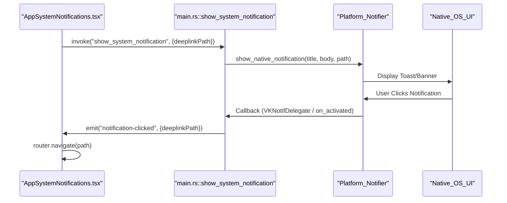

# Tauri Desktop Application

<details>
<summary>Relevant source files</summary>

The following files were used as context for generating this wiki page:

- [crates/tauri-app/Cargo.toml](crates/tauri-app/Cargo.toml)
- [crates/tauri-app/src/linux_notifications.rs](crates/tauri-app/src/linux_notifications.rs)
- [crates/tauri-app/src/macos_notifications.rs](crates/tauri-app/src/macos_notifications.rs)
- [crates/tauri-app/src/main.rs](crates/tauri-app/src/main.rs)
- [crates/tauri-app/src/windows_notifications.rs](crates/tauri-app/src/windows_notifications.rs)
- [crates/tauri-app/tauri.conf.json](crates/tauri-app/tauri.conf.json)
- [packages/local-web/src/app/hooks/useTauriNotificationNavigation.ts](packages/local-web/src/app/hooks/useTauriNotificationNavigation.ts)
- [packages/local-web/src/app/notifications/AppSystemNotifications.tsx](packages/local-web/src/app/notifications/AppSystemNotifications.tsx)
- [packages/local-web/src/app/notifications/showSystemNotification.ts](packages/local-web/src/app/notifications/showSystemNotification.ts)

</details>


The Vibe Kanban desktop application is built using **Tauri**, providing a cross-platform wrapper for the web-based workspace. It integrates the Rust backend services directly into the application lifecycle and implements native operating system features such as push notifications with click-handling, auto-updates, and clipboard access.

## Application Architecture

The desktop application is defined in the `vibe-kanban-tauri` crate [[crates/tauri-app/Cargo.toml:1-4]](). It acts as a coordinator that initializes the core `server` and `services` crates while providing a native webview frontend.

### Component Interaction
The following diagram illustrates how the Tauri wrapper bridges the frontend React application with the native OS and the Rust backend services.

**Tauri Bridge Architecture**
```mermaid
graph TD
  subgraph "Frontend_packages_local_web"
    [AppSystemNotifications.tsx] -- "invoke('show_system_notification')" --> [main.rs]
    [useTauriNotificationNavigation.ts] -- "listen('notification-clicked')" --> [main.rs]
  end

  subgraph "Tauri_App_crates_tauri_app"
    [main.rs] -- "manages" --> [TauriNotifier]
    [main.rs] -- "initializes" --> [macos_notifications.rs]
    [main.rs] -- "initializes" --> [windows_notifications.rs]
    [main.rs] -- "initializes" --> [linux_notifications.rs]
  end

  subgraph "Native_OS_APIs"
    [macos_notifications.rs] -- "UNUserNotificationCenter" --> "macOS_Notification"
    [windows_notifications.rs] -- "tauri-winrt-notification" --> "Windows_Toast"
    [linux_notifications.rs] -- "notify-rust" --> "D_Bus_Notification"
  end

  subgraph "Backend_Services_crates_services"
    [TauriNotifier] -- "implements_PushNotifier" --> [NotificationService]
  end
```
**Sources:** [[crates/tauri-app/src/main.rs:38-40]](), [[packages/local-web/src/app/notifications/showSystemNotification.ts:11-30]](), [[crates/tauri-app/src/macos_notifications.rs:21-25]](), [[crates/tauri-app/Cargo.toml:13-22]]()

## Native Notification System

A key feature of the desktop application is its custom notification implementation. While Tauri provides a standard notification plugin, Vibe Kanban implements platform-specific modules to support **click-handling** (deep-linking), which allows users to click a notification and be taken directly to a specific workspace.

### Platform Implementations
- **macOS**: Uses the `UNUserNotificationCenter` framework via `objc2`. A custom delegate `VKNotifDelegate` handles `userNotificationCenter:didReceiveNotificationResponse:withCompletionHandler:` to extract `deeplinkPath` from the notification's `userInfo` [[crates/tauri-app/src/macos_notifications.rs:49-109]]().
- **Windows**: Uses the `tauri-winrt-notification` crate to create toast notifications. It registers an `on_activated` callback that triggers when the user clicks the notification body [[crates/tauri-app/src/windows_notifications.rs:36-57]]().
- **Linux**: Uses `notify-rust` and spawns a dedicated thread for each notification to call `wait_for_action`, listening for the D-Bus `default` action signal [[crates/tauri-app/src/linux_notifications.rs:31-55]]().

### Notification Data Flow
The system bridges backend-initiated notifications (e.g., from an AI agent finishing a task) and frontend-initiated notifications.

**Notification Flow**

**Sources:** [[crates/tauri-app/src/main.rs:64-80]](), [[packages/local-web/src/app/hooks/useTauriNotificationNavigation.ts:10-35]](), [[crates/tauri-app/src/windows_notifications.rs:42-53]](), [[packages/local-web/src/app/notifications/AppSystemNotifications.tsx:51-57]]()

## Application Lifecycle & Configuration

### Initialization
The `main` function in `src/main.rs` performs several critical setup steps:
1.  **Crypto Provider**: Installs the `aws-lc-rs` provider for `rustls` before any TLS operations [[crates/tauri-app/src/main.rs:113-116]]().
2.  **Telemetry**: Initializes Sentry for desktop-specific error tracking via `sentry_utils::init_once(SentrySource::Desktop)` [[crates/tauri-app/src/main.rs:125]]().
3.  **Plugin Registration**: Loads essential plugins including `tauri_plugin_shell`, `tauri_plugin_opener`, and `tauri_plugin_notification` [[crates/tauri-app/src/main.rs:142-149]]().
4.  **macOS Performance**: On macOS, it uses `tauri-plugin-macos-fps` to unlock high refresh rates (ProMotion) in the `WKWebView` by disabling the 60fps cap [[crates/tauri-app/src/main.rs:151-157]]().

### Update System
The application includes an automated update checker that runs every hour defined by `UPDATE_CHECK_INTERVAL` [[crates/tauri-app/src/main.rs:26]](). 
- It checks for updates using `tauri-plugin-updater` only in release builds [[crates/tauri-app/src/main.rs:161-163]]().
- If an update is found, it downloads the bytes into a `pending_update` `Arc<Mutex<Option<Vec<u8>>>>` [[crates/tauri-app/src/main.rs:138]]().
- The update is applied when the application exits or restarts via the `RunEvent::Exit` handler.

### Tauri Configuration
The `tauri.conf.json` file defines the application identity and security policies:
- **Identifier**: `ai.bloop.vibe-kanban` [[crates/tauri-app/tauri.conf.json:5]]().
- **Content Security Policy (CSP)**: Restricted to `self`, `localhost`, and `127.0.0.1` to allow communication with the local backend server and WebSocket streams while preventing external script execution [[crates/tauri-app/tauri.conf.json:17]]().
- **Bundle Settings**: Configures icons and categories for the final installer [[crates/tauri-app/tauri.conf.json:20-38]]().

## Key Commands and Handlers

| Command | Function | Description |
| :--- | :--- | :--- |
| `show_system_notification` | [[crates/tauri-app/src/main.rs:64-80]]() | Routes a notification request to the appropriate native OS module or `NotificationService` fallback. |
| `read_clipboard_text` | [[crates/tauri-app/src/main.rs:82-86]]() | Uses the `arboard` crate to safely read text from the system clipboard. |
| `TauriNotifier::send` | [[crates/tauri-app/src/main.rs:89-110]]() | Implementation of the `PushNotifier` trait for the backend `NotificationService` to trigger OS notifications. |

**Sources:** [[crates/tauri-app/src/main.rs:64-110]](), [[crates/tauri-app/Cargo.toml:32]]()