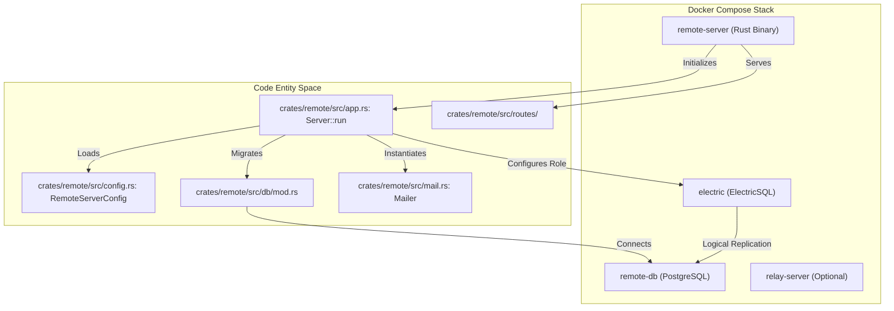
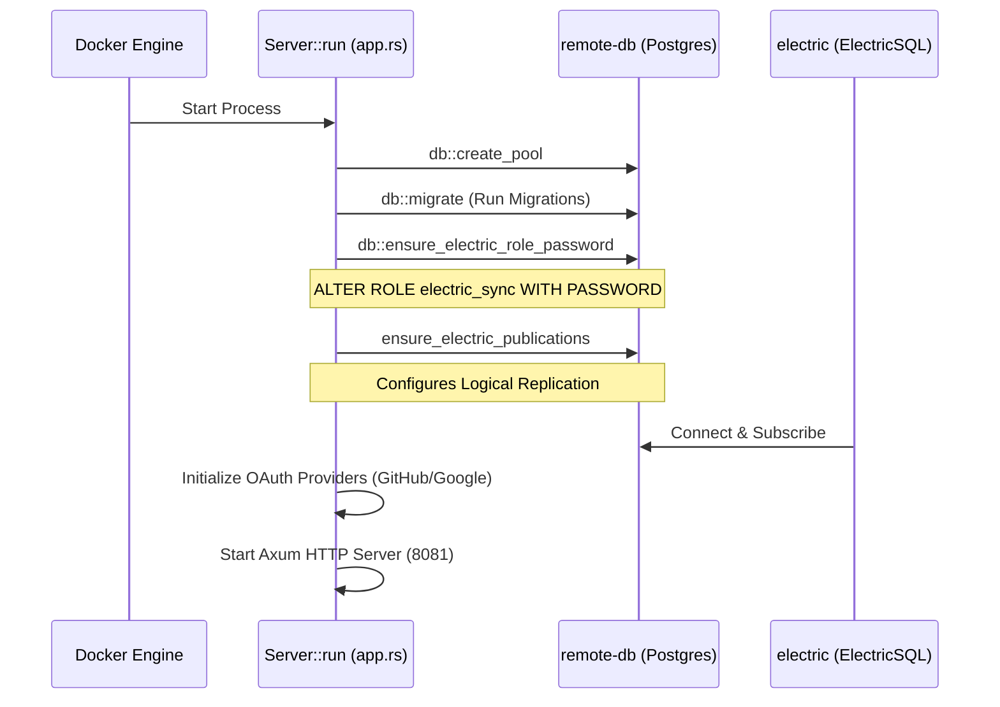

# Self-Hosting Guide

Relevant source files

The following files were used as context for generating this wiki page:

- [.dockerignore](.dockerignore)
- [Dockerfile](Dockerfile)
- [crates/api-types/src/notification.rs](crates/api-types/src/notification.rs)
- [crates/relay-tunnel/Dockerfile](crates/relay-tunnel/Dockerfile)
- [crates/remote/.sqlx/query-1d612faf67c945cfe22cfd7ab6b6d360fbce8dceb7b64c4d17b4df108434c822.json](crates/remote/.sqlx/query-1d612faf67c945cfe22cfd7ab6b6d360fbce8dceb7b64c4d17b4df108434c822.json)
- [crates/remote/.sqlx/query-1ea6478b8325ce0313727f756715c988d0c03ccb74a87e67325c73c03a5dcc33.json](crates/remote/.sqlx/query-1ea6478b8325ce0313727f756715c988d0c03ccb74a87e67325c73c03a5dcc33.json)
- [crates/remote/.sqlx/query-32388086083c01d21b0d4d052519a08002b82751e45aa59b3ac628cc96be2723.json](crates/remote/.sqlx/query-32388086083c01d21b0d4d052519a08002b82751e45aa59b3ac628cc96be2723.json)
- [crates/remote/.sqlx/query-3ef67cb768d55e4aa8d551401be7daa6c8a9c76a4218ce776d87db6e6d1c890c.json](crates/remote/.sqlx/query-3ef67cb768d55e4aa8d551401be7daa6c8a9c76a4218ce776d87db6e6d1c890c.json)
- [crates/remote/.sqlx/query-8123b99c8d0df1c3a39ae0b2e02b8f95e438dcaa7f85e4ad37a069d962ae2e39.json](crates/remote/.sqlx/query-8123b99c8d0df1c3a39ae0b2e02b8f95e438dcaa7f85e4ad37a069d962ae2e39.json)
- [crates/remote/Dockerfile](crates/remote/Dockerfile)
- [crates/remote/README.md](crates/remote/README.md)
- [crates/remote/docker-compose.yml](crates/remote/docker-compose.yml)
- [crates/remote/src/analytics.rs](crates/remote/src/analytics.rs)
- [crates/remote/src/app.rs](crates/remote/src/app.rs)
- [crates/remote/src/db/mod.rs](crates/remote/src/db/mod.rs)
- [crates/remote/src/lib.rs](crates/remote/src/lib.rs)
- [crates/remote/src/mail.rs](crates/remote/src/mail.rs)
- [docs/self-hosting/deploy-docker.mdx](docs/self-hosting/deploy-docker.mdx)
- [docs/self-hosting/local-development.mdx](docs/self-hosting/local-development.mdx)

This guide provides technical instructions for self-hosting the Vibe Kanban Cloud infrastructure. The self-hosted stack includes the remote server, a PostgreSQL database, and ElectricSQL for real-time synchronization.

## System Architecture

The self-hosted deployment relies on a containerized architecture managed via Docker Compose. The core components include the Rust-based `remote` server, which serves both the API and the pre-built React frontend, and supporting services for data persistence and real-time updates.

### Component Relationship

The following diagram illustrates how the self-hosted services interact and how they map to specific code entities within the `remote` crate.

**Diagram: Infrastructure to Code Mapping**

**Sources:**
- [crates/remote/docker-compose.yml:3-181]()
- [crates/remote/src/app.rs:27-55]()
- [crates/remote/src/db/mod.rs:34-46]()
- [crates/remote/src/mail.rs:38-59]()

---

## Configuration

Self-hosting is primarily configured via environment variables defined in a `.env.remote` file.

### Required Variables

| Variable | Description | Source |
| :--- | :--- | :--- |
| `VIBEKANBAN_REMOTE_JWT_SECRET` | Base64 string for signing authentication tokens. | [crates/remote/README.md:11]() |
| `SERVER_DATABASE_URL` | Connection string for the PostgreSQL instance. | [crates/remote/docker-compose.yml:97]() |
| `PUBLIC_BASE_URL` | The external URL where the service is accessible. | [crates/remote/docker-compose.yml:101]() |
| `ELECTRIC_ROLE_PASSWORD` | Password for the `electric_sync` database user. | [crates/remote/docker-compose.yml:100]() |

### Authentication Setup

Vibe Kanban requires at least one authentication provider. You can use GitHub OAuth, Google OAuth, or a "bootstrap" local account for initial setup.

1.  **OAuth Providers**: Requires registering an application in the provider's developer console and setting the callback URL to `${PUBLIC_BASE_URL}/v1/oauth/[provider]/callback`.
2.  **Local Auth**: Enabled by setting `SELF_HOST_LOCAL_AUTH_EMAIL` and `SELF_HOST_LOCAL_AUTH_PASSWORD`.

**Sources:**
- [crates/remote/src/app.rs:60-78]()
- [crates/remote/README.md:14-22]()
- [docs/self-hosting/local-development.mdx:24-54]()

---

## Deployment via Docker Compose

The `crates/remote/docker-compose.yml` file defines the standard production-ready stack.

### Service Definitions

*   **`remote-server`**: Built from `crates/remote/Dockerfile`. It uses a multi-stage build:
    1.  **fe-builder**: Compiles the `remote-web` React application using `pnpm`. [crates/remote/Dockerfile:8-34]()
    2.  **builder**: Compiles the Rust `remote` binary. It conditionally strips private billing dependencies if no specific features are requested via `sed` commands on `crates/remote/Cargo.toml`. [crates/remote/Dockerfile:36-103]()
    3.  **runtime**: A slim Debian image containing the binary and static assets. [crates/remote/Dockerfile:105-128]()
*   **`remote-db`**: A PostgreSQL 16 image configured with `wal_level=logical` to support ElectricSQL logical replication. [crates/remote/docker-compose.yml:4-10]()
*   **`electric`**: Handles real-time synchronization between the PostgreSQL backend and frontend clients. [crates/remote/docker-compose.yml:52-64]()

### Data Flow and Initialization

When the stack starts, the `remote-server` performs several initialization steps defined in `Server::run`:

**Diagram: Server Initialization Sequence**

**Sources:**
- [crates/remote/src/app.rs:33-55]()
- [crates/remote/src/db/mod.rs:84-115]()
- [crates/remote/docker-compose.yml:52-72]()

---

## Advanced Features

### Optional Profiles

The Docker Compose setup supports optional profiles for additional functionality:

*   **`relay`**: Starts the `relay-server` (from `crates/relay-tunnel/Dockerfile`) to allow remote access to local development environments via tunnels. [crates/remote/docker-compose.yml:159-180]()
*   **`attachments`**: Starts an `azurite` container to provide local S3-compatible blob storage for issue attachments. [crates/remote/docker-compose.yml:22-50]()

### Email Notifications

To enable email invitations and PR review notifications, a `LOOPS_EMAIL_API_KEY` must be provided. The system uses the `LoopsMailer` implementation to send transactional emails via the Loops.so API. If not provided, the system defaults to a `NoopMailer`.

**Sources:**
- [crates/remote/src/mail.rs:114-147]()
- [crates/remote/src/app.rs:95-110]()

### Storage Configuration

For production attachments, the system supports Azure Blob Storage and Cloudflare R2. Configuration is handled in `crates/remote/src/app.rs` which initializes `AzureBlobService` and `R2Service` based on environment variables.

**Sources:**
- [crates/remote/src/app.rs:118-134]()
- [crates/remote/src/azure_blob.rs:1-10]()
- [crates/remote/src/r2.rs:1-10]()

### Analytics and Monitoring

The self-hosted instance can be configured with PostHog for analytics and Sentry for error tracking. These are initialized during the build and runtime if keys are provided.

**Sources:**
- [crates/remote/src/analytics.rs:7-33]()
- [crates/remote/src/app.rs:171-182]()
- [crates/remote/Dockerfile:39-48]()