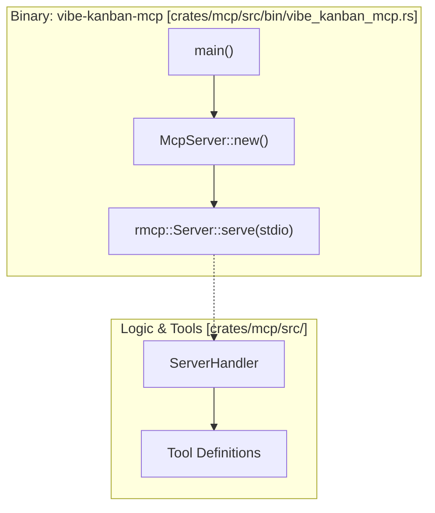
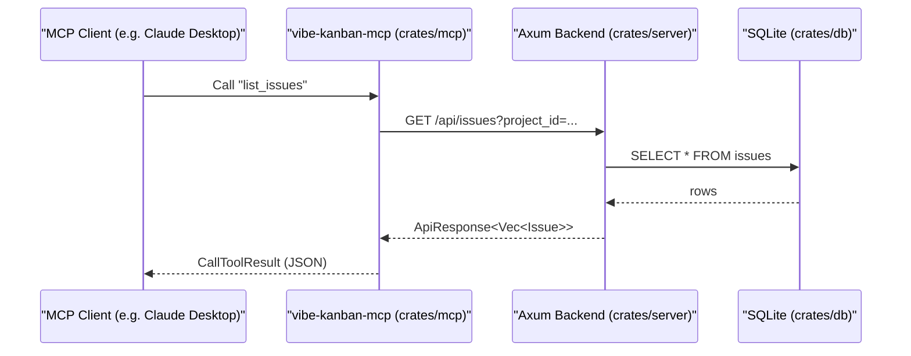

# Additional Tools

Relevant source files

The following files were used as context for generating this wiki page:

- [crates/executors/src/mcp_config.rs](crates/executors/src/mcp_config.rs)
- [crates/git-host/Cargo.toml](crates/git-host/Cargo.toml)
- [crates/mcp/Cargo.toml](crates/mcp/Cargo.toml)
- [docs/docs.json](docs/docs.json)
- [docs/images/vk-mcp-server-config.png](docs/images/vk-mcp-server-config.png)
- [docs/integrations/mcp-server-configuration.mdx](docs/integrations/mcp-server-configuration.mdx)
- [docs/integrations/vibe-kanban-mcp-server.mdx](docs/integrations/vibe-kanban-mcp-server.mdx)
- [docs/responsible-disclosure.mdx](docs/responsible-disclosure.mdx)
- [docs/supported-coding-agents.mdx](docs/supported-coding-agents.mdx)

This document covers standalone command-line tools and servers that complement the main Vibe Kanban application. These tools provide programmatic interfaces for external integrations and specialized workflows, allowing the Vibe Kanban ecosystem to interact with other AI assistants and terminal-based developer environments.

For information about configuring MCP servers **within** Vibe Kanban for use by coding agents, see [Settings and Configuration UI](#5.8) or the [Connecting MCP Servers guide](docs/integrations/mcp-server-configuration.mdx). This page focuses on the **MCP server exposed by Vibe Kanban** and other standalone tools.

---

## Overview

Vibe Kanban provides standalone tools that extend its functionality beyond the web interface:

| Tool | Command / Binary | Purpose | Reference |
|------|--------|---------|---------|
| **MCP Task Server** | `vibe-kanban-mcp` | Model Context Protocol server that enables external AI assistants (Claude Desktop, Raycast) to control Vibe Kanban | [crates/mcp/Cargo.toml:8-9]() |
| **Review CLI** | `review` | Command-line tool for code review workflows and artifact inspection | [crates/review/Cargo.toml:7-9]() |
| **VSCode Integration** | N/A | Extension-based integration for in-editor logs, diffs, and monitoring | [docs/integrations/vscode-extension.mdx:1-10]() |

Both tools are separate binaries that interact with the main Vibe Kanban server, leveraging shared types and utilities for API communication.

**Sources:** [crates/mcp/Cargo.toml:1-33](), [docs/docs.json:115-117]()

---

## MCP Task Server Architecture

The MCP Task Server (`vibe-kanban-mcp`) is a local-only Model Context Protocol server [docs/integrations/vibe-kanban-mcp-server.mdx:12-14](). It allows external clients to manage organizations, projects, issues, and workspaces via standardized tools.

### Binary Entry Point and Initialization

The MCP server is defined as a binary in the `mcp` crate [crates/mcp/Cargo.toml:7-9](). It depends on the `rmcp` library to handle the server-side protocol and transport [crates/mcp/Cargo.toml:26](). The server can be launched manually using `npx vibe-kanban@latest --mcp` [docs/integrations/vibe-kanban-mcp-server.mdx:46-48]().

**Vibe Kanban MCP Startup Flow**

**Sources:** [crates/mcp/Cargo.toml:8-26](), [docs/integrations/vibe-kanban-mcp-server.mdx:42-54]()

### Available MCP Tools

The server exposes a wide array of tools that map to Vibe Kanban's backend services. These include `get_context` for workspace metadata, `list_organizations`, and comprehensive `Issue` management tools [docs/integrations/vibe-kanban-mcp-server.mdx:63-134]().

**MCP to Backend API Bridge**

**Sources:** [docs/integrations/vibe-kanban-mcp-server.mdx:86-121](), [crates/mcp/Cargo.toml:15-17]()

For a deep dive into the MCP implementation, see **[MCP Task Server](#8.1)**.

---

## Review CLI Tool

The Review CLI is a specialized tool designed to streamline code review processes. It is built using `clap` for command-line argument parsing and `reqwest` for communicating with the Vibe Kanban backend.

### Key Capabilities
- **Artifact Inspection**: Handles compressed review artifacts generated during agent executions.
- **Interactive Prompts**: Utilizes terminal interactions during reviews to approve or reject changes.
- **Workflow Integration**: Bridges the gap between the web-based Kanban board and the local terminal environment.

For details on usage and commands, see **[Review CLI Tool](#8.2)**.

---

## VSCode Extension Integration

Vibe Kanban integrates with Visual Studio Code to provide a seamless transition between the AI agent's execution and the developer's primary editor.

- **Log Streaming**: View real-time output from `ExecutionProcess` directly in VSCode output channels.
- **Diff Management**: Review file changes proposed by executors within the VSCode diff editor.
- **Process Monitoring**: Start and stop workspace sessions from the editor.

For details on setting up the extension, see **[VSCode Extension Integration](#8.3)**.

---

## Shared Infrastructure

To ensure these additional tools can communicate with the main Vibe Kanban application without manual configuration, the system shares logic and types across crates.

- **API Types**: The MCP server uses the `api-types` crate to ensure request/response schemas match the backend [crates/mcp/Cargo.toml:15]().
- **Agent Config**: The `executors` crate provides `mcp_config.rs`, which contains utilities for reading and writing agent configuration files in JSON, TOML, or JSONC formats [crates/executors/src/mcp_config.rs:1-4]().
- **JSONC Preservation**: The `update_jsonc_content` function ensures that when updating agent configs (like Claude Code or Cursor), user comments are preserved [crates/executors/src/mcp_config.rs:120-131]().

**Sources:** [crates/mcp/Cargo.toml:15-18](), [crates/executors/src/mcp_config.rs:8-15]()