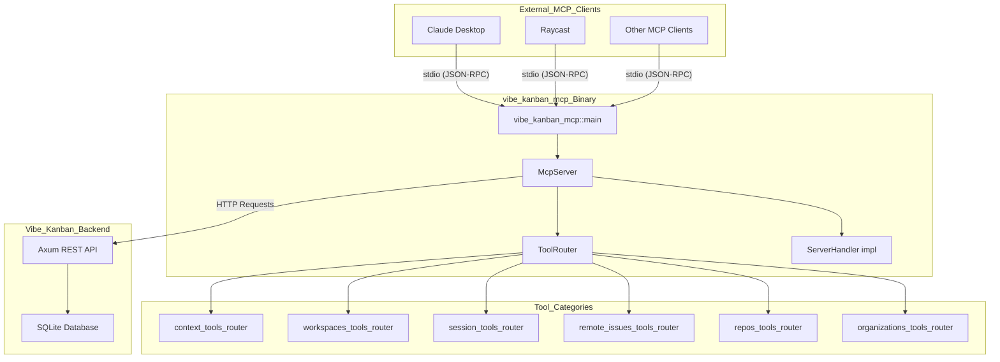
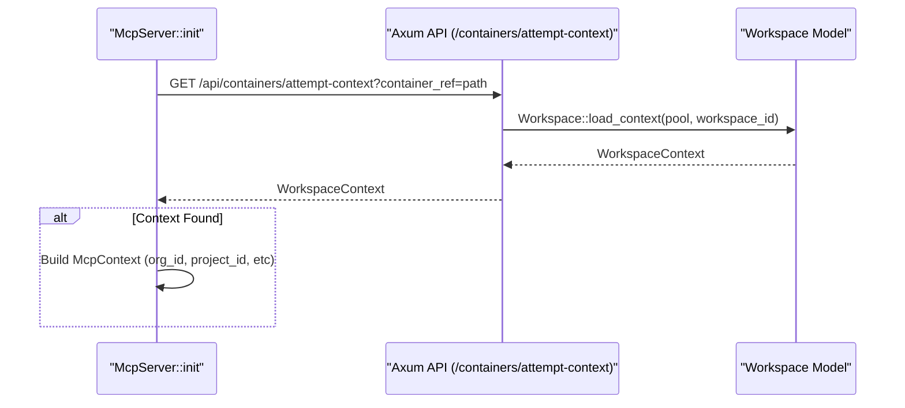
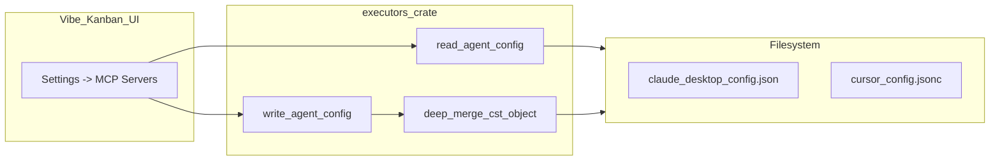
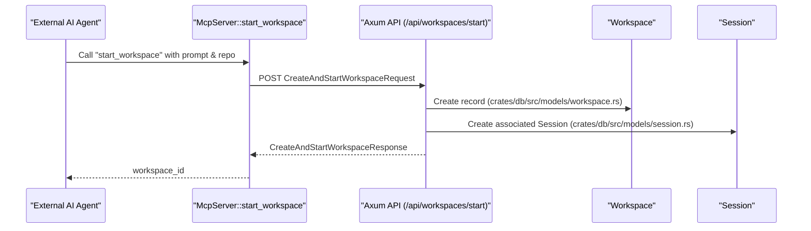

# MCP Task Server

<details>
<summary>Relevant source files</summary>

The following files were used as context for generating this wiki page:

- [crates/executors/src/mcp_config.rs](crates/executors/src/mcp_config.rs)
- [crates/git-host/Cargo.toml](crates/git-host/Cargo.toml)
- [crates/mcp/Cargo.toml](crates/mcp/Cargo.toml)
- [crates/mcp/src/task_server/handler.rs](crates/mcp/src/task_server/handler.rs)
- [crates/mcp/src/task_server/tools/issue_assignees.rs](crates/mcp/src/task_server/tools/issue_assignees.rs)
- [crates/mcp/src/task_server/tools/issue_relationships.rs](crates/mcp/src/task_server/tools/issue_relationships.rs)
- [crates/mcp/src/task_server/tools/issue_tags.rs](crates/mcp/src/task_server/tools/issue_tags.rs)
- [crates/mcp/src/task_server/tools/mod.rs](crates/mcp/src/task_server/tools/mod.rs)
- [crates/mcp/src/task_server/tools/organizations.rs](crates/mcp/src/task_server/tools/organizations.rs)
- [crates/mcp/src/task_server/tools/remote_issues.rs](crates/mcp/src/task_server/tools/remote_issues.rs)
- [crates/mcp/src/task_server/tools/remote_projects.rs](crates/mcp/src/task_server/tools/remote_projects.rs)
- [crates/mcp/src/task_server/tools/repos.rs](crates/mcp/src/task_server/tools/repos.rs)
- [crates/mcp/src/task_server/tools/sessions.rs](crates/mcp/src/task_server/tools/sessions.rs)
- [crates/mcp/src/task_server/tools/task_attempts.rs](crates/mcp/src/task_server/tools/task_attempts.rs)
- [crates/mcp/src/task_server/tools/workspaces.rs](crates/mcp/src/task_server/tools/workspaces.rs)
- [docs/docs.json](docs/docs.json)
- [docs/images/vk-mcp-server-config.png](docs/images/vk-mcp-server-config.png)
- [docs/integrations/mcp-server-configuration.mdx](docs/integrations/mcp-server-configuration.mdx)
- [docs/integrations/vibe-kanban-mcp-server.mdx](docs/integrations/vibe-kanban-mcp-server.mdx)
- [docs/responsible-disclosure.mdx](docs/responsible-disclosure.mdx)
- [docs/supported-coding-agents.mdx](docs/supported-coding-agents.mdx)

</details>


The MCP Task Server is a Model Context Protocol (MCP) server implementation that exposes Vibe Kanban's functionality to external AI assistants such as Claude Desktop, Raycast, or other MCP-compatible clients. It provides a programmatic interface for creating and managing workspaces, sessions, issues, repositories, and other Vibe Kanban entities through standardized MCP tools.

For information about configuring MCP servers **within** Vibe Kanban for use by coding agents, see the [MCP Server Configuration](/integrations/mcp-server-configuration) guide. This page covers the standalone MCP server that allows external clients to control Vibe Kanban itself.

## Architecture Overview

The MCP server is implemented as a standalone Rust binary `vibe-kanban-mcp` [crates/mcp/src/bin/vibe_kanban_mcp.rs:1-10]() that communicates with the Vibe Kanban backend via REST API. It operates in stdio mode, accepting JSON-RPC requests from MCP clients and translating them into API calls.

Title: "MCP Server Architecture and Data Flow"


Sources: [crates/mcp/src/task_server/handler.rs:9-11](), [crates/mcp/src/task_server/tools/mod.rs:51-74](), [docs/integrations/vibe-kanban-mcp-server.mdx:6-14]()

## Server Modes

The MCP server operates in one of two modes, determined at startup via command-line arguments:

### Global Mode

Global Mode provides unrestricted access to all MCP tools, allowing clients to manage any workspace, issue, or repository. This is the default mode.

**Initialization:**
```bash
npx vibe-kanban --mcp --mode global
```

**Available Tools:** All tools from all routers are exposed, including administrative tools like `list_workspaces` and `delete_workspace` [crates/mcp/src/task_server/tools/mod.rs:52-64]().

### Orchestrator Mode

Orchestrator Mode restricts the server to operate within the context of a specific workspace and session. The server automatically discovers workspace context from the current working directory and exposes only tools relevant to that workspace's workflow.

**Initialization:**
```bash
npx vibe-kanban --mcp --mode orchestrator
```

**Restricted Tools:** Administrative tools like `list_workspaces` and `delete_workspace` are explicitly removed from the router [crates/mcp/src/task_server/tools/mod.rs:70-71]().

| Mode | Use Case | Tool Access | Context Discovery |
|------|----------|-------------|-------------------|
| `Global` | External MCP clients managing multiple workspaces | Full access to all tools | Optional - provides context if running inside workspace |
| `Orchestrator` | Coding agents within a workspace session | Scoped to workspace operations only | Required - fails if no workspace context found |

Sources: [crates/mcp/src/task_server/handler.rs:20-27](), [crates/mcp/src/task_server/tools/mod.rs:66-73](), [docs/integrations/vibe-kanban-mcp-server.mdx:42-53]()

## Context Resolution and Workspace Discovery

At startup, the MCP server attempts to discover workspace context. This context enriches tool responses and enables workspace-scoped operations.

Title: "Context Resolution Sequence"


Sources: [crates/mcp/src/task_server/tools/context.rs:1-14]()

### McpContext and Tool Scoping

The server uses helper methods to resolve and validate workspace scope:

- **`resolve_workspace_id`**: Returns the explicit ID if provided, otherwise falls back to the scoped workspace ID from the context [crates/mcp/src/task_server/tools/mod.rs:177-187]().
- **`scope_allows_workspace`**: In `Orchestrator` mode, this ensures the requested operation is within the configured workspace scope [crates/mcp/src/task_server/tools/mod.rs:189-204]().

Sources: [crates/mcp/src/task_server/tools/mod.rs:177-204]()

## Tool Organization

Tools are organized into separate modules and combined using the `ToolRouter` composition pattern [crates/mcp/src/task_server/tools/mod.rs:39-49]().

Title: "MCP Tool Router Composition"

```mermaid
graph TB
    GlobalRouter["global_mode_router()"]
    OrchestratorRouter["orchestrator_mode_router()"]
    
    subgraph "Tool_Router_Modules"
        ContextRouter["context_tools_router"]
        WorkspacesRouter["workspaces_tools_router"]
        SessionsRouter["session_tools_router"]
        OrgsRouter["organizations_tools_router"]
        ReposRouter["repos_tools_router"]
        ProjectsRouter["remote_projects_tools_router"]
        IssuesRouter["remote_issues_tools_router"]
        AssigneesRouter["issue_assignees_tools_router"]
        TagsRouter["issue_tags_tools_router"]
        RelationsRouter["issue_relationships_tools_router"]
        AttemptsRouter["task_attempts_tools_router"]
    end
    
    GlobalRouter --> ContextRouter
    GlobalRouter --> WorkspacesRouter
    GlobalRouter --> SessionsRouter
    GlobalRouter --> OrgsRouter
    GlobalRouter --> ReposRouter
    GlobalRouter --> ProjectsRouter
    GlobalRouter --> IssuesRouter
    GlobalRouter --> AssigneesRouter
    GlobalRouter --> TagsRouter
    GlobalRouter --> RelationsRouter
    GlobalRouter --> AttemptsRouter
    
    OrchestratorRouter --> ContextRouter
    OrchestratorRouter --> WorkspacesRouter
    OrchestratorRouter --> SessionsRouter
```


Sources: [crates/mcp/src/task_server/tools/mod.rs:51-74]()

### Communication with Backend API

The MCP server communicates with the Vibe Kanban backend through HTTP requests. All requests are wrapped in helper methods that handle serialization and error conversion.

- **`send_json<T>`**: Sends a request and deserializes the response into an `ApiResponseEnvelope<T>` [crates/mcp/src/task_server/tools/mod.rs:113-144]().
- **`send_empty_json`**: Sends a request and expects a success/failure indicator without a data payload [crates/mcp/src/task_server/tools/mod.rs:146-175]().

Sources: [crates/mcp/src/task_server/tools/mod.rs:113-175]()

## Key Tool Categories

### Workspace Management
Enables listing, updating, and deleting workspaces. The `list_workspaces` tool supports filtering by `archived`, `pinned`, `branch`, and `name_search` [crates/mcp/src/task_server/tools/workspaces.rs:102-167]().

### Issue Management
Comprehensive tools for managing remote issues, including:
- **`list_issues`**: Supports extensive filtering (status, priority, assignee, tags) [crates/mcp/src/task_server/tools/remote_issues.rs:42-75]().
- **`create_issue`**: Creates issues in specific projects [crates/mcp/src/task_server/tools/remote_issues.rs:19-34]().
- **`get_issue`**: Returns full details including PRs, tags, and sub-issues [crates/mcp/src/task_server/tools/remote_issues.rs:154-188]().
- **`create_issue_relationship`**: Links issues with types like `blocking`, `related`, or `has_duplicate` [crates/mcp/src/task_server/tools/issue_relationships.rs:47-72]().

### Task and Workspace Execution
The `start_workspace` tool creates a new workspace and immediately starts its first session with a specified executor (e.g., `CLAUDE_CODE`, `GEMINI`) [crates/mcp/src/task_server/tools/task_attempts.rs:94-206](). It can also link the workspace to an existing remote issue [crates/mcp/src/task_server/tools/task_attempts.rs:151-167]().

### Session Interaction
- **`create_session`**: Starts a new agent session in a `Workspace` [crates/mcp/src/task_server/tools/sessions.rs:146-191]().
- **`run_coding_agent_in_session`**: Sends a prompt to an active coding agent via the `/api/sessions/follow-up` endpoint [crates/mcp/src/task_server/tools/sessions.rs:223-272]().
- **`get_execution`**: Polls the status of an `ExecutionProcess` [crates/mcp/src/task_server/tools/sessions.rs:296-332]().

Sources: [crates/mcp/src/task_server/tools/workspaces.rs:100-206](), [crates/mcp/src/task_server/tools/remote_issues.rs:11-188](), [crates/mcp/src/task_server/tools/task_attempts.rs:92-206](), [crates/mcp/src/task_server/tools/sessions.rs:143-332]()

## Agent Configuration Management

The system provides utilities for managing the MCP configuration files of various coding agents (e.g., Claude Desktop, Cursor). This is handled in the `executors` crate, which supports JSON, TOML, and JSONC (JSON with comments) formats [crates/executors/src/mcp_config.rs:1-6]().

- **`read_agent_config`**: Loads the configuration from disk, handling different file extensions and formats [crates/executors/src/mcp_config.rs:59-86]().
- **`write_agent_config`**: Persists updates to agent configurations while attempting to preserve comments in JSONC files via `deep_merge_cst_object` [crates/executors/src/mcp_config.rs:88-104](), [crates/executors/src/mcp_config.rs:135-163]().

Title: "Agent MCP Configuration Flow"


Sources: [crates/executors/src/mcp_config.rs:59-163](), [docs/integrations/mcp-server-configuration.mdx:15-32]()

## Data Flow: Starting a Task via MCP

The following diagram illustrates the flow from a Natural Language request to the creation of code entities in the backend.

Title: "MCP Task Initiation Data Flow"


Sources: [crates/mcp/src/task_server/tools/task_attempts.rs:179-206](), [crates/db/src/models/session.rs:1-10]()

## Error Handling

The server uses a custom `ToolError` struct to capture error messages and optional details [crates/mcp/src/task_server/tools/mod.rs:19-37](). Errors from the backend API are converted into MCP-compatible error responses using the `tool_error` helper [crates/mcp/src/task_server/tools/mod.rs:98-111]().

Sources: [crates/mcp/src/task_server/tools/mod.rs:19-111]()