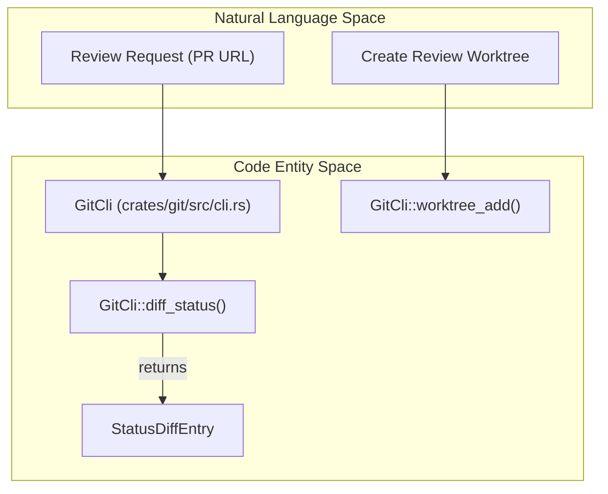
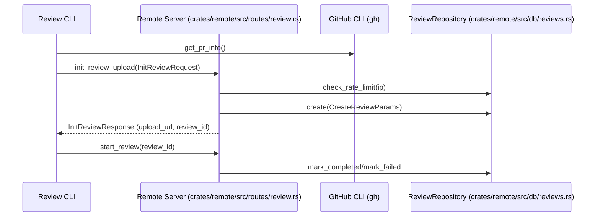
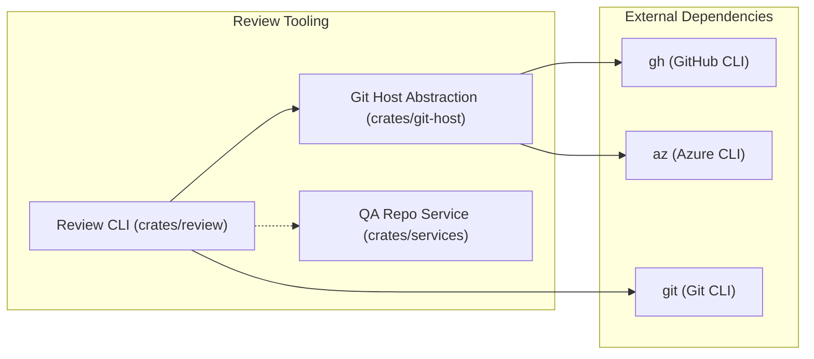

# Review CLI Tool

Relevant source files

The following files were used as context for generating this wiki page:

- [.github/actions/setup-jsign/action.yml](.github/actions/setup-jsign/action.yml)
- [crates/git-host/src/azure/cli.rs](crates/git-host/src/azure/cli.rs)
- [crates/git-host/src/github/cli.rs](crates/git-host/src/github/cli.rs)
- [crates/git/src/cli.rs](crates/git/src/cli.rs)
- [crates/remote/.sqlx/query-7373b3a43a7dd6c5d77c13b5094bb01a63e2902a89dec683659644dd80eb6990.json](crates/remote/.sqlx/query-7373b3a43a7dd6c5d77c13b5094bb01a63e2902a89dec683659644dd80eb6990.json)
- [crates/remote/src/config.rs](crates/remote/src/config.rs)
- [crates/remote/src/db/reviews.rs](crates/remote/src/db/reviews.rs)
- [crates/remote/src/routes/github_app.rs](crates/remote/src/routes/github_app.rs)
- [crates/remote/src/routes/review.rs](crates/remote/src/routes/review.rs)
- [crates/review/src/github.rs](crates/review/src/github.rs)
- [crates/services/src/services/qa_repos.rs](crates/services/src/services/qa_repos.rs)
- [crates/tauri-app/msi-template.wxs](crates/tauri-app/msi-template.wxs)
- [scripts/build-tauri-msi.js](scripts/build-tauri-msi.js)

## Purpose and Scope

The `review` tool is a command-line utility within the Vibe Kanban ecosystem designed to facilitate code review workflows, particularly those triggered by AI agents or external webhooks. It allows developers to interact with pull request (PR) data, clone repositories for inspection, and manage review artifacts (like tarball snapshots) that are processed by the Vibe Kanban backend and AI workers. It also provides a bridge for local environments to utilize the same review logic used by the remote services, including rate-limited uploads and status tracking.

**Sources:** [crates/review/src/github.rs:1-19](), [crates/git/src/cli.rs:1-17](), [crates/remote/src/routes/review.rs:21-32]()

---

## Overview

The Review CLI serves as a bridge between the local development environment and the Vibe Kanban remote services. It provides mechanisms to parse GitHub PR URLs, fetch metadata, and prepare codebases for AI-assisted reviews. It is used both as a standalone tool for developers and as a component in automated workflows. The tool leverages the system's `git` CLI for reliable working-tree mutations and the GitHub `gh` CLI for repository metadata. In remote deployments, it interacts with the `ReviewRepository` to track the lifecycle of review objects stored in R2 or Azure Blob storage.

**Sources:** [crates/review/src/github.rs:52-88](), [crates/git/src/cli.rs:14-17](), [crates/review/src/github.rs:147-199](), [crates/remote/src/db/reviews.rs:69-77]()

---

## Core Logic and Implementation

### GitHub Integration and Metadata Fetching

The CLI interacts with GitHub primarily through the `gh` CLI. This ensures that authentication is handled by the user's existing environment and provides access to fields like `baseRefOid` and `headRefOid`.

| Component | Role | Key Functionality |
|:---|:---|:---|
| `parse_pr_url` | URL Parser | Extracts owner, repo, and PR number from GitHub URLs [crates/review/src/github.rs:52-88](). |
| `get_pr_info` | Metadata Fetcher | Uses `gh pr view --json` to retrieve PR titles, bodies, and commit SHAs [crates/review/src/github.rs:147-199](). |
| `get_pr_info_via_api` | Fallback Fetcher | Uses `gh api` for older CLI versions that don't support specific JSON fields [crates/review/src/github.rs:108-144](). |
| `clone_repo` | Repo Manager | Uses `gh repo clone` to bring the codebase local for analysis [crates/review/src/github.rs:202-226](). |

**Sources:** [crates/review/src/github.rs:52-199](), [crates/review/src/github.rs:202-226]()

### Git CLI Operations

The review tool relies on a specialized `GitCli` wrapper rather than `libgit2` for destructive operations. This is due to the CLI's superior handling of sparse-checkouts and cross-platform stability (specifically WSL/Windows interoperability).

**Diagram: Git Operation Mapping**

- **`worktree_add`**: Creates isolated environments for reviews without clobbering the main development branch [crates/git/src/cli.rs:85-108]().
- **`diff_status`**: Generates a list of changes (`StatusDiffEntry`) between the PR head and the base commit using a temporary index file to track renames and untracked files accurately [crates/git/src/cli.rs:168-185]().

**Sources:** [crates/git/src/cli.rs:1-17](), [crates/git/src/cli.rs:85-108](), [crates/git/src/cli.rs:168-185]()

---

## Remote and Local Review Workflows

The system supports both local review preparation and remote service integration. For remote reviews, the backend utilizes the `ReviewRepository` and `R2Config` or `AzureBlobConfig` to manage the storage and state of review artifacts.

### Review Lifecycle Sequence

**Diagram: Review Initialization and Backend Integration**

1.  **URL Parsing**: The CLI validates the PR URL and extracts identifiers [crates/review/src/github.rs:52-88]().
2.  **Rate Limiting**: The remote server enforces limits (e.g., 2 per minute, 20 per hour) based on the client's IP address extracted from headers like `CF-Connecting-IP` or `X-Forwarded-For` [crates/remote/src/routes/review.rs:146-177](), [crates/remote/src/routes/review.rs:181-199]().
3.  **Storage Config**: Reviews are uploaded to object storage configured via `R2Config` or `AzureBlobConfig` [crates/remote/src/config.rs:26-32](), [crates/remote/src/config.rs:81-90]().
4.  **Database Persistence**: The `ReviewRepository` tracks the `status`, `gh_pr_url`, and `r2_path` for each review session [crates/remote/src/db/reviews.rs:19-37]().

**Sources:** [crates/remote/src/routes/review.rs:181-205](), [crates/remote/src/db/reviews.rs:78-115](), [crates/remote/src/config.rs:25-90]()

---

## Host-Specific Implementations

The review logic is abstracted via the `git-host` crate to support multiple Git hosts, primarily GitHub and Azure DevOps.

| Host | CLI Tool | Implementation Detail |
|:---|:---|:---|
| **GitHub** | `gh` | Supports JSON output for PR details and repository views via `GhCli` [crates/git-host/src/github/cli.rs:135-202](). |
| **Azure DevOps** | `az` | Uses `az repos` for PR list and thread (comment) management via `AzCli` [crates/git-host/src/azure/cli.rs:127-216](). |

### Azure Integration
The `AzCli` helper manages authentication checks by looking for strings like "az login" or "not logged in" in the stderr output of command executions [crates/git-host/src/azure/cli.rs:170-180](). It extracts organization URLs and project IDs to uniquely identify the review context [crates/git-host/src/azure/cli.rs:218-241]().

**Sources:** [crates/git-host/src/github/cli.rs:135-202](), [crates/git-host/src/azure/cli.rs:127-138](), [crates/git-host/src/azure/cli.rs:170-241]()

---

## Architecture and Tooling

The tool is part of a larger ecosystem of standalone binaries and services that complement the Vibe Kanban server.

**Diagram: Review CLI System Context**

### Key Components
- **`GitCli`**: Centralizes all destructive working-tree operations to ensure safety and correctness [crates/git/src/cli.rs:14-17]().
- **`PrInfo`**: An internal structure used to pass PR metadata (owner, repo, SHAs) between functions [crates/review/src/github.rs:11-19]().
- **`QA Repos`**: For testing and QA mode, the system can bypass standard discovery and use hardcoded repositories (`internal-qa-1`, `internal-qa-2`) cloned to a persistent temp directory [crates/services/src/services/qa_repos.rs:15-28]().
- **`Review` Model**: Represents the persistent state of a review in the PostgreSQL database, including webhook-specific fields like `github_installation_id` [crates/remote/src/db/reviews.rs:19-37]().

**Sources:** [crates/git/src/cli.rs:14-17](), [crates/review/src/github.rs:11-19](), [crates/services/src/services/qa_repos.rs:1-28](), [crates/remote/src/db/reviews.rs:19-37]()