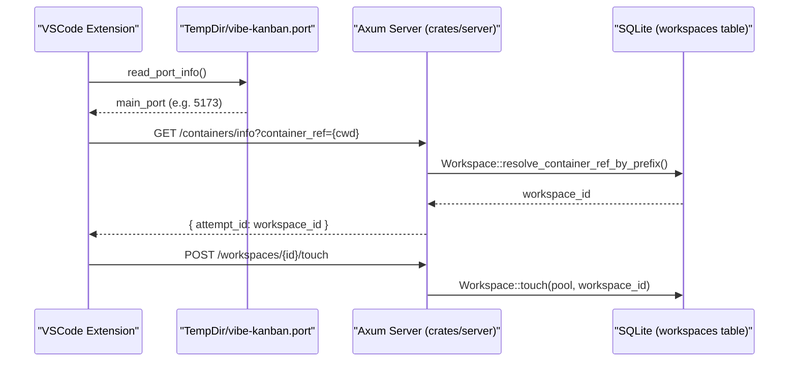
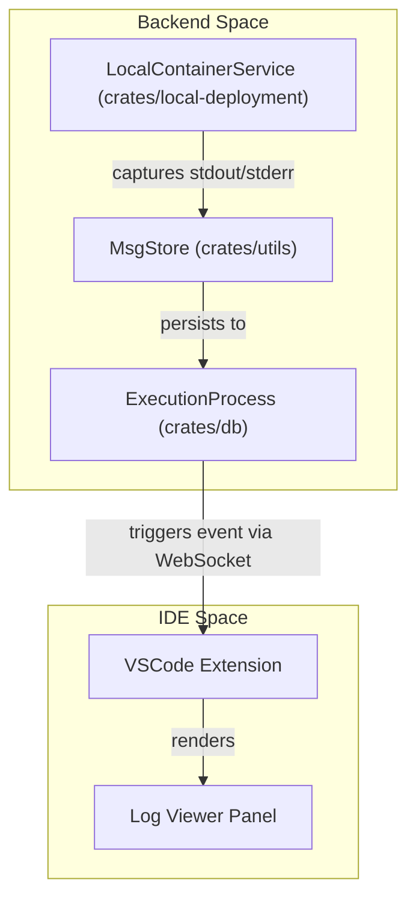

# VSCode Extension Integration

Relevant source files

The following files were used as context for generating this wiki page:

- [crates/db/.sqlx/query-1b186dc075846fc1f7270a942afbf82a88806ee6ababdb437ab5e97ddd2122da.json](crates/db/.sqlx/query-1b186dc075846fc1f7270a942afbf82a88806ee6ababdb437ab5e97ddd2122da.json)
- [crates/db/.sqlx/query-2a57b702e52b3cc9bdbc361267985958b11d4493b01a9ab8daedf5d951422897.json](crates/db/.sqlx/query-2a57b702e52b3cc9bdbc361267985958b11d4493b01a9ab8daedf5d951422897.json)
- [crates/db/.sqlx/query-f584dbe0f2f2a4f1e7dcf5b8f675eb2a6d954bb3f148ac0fece10652f05fb49b.json](crates/db/.sqlx/query-f584dbe0f2f2a4f1e7dcf5b8f675eb2a6d954bb3f148ac0fece10652f05fb49b.json)
- [crates/db/src/models/execution_process.rs](crates/db/src/models/execution_process.rs)
- [crates/db/src/models/workspace.rs](crates/db/src/models/workspace.rs)
- [crates/local-deployment/src/container.rs](crates/local-deployment/src/container.rs)
- [crates/server/src/routes/containers.rs](crates/server/src/routes/containers.rs)
- [crates/services/src/services/container.rs](crates/services/src/services/container.rs)
- [crates/utils/src/port_file.rs](crates/utils/src/port_file.rs)
- [packages/ui/src/components/SessionChatBox.tsx](packages/ui/src/components/SessionChatBox.tsx)
- [packages/ui/src/components/TurnNavigationPopup.tsx](packages/ui/src/components/TurnNavigationPopup.tsx)
- [packages/web-core/src/features/workspace-chat/model/conversation-scroll-commands.ts](packages/web-core/src/features/workspace-chat/model/conversation-scroll-commands.ts)
- [packages/web-core/src/features/workspace-chat/model/useConversationVirtualizer.ts](packages/web-core/src/features/workspace-chat/model/useConversationVirtualizer.ts)
- [packages/web-core/src/features/workspace-chat/model/useScrollCommandExecutor.ts](packages/web-core/src/features/workspace-chat/model/useScrollCommandExecutor.ts)
- [packages/web-core/src/features/workspace-chat/ui/ConversationListContainer.tsx](packages/web-core/src/features/workspace-chat/ui/ConversationListContainer.tsx)
- [packages/web-core/src/features/workspace-chat/ui/forwardWheelToScroller.ts](packages/web-core/src/features/workspace-chat/ui/forwardWheelToScroller.ts)
- [packages/web-core/src/pages/kanban/ProjectRightSidebarContainer.tsx](packages/web-core/src/pages/kanban/ProjectRightSidebarContainer.tsx)
- [packages/web-core/src/pages/workspaces/VSCodeWorkspacePage.tsx](packages/web-core/src/pages/workspaces/VSCodeWorkspacePage.tsx)
- [packages/web-core/src/pages/workspaces/WorkspacesMainContainer.tsx](packages/web-core/src/pages/workspaces/WorkspacesMainContainer.tsx)

The Vibe Kanban VSCode extension provides a bridge between the local IDE environment and the Vibe Kanban backend. It allows developers to monitor AI agent progress, view real-time logs, and inspect diffs directly within VSCode while the backend manages isolated workspaces and execution processes.

## Overview and Purpose

The integration is designed to synchronize the IDE's state with the backend's active workspaces. It enables:
- **Workspace Discovery**: Automatically detecting which Vibe Kanban workspace corresponds to the currently open folder in VSCode [crates/server/src/routes/containers.rs:52-54]().
- **Process Monitoring**: Displaying the status and logs of active `ExecutionProcess` entities [crates/db/src/models/execution_process.rs:62-78]().
- **Integrated Chat**: Providing a specialized view of the session chat tailored for the IDE [packages/web-core/src/pages/workspaces/VSCodeWorkspacePage.tsx:83-101]().

## Backend Integration Points

The backend exposes specific REST endpoints and file-system markers to facilitate the extension's functionality.

### Workspace Resolution
The extension identifies the active workspace by querying the `/containers/info` endpoint. This endpoint maps a directory path (container reference) to a Vibe Kanban `Workspace` ID [crates/server/src/routes/containers.rs:23-35]().

| Endpoint | Method | Purpose |
| :--- | :--- | :--- |
| `/containers/info` | `GET` | Resolves a container reference prefix to a `workspace_id` [crates/server/src/routes/containers.rs:55-55](). |
| `/containers/attempt-context` | `GET` | Retrieves full `WorkspaceContext`, including repository mappings and session IDs [crates/server/src/routes/containers.rs:37-48](). |

### Port Discovery
To connect to the local Vibe Kanban server, the extension reads a `.port` file stored in the system's temporary directory. This file contains the dynamically assigned ports for the main API and the preview proxy [crates/utils/src/port_file.rs:13-29]().

### Workspace Activity Tracking
The extension signals to the backend that a workspace is actively being used in an editor by calling the `touch` method. This updates the `updated_at` timestamp in the `workspaces` table, preventing the `LocalContainerService` from automatically cleaning up the workspace worktree [crates/db/src/models/workspace.rs:182-192](), [crates/local-deployment/src/container.rs:130-130]().

### Data Flow: IDE to Backend
The following diagram illustrates how the VSCode Extension discovers the backend and associates the local filesystem with a database workspace.

**Workspace Discovery and Synchronization**

Sources: [crates/utils/src/port_file.rs:35-55](), [crates/server/src/routes/containers.rs:23-35](), [crates/db/src/models/workspace.rs:184-192]()

## Execution and Log Monitoring

The extension monitors `ExecutionProcess` entities to provide real-time feedback within the IDE.

### Process Lifecycle
Processes are tracked via the `ExecutionProcessStatus` enum. The extension filters for processes related to the active session [crates/db/src/models/execution_process.rs:43-48]().

- **Running**: The process is currently executing (e.g., a `CodingAgent` or `SetupScript`) [crates/db/src/models/execution_process.rs:53-59]().
- **Completed/Failed/Killed**: Terminal states that trigger UI updates in the extension's process list [crates/db/src/models/execution_process.rs:45-47]().

### Log Capture
Logs are captured by the `LocalContainerService` using `db_stream_handles` [crates/local-deployment/src/container.rs:77-77](). The backend manages these via `MsgStore` instances mapped to specific execution IDs [crates/local-deployment/src/container.rs:74-74]().

**Process Log Integration**

Sources: [crates/local-deployment/src/container.rs:72-78](), [crates/services/src/services/container.rs:89-91](), [crates/db/src/models/execution_process.rs:62-78]()

## Frontend Integration: VSCodeWorkspacePage

The extension hosts a specialized webview component, `VSCodeWorkspacePage`, which provides a optimized UI for the IDE sidebar or editor panel [packages/web-core/src/pages/workspaces/VSCodeWorkspacePage.tsx:83-83]().

### Features and Constraints
- **Bridge Integration**: Installs a keyboard and clipboard bridge to ensure the webview behaves like a native IDE component [packages/web-core/src/pages/workspaces/VSCodeWorkspacePage.tsx:1-2]().
- **Theme Sync**: Uses `useStyleOverrideThemeSetter` to synchronize the Vibe Kanban UI colors with the user's VSCode theme [packages/web-core/src/pages/workspaces/VSCodeWorkspacePage.tsx:85-85]().
- **Context Menu**: Implements `WebviewContextMenu` to provide native-feeling right-click actions [packages/web-core/src/pages/workspaces/VSCodeWorkspacePage.tsx:175-175]().
- **Scroll Synchronization**: Automatically adjusts scroll positions when the chat input or other UI elements resize, ensuring the user stays at the bottom of the conversation [packages/web-core/src/pages/workspaces/VSCodeWorkspacePage.tsx:148-163]().

### Component Hierarchy
The VSCode-specific view wraps the core chat components but disables certain web-only features:
- `VSCodeChatBox`: A wrapper around `SessionChatBoxContainer` that sets `disableViewCode` to true (as the code is already visible in the IDE) [packages/web-core/src/pages/workspaces/VSCodeWorkspacePage.tsx:26-81]().
- `ConversationList`: Handles the virtualization and rendering of log entries and agent turns [packages/web-core/src/pages/workspaces/VSCodeWorkspacePage.tsx:210-214]().

| Component | File Path | Role |
| :--- | :--- | :--- |
| `LocalContainerService` | `crates/local-deployment/src/container.rs` | Manages the actual shell processes and log capture [crates/local-deployment/src/container.rs:69-88](). |
| `ExecutionProcess` | `crates/db/src/models/execution_process.rs` | The data model representing an active or past execution [crates/db/src/models/execution_process.rs:62-78](). |
| `VSCodeWorkspacePage` | `packages/web-core/src/pages/workspaces/VSCodeWorkspacePage.tsx` | The entry point for the VSCode webview UI [packages/web-core/src/pages/workspaces/VSCodeWorkspacePage.tsx:83-83](). |

Sources: [crates/local-deployment/src/container.rs:1-133](), [crates/server/src/routes/containers.rs:1-58](), [crates/db/src/models/execution_process.rs:1-145](), [packages/web-core/src/pages/workspaces/VSCodeWorkspacePage.tsx:1-200]()