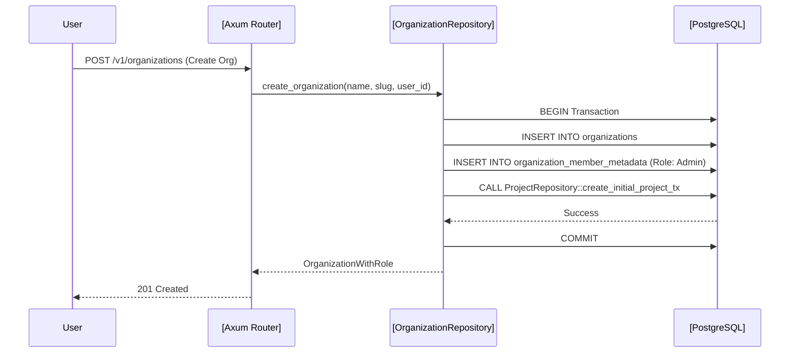

# Cloud and Team Collaboration

<details>
<summary>Relevant source files</summary>

The following files were used as context for generating this wiki page:

- [crates/remote/.sqlx/query-b97175fb9a4f5a7379119da3760be7efc1ba2bf95bd5d3e6725f4f98aa7d955a.json](crates/remote/.sqlx/query-b97175fb9a4f5a7379119da3760be7efc1ba2bf95bd5d3e6725f4f98aa7d955a.json)
- [crates/remote/Cargo.lock](crates/remote/Cargo.lock)
- [crates/remote/Cargo.toml](crates/remote/Cargo.toml)
- [crates/remote/scripts/prepare-db.sh](crates/remote/scripts/prepare-db.sh)
- [crates/remote/src/db/organizations.rs](crates/remote/src/db/organizations.rs)

</details>


The Vibe Kanban Cloud infrastructure extends the local AI coding agent experience into a multi-user environment. It enables team-based workflows, centralized project management, and real-time synchronization between distributed clients. While the local application focuses on individual workspace execution, the Cloud layer provides the persistence and collaboration primitives necessary for organizations to manage shared backlogs and remote resources.

## System Overview

The Cloud architecture bridges the frontend application with a PostgreSQL backend, utilizing ElectricSQL for real-time data propagation. The system is designed to handle multiple "Organizations," each containing "Projects," "Issues," and "Remote Workspaces." The backend is implemented in the `remote` crate, which leverages `sqlx` for database interactions and `axum` for the web server [crates/remote/Cargo.toml:20-33]().

### Collaboration Topology

The following diagram illustrates how high-level collaboration entities in the "Natural Language Space" map to specific backend repositories and frontend types in the "Code Entity Space."

| Natural Language Concept | Code Entity (Backend) | Code Entity (Frontend) |
| :--- | :--- | :--- |
| **Organization** | `OrganizationRepository` [crates/remote/src/db/organizations.rs:14]() | `Organization` [crates/remote/src/db/organizations.rs:1]() |
| **Team Member** | `organization_members` module [crates/remote/src/db/organizations.rs:7]() | `MemberRole` [crates/remote/src/db/organizations.rs:1]() |
| **Project** | `ProjectRepository` [crates/remote/src/db/organizations.rs:11]() | `Project` (via `api-types`) |
| **Issue** | `IssueRepository` (in `db/issues.rs`) | `Issue` (via `api-types`) |
| **Sync Engine** | `ElectricSQL` | `Shape` (Client-side) |

### Data Relationship Flow

```mermaid
graph TD
    subgraph "Cloud Backend (remote crate)"
        [OrganizationRepository] -->|owns| [ProjectRepository]
        [ProjectRepository] -->|contains| [IssueRepository]
        [PgPool] -->|manages| [PostgresDB]
    end

    subgraph "Frontend (Remote Web)"
        [RemoteAppShell] -->|queries| [useUserOrganizations]
        [RemoteNavbarContainer] -->|displays| [ProjectContext]
    end

    [OrganizationRepository] -.->|uses| [PgPool]
    [RemoteAppShell] -.->|Axum Routes| [OrganizationRepository]
    [PostgresDB] -.->|ElectricSQL Sync| [RemoteAppShell]
```
**Sources:** [crates/remote/src/db/organizations.rs:14-21](), [crates/remote/src/db/organizations.rs:113-176](), [crates/remote/Cargo.toml:20-33]()

---

## Key Collaboration Features

### Organizations and Team Members
The system uses a hierarchical multi-tenancy model. Users can belong to multiple organizations, including a "Personal Organization" automatically created upon first sign-in via `ensure_personal_org_and_admin_membership` [crates/remote/src/db/organizations.rs:60-95](). Access control is managed via the `MemberRole` enum (Admin or Member), which dictates permissions for project creation and organization settings [crates/remote/src/db/organizations.rs:1-12]().

For details, see [Organizations and Team Members](#9.1).

### Cloud Authentication and OAuth
Authentication is handled through a centralized OAuth flow supporting GitHub and Google. The backend manages JWT token issuance and validation. The `remote` crate includes dependencies like `jsonwebtoken` and `aes-gcm` to handle secure token management and data encryption [crates/remote/Cargo.toml:43-51]().

For details, see [Cloud Authentication and OAuth](#9.2).

### ElectricSQL Real-time Sync
Vibe Kanban Cloud employs **ElectricSQL** to provide a reactive UI. Instead of traditional polling, the frontend subscribes to "Shapes"—subsets of the Postgres database. The backend infrastructure supports this via a PostgreSQL instance prepared with specific migrations found in the `remote` crate's database scripts [crates/remote/scripts/prepare-db.sh:65-72]().

For details, see [ElectricSQL Real-time Sync](#9.3).

### Remote Projects and Issues
The core of the collaboration experience is the Remote Project model. Unlike local projects, these are stored in the Cloud PostgreSQL database. The `OrganizationRepository` ensures that every new organization (including personal ones) is initialized with a default project through `ProjectRepository::create_initial_project_tx` [crates/remote/src/db/organizations.rs:79-87]().

For details, see [Remote Projects and Issues](#9.4).

---

## Technical Integration Map

The interaction between the user's organization management and the underlying PostgreSQL storage is mediated by the `OrganizationRepository`.


**Sources:** [crates/remote/src/db/organizations.rs:113-176](), [crates/remote/src/db/organizations.rs:182-205](), [crates/remote/scripts/prepare-db.sh:71-72]()