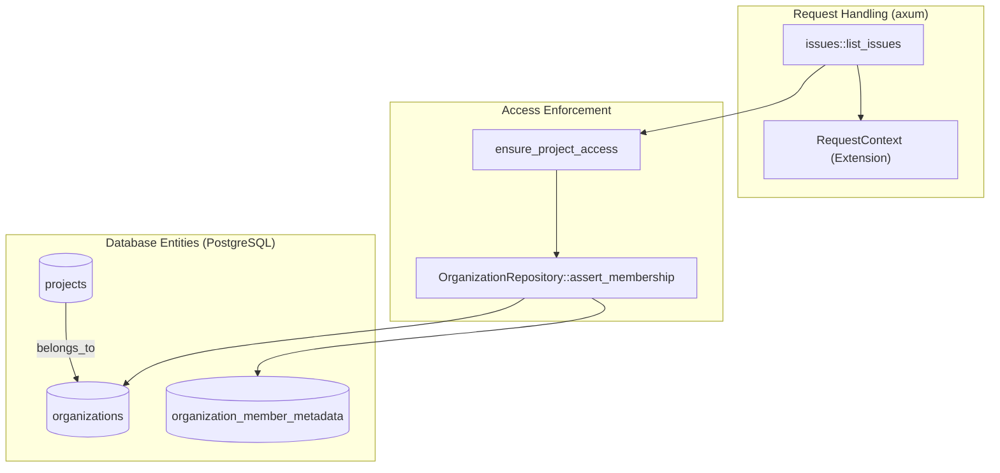
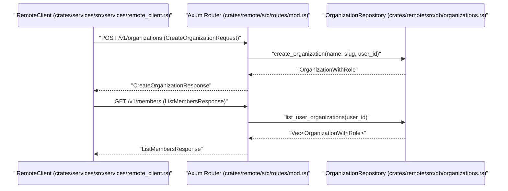

# Organizations and Team Members

Relevant source files

The following files were used as context for generating this wiki page:

- [crates/api-types/src/issue.rs](crates/api-types/src/issue.rs)
- [crates/remote/.sqlx/query-a5d1aeb3ce62a3f286a2a4bddc38c3f5caf2eb556236b561b68483b17dc24cfd.json](crates/remote/.sqlx/query-a5d1aeb3ce62a3f286a2a4bddc38c3f5caf2eb556236b561b68483b17dc24cfd.json)
- [crates/remote/.sqlx/query-b97175fb9a4f5a7379119da3760be7efc1ba2bf95bd5d3e6725f4f98aa7d955a.json](crates/remote/.sqlx/query-b97175fb9a4f5a7379119da3760be7efc1ba2bf95bd5d3e6725f4f98aa7d955a.json)
- [crates/remote/.sqlx/query-d2275416ba3ddb1bbaf929787b5df4c736084582ddebdbe9f4a4aa6853727484.json](crates/remote/.sqlx/query-d2275416ba3ddb1bbaf929787b5df4c736084582ddebdbe9f4a4aa6853727484.json)
- [crates/remote/scripts/prepare-db.sh](crates/remote/scripts/prepare-db.sh)
- [crates/remote/src/bin/generate_types.rs](crates/remote/src/bin/generate_types.rs)
- [crates/remote/src/db/issues.rs](crates/remote/src/db/issues.rs)
- [crates/remote/src/db/organizations.rs](crates/remote/src/db/organizations.rs)
- [crates/remote/src/routes/issues.rs](crates/remote/src/routes/issues.rs)
- [crates/remote/src/routes/mod.rs](crates/remote/src/routes/mod.rs)
- [crates/remote/src/routes/workspaces.rs](crates/remote/src/routes/workspaces.rs)
- [crates/remote/src/shape_routes.rs](crates/remote/src/shape_routes.rs)
- [crates/server/src/routes/remote/issues.rs](crates/server/src/routes/remote/issues.rs)
- [crates/services/src/services/remote_client.rs](crates/services/src/services/remote_client.rs)
- [shared/remote-types.ts](shared/remote-types.ts)

In Vibe Kanban Cloud, organizations serve as the top-level container for collaborative work. They manage projects, issues, and member access. The system distinguishes between **Personal Organizations**, which are automatically provisioned for individual users, and **Team Organizations**, which support multi-user collaboration through roles and invitations.

## Organization Model and Implementation

Organizations are defined by the `Organization` struct and persisted in the `organizations` table. Each organization is identified by a unique `Uuid` and a URL-friendly `slug`.

### Core Data Structures
- **Organization**: Represents the entity itself, including its name, slug, and whether it is a personal workspace [shared/remote-types.ts:7-7]().
- **OrganizationMember**: Links a `User` to an `Organization` with a specific `MemberRole` [shared/remote-types.ts:82-82]().
- **MemberRole**: An enum defining permissions, currently supporting `ADMIN` and `MEMBER` [shared/remote-types.ts:80-80]().

### Data Flow: Organization Resolution
The backend uses `OrganizationRepository` to manage the lifecycle and access checks for organizations.

| Function | Purpose | Location |
| :--- | :--- | :--- |
| `fetch_organization` | Retrieves organization metadata by ID | [crates/remote/src/db/organizations.rs:31-54]() |
| `list_user_organizations` | Returns all organizations a user belongs to | [crates/remote/src/db/organizations.rs:178-205]() |
| `assert_admin` | Validates that a user has administrative rights | [crates/remote/src/db/organizations.rs:105-111]() |
| `create_organization` | Initializes a new org, a default project, and assigns the creator as ADMIN | [crates/remote/src/db/organizations.rs:113-176]() |

**Sources:** [crates/remote/src/db/organizations.rs:1-213](), [shared/remote-types.ts:7-82]()

## Personal vs. Team Organizations

Vibe Kanban ensures every user has a sandbox environment upon registration.

### Personal Organizations
When a user first authenticates, the system calls `ensure_personal_org_and_admin_membership` [crates/remote/src/db/organizations.rs:60-95]().
1. **Auto-provisioning**: A personal organization is created with `is_personal = true`.
2. **Naming**: The name is derived from the user's display name or email [crates/remote/src/db/organizations.rs:65-66]().
3. **Default Project**: The `ProjectRepository::create_initial_project_tx` function is called to generate a "General" project with standard Kanban statuses (Todo, In Progress, Done) and tags [crates/remote/src/db/organizations.rs:79-86]().

### Team Organizations
Team organizations are created via the `create_organization` method [crates/remote/src/db/organizations.rs:113-118](). Unlike personal orgs, these allow multiple members and are intended for shared repository management.

**Sources:** [crates/remote/src/db/organizations.rs:60-176]()

## Membership and Access Control

Access control is enforced at the route level using middleware and repository assertions.

### Role-Based Access Control (RBAC)
Permissions are verified using the `OrganizationRepository::check_user_role` method [crates/remote/src/db/organizations.rs:97-103]().

- **ADMIN**: Can manage organization settings, invite members, and delete projects.
- **MEMBER**: Can view and interact with projects and issues but cannot modify organization-level metadata.

### Project and Issue Access
Before performing operations on issues or workspaces, the system verifies the user's relationship to the parent project via `ensure_project_access` [crates/remote/src/routes/issues.rs:186-186](). This helper function ensures that the project belongs to an organization where the user is an active member.

### Technical Entity Mapping
The following diagram illustrates how the code entities relate to the logical concepts of organizations and members.

**Diagram: Organization Access Logic**

**Sources:** [crates/remote/src/routes/issues.rs:180-212](), [crates/remote/src/db/organizations.rs:23-29](), [crates/remote/src/routes/organization_members.rs:18-18]() (Note: file reference inferred from existing structure)

## Invitations and Onboarding

Collaboration is facilitated through an invitation system managed by the `RemoteClient`.

### Invitation Workflow
1. **Creation**: An `ADMIN` generates an invitation via `create_invitation` in the `RemoteClient` [crates/services/src/services/remote_client.rs:8-9]().
2. **Redemption**: A user accepts the invitation, which triggers `add_member` in the database [crates/remote/src/db/organizations.rs:162-162]().
3. **Synchronization**: Upon joining, the user's client subscribes to the organization's data "shapes" via ElectricSQL to receive real-time updates of projects and issues [crates/remote/src/shape_routes.rs:74-80]().

### Data Flow: Remote Client Interaction
The `RemoteClient` in the services crate handles the communication between the local environment and the Cloud API for member management.

**Diagram: Member Management Data Flow**

**Sources:** [crates/services/src/services/remote_client.rs:5-20](), [crates/remote/src/routes/mod.rs:116-117](), [crates/remote/src/db/organizations.rs:113-181]()

## Real-time Sync and Shapes

Organizations define the boundary for data synchronization. The `all_shape_routes` function defines "shapes" that are filtered by `organization_id` [crates/remote/src/shape_routes.rs:72-98]().

- **Org-Scoped Shapes**: Projects, Organization Members, and Users are synced based on the `organization_id` provided in the fallback query [crates/remote/src/shape_routes.rs:74-98]().
- **User-Scoped Shapes**: Notifications and User-specific Workspaces are filtered by the authenticated `user_id` [crates/remote/src/shape_routes.rs:81-86]().

**Sources:** [crates/remote/src/shape_routes.rs:1-181]()