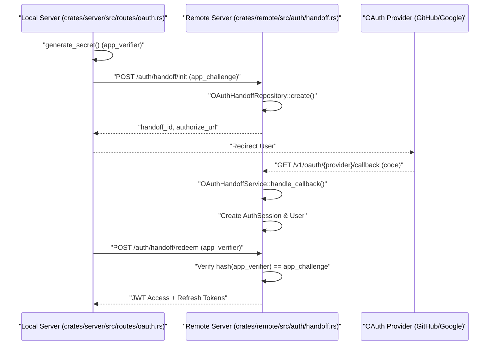
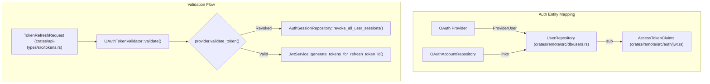

# Cloud Authentication and OAuth

Relevant source files

The following files were used as context for generating this wiki page:

- [Caddyfile.example](Caddyfile.example)
- [crates/api-types/src/oauth.rs](crates/api-types/src/oauth.rs)
- [crates/remote/.sqlx/query-efb2b5c658e8b19949dfecf7993578c10248c7a16db74eb3476cc9e8d90573a2.json](crates/remote/.sqlx/query-efb2b5c658e8b19949dfecf7993578c10248c7a16db74eb3476cc9e8d90573a2.json)
- [crates/remote/src/auth/handoff.rs](crates/remote/src/auth/handoff.rs)
- [crates/remote/src/auth/jwt.rs](crates/remote/src/auth/jwt.rs)
- [crates/remote/src/auth/local.rs](crates/remote/src/auth/local.rs)
- [crates/remote/src/auth/mod.rs](crates/remote/src/auth/mod.rs)
- [crates/remote/src/auth/oauth_token_validator.rs](crates/remote/src/auth/oauth_token_validator.rs)
- [crates/remote/src/auth/provider.rs](crates/remote/src/auth/provider.rs)
- [crates/remote/src/routes/tokens.rs](crates/remote/src/routes/tokens.rs)
- [crates/server/src/routes/oauth.rs](crates/server/src/routes/oauth.rs)
- [crates/services/src/services/remote_sync.rs](crates/services/src/services/remote_sync.rs)
- [packages/ui/src/components/Dialog.tsx](packages/ui/src/components/Dialog.tsx)
- [packages/ui/src/components/GuideDialogShell.tsx](packages/ui/src/components/GuideDialogShell.tsx)
- [packages/ui/src/components/KeyboardDialog.tsx](packages/ui/src/components/KeyboardDialog.tsx)
- [packages/ui/src/components/MobileDrawer.tsx](packages/ui/src/components/MobileDrawer.tsx)
- [packages/web-core/src/features/onboarding/ui/LandingPage.tsx](packages/web-core/src/features/onboarding/ui/LandingPage.tsx)
- [packages/web-core/src/features/onboarding/ui/OnboardingSignInPage.tsx](packages/web-core/src/features/onboarding/ui/OnboardingSignInPage.tsx)
- [packages/web-core/src/shared/dialogs/global/OAuthDialog.tsx](packages/web-core/src/shared/dialogs/global/OAuthDialog.tsx)
- [packages/web-core/src/shared/dialogs/settings/SettingsDialog.tsx](packages/web-core/src/shared/dialogs/settings/SettingsDialog.tsx)
- [packages/web-core/src/shared/dialogs/shared/KeyboardShortcutsDialog.tsx](packages/web-core/src/shared/dialogs/shared/KeyboardShortcutsDialog.tsx)

Vibe Kanban employs a sophisticated authentication system designed for both local and cloud deployments. It supports traditional local login (email/password) alongside OAuth 2.0 providers like GitHub and Google. A key architectural feature is the **Authentication Handoff** pattern, which allows the local application to securely delegate authentication to the remote cloud server while maintaining proof-of-possession of the resulting session tokens.

## Authentication Handoff Flow

The handoff pattern is used when a local Vibe Kanban instance needs to authenticate a user via the cloud service. It utilizes a PKCE-like flow with an `app_challenge` and `app_verifier` to ensure that only the instance that initiated the login can redeem the final session tokens.

### Data Flow and Logic

1.  **Initialization**: The local server generates a secret `app_verifier` and its SHA-256 hash, the `app_challenge` [crates/server/src/routes/oauth.rs:120-121]().
2.  **Remote Registration**: The local server calls the remote `/auth/handoff/init` endpoint, providing the provider and the challenge [crates/server/src/routes/oauth.rs:123-129]().
3.  **State Management**: The remote server creates an `OAuthHandoff` record in the PostgreSQL database via `OAuthHandoffRepository::create` [crates/remote/src/auth/handoff.rs:152-160]().
4.  **User Authorization**: The user is redirected to the OAuth provider (GitHub/Google). Upon successful login, the provider redirects back to the remote server's callback URL [crates/remote/src/auth/handoff.rs:203-212]().
5.  **Token Redemption**: After the browser-based flow completes, the local server redeems the `handoff_id` by providing the original `app_verifier` to the `/auth/handoff/redeem` endpoint [crates/server/src/routes/oauth.rs:188-195]().

### Handoff Sequence Diagram

**Sources:** [crates/server/src/routes/oauth.rs:114-141](), [crates/remote/src/auth/handoff.rs:128-174](), [crates/remote/src/auth/handoff.rs:215-250]()

## JWT Token Management

The system uses JSON Web Tokens (JWT) for session management. The `JwtService` handles the generation and validation of two distinct token types:

| Token Type | TTL | Purpose | Claims |
| :--- | :--- | :--- | :--- |
| **Access Token** | 2 Minutes | Short-lived token for authorizing API requests. | `sub` (User ID), `session_id`, `aud: "access"` |
| **Refresh Token** | 365 Days | Long-lived token used to obtain new access tokens. | `sub`, `session_id`, `jti` (Refresh ID), `aud: "refresh"`, `provider` |

### Token Security and Rotation
*   **Rotation**: Every time a refresh token is used via `refresh_token`, a new refresh token is issued, and the old one is invalidated [crates/remote/src/auth/jwt.rs:112-114]().
*   **Reuse Detection**: The `AuthSessionRepository` tracks token lineage. If a previously used refresh token is presented (indicating a potential theft/replay attack), the entire session is immediately revoked via `revoke_auth_session` [crates/remote/src/routes/tokens.rs:137-155]().
*   **Grace Period**: A small window is allowed for network failures where the previous token might be retried [crates/remote/src/routes/tokens.rs:127-128]().
*   **Encryption**: Provider-specific tokens (like GitHub access tokens) are stored encrypted within the `OAuthAccount` record [crates/remote/src/auth/jwt.rs:167-174]().

**Sources:** [crates/remote/src/auth/jwt.rs:22-24](), [crates/remote/src/auth/jwt.rs:124-169](), [crates/remote/src/routes/tokens.rs:103-155]()

## OAuth Provider Integration

Vibe Kanban implements the `AuthorizationProvider` trait to support multiple OAuth backends.

### Supported Providers
1.  **GitHub**: Authenticates via GitHub OAuth app. It fetches the user's primary verified email to establish identity [crates/remote/src/auth/provider.rs:167-240]().
2.  **Google**: Uses standard Google OpenID Connect flow.

### Token Validation Service
The `OAuthTokenValidator` is a component that ensures the underlying provider token is still valid when a user refreshes their session.

*   If the user revokes the Vibe Kanban app access in their GitHub settings, the next refresh attempt will fail validation.
*   Upon validation failure, `OAuthTokenValidator::validate` triggers `revoke_all_user_sessions` to ensure the user is logged out of all devices [crates/remote/src/auth/oauth_token_validator.rs:52-85]().

**Sources:** [crates/remote/src/auth/provider.rs:60-72](), [crates/remote/src/auth/oauth_token_validator.rs:31-57](), [crates/remote/src/auth/oauth_token_validator.rs:93-117]()

## Frontend Implementation

The frontend handles authentication via the `useUserSystem` hook and the `OnboardingSignInPage`.

*   **Provider Selection**: Users can choose between GitHub and Google (if enabled) [packages/web-core/src/features/onboarding/ui/OnboardingSignInPage.tsx:101-102]().
*   **OAuth Dialog**: The `OAuthDialog` manages the popup window for the provider's authorization page [packages/web-core/src/features/onboarding/ui/OnboardingSignInPage.tsx:7-9]().
*   **Onboarding State**: Completion of the sign-in flow triggers the `finishOnboarding` logic, which saves the `remote_onboarding_acknowledged` flag to the user's local configuration [packages/web-core/src/features/onboarding/ui/OnboardingSignInPage.tsx:161-178]().

**Sources:** [packages/web-core/src/features/onboarding/ui/OnboardingSignInPage.tsx:74-113](), [packages/web-core/src/features/onboarding/ui/OnboardingSignInPage.tsx:161-207]()

## Configuration

Cloud authentication requires specific environment variables to be set in the remote server:

*   **JWT Secrets**: `JWT_SECRET` for signing tokens and an encryption key for provider tokens [crates/remote/src/auth/jwt.rs:88-103]().
*   **Provider Credentials**: `GITHUB_CLIENT_ID` and `GITHUB_CLIENT_SECRET` for the GitHub OAuth application [crates/remote/src/auth/provider.rs:108-122]().
*   **Public Origin**: `SERVER_PUBLIC_BASE_URL` used to construct redirect URIs for the handoff flow [crates/remote/src/auth/handoff.rs:105-121]().

**Sources:** [crates/remote/src/auth/handoff.rs:108-122](), [crates/remote/src/auth/jwt.rs:88-103]()