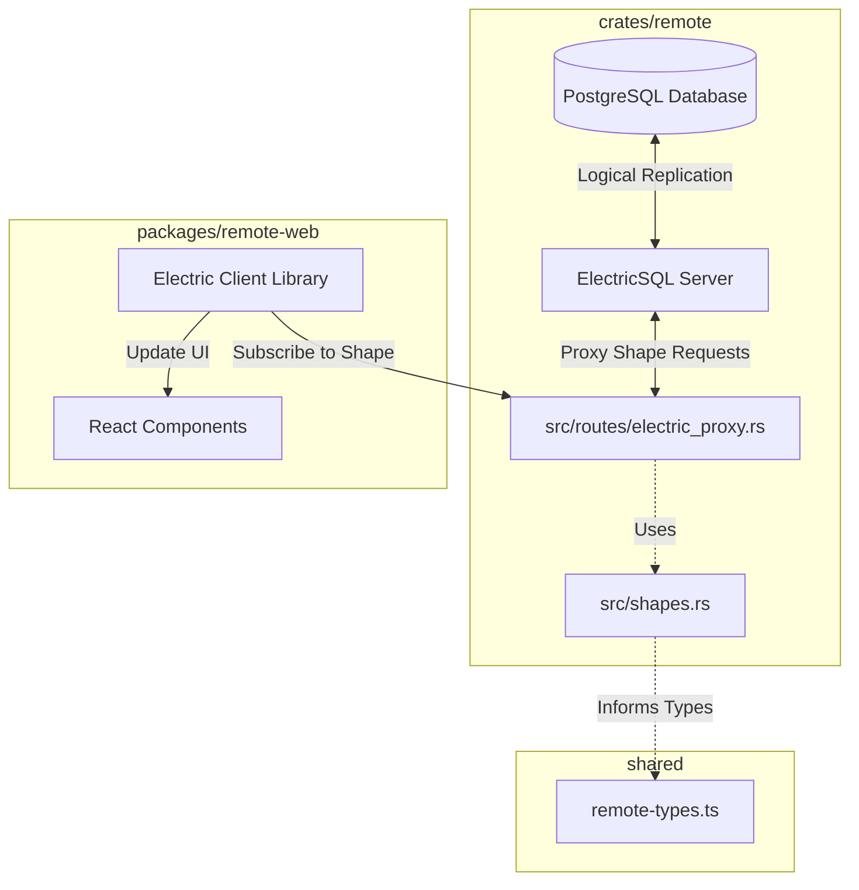
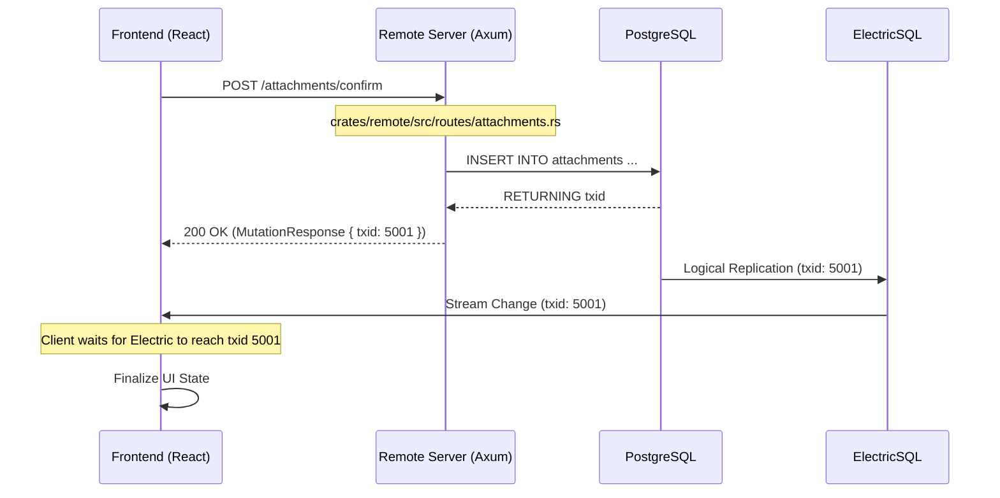

# ElectricSQL Real-time Sync

Relevant source files

The following files were used as context for generating this wiki page:

- [.github/actions/cargo-checks-common-setup/action.yml](.github/actions/cargo-checks-common-setup/action.yml)
- [.github/actions/setup-node/action.yml](.github/actions/setup-node/action.yml)
- [.github/workflows/pre-release.yml](.github/workflows/pre-release.yml)
- [.github/workflows/publish.yml](.github/workflows/publish.yml)
- [.github/workflows/relay-deploy-dev.yml](.github/workflows/relay-deploy-dev.yml)
- [.github/workflows/relay-deploy-prod.yml](.github/workflows/relay-deploy-prod.yml)
- [.github/workflows/relay-release.yml](.github/workflows/relay-release.yml)
- [.github/workflows/remote-deploy-dev.yml](.github/workflows/remote-deploy-dev.yml)
- [.github/workflows/remote-deploy-prod.yml](.github/workflows/remote-deploy-prod.yml)
- [.github/workflows/remote-release.yml](.github/workflows/remote-release.yml)
- [.github/workflows/test.yml](.github/workflows/test.yml)
- [AGENTS.md](AGENTS.md)
- [CLAUDE.md](CLAUDE.md)
- [crates/remote/AGENTS.md](crates/remote/AGENTS.md)
- [crates/remote/src/attachments/cleanup.rs](crates/remote/src/attachments/cleanup.rs)
- [crates/remote/src/attachments/mod.rs](crates/remote/src/attachments/mod.rs)
- [crates/remote/src/attachments/thumbnail.rs](crates/remote/src/attachments/thumbnail.rs)
- [crates/remote/src/db/attachments.rs](crates/remote/src/db/attachments.rs)
- [crates/remote/src/routes/attachments.rs](crates/remote/src/routes/attachments.rs)
- [crates/remote/src/routes/electric_proxy.rs](crates/remote/src/routes/electric_proxy.rs)
- [crates/remote/src/shapes.rs](crates/remote/src/shapes.rs)

Vibe Kanban Cloud utilizes **ElectricSQL** to provide a seamless, real-time reactive data layer between the PostgreSQL backend and frontend clients. This system ensures that changes made by one user (or an AI agent) are instantly reflected across all connected clients without manual polling.

## Architecture Overview

The synchronization architecture consists of a central PostgreSQL database, an ElectricSQL replication server, and a proxy layer within the `remote` crate. Clients subscribe to "Shapes"—filtered subsets of the database—which are then streamed to the frontend.

### Data Flow: Natural Language to Code Entities

This diagram maps the high-level synchronization concepts to specific code entities within the `crates/remote` and `shared` directories.

"Natural Language Space to Code Entity Space: Sync Architecture"

**Sources:**
- [crates/remote/src/routes/electric_proxy.rs:41-51]()
- [crates/remote/src/shapes.rs:15-30]()
- [AGENTS.md:15-27]()

---

## Shape Subscriptions

A **Shape** is a set of rows and columns from a specific table, often filtered by a `WHERE` clause (e.g., "all issues for Project X"). In Vibe Kanban, these are defined in the backend to ensure security and consistency.

### Shape Definitions
Shapes are defined using the `ShapeDefinition` struct and the `define_shape!` macro. These definitions include the table name, a parameterized `where_clause`, and the API path used for proxying.

| Shape Name | Table | Filter Parameter | Source |
| :--- | :--- | :--- | :--- |
| `PROJECTS_SHAPE` | `projects` | `organization_id` | [crates/remote/src/shapes.rs:15-21]() |
| `NOTIFICATIONS_SHAPE` | `notifications` | `user_id` | [crates/remote/src/shapes.rs:23-29]() |
| `PROJECT_ISSUES_SHAPE` | `issues` | `project_id` | [crates/remote/src/shapes.rs:67-73]() |
| `ISSUE_COMMENTS_SHAPE` | `issue_comments` | `issue_id` | [crates/remote/src/shapes.rs:147-153]() |
| `USER_WORKSPACES_SHAPE` | `workspaces` | `owner_user_id` | [crates/remote/src/shapes.rs:75-81]() |

### The Proxy Layer
To prevent unauthorized access, clients do not connect to ElectricSQL directly. Instead, they request shapes through the `remote` server's proxy. The proxy validates the user's session and appends the correct `WHERE` clause parameters before forwarding the request to the Electric origin.

**Key Implementation Details:**
- **Route Merging:** The router in `electric_proxy.rs` dynamically merges all shape routes defined in the shape definition system [crates/remote/src/routes/electric_proxy.rs:33-39]().
- **Security:** The `proxy_table` function enforces that the `table` and `where` clause are set server-side, preventing clients from overriding them with malicious parameters [crates/remote/src/routes/electric_proxy.rs:58-67]().
- **Parameter Forwarding:** Safe client parameters like `offset`, `handle`, `live`, and `cursor` are forwarded to Electric, while others are stripped [crates/remote/src/routes/electric_proxy.rs:30-31](), [crates/remote/src/routes/electric_proxy.rs:75-80]().
- **Sticky Sessions:** The proxy uses an `x-vk-electric-sticky` header based on the `session_id` to ensure consistent routing to Electric nodes during live synchronization [crates/remote/src/routes/electric_proxy.rs:91]().

**Sources:**
- [crates/remote/src/routes/electric_proxy.rs:45-116]()
- [crates/remote/src/shapes.rs:1-162]()

---

## The txid Handshake Pattern

Vibe Kanban implements a "txid handshake" to handle the transition between an HTTP mutation (e.g., creating an issue) and the subsequent real-time update. This prevents UI "flicker" where a client might receive an optimistic update, then a stale server state, before finally receiving the real-time sync.

### Implementation Flow

1.  **Mutation Request:** The client sends a POST request to a mutation endpoint (e.g., creating an issue or adding an attachment).
2.  **Transaction ID:** The backend executes the SQL inside a transaction and retrieves the Postgres transaction ID.
3.  **Response:** The server returns a `MutationResponse` containing the `txid`.
4.  **Handshake:** The client uses this `txid` to ensure its local Electric cache has "caught up" to at least that transaction before clearing optimistic state.

"Code Entity Space: Mutation and Txid Flow"

**Sources:**
- [crates/remote/src/routes/attachments.rs:76-89]()
- [crates/remote/src/routes/electric_proxy.rs:45-51]()
- [AGENTS.md:15-17]()

---

## Type Synchronization

To ensure the frontend correctly interprets the data streamed via ElectricSQL, TypeScript types are auto-generated from the Rust structs using `ts-rs`.

- **Generation Script:** The `remote-generate-types` binary iterates through the models and shapes to export their TypeScript equivalents [AGENTS.md:25-27]().
- **Output File:** `shared/remote-types.ts` contains the interface definitions used by the frontend for both REST responses and ElectricSQL shape data [AGENTS.md:8]().
- **Command:** Developers run `pnpm run remote:generate-types` to synchronize types after modifying Rust database models in `crates/remote` [AGENTS.md:25]().

**Sources:**
- [AGENTS.md:19-27]()
- [crates/remote/src/shapes.rs:3-7]()