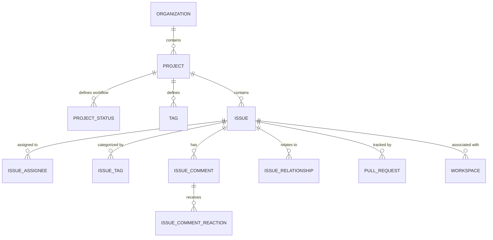
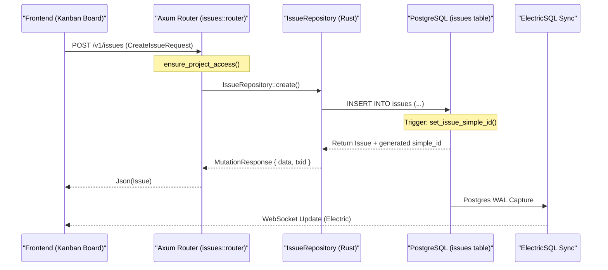

# Remote Projects and Issues

<details>
<summary>Relevant source files</summary>

The following files were used as context for generating this wiki page:

- [crates/api-types/src/issue.rs](crates/api-types/src/issue.rs)
- [crates/remote/.sqlx/query-a5d1aeb3ce62a3f286a2a4bddc38c3f5caf2eb556236b561b68483b17dc24cfd.json](crates/remote/.sqlx/query-a5d1aeb3ce62a3f286a2a4bddc38c3f5caf2eb556236b561b68483b17dc24cfd.json)
- [crates/remote/.sqlx/query-d2275416ba3ddb1bbaf929787b5df4c736084582ddebdbe9f4a4aa6853727484.json](crates/remote/.sqlx/query-d2275416ba3ddb1bbaf929787b5df4c736084582ddebdbe9f4a4aa6853727484.json)
- [crates/remote/migrations/20260112000000_remote-projects.sql](crates/remote/migrations/20260112000000_remote-projects.sql)
- [crates/remote/src/bin/generate_types.rs](crates/remote/src/bin/generate_types.rs)
- [crates/remote/src/db/issues.rs](crates/remote/src/db/issues.rs)
- [crates/remote/src/db/project_statuses.rs](crates/remote/src/db/project_statuses.rs)
- [crates/remote/src/db/projects.rs](crates/remote/src/db/projects.rs)
- [crates/remote/src/db/tags.rs](crates/remote/src/db/tags.rs)
- [crates/remote/src/db/types.rs](crates/remote/src/db/types.rs)
- [crates/remote/src/routes/issues.rs](crates/remote/src/routes/issues.rs)
- [crates/remote/src/routes/mod.rs](crates/remote/src/routes/mod.rs)
- [crates/remote/src/routes/project_statuses.rs](crates/remote/src/routes/project_statuses.rs)
- [crates/remote/src/routes/projects.rs](crates/remote/src/routes/projects.rs)
- [crates/remote/src/routes/tags.rs](crates/remote/src/routes/tags.rs)
- [crates/remote/src/routes/workspaces.rs](crates/remote/src/routes/workspaces.rs)
- [crates/remote/src/shape_routes.rs](crates/remote/src/shape_routes.rs)
- [crates/server/src/routes/remote/issues.rs](crates/server/src/routes/remote/issues.rs)
- [crates/services/src/services/remote_client.rs](crates/services/src/services/remote_client.rs)
- [shared/remote-types.ts](shared/remote-types.ts)

</details>


This page details the data model and backend implementation for managing projects and issues in the Vibe Kanban cloud environment. Unlike the local workspace-centric model, the remote system implements a multi-tenant, relational structure designed for team collaboration, featuring configurable workflows, tagging, and integrated pull request tracking.

## Overview

The remote data model is built on PostgreSQL and exposed via the `remote` crate. It supports hierarchical organization of work through Organizations, Projects, and Issues. Key features include:
- **Project-Specific Workflows**: Customizable statuses and priorities [crates/remote/migrations/20260112000000_remote-projects.sql:29-38]().
- **Relational Integrity**: Issues support parent-child relationships, blockers, and duplicates [crates/remote/migrations/20260112000000_remote-projects.sql:141-152]().
- **Automated Identifiers**: Sequential issue numbering and human-readable "Simple IDs" (e.g., `VIBE-42`) via database triggers [crates/remote/migrations/20260112000000_remote-projects.sql:92-121]().
- **Real-time Sync**: Tight integration with ElectricSQL for frontend state synchronization [crates/remote/src/shape_routes.rs:72-180]().

## Data Model and Relationships

The core of the system is the `Issue` entity, which resides within a `Project`. Projects are owned by `Organizations`.

### Entity Relationship Diagram

The following diagram illustrates the relationships between core entities in the `remote` database schema.

Title: Remote Issue Data Model

**Sources:** [crates/remote/migrations/20260112000000_remote-projects.sql:53-195](), [shared/remote-types.ts:7-43]()

### Core Entities

| Entity | Role | Code Reference |
| :--- | :--- | :--- |
| `Project` | Container for issues, defines the "Issue Prefix" and default color. | [shared/remote-types.ts:7-7]() |
| `ProjectStatus` | Defines a column on the Kanban board (e.g., "Todo", "In Progress"). | [shared/remote-types.ts:19-19]() |
| `Issue` | The primary unit of work, containing title, description, and metadata. | [shared/remote-types.ts:23-23]() |
| `Tag` | Categorical labels applied across issues in a project. | [shared/remote-types.ts:21-21]() |
| `IssueRelationship` | Tracks dependencies (blocking, related, duplicate). | [shared/remote-types.ts:37-39]() |

**Sources:** [shared/remote-types.ts:7-43](), [crates/remote/src/db/projects.rs:30-55](), [crates/remote/src/db/project_statuses.rs:28-56]()

## Implementation Details

### Sequential ID Generation
Vibe Kanban uses a database trigger `set_issue_simple_id` to maintain human-readable IDs. When a new issue is inserted into the `issues` table:
1. The `issue_counter` in the `projects` table is atomically incremented [crates/remote/migrations/20260112000000_remote-projects.sql:98-102]().
2. The organization's `issue_prefix` is retrieved from the `organizations` table [crates/remote/migrations/20260112000000_remote-projects.sql:105-108]().
3. The `simple_id` is concatenated using the prefix and the counter (e.g., `PREFIX-N`) [crates/remote/migrations/20260112000000_remote-projects.sql:112-112]().

### Search and Filtering
The `IssueRepository::search` function handles complex filtering including full-text search on titles/descriptions, filtering by multiple status IDs, assignees, and tags [crates/remote/src/db/issues.rs:63-138](). It uses PostgreSQL `ILIKE` with escaped patterns for safe text matching [crates/remote/src/db/issues.rs:56-61]().

### Workspace Integration
Remote issues are linked to development environments via the `Workspace` entity [shared/remote-types.ts:17-17](). When a workspace is created from an issue, the system triggers `sync_issue_from_workspace_created`, which can automatically move the issue to an "In Progress" status [crates/remote/src/routes/workspaces.rs:92-98]().

## Data Flow: Issue Creation and Sync

This diagram bridges the Natural Language Space (UI Actions) to the Code Entity Space (Backend Handlers and Database).

Title: Issue Creation Flow

**Sources:** [crates/remote/src/routes/issues.rs:34-41](), [crates/remote/src/db/issues.rs:140-161](), [crates/remote/migrations/20260112000000_remote-projects.sql:118-121]()

## GitHub and PR Integration

The remote system integrates with external Git hosts to track code changes associated with issues.

### Automated Status Sync
The `IssueRepository` contains logic to sync statuses based on external events:
- **Local Merge**: `sync_status_from_local_workspace_merge` updates issue state when a developer merges code locally [crates/remote/src/routes/workspaces.rs:186-191]().
- **PR Status**: The `PullRequest` entity tracks `open`, `merged`, and `closed` states in the cloud backend [shared/remote-types.ts:55-57]().

### Notification System
Changes to issues (status, title, priority) trigger notifications to interested parties. The `notify_issue_update_changes` function determines which fields changed and dispatches notifications via `send_issue_notifications` or `send_debounced_issue_notifications` [crates/remote/src/routes/issues.rs:51-173]().

## Type Synchronization

To ensure consistency between the Rust backend and TypeScript frontend, the system uses an automated generation script.

Title: Type Synchronization Flow
```mermaid
graph LR
    subgraph "Rust Backend"
        "api_types::Issue"["api_types::Issue"]
        "api_types::Project"["api_types::Project"]
    end

    subgraph "Generation Tool"
        "generate_types"["bin/generate_types.rs"]
    end

    subgraph "Frontend Types"
        "remote_types_ts"["shared/remote-types.ts"]
    end

    "api_types::Issue" --> "generate_types"
    "api_types::Project" --> "generate_types"
    "generate_types" -- "export_shapes()" --> "remote_types_ts"
```

- **Definition**: Types are defined in Rust using the `TS` trait from `ts-rs` [crates/remote/src/bin/generate_types.rs:28-28]().
- **Generation**: The `generate_types` binary iterates through all models, mutation definitions, and ElectricSQL shape routes [crates/remote/src/bin/generate_types.rs:74-139]().
- **Output**: The results are written to `shared/remote-types.ts` for consumption by the React frontend [crates/remote/src/bin/generate_types.rs:37-42]().

**Sources:**
- `crates/remote/src/db/issues.rs`
- `crates/remote/src/routes/issues.rs`
- `crates/remote/migrations/20260112000000_remote-projects.sql`
- `shared/remote-types.ts`
- `crates/remote/src/bin/generate_types.rs`
- `crates/remote/src/routes/workspaces.rs`
- `crates/remote/src/shape_routes.rs`