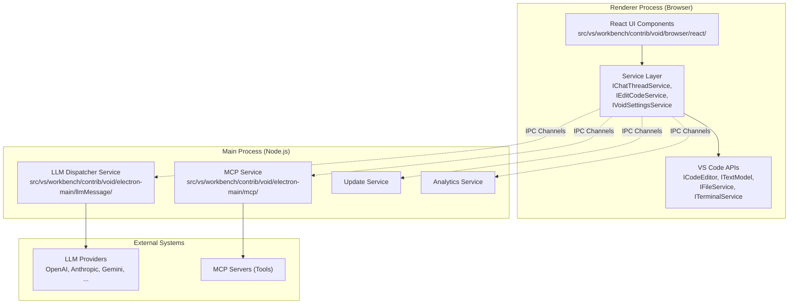
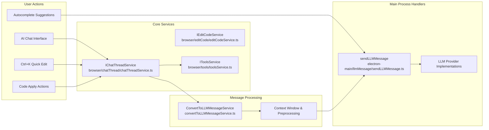
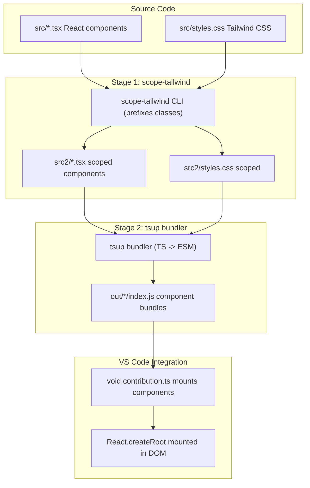
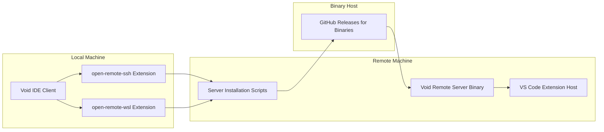

# Overview

<details>
<summary>Relevant source files</summary>

The following files were used as context for generating this wiki page:

- [.devcontainer/Dockerfile](.devcontainer/Dockerfile)
- [.devcontainer/README.md](.devcontainer/README.md)
- [.voidrules](.voidrules)

</details>


This document provides a high-level introduction to Void’s purpose, architecture, core systems, and organization within the VS Code fork codebase. Void is an AI-powered fork of Visual Studio Code that deeply integrates Large Language Model (LLM) capabilities to enhance code editing through chat, inline editing, autocomplete, and tool automation.

For detailed guidance on specific topics, see the linked child pages at the end of this overview.

---

## What is Void?

Void is an **open-source AI-augmented fork of VS Code** designed to integrate large-scale language models deeply into the developer workflow. It extends VS Code by embedding LLM-driven features such as conversational chat, inline quick edits, AI autocompletion, and programmatic code transformations.

Key points:

- Forked from the [microsoft/vscode](https://github.com/microsoft/vscode) repository
- Transparently adds AI features without sending code data beyond LLM requests
- Supports a wide range of LLM providers (OpenAI, Anthropic, Gemini, Ollama, Mistral, Groq, and more)
- Enables local hosting and “bring your own model” scenarios
- Source code fully available at [github.com/voideditor/void](https://github.com/voideditor/void)

Void targets developers who want AI-assisted coding integrated naturally into their editor with full control and transparency.

**Sources:** [.voidrules:1-5](), [README.md:1-42]()

---

## Project Status

Development of Void is currently paused while exploring new coding paradigms, but the existing codebase remains fully functional and serves as a comprehensive example of how to build a VS Code fork integrated with AI assistant capabilities.

**Sources:** [README.md:25-30]()

---

## Architecture Foundations

### VS Code Backbone

Void builds entirely on top of VS Code’s core architecture, which includes:

- **Electron-based desktop application**
- **Monaco Editor** as the text editor engine
- **Service-oriented architecture** with dependency injection
- **Multi-process design** with separation between main and renderer processes
- **Native VS Code extensions and contribution points**

Custom Void features are confined mostly within the `src/vs/workbench/contrib/void/` directory for maintainability and modularity.

**Sources:** [.voidrules:3-5](), [package.json:185]() 

---

### Process Separation and IPC

Void respects VS Code’s multi-process Electron model to isolate UI from Node.js native modules and preserve security.



- **Renderer process** hosts UI components, uses React for interface in `src/vs/workbench/contrib/void/browser/react/`.
- **Services** in the renderer provide main business logic, communicate via IPC to main.
- **Main process** does LLM calls, law enforcement on native modules, update downloads, and metrics.
- **IPC channels** ensure clean boundaries between renderer UI and Node.js logic.

**Sources:** [.voidrules:3](), [VOID_CODEBASE_GUIDE.md:19-31, 55-68]()

---

### Key Codebase Directories

| Directory | Description |
|-----------|-------------|
| `src/vs/workbench/contrib/void/` | All Void-specific source code |
| `.../browser/` | Renderer-side services and UI |
| `.../browser/react/` | React components and build scripts |
| `.../electron-main/` | Main process services including LLM and MCP |
| `.../common/` | Shared types and utilities |
| `extensions/open-remote-ssh/` | Remote SSH development extension |
| `extensions/open-remote-wsl/` | Remote WSL development extension |

**Sources:** [.voidrules:3-5](), [VOID_CODEBASE_GUIDE.md:19-31]()

---

## Core Systems

### AI/LLM Integration Pipeline

Void’s AI features flow through a layered architecture coordinating UI, services, message conversion, and provider calls:



- **`IChatThreadService`** orchestrates chat conversations, tool executions, and edits.
- **`ConvertToLLMMessageService`** adapts internal chat formats to provider-specific message schemas.
- **`sendLLMMessage`** dispatches IPC calls in the main process to concrete LLM API implementations.
- Providers include OpenAI, Anthropic, Gemini, Ollama, Mistral, Groq, and others.

**Sources:** [VOID_CODEBASE_GUIDE.md:55-68](), [package.json:75-82, 112-113, 125, 127]()

---

### React UI Layer and Build Pipeline

Void employs React 19 to build its user interface integrated with VS Code’s DOM and style system.



- The first build step scopes CSS to avoid collisions with VS Code’s global styles.
- The second step bundles components as ESM modules for VS Code to load.
- Components cover chat sidebar, settings, quick edit, tooltips, onboarding, diffs, and editor widgets.

**Sources:** [src/vs/workbench/contrib/void/browser/react/build.js:1-154](), [src/vs/workbench/contrib/void/browser/react/tsup.config.js:1-43](), [package.json:13-14]()

---

### Service Layer Architecture

Void implements singleton services following VS Code’s dependency injection conventions:

| Service | Folder | Process | Responsibility |
|---------|--------|---------|----------------|
| `IChatThreadService` | `browser/chatThread/` | Renderer | Manages chat conversations, LLM calls, tool integration |
| `IEditCodeService` | `browser/editCode/` | Renderer | Manages code diffs, streaming edits, apply workflows |
| `IVoidSettingsService` | `browser/voidSettings/` | Renderer | Stores provider configs, models, persists preferences |
| `ILLMMessageService` | `browser/llmMessage/` | Renderer (proxy) | IPC proxy to main process LLM dispatcher |
| `IToolsService` | `browser/tools/` | Renderer | Validates and executes built-in and MCP tools |
| `IMCPService` | `browser/mcp/` | Renderer (proxy) | Proxies MCP tool handling to main process |
| `IVoidUpdateService` | `browser/voidUpdate/` | Renderer (proxy) | Manages update checks and notifications |
| `IMetricsService` | `browser/metrics/` | Renderer (proxy) | Sends analytics to PostHog |

Proxy services handle bridging renderer and main process logic, especially for Node.js native modules and external APIs.

**Sources:** [VOID_CODEBASE_GUIDE.md:49]()

---

## Entry Points and User Interaction

Void initializes largely like standard VS Code:

1. Electron main process boots and launches VS Code workbench
2. The workbench loads user interface components
3. Void contributions activate in `src/vs/workbench/contrib/void/browser/void.contribution.ts`, registering services and UI elements

Commands (actions) are registered for user interaction via keyboard shortcuts and command palette:

```mermaid
graph TB
    subgraph "User Input"
        Keyboard["Keyboard (e.g. Cmd+L, Cmd+K, Cmd+Shift+L)"]
        CmdPalette["Command Palette (Cmd+Shift+P)"]
    end
    
    subgraph "Actions Layer"
        ActionsDef["Action Definitions<br/>void-*.action.ts"]
        ActionsImpl["Action Implementations<br/>addToChat(), openQuickEdit(), newThread()"]
    end
    
    subgraph "Services"
        Services["ChatThreadService, EditCodeService, etc."]
    end
    
    Keyboard --> ActionsDef
    CmdPalette --> ActionsDef
    ActionsDef --> ActionsImpl
    ActionsImpl --> Services
```

Notable commands include adding code to chat, quick edit opening, new chat thread creation, and accepting or rejecting AI-suggested diffs.

**Sources:** [VOID_CODEBASE_GUIDE.md:51-52]()

---

## Build System Summary

Void uses a two-stage React build pipeline to integrate Tailwind CSS into VS Code:

- **Stage 1: scope-tailwind** prefixes all Tailwind CSS classes with `void-` to avoid conflicts with VS Code’s global CSS.
- **Stage 2: tsup** bundles the scoped React components into ESM modules for efficient loading.

These coordinated steps enable seamless embedding of React UI in the VS Code environment.

For the full VS Code build, Gulp orchestrates TypeScript compilation, extension building, and packaging.

**Sources:** [src/vs/workbench/contrib/void/browser/react/build.js:1-154](), [src/vs/workbench/contrib/void/browser/react/tsup.config.js:1-43](), [package.json:12-72]()

---

## Remote Development Capabilities

Void supports remote development workflows through extensions for SSH and WSL:



Scripts automate server installation on remote hosts, downloading platform binaries from GitHub releases, enabling full remote VS Code experience with AI capabilities.

**Sources:** [extensions/open-remote-ssh/src/serverSetup.ts:205-626](), [extensions/open-remote-wsl/src/serverSetup.ts:137-353](), [extensions/open-remote-ssh/package.json:70-75](), [extensions/open-remote-wsl/package.json:37-42]()

---

## Dependency Highlights

Void builds on critical dependencies aligned with AI and modern web development:

| Category | Package | Version | Role |
|----------|---------|---------|------|
| AI Providers | `@anthropic-ai/sdk` | ^0.40.0 | Anthropic client |
|  | `openai` | ^4.96.0 | OpenAI API client |
|  | `@google/genai` | ^0.13.0 | Google Gemini SDK |
|  | `ollama` | ^0.5.15 | Local Ollama client |
|  | `@mistralai/mistralai` | ^1.6.0 | Mistral AI client |
|  | `groq-sdk` | ^0.20.1 | Groq API client |
|  | `@modelcontextprotocol/sdk` | ^1.11.2 | MCP integration |
| UI Framework | `react` | ^19.1.0 | React UI library |
|  | `react-dom` | ^19.1.0 | React DOM rendering |
| Styling | `tailwindcss` | ^3.4.17 | CSS utilities |
|  | `scope-tailwind` | ^1.0.9 | CSS class scoping |
| Build | `tsup` | ^8.4.0 | Bundler |
| Core | `electron` | 34.3.2 | Electron desktop runtime |

---

## Next Steps

To learn more about Void in detail, explore the following child wiki pages:

- [Getting Started](#1.1) — Installation, prerequisites, and first run
- [Contributing to Void](#1.2) — Development workflow and build process
- [Architecture Overview](#1.3) — Detailed system architecture and process interaction

These pages will help you navigate setup, extend the codebase, and develop understanding of Void’s internals.

---

# Summary

Void is a robust open-source fork of VS Code that integrates LLM capabilities tightly into the developer experience. Its architecture preserves VS Code’s modularity and security boundaries while empowering LLM-powered chat, editing, autocomplete, and tooling. The codebase is designed for transparency, extensibility, and remote development, with modern React UI and a clean service layering approach.

---

**Sources:**

- [.voidrules:1-16]()
- [README.md:1-42, 25-30]()
- [package.json:1-10, 12-72, 74-138, 140-256]()
- [VOID_CODEBASE_GUIDE.md:1-168]()
- [src/vs/workbench/contrib/void/browser/react/build.js:1-154]()
- [src/vs/workbench/contrib/void/browser/react/tsup.config.js:1-43]()
- [extensions/open-remote-ssh/src/serverSetup.ts:1-626]()
- [extensions/open-remote-wsl/src/serverSetup.ts:1-353]()