# Getting Started

<details>
<summary>Relevant source files</summary>

The following files were used as context for generating this wiki page:

- [.configurations/configuration.dsc.yaml](.configurations/configuration.dsc.yaml)
- [.devcontainer/devcontainer.json](.devcontainer/devcontainer.json)
- [.devcontainer/post-create.sh](.devcontainer/post-create.sh)

</details>


This page guides you through installing Void, completing the initial setup, and using core features for the first time. For information about Void’s architecture and how systems interact, see [Architecture Overview](#1.3). For development and contribution instructions, see [Contributing to Void](#1.2).

## Purpose and Scope

This document covers:

- Downloading and installing Void
- First-time onboarding flow and provider configuration
- Model selection for different features
- Basic usage of Chat and Quick Edit features

After completing this guide, you will have Void installed with at least one LLM provider configured and be ready to use AI-powered coding features.

---

## Installation

### Downloading Void

Void distributes pre-built binaries for macOS, Windows, and Linux. Download the appropriate version for your platform from the [Void website](https://voideditor.com) or the [GitHub releases page](https://github.com/voideditor/binaries/releases).

**Platform-specific installers:**

- **macOS**: `.dmg` file for drag-and-drop installation
- **Windows**: `.exe` installer or portable `.zip`
- **Linux**: `.deb`, `.rpm`, or `.tar.gz` depending on distribution

The binary naming convention follows:

```
void-{platform}-{arch}-{version}
```

where `platform` is `darwin`, `win32`, or `linux`, and `arch` is typically `x64` or `arm64`.

### Development Environment Prerequisites

If you intend to build Void from source or develop on it, the following prerequisites are recommended:

- **Git**
- **Node.js 20** (LTS)
- **Python 3.10**
- **Visual Studio 2022 Build Tools** (Windows only)

These can be installed using the Windows winget package manager with the configuration manifest `.configurations/configuration.dsc.yaml`, which automates dependencies installation for Windows developers.

For cross-platform development, the repository includes a [Dev Container](.devcontainer/devcontainer.json) that sets up a containerized environment with Rust, desktop-lite features, and VNC support for GUI access. After opening the container, the post-create script (`.devcontainer/post-create.sh`) runs `npm install` and starts Void in development mode.

**Sources:**  
[.configurations/configuration.dsc.yaml:1-56]()  
[.devcontainer/devcontainer.json:1-53]()  
[.devcontainer/post-create.sh:1-4]()

### First Launch

On first launch, Void displays a full-screen onboarding interface. This onboarding flow is required before accessing the editor and ensures you have at least one Chat model configured.

**Sources:**  
[VoidOnboarding.tsx:18-40]()

---

## Onboarding Flow

### Overview

The onboarding process guides you through provider setup and model configuration. The flow consists of multiple pages to help you select and configure an LLM provider matching your requirements.

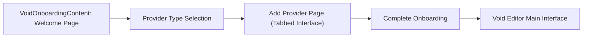

The onboarding state is driven by the `VoidOnboardingContent` React component, which tracks the current page index and manages selections of providers and models.

**Sources:**  
[VoidOnboarding.tsx:470-593]()

### Provider Type Selection

The first onboarding page presents options to select what type of provider to use:

| Option   | Providers Included               | Description                                      |
|----------|--------------------------------|-------------------------------------------------|
| **Smart** | Anthropic, OpenAI, Gemini, OpenRouter | Highest performing models on benchmarks         |
| **Private** | Ollama, vLLM, OpenAI-Compatible, LM Studio | Local/self-hosted models prioritizing privacy  |
| **Cheap** | Gemini, DeepSeek, OpenRouter, Ollama, vLLM | Free tiers or affordable options                 |
| **All** | All available providers          | Access to entire set of configured providers     |

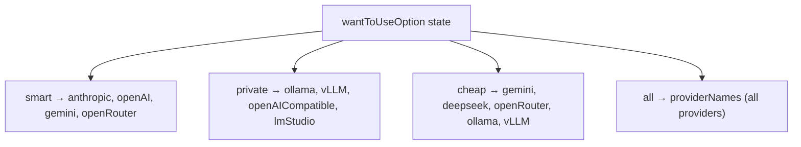

**Sources:**  
[VoidOnboarding.tsx:468-517]()  
[voidSettingsTypes.ts:16-20]()

### Add Provider Page

The second onboarding page organizes providers into tabs:

- **Free:** Gemini, OpenRouter
- **Paid:** Cloud API providers requiring keys
- **Local:** Ollama, vLLM, LM Studio detected automatically
- **Cloud/Other:** Google Vertex, Azure, AWS Bedrock, LiteLLM, OpenAI-Compatible

Within each tab, users configure API keys or endpoints and select enabled models.

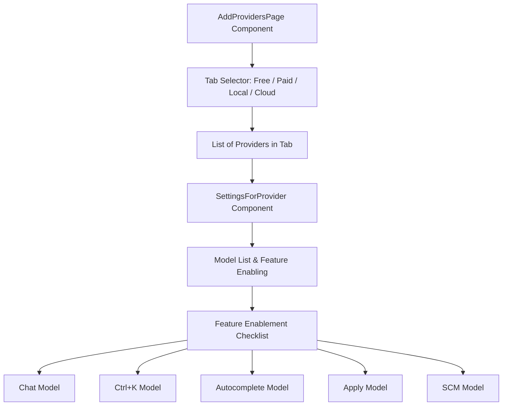

Each provider’s settings include `SettingsAtProvider` data structures with fields such as:

- `apiKey` (for API providers)
- `models` (array of configured models with properties like `modelName`, `type` (`default`, `autodetected`, `custom`), and `isHidden`)
- `_didFillInProviderSettings` (boolean flag indicating configuration completion)

Validation enforces that at least one Chat model is enabled before proceeding.

**Example: Anthropic Provider Settings**

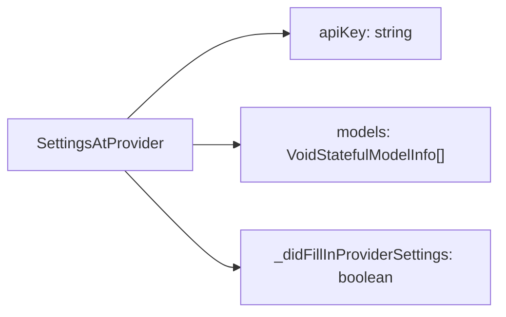

**Sources:**  
[VoidOnboarding.tsx:96-273]()  
[voidSettingsTypes.ts:32-50]()  
[voidSettingsTypes.ts:398-430]()

### Local Provider Auto-Detection

Void automatically detects running local providers (Ollama, vLLM, LM Studio) and retrieves their available models.

**Detection Flow:**

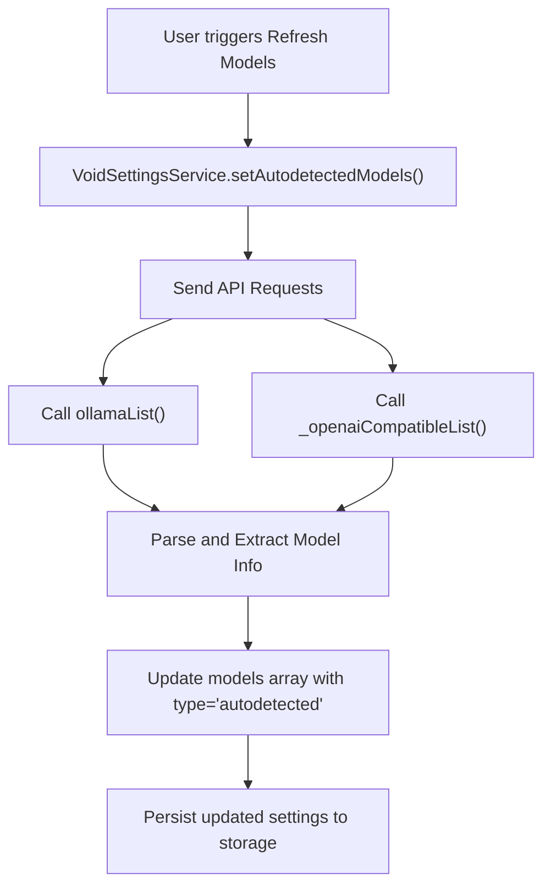

The Ollama detection uses the Ollama API to list available models at the configured endpoint, overwriting previous autodetected models but preserving user custom models.

**Sources:**  
[voidSettingsService.ts:74-104]()  
[sendLLMMessage.impl.ts:628-650]()  
[sendLLMMessage.impl.ts:398-423]()

---

## Model Selection and Feature Mapping

Void supports independent model selection per feature. The primary features requiring models include:

| Feature     | Display Name      | Requirements                   | Syncing Behavior          |
|-------------|-------------------|--------------------------------|--------------------------|
| `Chat`      | Chat              | Any model                      | Primary model selection   |
| `Ctrl+K`    | Quick Edit        | Any model                      | Independent               |
| `Autocomplete` | Autocomplete      | Requires Fill-In-Middle (FIM) support | Independent               |
| `Apply`     | Fast Apply        | Any model                      | Syncs to Chat by default  |
| `SCM`       | Commit Message Gen | Any model                      | Syncs to Chat by default  |

### Feature-to-Model Mapping Storage

Mappings are stored in the `VoidSettingsState`'s `modelSelectionOfFeature` property which maps feature names to a `ModelSelection` object or `null`.

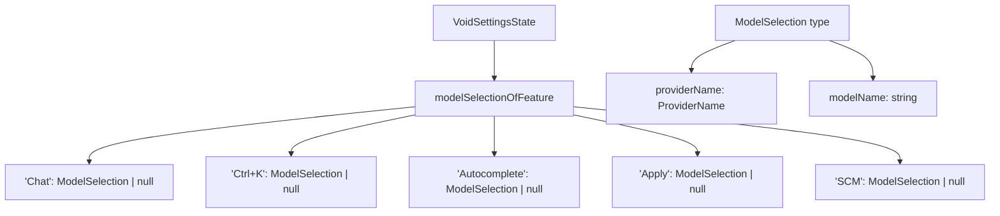

### Fill-In-Middle (FIM) Requirement for Autocomplete

The `Autocomplete` feature requires models supporting FIM. This is enforced via a filter function when validating model selections:

```typescript
// voidSettingsService.ts excerpt
'Autocomplete': {
  filter: (o, opts) => getModelCapabilities(o.providerName, o.modelName, opts.overridesOfModel).supportsFIM,
  emptyMessage: { message: 'No models support FIM', priority: 'always' }
}
```

Models known to support FIM include Codestral and Devstral from Mistral, Qwen 2.5 Coder, Starcoder2, and CodeGemma 2b.

**Sources:**  
[voidSettingsTypes.ts:365-385]()  
[voidSettingsService.ts:107-121]()  
[modelCapabilities.ts:162-203]()

### Model Capabilities System

Model capabilities are statically defined in `modelCapabilities.ts` as `VoidStaticModelInfo` objects. These capabilities describe each model’s features and behavior.

Key properties in `VoidStaticModelInfo`:

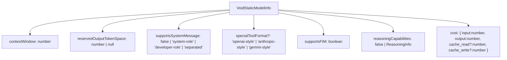

Capabilities are organized into named sets by provider:

- `openAIModelOptions` (OpenAI models)
- `anthropicModelOptions` (Anthropic)
- `geminiModelOptions` (Gemini)
- `openSourceModelOptions_assumingOAICompat` (Open source models compatible with OpenAI API)

Fallback capabilities attempt pattern matching on model names for unmapped models.

**Sources:**  
[modelCapabilities.ts:162-252]()  
[modelCapabilities.ts:479-703]()

---

## Basic Usage

### Opening the Sidebar

Once onboarding is complete, Void opens to the main editor interface. The AI sidebar appears and can be toggled with:

- **Keybinding:** `Cmd+B` (Mac) or `Ctrl+B` (Windows/Linux)
- **Menu:** View → Sidebar

The sidebar includes:

- Chat interface for conversational AI
- Thread history for conversation management
- Settings button for model/provider configuration

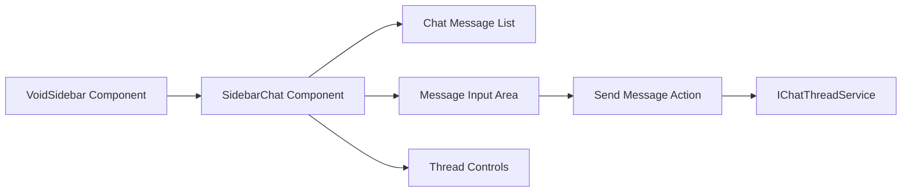

**Sources:**  
[VOID_CODEBASE_GUIDE.md:56-68]()  
[SidebarChat.tsx:20-80]()

### Sending Your First Chat Message

User’s chat message handling flow:

1. Type message in the sidebar input.
2. Press Enter or click send.
3. Message is appended via `ChatThreadService.sendMessage()` to the current conversation.
4. Message is converted to provider-specific format by `ConvertToLLMMessageService`.
5. Sent to the main process via IPC channel `void-channel-llmMessage`.
6. Dispatched by `sendLLMMessage` to the corresponding provider’s SDK implementation.
7. Response streams back incrementally triggering `onText` callbacks.
8. UI updates show streaming response text in chat.

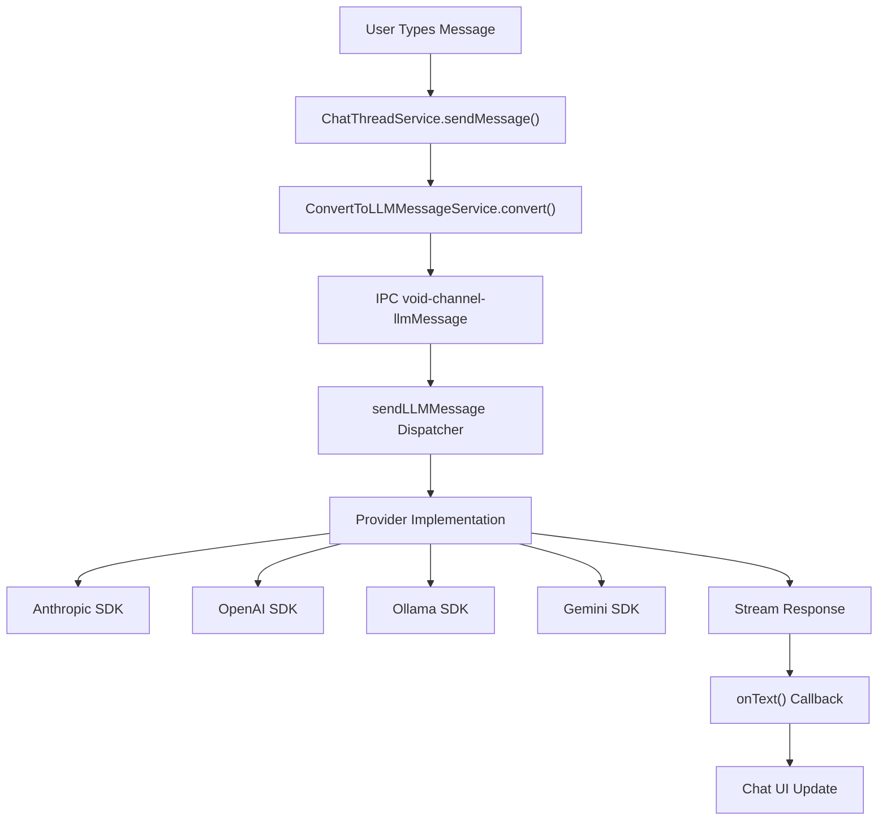

If Chat is set to "agent" mode, LLM can initiate tool calls, which appear as special messages with approval mechanisms.

**Sources:**  
[sendLLMMessage.impl.ts:1-388]()  
[VOID_CODEBASE_GUIDE.md:55-68]()  
[ConvertToLLMMessageService.ts:10-55]()

### Using Quick Edit (Ctrl+K)

Quick Edit allows inline modification of code through AI assistance without leaving the editor or switching to the sidebar.

**Activation workflow:**

1. Place the text cursor where edits are desired.
2. Press `Ctrl+K` (`Cmd+K` on Mac).
3. An inline input widget appears.
4. Enter your instruction and press Enter.

**Processing flow:**

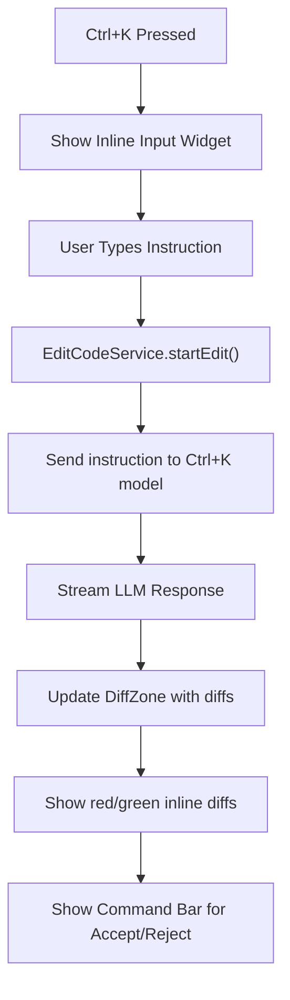

The DiffZone concept tracks and manages regions of code under edit. Changes stream and appear as colored diffs.

- **Fast Apply:** LLM outputs search-and-replace blocks marking old and new code sections.
- **Slow Apply:** LLM rewrites entire file region. Slower but more thorough; configurable.

**Sources:**  
[VOID_CODEBASE_GUIDE.md:84-97]()  
[QuickEdit.tsx:10-45]()  
[editCodeService.ts:50-120]()

---

## Provider Configuration Details

### Default Provider Settings

Default endpoints and APIs for well-known providers include:

| Provider    | Default Endpoint                    | Notes                         |
|-------------|-----------------------------------|-------------------------------|
| Ollama      | `http://127.0.0.1:11434`          | Local API                     |
| vLLM        | `http://localhost:8000`            | Local API                     |
| LM Studio   | `http://localhost:1234`            | Local API                     |
| LiteLLM     | `http://localhost:4000`            | Local API                     |

API key formats vary by cloud provider (OpenAI, Anthropic, Gemini, Groq, DeepSeek, etc.)

**Sources:**  
[modelCapabilities.ts:12-69]()  
[voidSettingsTypes.ts:113-133]()

### Encrypted Storage of Settings

Void stores provider settings and sensitive data such as API keys encrypted in VS Code’s storage service.

Storage flow:

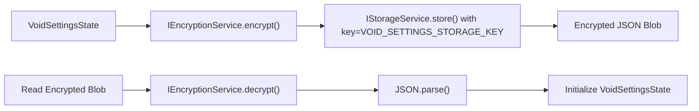

Scope: `StorageScope.APPLICATION` (global), Target: `StorageTarget.USER`.

**Sources:**  
[voidSettingsService.ts:350-366]()

---

## Summary Diagram: Bridging Natural Language to Code Entities (Getting Started)

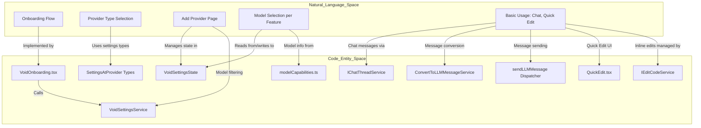

---

## Next Steps

After completing initial setup, explore:

- **[Sidebar Chat and Thread Management](#2.1):** Managing conversations and chat features.
- **[Settings and Model Selection](#2.2):** Advanced configuration and per-feature model management.
- **[Quick Edit (Ctrl+K)](#2.3):** Inline editing with AI assistance.
- **[Code Editing and Apply System](#2.5):** Understanding diff application and workflows.
- **[Autocomplete and Inline Suggestions](#2.6):** Configuring AI autocomplete.

For development and contribution:

- **[Contributing to Void](#1.2):** Development environment setup and build pipelines.
- **[Architecture Overview](#1.3):** Deep dive into system design and architecture.

---

**Sources:**  
[.configurations/configuration.dsc.yaml]()  
[.devcontainer/devcontainer.json]()  
[.devcontainer/post-create.sh]()  
[VoidOnboarding.tsx]()  
[voidSettingsTypes.ts]()  
[voidSettingsService.ts]()  
[modelCapabilities.ts]()  
[sendLLMMessage.impl.ts]()  
[QuickEdit.tsx]()  
[editCodeService.ts]()  
[VOID_CODEBASE_GUIDE.md]()  
[ConvertToLLMMessageService.ts]()