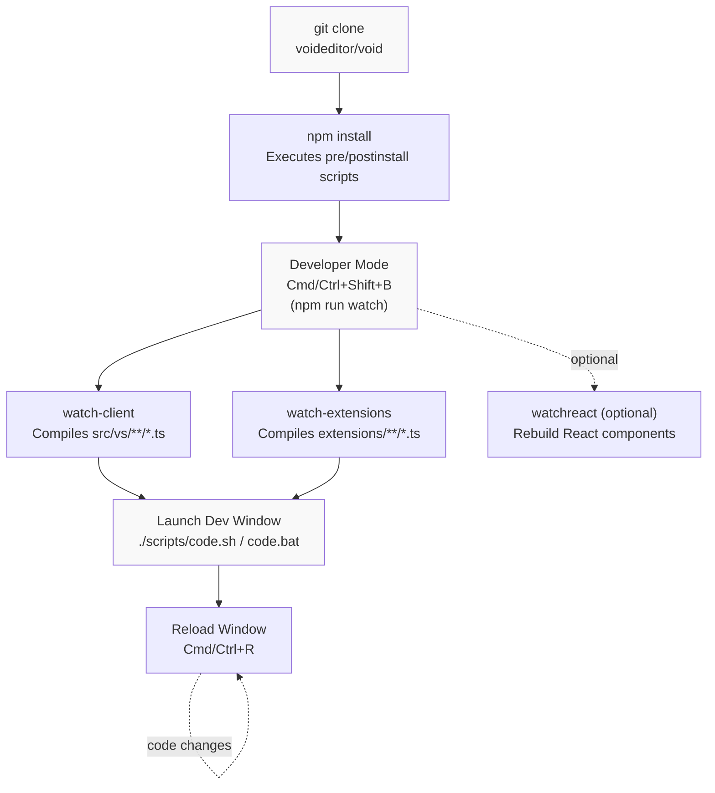
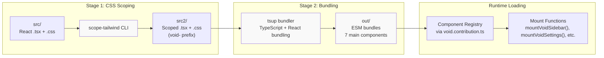
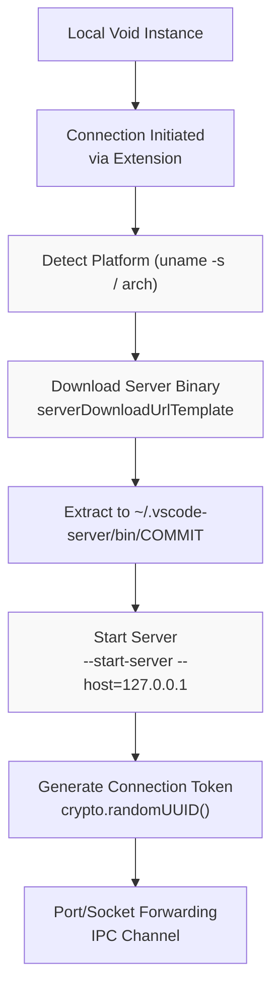

# Contributing to Void

<details>
<summary>Relevant source files</summary>

The following files were used as context for generating this wiki page:

- [.devcontainer/Dockerfile](.devcontainer/Dockerfile)
- [.devcontainer/devcontainer-lock.json](.devcontainer/devcontainer-lock.json)
- [.devcontainer/devcontainer.json](.devcontainer/devcontainer.json)
- [.devcontainer/install-vscode.sh](.devcontainer/install-vscode.sh)
- [.editorconfig](.editorconfig)
- [.gitignore](.gitignore)

</details>


This document provides a comprehensive guide to contributing to the Void project, covering development environment setup, build processes, and contribution workflows. For information about the overall architecture of Void, see [Architecture Overview](#1.3). For detailed build system documentation, see [Build System and Pipeline](#5.1). For React component integration patterns, see [React Component Architecture](#5.2).

---

## Prerequisites by Platform

Before contributing to Void, you must install platform-specific dependencies required to build native modules and compile the project.

### macOS Prerequisites

**Requirements:**
- Python (typically pre-installed)
- Xcode Command Line Tools (typically pre-installed)

Verify installation with `xcode-select -p`. If not installed, run `xcode-select --install`.

### Windows Prerequisites

**Requirements:**
- Visual Studio 2022 (Community Edition) or VS Build Tools
- Specific workloads and components

**Installation Steps:**

1. Download and install [Visual Studio 2022](https://visualstudio.microsoft.com/thank-you-downloading-visual-studio/?sku=Community)

2. In the Workloads tab, select:
   - `Desktop development with C++`
   - `Node.js build tools`

3. In the Individual Components tab, select:
   - `MSVC v143 - VS 2022 C++ x64/x86 Spectre-mitigated libs (Latest)`
   - `C++ ATL for latest build tools with Spectre Mitigations`
   - `C++ MFC for latest build tools with Spectre Mitigations`

### Linux Prerequisites

**Debian/Ubuntu:**
```bash
sudo apt-get install build-essential g++ libx11-dev libxkbfile-dev libsecret-1-dev libkrb5-dev python-is-python3
```

**Red Hat/Fedora:**
```bash
sudo dnf install @development-tools gcc gcc-c++ make libsecret-devel krb5-devel libX11-devel libxkbfile-devel
```

**SUSE/openSUSE:**
```bash
sudo zypper install patterns-devel-C-C++-devel_C_C++ krb5-devel libsecret-devel libxkbfile-devel libX11-devel
```

Additionally, install `node-gyp` globally:
```bash
npm install -g node-gyp
```

**Node.js Version:**
Void requires Node.js version `20.18.2` as specified in [.nvmrc](). Use [nvm](https://github.com/nvm-sh/nvm) to manage Node versions:
```bash
nvm install
nvm use
```

**Sources:** [HOW_TO_CONTRIBUTE.md:27-53]()

---

## Development Environment Setup

### Initial Repository Setup

**Clone and Install:**
```bash
git clone https://github.com/voideditor/void
cd void
npm install
```

The `npm install` command executes essential scripts:
- `build/npm/preinstall.js` — performs pre-installation validation
- `build/npm/postinstall.js` — handles setup tasks post-installation

### Entering Developer Mode

Developer Mode initializes file watchers that automatically recompile source files upon changes, enabling continuous development. Note that the initial build may take approximately 5 minutes.

**Platform-specific shortcut keys to start Developer Mode:**

| Platform | Shortcut        |
|----------|-----------------|
| Windows  | <kbd>Ctrl+Shift+B</kbd> |
| macOS    | <kbd>Cmd+Shift+B</kbd>  |
| Linux    | <kbd>Ctrl+Shift+B</kbd> |

This triggers the VS Code task defined in `.vscode/tasks.json` which runs:

- `npm run watch-client` — watches and compiles core TypeScript sources under `src/vs/**`
- `npm run watch-extensions` — watches and compiles extension code under `extensions/**`

**Alternatively, run in terminal:**
```bash
npm run watch
```
This executes `npm-run-all -lp watch-client watch-extensions` (see [package.json:24-38]()).

### Development Workflow Diagram



**Sources:** [HOW_TO_CONTRIBUTE.md:55-73](), [package.json:12-38]()

---

## Development Window Launch

After configuring Developer Mode, launch a development instance of Void.

**Launch Script by Platform:**

| Platform      | Script           | Location            |
|---------------|------------------|---------------------|
| Windows       | `./scripts/code.bat` | [scripts/code.bat]() |
| macOS/Linux   | `./scripts/code.sh`  | [scripts/code.sh]()  |

**Recommended Flags for Isolation:**

```bash
./scripts/code.sh --user-data-dir ./.tmp/user-data --extensions-dir ./.tmp/extensions
```

These flags isolate user data and extensions to the `.tmp` folder, allowing environment reset by deleting `.tmp`.

**Reload Changes:**

- Press <kbd>Cmd+R</kbd> (macOS) or <kbd>Ctrl+R</kbd> (Windows/Linux) to reload the active window.
- Or open the Command Palette <kbd>Cmd+Shift+P</kbd> / <kbd>Ctrl+Shift+P</kbd> and run `Reload Window`.

**Stopping Watch Processes:**
- Use <kbd>Ctrl+D</kbd> in the terminal to gracefully stop watch processes.
- **Avoid** <kbd>Ctrl+C</kbd>, which closes the terminal but leaves the watcher running in the background.

**Sources:** [HOW_TO_CONTRIBUTE.md:66-72]()

---

## Build System Architecture

Void extends the existing VS Code build system with a custom two-stage React build pipeline. It uses VS Code’s Gulp tasks for TypeScript compilation and a separate pipeline for React components with scoped Tailwind CSS.

### Core TypeScript Compilation

VS Code’s native Gulp tasks compile core and extension TypeScript:

| Task             | File           | Purpose                         |
|------------------|----------------|--------------------------------|
| `compile`        | gulpfile.js    | One-time full TypeScript build |
| `watch-client`   | gulpfile.js    | Watch core source files (`src/vs/**`)  |
| `watch-extensions`| gulpfile.js   | Watch extension files (`extensions/**`) |

---

### React Build Pipeline Overview

Void’s React UI components use a **two-stage build** to integrate:

1. **Scope Tailwind CSS and Component Prefixing** (to avoid style conflicts)
2. **Bundle with TSUP** to produce ESM modules consumable by the Void extension host



**Sources:** [src/vs/workbench/contrib/void/browser/react/build.js:1-154](), [VOID_CODEBASE_GUIDE.md:128-130]()

---

## React Component Build Pipeline

### Stage 1: CSS Scoping with `scope-tailwind`

The `scope-tailwind` CLI processes React component `.css` and `.tsx` files by prefixing all Tailwind CSS classes with `void-` and wrapping styles inside a `.void-scope` selector to prevent style conflicts with VS Code’s global CSS.

**Process Example:**

- Input CSS (`src/styles.css`):
  ```css
  .button {
    background: blue;
  }
  ```
- Transformed CSS (`src2/styles.css`):
  ```css
  .void-scope .void-button {
    background: blue;
  }
  ```

**Typical Command:**
```bash
npx scope-tailwind ./src -o ./src2/ -s void-scope -c styles.css -p "void-"
```

- **Input directory:** `src/`
- **Output directory:** `src2/`
- **Scope wrapper:** `.void-scope`
- **Class prefix:** `void-`

This ensures all React UI elements have uniquely namespaced CSS classes.

### Stage 2: Bundling with `tsup`

The `tsup` tool bundles the scoped `.tsx` React components from `src2/` into ES modules suitable for direct consumption in the VS Code extension environment.

**Configuration Highlights:** (in `tsup.config.js`)

- **Entry points:**  
  ```js
  [
    './src2/void-editor-widgets-tsx/index.tsx',
    './src2/sidebar-tsx/index.tsx',
    './src2/void-settings-tsx/index.tsx',
    './src2/void-tooltip/index.tsx',
    './src2/void-onboarding/index.tsx',
    './src2/quick-edit-tsx/index.tsx',
    './src2/diff/index.tsx',
  ]
  ```
- **Output:** `out/` directory with subfolders for each component
- **Output format:** ES modules (`esm`)
- **Platform:** Browser (React components target browser environment)
- **CSS Injection:** Inline via `injectStyle: true`
- **External modules:** All node_modules bundled, local imports preserved external
- **Watch mode support** for development rebuilds

**Output structure example:**
```
out/
├── sidebar-tsx/index.js
├── void-settings-tsx/index.js
├── ctrl-k-tsx/index.js
├── quick-edit-tsx/index.js
├── void-tooltip/index.js
├── void-onboarding/index.js
└── diff/index.js
```

**Sources:** [src/vs/workbench/contrib/void/browser/react/tsup.config.js:1-43]()

---

### Watch Mode for React Components

For efficient development, run React watchers to automatically rebuild on source changes.

**Start React watcher:**
```bash
npm run watchreact
```

This runs two concurrent watchers defined in `build.js`:

- A `nodemon` process watches `src/**/*.{ts,tsx,css}`, triggering the `scope-tailwind` recompilation.
- A `tsup --watch` process watches `src2/**/*`, triggering re-bundling.

---

### Combined Development Setup

| Terminal 1                                 | Terminal 2                      |
|--------------------------------------------|--------------------------------|
| `npm run watch` (core TypeScript watcher)  | `npm run watchreact` (React watcher) |

---

### Key React Runtime Components

- `void.contribution.ts` registers component bundles with VS Code contribution points.
- Mount functions such as `mountVoidSidebar()`, `mountVoidSettings()` instantiate React components in their respective UI containers.

---

## Build System Troubleshooting

| Error or Issue                                                 | Cause                                         | Solution or Workaround                       |
|----------------------------------------------------------------|-----------------------------------------------|----------------------------------------------|
| `TypeError: Failed to fetch dynamically imported module`       | Import missing `.js` extension in source code | Ensure imports end with `.js` extension      |
| React build runs out of memory                                  | Insufficient Node.js memory                    | Run build with `NODE_OPTIONS="--max-old-space-size=8192"` |
| Styles missing or delayed loading                               | Styles not compiled or loaded yet              | Wait a few seconds, reload window             |
| `libtool: error: unrecognised option: '-static'` on macOS      | Default BSD libtool used instead of GNU libtool | Install GNU libtool: `brew install libtool`  |
| `SUID sandbox helper binary` permission errors                 | Incorrect permissions on sandbox binary       | Fix permissions with `sudo chown root:root .build/electron/chrome-sandbox && sudo chmod 4755 .build/electron/chrome-sandbox` |

**Important Path and Version Notes:**

- Void repository path **must not contain spaces**.
- Node.js version must match `.nvmrc` (20.18.2).

**Sources:** [HOW_TO_CONTRIBUTE.md:76-88]()

---

## Contributing Guidelines

### Contribution Methods

| Method              | Description                                    |
|---------------------|------------------------------------------------|
| **Roadmap Items**   | Implement features from the [Project Board](https://github.com/orgs/voideditor/projects/2) |
| **Suggestions**    | Discuss ideas and features on [Discord](https://discord.gg/RSNjgaugJs) |
| **Bug Reports**    | Submit issues on GitHub Issues page            |

### Pull Request Guidelines

**Process:**
1. Create a feature or fix branch.
2. Test thoroughly in Developer Mode.
3. Submit a pull request with descriptive summary (no AI-generated PR texts).
4. Avoid bundling unrelated changes.

**Notes:**
- You do not need to create an Issue before a PR unless it spans multiple issues.
- PRs should avoid upstream VS Code changes; focus on Void-specific code.

### Development Pause Notice

Active development on Void IDE is currently paused (see [README.md:25-29]()). The team responds to email inquiries at `hello@voideditor.com` concerning building and maintaining custom forks but may not review PRs or issues actively.

### Void-Specific Code Organization

Void's main code components reside under:
```
src/vs/workbench/contrib/void/
├── browser/          # Browser (renderer) process code
│   ├── react/        # React components
│   └── *.ts          # Services, actions, utilities
├── common/           # Code shared among processes
└── electron-main/    # Main Electron process code
```

**Sources:** [HOW_TO_CONTRIBUTE.md:1-11](), [HOW_TO_CONTRIBUTE.md:146-151](), [README.md:25-35]()

---

## Distribution and Packaging

### Production Build Pipeline

Void’s production and releases are managed via a specialized fork of the VSCodium build process, maintained in [void-builder](https://github.com/voideditor/void-builder).

Steps:

1. GitHub workflows trigger builds.
2. Platform-specific binaries are compiled.
3. Installers are created.
4. Releases are published to distribution channels.

### Local Executable Build (For Testing Only)

Developers can build local executable binaries; however, this is discouraged for distribution purposes.

**Build commands by platform:**

| Platform           | Command                             | Output Directory           |
|--------------------|-----------------------------------|----------------------------|
| macOS (Apple Silicon) | `npm run gulp vscode-darwin-arm64` | `../VSCode-darwin-arm64/`  |
| macOS (Intel)      | `npm run gulp vscode-darwin-x64`    | `../VSCode-darwin-x64/`    |
| Windows (x64)      | `npm run gulp vscode-win32-x64`     | `../VSCode-win32-x64/`     |
| Windows (ARM)      | `npm run gulp vscode-win32-arm64`   | `../VSCode-win32-arm64/`   |
| Linux (x64)        | `npm run gulp vscode-linux-x64`     | `../VSCode-linux-x64/`     |
| Linux (ARM)        | `npm run gulp vscode-linux-arm64`   | `../VSCode-linux-arm64/`   |

**Notes:**
- Outputs are placed **outside** the `void/` repository directory.
- Typical build time: ~25 minutes.

**Sources:** [HOW_TO_CONTRIBUTE.md:105-143]()

---

## Remote Development Support

Void integrates remote development support via its `open-remote-ssh` and `open-remote-wsl` extensions, allowing seamless development on SSH or WSL remotes.

### Remote Server Installation Flow



- On connection, the remote platform is determined.
- The appropriate server binary tarball is downloaded, extracted, and started.
- A unique connection token is created for secure IPC.
- Communication between client and server is forwarded over SSH/WSL tunnels.

**Server Binary URL Template:**

```
https://github.com/voideditor/binaries/releases/download/${version}/void-reh-${os}-${arch}-${version}.tar.gz
```

Supports variable substitution:

| Variable   | Description                            |
|------------|------------------------------------|
| `${version}` | Void version (e.g., 1.99.3)          |
| `${commit}`  | Git commit hash                      |
| `${quality}` | Release quality (stable, insiders)   |
| `${os}`      | Platform (`linux`, `darwin`, `win32`, `alpine`) |
| `${arch}`    | Architecture (`x64`, `arm64`, `armhf`) |
| `${release}` | Void-specific release number          |

**Sources:** [extensions/open-remote-ssh/src/serverSetup.ts:42](), [extensions/open-remote-wsl/src/serverSetup.ts:42]()

---

### SSH and WSL Extension Configuration

| Setting                                  | Default                      | Description                      |
|------------------------------------------|------------------------------|----------------------------------|
| `remote.SSH.configFile`                   | `""`                         | Path to SSH config file           |
| `remote.SSH.connectTimeout`               | `60`                         | SSH connection timeout (seconds) |
| `remote.SSH.enableDynamicForwarding`     | `true`                       | Enable SSH dynamic forwarding     |
| `remote.SSH.serverDownloadUrlTemplate`   | See above URL template       | Server binary download URL        |
| `remote.SSH.remotePlatform`               | `{}`                         | Hostname to platform map          |
| `remote.SSH.remoteServerListenOnSocket`  | `false`                      | Use socket instead of port        |
| `remote.WSL.serverDownloadUrlTemplate`   | See above URL template       | Server binary download URL        |

**Sources:** [extensions/open-remote-ssh/package.json:36-101](), [extensions/open-remote-wsl/package.json:36-43]()

---

### Server Installation Scripts

The remote server installation process performs:

1. Platform detection (`uname -s`, system architecture)
2. Directory preparation (`~/.vscode-server/bin/COMMIT`)
3. Binary download (`wget` or `curl`)
4. Extraction (`tar -xf`)
5. Server startup with token-based authentication
6. Connection handshake returning port/socket and token info

**Server startup command snippet:**
```bash
$SERVER_SCRIPT \
  --start-server \
  --host=127.0.0.1 \
  --port=0 \
  --connection-token-file $SERVER_TOKENFILE \
  --telemetry-level off \
  --enable-remote-auto-shutdown \
  --accept-server-license-terms
```

**Sources:**  
- [extensions/open-remote-ssh/src/serverSetup.ts:205-426]()  
- [extensions/open-remote-wsl/src/serverSetup.ts:137-353]()

---

## Development Tips

### Useful NPM Scripts

| Script              | Purpose                          |
|---------------------|---------------------------------|
| `npm run buildreact` | One-time React components build |
| `npm run watchreact` | Watch React files for changes    |
| `npm run watch`      | Watch core and extension sources |
| `npm run compile`    | Compile entire codebase once     |

### Daemon Scripts (macOS/Linux)

Use the `deemon` package for background watchers.

| Script              | Purpose                             |
|---------------------|------------------------------------|
| `npm run watchd`    | Run core watch in daemon mode        |
| `npm run watchreactd` | Run React watcher as daemon          |
| `npm run kill-watchd` | Stop watch daemon                    |
| `npm run restart-watchd` | Restart watch daemon               |

### Codebase Navigation

Understanding the codebase structure and architectural patterns is essential:

- See [VOID_CODEBASE_GUIDE.md]() for an overview.
- Void code is mainly within `src/vs/workbench/contrib/void/`.
- React components live in `browser/react/src`.
- Services use VS Code pattern: singletons injected via `createDecorator` and `registerSingleton`.

**Sources:** [VOID_CODEBASE_GUIDE.md:1-168](), [HOW_TO_CONTRIBUTE.md:13-20]()

---

# Summary

To contribute effectively:

- Install platform prerequisites.
- Use Developer Mode to build/watch sources.
- Leverage the two-stage React pipeline (scope-tailwind + tsup).
- Build locally using VS Code scripts or rely on the official `void-builder` pipeline for release builds.
- Follow contribution guidelines closely and respect the codebase structure.
- Utilize remote development features for SSH/WSL workflows.

This detailed workflow ensures smooth development and integration of new features in the Void fork of VS Code.

---

**Sources:**  
- [HOW_TO_CONTRIBUTE.md:1-151]()  
- [README.md:25-35]()  
- [package.json:12-43]()  
- [src/vs/workbench/contrib/void/browser/react/build.js:1-154]()  
- [src/vs/workbench/contrib/void/browser/react/tsup.config.js:1-43]()  
- [.devcontainer/*]()  
- [extensions/open-remote-ssh/src/serverSetup.ts:42,205-426]()  
- [extensions/open-remote-wsl/src/serverSetup.ts:42,137-353]()