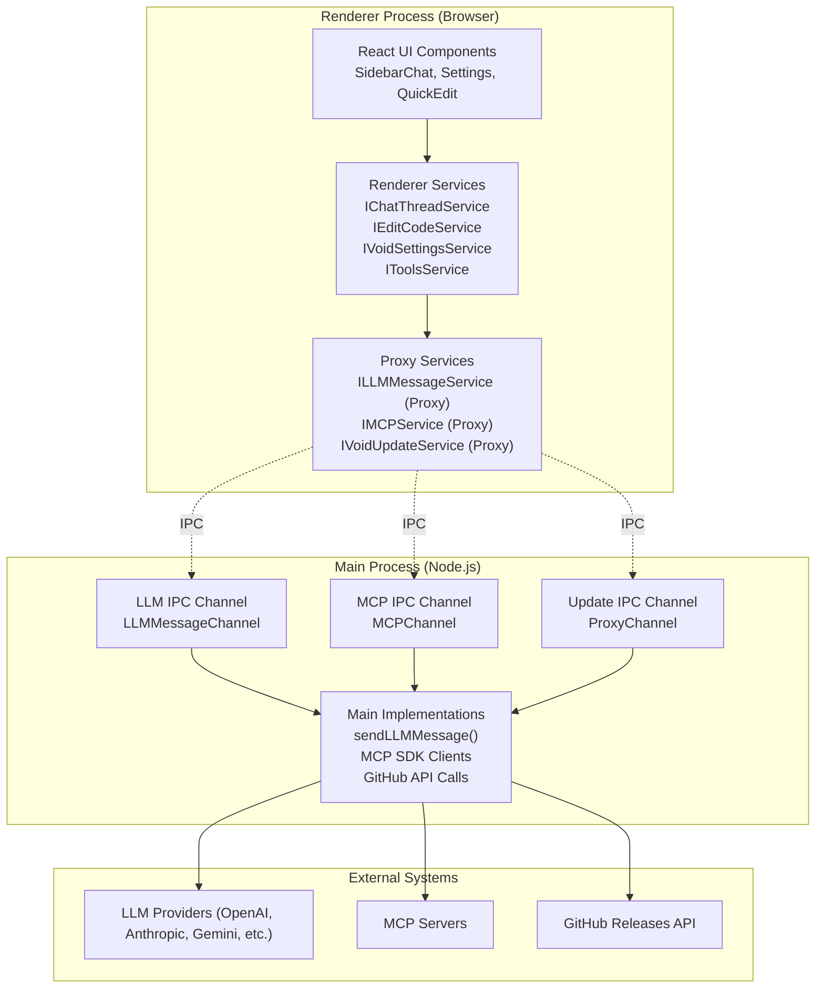
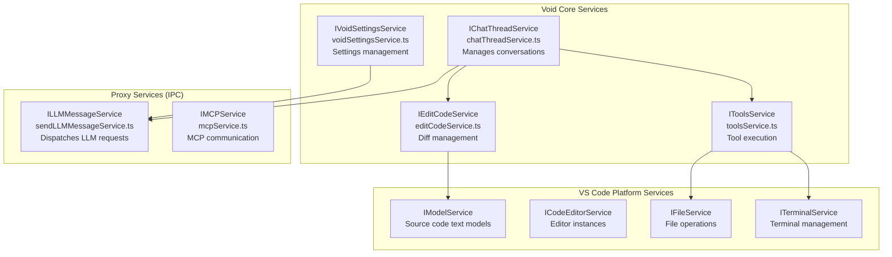
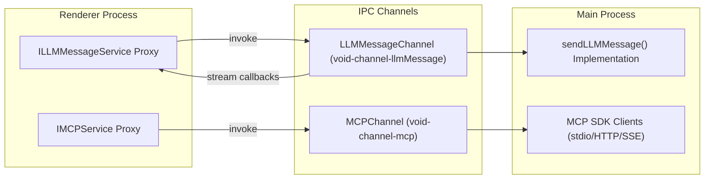
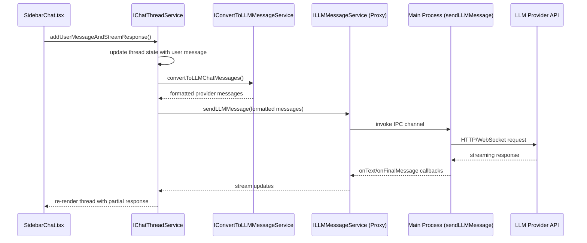
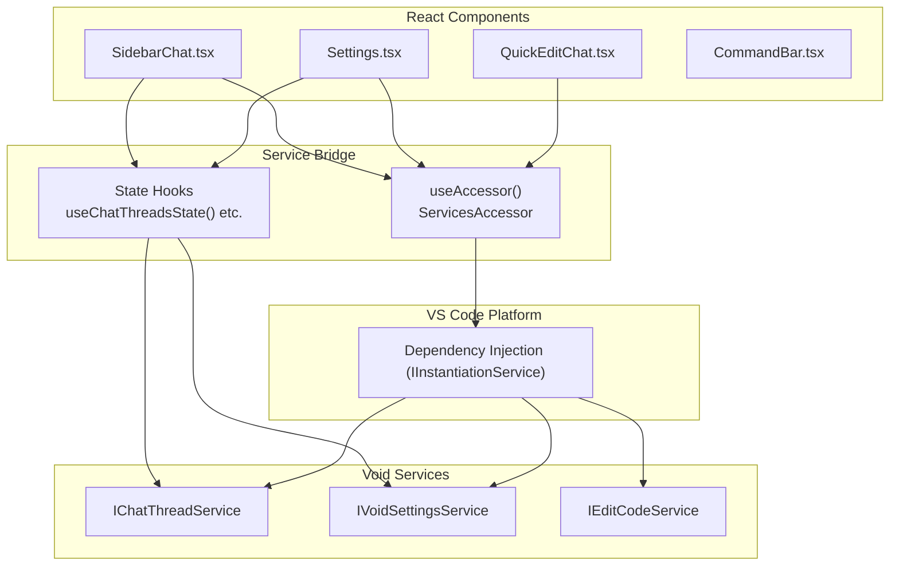
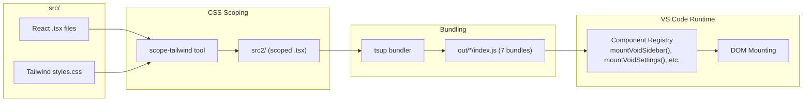
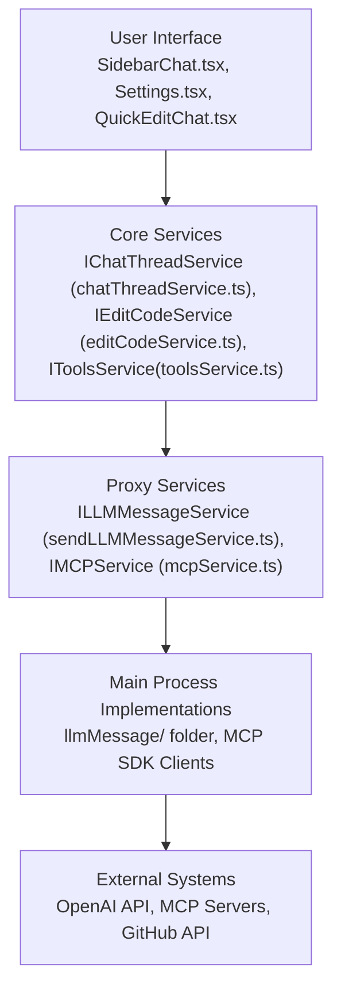
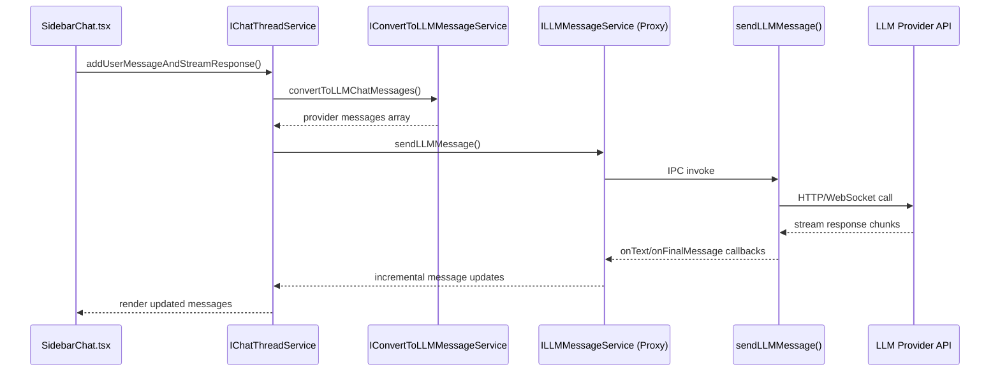

# Architecture Overview

<details>
<summary>Relevant source files</summary>

The following files were used as context for generating this wiki page:

- [.devcontainer/README.md](.devcontainer/README.md)
- [.devcontainer/devcontainer.json](.devcontainer/devcontainer.json)
- [.vscode/launch.json](.vscode/launch.json)

</details>


## Purpose and Scope

This page provides a comprehensive, high-level overview of Void's system architecture. Void extends Visual Studio Code (VS Code) by integrating large language model (LLM) capabilities via a multi-process Electron application structure, a layered service architecture, and React-driven UI components. We explain the separation between the renderer, main, and shared code, how services form the foundation for features, the role of IPC for inter-process communication, and how Void's contrib layer builds on top of the existing VS Code platform.

---

## Electron Multi-Process Architecture

Void operates as an Electron app inheriting VS Code’s architecture by splitting functionality across multiple processes to leverage security boundaries, performance, and platform APIs:

- **Renderer Process (Browser):** Runs UI components (React-based) and “renderer services” that interact with the DOM, VS Code workbench, and stateful feature logic. Code here avoids direct Node.js APIs for security and sandboxing. Files reside mainly in `browser/`.

- **Main Process (Node.js):** Responsible for native modules, file system access, networking, managing subprocesses, and integration with OS-level APIs and native SDKs. Void also installs main process LLM provider implementations here. Files reside in `electron-main/`.

- **Common Code:** Utilities, typings, and abstractions usable in both main and renderer processes. Located in `common/`.

This isolation ensures DOM code cannot access Node.js internals directly, and main process code avoids direct DOM manipulation.

### Process Structure Diagram



**Sources:** [.vscode/launch.json:1-260](), [VOID_CODEBASE_GUIDE.md:18-31](), [services.tsx:1-117]()

---

## Service Layer Architecture

Void structures functionality into a collection of singleton services following VS Code’s dependency injection and service registration pattern. Services encapsulate feature logic, state management, and cross-cutting concerns, allowing modular development and testability.

### Service Registration Example

```typescript
// Interface definition
export const IMyService = createDecorator<IMyService>('myService');

// Implementation class with injected dependencies
class MyService implements IMyService {
    constructor(@IOtherService private readonly otherService: IOtherService) {}
}

// Register as singleton with eager instantiation
registerSingleton(IMyService, MyService, InstantiationType.Eager);
```

### Core Services and Responsibilities

| Service Name               | Location                     | Process  | Responsibilities                                                       |
|----------------------------|------------------------------|----------|----------------------------------------------------------------------|
| `IChatThreadService`       | `browser/chatThreadService.ts` | Renderer | Manages chat threads, message states, orchestrates LLM calls, tools  |
| `IEditCodeService`         | `browser/editCodeService.ts`  | Renderer | Manages diff zones, applies code edits, integrates undo/redo         |
| `IVoidSettingsService`     | `common/voidSettingsService.ts`| Both     | Manages provider settings, model selection, persists global settings  |
| `IToolsService`            | `browser/toolsService.ts`     | Renderer | Validates and runs built-in tools (e.g. read_file, edit_file)         |
| `ILLMMessageService`       | `common/sendLLMMessageService.ts` | Proxy    | Sends LLM requests to main process, handles streaming responses       |
| `IMCPService`              | `common/mcpService.ts`        | Proxy    | Communicates with MCP servers, manages tool execution pipelines       |
| `IVoidModelService`        | `common/voidModelService.ts`  | Renderer | Manages text model lifecycles and access                              |

### Core Services Interaction Diagram



**Sources:** [chatThreadService.ts:230-296](), [editCodeService.ts:157-245](), [toolsService.ts:127-156](), [VOID_CODEBASE_GUIDE.md:49-50]()

---

## IPC Communication Architecture

Inter-process communication (IPC) bridges the Renderer and Main processes. Void implements dedicated IPC channels to handle complex interactions in streaming and tool execution.

### Channel Types and Roles

| IPC Channel           | Channel Name                | Description                          | Direction             |
|-----------------------|-----------------------------|------------------------------------|-----------------------|
| **LLMMessageChannel**  | `void-channel-llmMessage`   | Streams LLM request/response data  | Renderer ↔ Main       |
| **MCPChannel**         | `void-channel-mcp`          | Manages MCP server and tool calls  | Renderer ↔ Main       |
| **ProxyChannel**       | e.g. `void-channel-update`  | Simple request-response (updates)  | Renderer ↔ Main       |

### IPC Architecture Diagram



**Sources:** [services.tsx:88-117](), [VOID_CODEBASE_GUIDE.md:55-68]()

---

## Chat Message Handling Flow

The `IChatThreadService` orchestrates sending and receiving chat messages on the renderer side:

- User sends message through the React chat UI.
- `IChatThreadService` adds user message to thread state.
- Converts chat thread state to provider-specific message format using `IConvertToLLMMessageService`.
- Sends formatted messages to `ILLMMessageService` for dispatching through IPC.
- The main process deals with the actual API calls to LLM providers, streams back responses.
- Renderer streams incremental responses via callbacks, updating thread state and UI progressively.

### Chat Flow Sequence Diagram



**Sources:** [chatThreadService.ts:732-820](), [convertToLLMMessageService.ts:1-50]()

---

## React Integration and Component Lifecycle

React components form the main user interface layer in the renderer process. Void uses a custom React architecture tightly integrated with VS Code’s dependency injection system and service event propagation.

### Key React Components

| Component          | Bundle Path                      | Mount Function         | Description                          |
|--------------------|---------------------------------|-----------------------|------------------------------------|
| SidebarChat        | `out/sidebar-tsx/index.js`       | `mountVoidSidebar()`   | Chat sidebar panel UI               |
| Settings           | `out/void-settings-tsx/index.js` | `mountVoidSettings()`  | Provider and model configuration   |
| QuickEdit          | `out/quick-edit-tsx/index.js`    | `mountQuickEdit()`     | Inline Ctrl+K editing widget       |
| CommandBar         | `out/diff/index.js`              | `mountCommandBar()`    | Accept/reject diffs, navigation bar|
| Tooltip            | `out/void-tooltip/index.js`      | `mountVoidTooltip()`   | Hover tooltips                     |
| Onboarding         | `out/void-onboarding/index.js`   | `mountVoidOnboarding()`| First-run setup                    |

### React Service Accessor Pattern

React components access VS Code services through the `useAccessor()` hook, which returns a `ServicesAccessor` instance to fetch registered service implementations.

```typescript
const accessor = useAccessor();
const chatService = accessor.get(IChatThreadService);
const settingsService = accessor.get(IVoidSettingsService);
```

Services register once during component mount and expose state change events that React components subscribe to via hooks like `useChatThreadsState()`.

### React Architecture Diagram



**Sources:** [services.tsx:60-117](), [SidebarChat.tsx:1-50]()

---

## Build Pipeline for React Components

Void's React components are built separately from the main VS Code build system to keep them isolated and maintainable. This build uses a two-stage pipeline:

- **Stage 1 - CSS Scoping:** Uses `scope-tailwind` to scope Tailwind CSS styles to prevent conflicts with VS Code core styles. Outputs scoped component files in `src2/`.

- **Stage 2 - Bundling:** Uses `tsup` to bundle scoped `.tsx` sources into individual JS bundles under `out/`.

### Build Pipeline Diagram



### Component Bundle Summary

| Bundle          | Mount Function       | Purpose                    |
|-----------------|----------------------|----------------------------|
| Sidebar Chat    | `mountVoidSidebar()`  | Main chat UI               |
| Settings        | `mountVoidSettings()` | Provider/model config UI   |
| Quick Edit      | `mountQuickEdit()`    | Inline quick edit widget   |
| Command Bar     | `mountCommandBar()`   | Diff accept/reject buttons |
| Tooltip         | `mountVoidTooltip()`  | Hover tooltips             |
| Onboarding      | `mountVoidOnboarding()`| Setup wizard             |

Each bundle includes inline CSS styles scoped for isolation.

**Sources:** [VOID_CODEBASE_GUIDE.md:99-122](), [editCodeService.ts:373-456](), [QuickEditChat.tsx:1-139]()

---

## Key Architectural Patterns

### 1. Service Singleton Pattern

Every major feature is provided by a singleton service registered with VS Code's dependency injection, ensuring single instances and well-defined startup order.

*Example services:* `IChatThreadService`, `IEditCodeService`.

### 2. IPC Proxy Pattern

Renderer process services that depend on main process functionality utilize proxy instances that forward calls asynchronously over IPC, handling streaming callbacks natively.

*Implemented in*: `sendLLMMessageService.ts` and `mcpService.ts` proxy layers.

### 3. Event-Driven State Updates

Services expose VS Code `Emitter` event patterns that enable React hooks and UI components to listen for state changes, enabling responsive UI updates without polling.

### 4. Diff Zone Abstraction

Code editing features maintain two types of diff zones that represent line ranges with pending edits or inline suggestions:

- `DiffZone`: supports full apply, undo/redo, visual diff highlighting.
- `CtrlKZone`: supports quick inline edits displayed via Ctrl+K keybindings.

### 5. Tool Execution Pipeline

Tools are executed through a pipeline that enforces parameter validation, approval workflows (e.g., for edits or terminal commands), execution on main or MCP servers, and result formatting for chat display.

---

## File Organization

Void's codebase extends VS Code under `src/vs/workbench/contrib/void/` and is organized as follows:

```
void/
├── browser/              # Renderer services and UI React components
│   ├── react/            # React source, scoped sources, and bundles
│   ├── chatThreadService.ts
│   ├── editCodeService.ts
│   ├── toolsService.ts
│   └── sidebarActions.ts
├── electron-main/        # Main process implementations
│   └── llmMessage/       # LLM providers and IPC channel handlers
├── common/               # Shared utilities, types, and protocol layers
│   ├── prompt/
│   ├── sendLLMMessageTypes.ts
│   ├── voidSettingsTypes.ts
│   └── modelCapabilities.ts
└── contribution.ts       # VS Code extension entry point, registers contrib
```

**Sources:** [VOID_CODEBASE_GUIDE.md:1-122](), [README.md:33-35]()

---

## Summary

Void leverages and extends VS Code’s Electron multi-process model, adding a rich AI-powered service layer that orchestrates chat threads, model calls, code edits, and tool execution. React components form a cohesive user interface built with a scoped CSS build pipeline. IPC channels enable streaming, stateful communication between renderer and main processes, abstracting away provider implementations. This modular, layered architecture provides strong separation of concerns, extensibility, and performance required for an advanced AI-assisted code editor experience.

---

# Diagrams Recap: From Natural Language to Code Entities

### 1. System Components Mapped to Code Entities



### 2. Message Dispatch Flow Connecting Runtime Systems with Code



---

This detailed view links natural language concepts such as "chat UI," "message conversion," and "LLM providers" with precise code entities and files, enabling engineers to navigate the codebase efficiently.

---

**Sources**:  
- `.vscode/launch.json` (lines 1–260)  
- `services.tsx` (lines 1–117)  
- `chatThreadService.ts` (lines 230–296, 732–820)  
- `editCodeService.ts` (lines 157–245, 373–456)  
- `toolsService.ts` (lines 127–156)  
- `SidebarChat.tsx` (lines 1–50)  
- `convertToLLMMessageService.ts` (lines 1–50)  
- `VOID_CODEBASE_GUIDE.md` (sections 18–31, 49–68, 99–122)