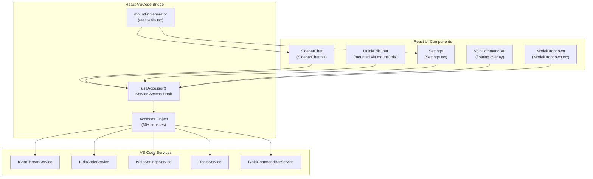
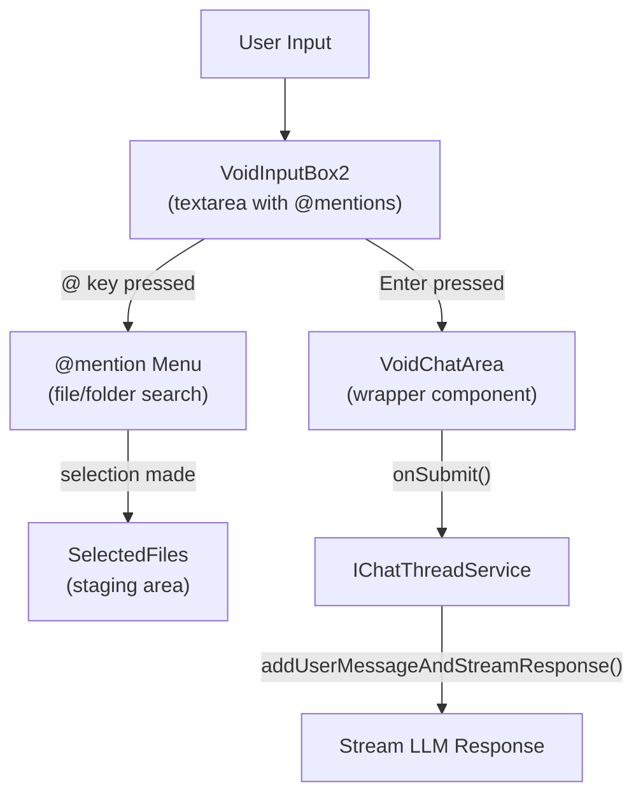
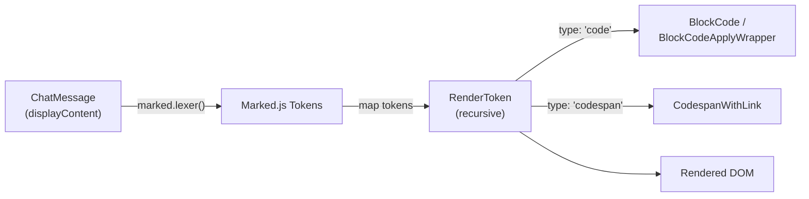
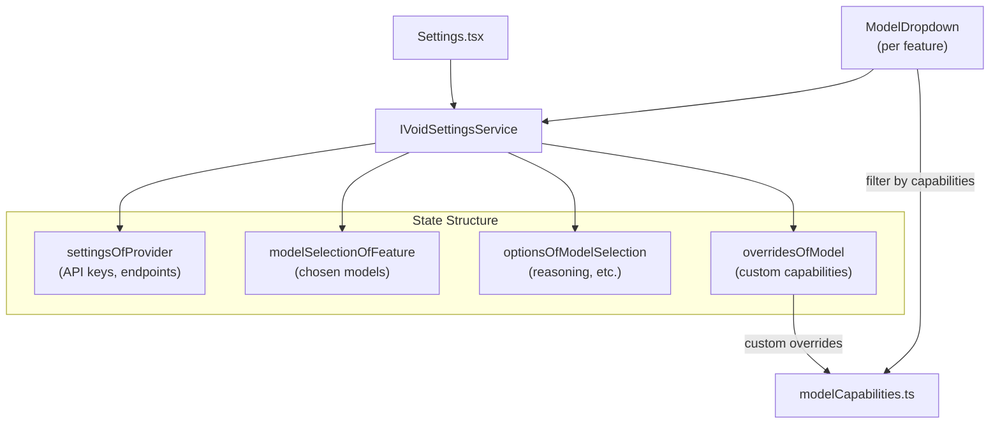
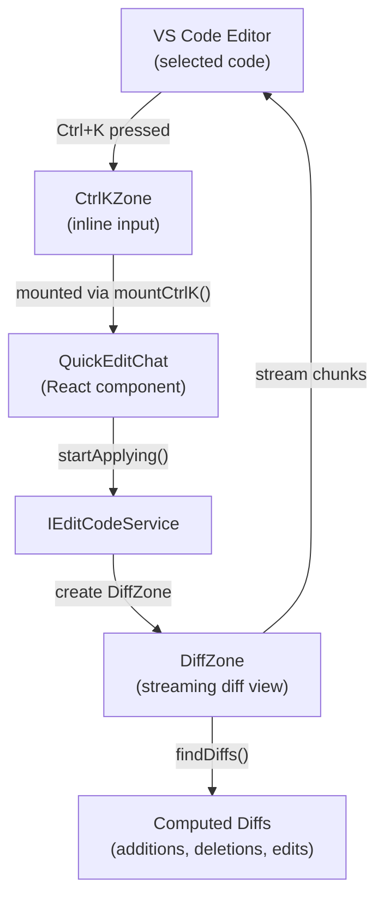
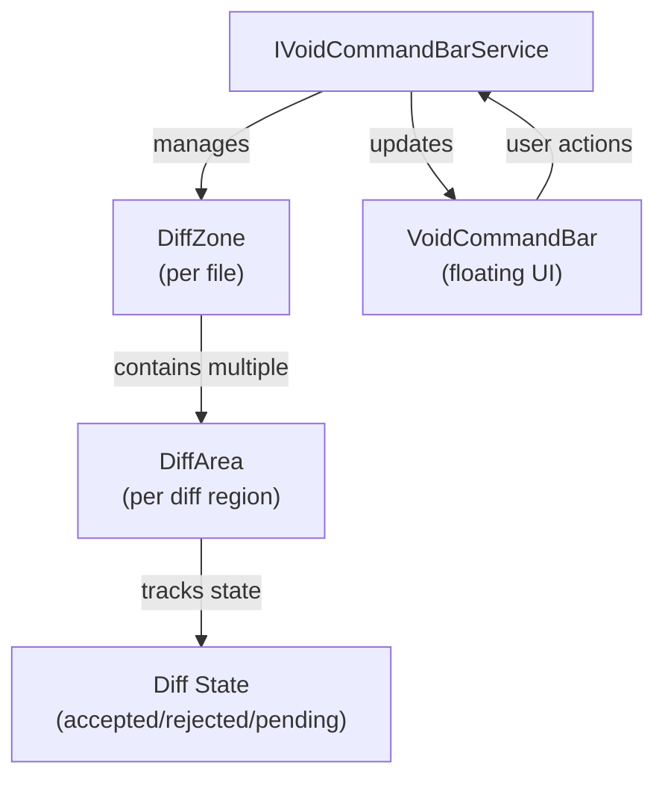
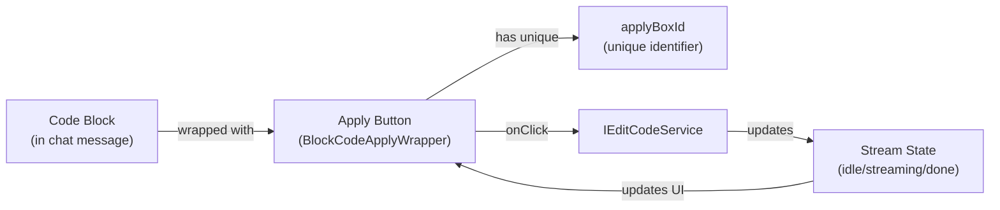

# Core Features

<details>
<summary>Relevant source files</summary>

The following files were used as context for generating this wiki page:

- [.voidrules](.voidrules)
- [.vscode/extensions.json](.vscode/extensions.json)

</details>


This document describes the main user-facing features of Void, focusing on the chat interface, code editing, settings, and UI components. It explains how these features are structured, how they interact with backend services, and which code entities implement them.

For details on the backend services that power these features, see [Core Services and Architecture](#3). For information about LLM integration, see [LLM Integration](#4).

---

## Overview

Void provides several key user-facing features:

1. **Sidebar Chat** – The primary interface for conversing with LLMs, managing selections, and executing tools.
2. **Settings Interface** – Configuration for models, providers, and feature-specific options.
3. **Quick Edit (Ctrl+K)** – Inline code editing with streaming LLM responses.
4. **Command Bar** – Floating UI for navigating and accepting/rejecting diffs.
5. **Apply System** – Code change application with diff visualization.

These features are implemented as React components communicating with VS Code services through a standardized accessor pattern. The `useAccessor()` hook provides access to 30+ services including `IChatThreadService`, `IEditCodeService`, `IVoidSettingsService`, and others.

---

## Architecture: React-VSCode Integration

### Diagram: Core Feature Components and Services



Void's React components are mounted into VS Code using `mountFnGenerator`, which bridges React's component model with the VS Code extension host. Components access services through the `useAccessor()` hook pattern for seamless state and service integration.

Sources:
- [src/vs/workbench/contrib/void/browser/react/src/sidebar-tsx/SidebarChat.tsx:9]()
- [src/vs/workbench/contrib/void/browser/react/src/util/services.ts]()
- [src/vs/workbench/contrib/void/browser/react/src/void-settings-tsx/Settings.tsx:10]()
- [src/vs/workbench/contrib/void/browser/editCodeService.ts:391-420]()

---

## Chat Interface

The chat interface is the primary user-facing feature to interact with LLMs, manage conversations, and execute code-related tools.

### Chat Input and Staging Area

The input system is based on the `VoidInputBox2` component, which provides:

- Multiline text input for extensive queries.
- An `@mention` mechanism for file and folder selection within the workspace.
- A staging area (`SelectedFiles` component) showing selected items ready for use.
- Submit and abort controls (`ButtonSubmit`, `ButtonStop`).

### Diagram: Chat Input Flow



This input system enables intuitive natural language requests augmented with precise code context selections.

Sources:
- [src/vs/workbench/contrib/void/browser/react/src/sidebar-tsx/SidebarChat.tsx:322-413]()
- [src/vs/workbench/contrib/void/browser/react/src/util/inputs.tsx:343-644]()
- [src/vs/workbench/contrib/void/browser/chatThreadService.ts:282-284]()

### Chat Modes

Void supports three chat modes controlled by the `chatMode` setting:

| Mode    | Description                                | Available Tools                  | Code Reference                             |
|---------|--------------------------------------------|--------------------------------|--------------------------------------------|
| normal  | Standard chat without tool calling          | None                           | Tools are `undefined`                               |
| gather  | Read-only mode for searching and reading file data | Read-only tools (search, read_file, ls_dir, etc.) | [prompts.ts:362-364]()                       |
| agent   | Full mode with file editing and command execution | All built-in + MCP tools       | [prompts.ts:365-366]()                         |

The mode selection UI is implemented in `ChatModeDropdown`.

Sources:
- [src/vs/workbench/contrib/void/common/prompt/prompts.ts:362-366]()
- [src/vs/workbench/contrib/void/browser/react/src/sidebar-tsx/SidebarChat.tsx:263-286]()

### Message Rendering

Messages are rendered through `ChatMarkdownRender`, supporting:

- Markdown with syntax highlighting.
- Code blocks including language detection.
- Interactive Apply buttons for code blocks.
- Clickable codespan links to symbols and files.
- (Optionally) LaTeX rendering (disabled by default).

### Diagram: Message Rendering Pipeline



Sources:
- [src/vs/workbench/contrib/void/browser/react/src/markdown/ChatMarkdownRender.tsx:269-337]()
- [src/vs/workbench/contrib/void/browser/react/src/markdown/ChatMarkdownRender.tsx:110-166]()
- [src/vs/workbench/contrib/void/browser/react/src/markdown/ApplyBlockHoverButtons.tsx:180-376]()

### Thread Management

Threads hold message history and state such as staging selections and link metadata. Managed by `IChatThreadService`, threads have a structure like:

```typescript
type ThreadType = {
  id: string;
  createdAt: string;
  lastModified: string;
  messages: ChatMessage[];
  state: {
    currCheckpointIdx: number | null;
    stagingSelections: StagingSelectionItem[];
    focusedMessageIdx: number | undefined;
    linksOfMessageIdx: { [messageIdx: number]: { [codespanName: string]: CodespanLocationLink } };
  };
}
```

Users can switch between threads and browse history via the `PastThreadsList` UI.

Sources:
- [src/vs/workbench/contrib/void/browser/chatThreadService.ts:114-144]()
- [src/vs/workbench/contrib/void/browser/chatThreadService.ts:238-244]()
- [src/vs/workbench/contrib/void/browser/react/src/sidebar-tsx/SidebarThreadSelector.tsx]()

For more, see [Sidebar Chat and Thread Management](#2.1).

---

## Settings Interface

Void provides a robust settings UI for managing LLM providers, models, and feature-specific options.

### Settings Tabs and Components

| Tab       | Purpose                                            | Components Involved                        |
|-----------|--------------------------------------------------|-------------------------------------------|
| Models    | Manage, add, or hide models; configure overrides | `ModelDump`                               |
| Providers | Configure API keys, endpoints, headers            | `SettingsForProvider`                      |
| Features  | Select models for each feature independently      | Multiple `ModelDropdown` components        |

### Model Selection System

Each feature (Chat, Autocomplete, Quick Edit, Apply, SCM) can independently select a model:

```typescript
type ModelSelectionOfFeature = {
  [K in FeatureName]: ModelSelection | null;
}

type ModelSelection = {
  providerName: ProviderName;
  modelName: string;
}
```

### Diagram: Model Selection Architecture



Sources:
- [src/vs/workbench/contrib/void/common/voidSettingsService.ts:40-49]()
- [src/vs/workbench/contrib/void/browser/react/src/void-settings-tsx/ModelDropdown.tsx:25-47]()
- [src/vs/workbench/contrib/void/browser/react/src/void-settings-tsx/Settings.tsx:374-607]()

### Model Filtering and Reasoning

Model availability per feature is filtered by capability:

- Autocomplete requires Fill-In-the-Middle (FIM).
- Chat modes like Agent require tool calling.

Reasoning-enabled models (e.g., Anthropic Claude) have configurable budget/effort sliders and enable toggles in the UI, implemented with `ReasoningOptionSlider`.

For details, see [Settings and Model Selection](#2.2).

---

## Quick Edit (Ctrl+K)

The Quick Edit feature enables inline code edits triggered by the keyboard shortcut `Ctrl+K`. It allows users to quickly generate code modifications powered by LLM responses.

### Quick Edit Flow

- User selects code and presses `Ctrl+K`.
- `QuickEditChat` React component is mounted inline via `mountCtrlK()`.
- User enters natural language prompts requesting changes.
- LLM responses stream and parse into code diffs.
- Changes are applied either with Fast Apply (structured search/replace blocks) or Slow Apply (full rewrite).

### Diagram: Quick Edit Architecture



Sources:
- [src/vs/workbench/contrib/void/browser/editCodeService.ts:373-447]()
- [src/vs/workbench/contrib/void/browser/editCodeService.ts:697-858]()

### Fast vs Slow Apply

| Mode         | Description                         | Usage Scenario                     | Code Location                             |
|--------------|-----------------------------------|----------------------------------|------------------------------------------|
| Fast Apply   | Uses LLM output search/replace blocks | Default, preferred approach      | [editCodeService.ts:734-751]()            |
| Slow Apply   | Rewrites entire file as fallback  | When fast apply fails             | [editCodeService.ts:753-774]()            |
| Instant Apply| Direct application without UI     | Used for user-invoked chat apply | [editCodeService.ts:776-790]()            |

Sources:
- [src/vs/workbench/contrib/void/browser/editCodeService.ts:734-790]()

For comprehensive documentation see [Quick Edit (Ctrl+K)](#2.3).

---

## Command Bar and Diff Navigation

The Command Bar is a floating UI overlay that aids users in managing diffs generated from LLM responses or edits.

### Features

| Action            | Keybinding         | Description                      |
|-------------------|--------------------|---------------------------------|
| Accept current diff | Cmd+Shift+Y        | Accept currently highlighted diff |
| Reject current diff | Cmd+Shift+N        | Reject currently highlighted diff |
| Accept all diffs   | Cmd+Shift+A        | Accept all pending diffs          |
| Reject all diffs   | Cmd+Shift+X        | Reject all pending diffs          |
| Navigate next diff | Cmd+Shift+]        | Move cursor to the next diff      |
| Navigate previous diff | Cmd+Shift+[    | Move cursor to the previous diff  |

### Diagram: Command Bar State Management



Sources:
- [src/vs/workbench/contrib/void/browser/voidCommandBarService.ts]()
- [src/vs/workbench/contrib/void/browser/editCodeService.ts:157-180]()

For full details, see [Command Bar and Diff Navigation](#2.4).

---

## Apply System

The Apply system handles integrating LLM-suggested code changes into files while providing visual diff previews.

### Apply Button Flow

- Code blocks containing code changes are wrapped with `BlockCodeApplyWrapper`.
- The Apply button triggers `EditCodeService.startApplying()`.
- The code is parsed into diffs and streamed progressively in a `DiffZone`.
- The user reviews diffs and uses the Command Bar to accept or reject changes.

### Diagram: Apply Button Architecture



### Edit Tool Integration

Special LLM tool messages like `edit_file` or `rewrite_file` produce apply-enabled UI components. The `EditTool` React component renders these with interactive Apply buttons.

Sources:
- [src/vs/workbench/contrib/void/browser/react/src/markdown/ApplyBlockHoverButtons.tsx:180-376]()
- [src/vs/workbench/contrib/void/browser/editCodeService.ts:697-858]()
- [src/vs/workbench/contrib/void/browser/react/src/sidebar-tsx/SidebarChat.tsx:906-976]()

For more, consult [Code Editing and Apply System](#2.5).

---

## Bridging Natural Language Features to Code Entities

This diagram maps user-facing systems (natural language space) to their key code components and services, helping engineers locate source files by feature.

### Diagram: Feature-to-Code Mapping

```mermaid
graph TD
    ChatInterface["Chat Interface"]
    QuickEdit["Quick Edit (Ctrl+K)"]
    CommandBar["Command Bar"]
    ApplySystem["Apply System"]
    Settings["Settings"]

    ChatInterface -->|"Component"| SidebarChat["SidebarChat.tsx"]
    ChatInterface -->|"Service"| IChatThreadService["IChatThreadService"]
    ChatInterface -->|"Input"| VoidInputBox2["VoidInputBox2 (inputs.tsx)"]
    ChatInterface -->|"Rendering"| ChatMarkdownRender["ChatMarkdownRender.tsx"]

    QuickEdit -->|"Component"| QuickEditChat["QuickEditChat.tsx"]
    QuickEdit -->|"Service"| IEditCodeService["IEditCodeService"]
    QuickEdit -->|"Zone"| CtrlKZone["CtrlKZone"]

    CommandBar -->|"Component"| VoidCommandBar["VoidCommandBar.tsx"]
    CommandBar -->|"Service"| IVoidCommandBarService["IVoidCommandBarService"]

    ApplySystem -->|"Component"| BlockCodeApplyWrapper["BlockCodeApplyWrapper"]
    ApplySystem -->|"Service"| IEditCodeService
    ApplySystem -->|"State"| useApplyStreamState["useApplyStreamState"]
    
    Settings -->|"Component"| SettingsTsx["Settings.tsx"]
    Settings -->|"Service"| IVoidSettingsService["IVoidSettingsService"]
    Settings -->|"Dropdown"| ModelDropdown["ModelDropdown.tsx"]
```



Sources:
- [src/vs/workbench/contrib/void/browser/react/src/sidebar-tsx/SidebarChat.tsx]()
- [src/vs/workbench/contrib/void/browser/chatThreadService.ts]()
- [src/vs/workbench/contrib/void/browser/react/src/util/inputs.tsx]()
- [src/vs/workbench/contrib/void/browser/react/src/markdown/ChatMarkdownRender.tsx]()
- [src/vs/workbench/contrib/void/browser/editCodeService.ts]()
- [src/vs/workbench/contrib/void/browser/voidCommandBarService.ts]()
- [src/vs/workbench/contrib/void/browser/react/src/markdown/ApplyBlockHoverButtons.tsx]()
- [src/vs/workbench/contrib/void/browser/react/src/void-settings-tsx/Settings.tsx]()
- [src/vs/workbench/contrib/void/common/voidSettingsService.ts]()
- [src/vs/workbench/contrib/void/browser/react/src/void-settings-tsx/ModelDropdown.tsx]()

---

## Summary Table: Core Features and Code Entities

| Feature                 | Main UI Component(s)                  | Main Service(s) / Interface(s)            |
|-------------------------|-------------------------------------|-------------------------------------------|
| Sidebar Chat            | `SidebarChat.tsx`                   | `IChatThreadService`, `IToolsService`    |
| Quick Edit (Ctrl+K)     | `QuickEditChat.tsx`                 | `IEditCodeService`                        |
| Sidebar & Thread Mgmt   | `SidebarThreadSelector.tsx`         | `IChatThreadService`                      |
| Settings & Model Select | `Settings.tsx`, `ModelDropdown.tsx` | `IVoidSettingsService`                    |
| Command Bar             | `VoidCommandBar.tsx`                 | `IVoidCommandBarService`                  |
| Apply System            | `BlockCodeApplyWrapper`              | `IEditCodeService`, `useApplyStreamState`|
| Editor Watermark        | Various UI components                | `IEditCodeService`                        |

---

**For further details on each feature, see the child pages:**

- [Sidebar Chat and Thread Management](#2.1)
- [Settings and Model Selection](#2.2)
- [Quick Edit (Ctrl+K)](#2.3)
- [Command Bar and Diff Navigation](#2.4)
- [Code Editing and Apply System](#2.5)
- [Autocomplete and Inline Suggestions](#2.6)
- [Sidebar Actions and Keybindings](#2.7)
- [Editor Watermark and Welcome Screen](#2.8)

---

This overview aims to orient developers and contributors to the major interactive features, their UI components, and their corresponding backend services, illustrating how Void integrates AI-assisted coding experiences atop VS Code.

Sources:
- Aggregate of all cited files above