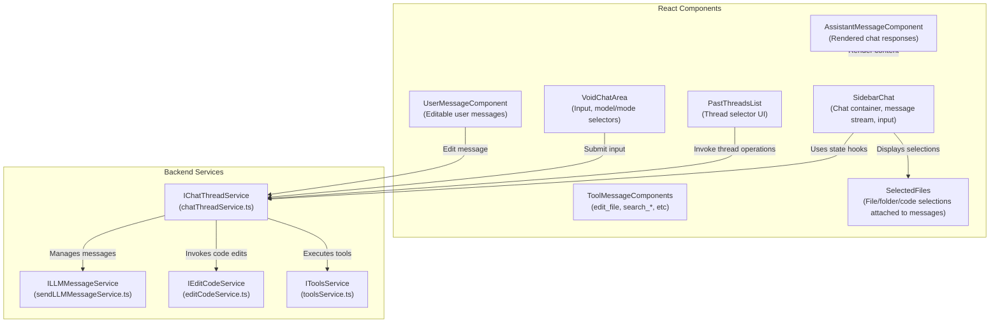
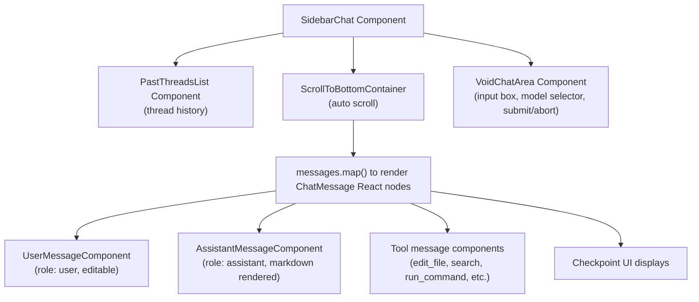
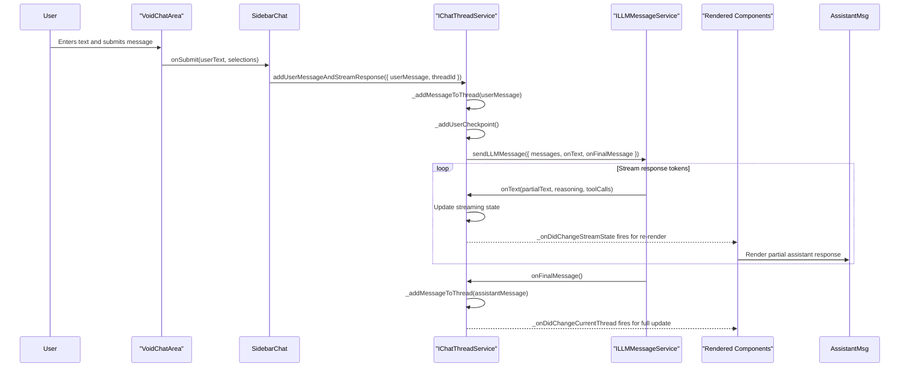
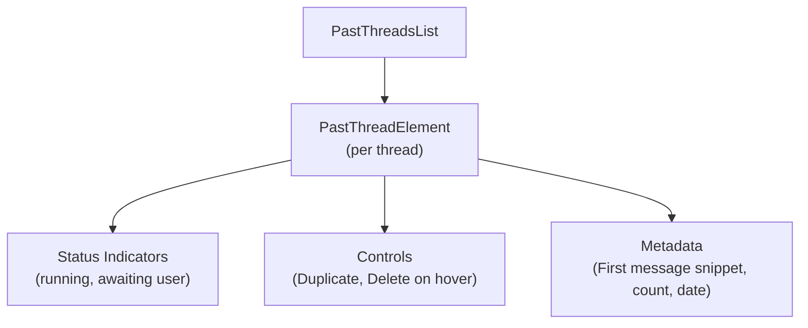
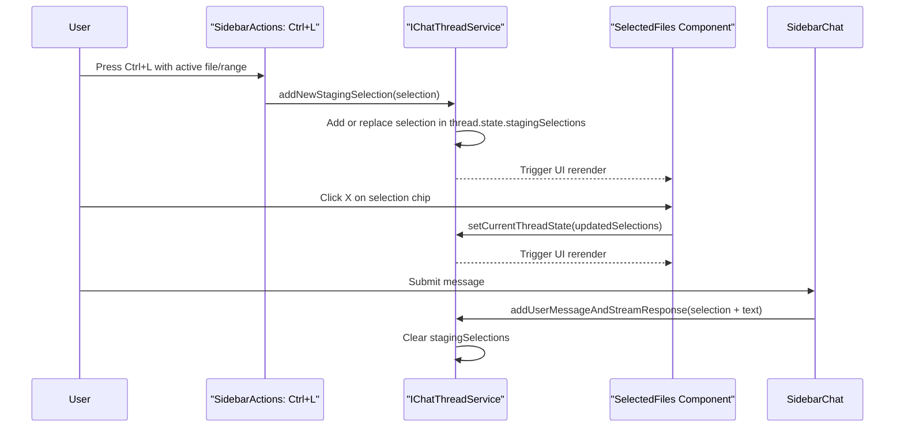
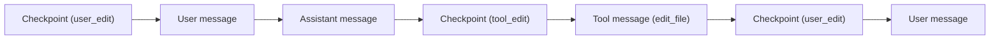

# Sidebar Chat and Thread Management

<details>
<summary>Relevant source files</summary>

The following files were used as context for generating this wiki page:

- [.devcontainer/README.md](.devcontainer/README.md)
- [.voidrules](.voidrules)

</details>


## Purpose and Scope

This document thoroughly details the Sidebar Chat interface and Thread Management system within Void, focusing on the components and services responsible for chat interaction, thread lifecycle maintenance, message flow, and conversation history persistence. It covers the following major pieces:

- **SidebarChat.tsx:** React UI managing chat message input, rendering, streaming updates, user interactions, and displaying chat history.
- **SidebarThreadSelector.tsx:** UI component for listing, sorting, filtering, and managing multiple chat threads.
- **chatThreadService.ts:** The core service implementing `IChatThreadService`, which orchestrates chat threads, message addition, streaming responses, checkpointing, and persistent storage.

This page explains the data flow between these components, the internal data structures and APIs for managing chat threads and messages, as well as how the chat system interfaces with other core services like the LLM message service and code editing service.

---

## System Overview

The Sidebar Chat system provides a rich UI built with React that is tightly integrated with Void's chat thread service backend. It manages multi-threaded chat conversations where each thread maintains an independent history of exchanged messages, user selections, LLM assistant responses, and tool executions.

### High-level Architecture



**Key points:**
- React components consume service state via hooks like `useChatThreadsState()` and `useChatThreadsStreamState()`.
- The `IChatThreadService` is the central orchestrator, managing thread lifecycle, message state, streaming LLM responses, and checkpoints.
- Chat messages are typed as unions (`user`, `assistant`, `tool`, `checkpoint`) handled in rendering and message flow.
- Tools invoked by the AI or user result in asynchronous message additions and UI updates.
- Selections specify files/folders or code snippets attached to user messages to provide chat context.

**Sources:**  
[src/vs/workbench/contrib/void/browser/react/src/sidebar-tsx/SidebarChat.tsx:1-50](),  
[src/vs/workbench/contrib/void/browser/chatThreadService.ts:230-296](),  
[src/vs/workbench/contrib/void/browser/react/src/sidebar-tsx/SidebarThreadSelector.tsx:1-100]()  

---

## SidebarChat.tsx — Chat Interface Implementation

`SidebarChat.tsx` is the primary React component composing the chat UI, handling the user input area, message rendering, streaming state, and integration with the backend chat thread service. It uses custom hooks to subscribe to global thread state and stream updates.

### Component Structure and Data Flow



- `SidebarChat` coordinates fetching the current thread and its messages from `useChatThreadsState()`.
- Streaming state for the active thread is managed with `useChatThreadsStreamState()`.
- Messages are rendered using appropriate components based on their `role`.
- `VoidChatArea` supports user input, model/mode dropdowns, and submission handling.
- Scroll container ensures the chat view scrolls automatically on new messages.

**Sources:**  
[src/vs/workbench/contrib/void/browser/react/src/sidebar-tsx/SidebarChat.tsx:1200-1300]()

### Message Submission Flow

When a user submits a new message:



- Messages are added optimistically to the thread.
- User checkpoints persist file states before LLM response.
- LLM streaming tokens update the UI in real time.
- Final assistant message appended upon streaming completion.
- All state changes emit events triggering React updates.

**Sources:**  
[src/vs/workbench/contrib/void/browser/react/src/sidebar-tsx/SidebarChat.tsx:1440-1460](),  
[src/vs/workbench/contrib/void/browser/chatThreadService.ts:730-850]()

### Key Components in SidebarChat.tsx

| Component                   | Lines       | Role                                          |
|-----------------------------|-------------|-----------------------------------------------|
| `SidebarChat` main component | 1200-1800   | Orchestrates chat view, streaming state, message submission and abort |
| `VoidChatArea`               | 322-413     | Input form with textarea, model and mode selection, submit/abort buttons |
| `UserMessageComponent`       | 1020-1155   | Editable view of user messages, inline editing, staging selection management |
| `AssistantMessageComponent`  | 1157-1198   | Renders assistant LLM messages as markdown with reasoning and code blocks |
| `EditTool`                   | 906-976     | Specialized tool message for `edit_file` and `rewrite_file` with diff editor and apply controls |
| `ResultWrapper`              | 777-897     | Wraps simpler tool messages like file system listings or command output |
| `SelectedFiles`              | 580-758     | Displays files, folders, or code ranges attached to message draft for context |

**Sources:**  
[src/vs/workbench/contrib/void/browser/react/src/sidebar-tsx/SidebarChat.tsx:580-1800]()

---

## Chat Thread Management in chatThreadService.ts

The `chatThreadService.ts` implements thread management, message orchestration, streaming state, checkpoints, and persistent conversation history.

### Thread Data Structures

`ThreadType` represents one chat thread with its history and UI state:

```typescript
type ThreadType = {
    id: string;                  // UUID unique identifier
    createdAt: string;           // ISO timestamp of creation
    lastModified: string;        // ISO timestamp of latest update
    messages: ChatMessage[];     // Array of messages in user/assistant/tool/checkpoint form
    filesWithUserChanges: Set<string>;  // Tracks which files have user edits (volatile, not persisted)

    state: {
        currCheckpointIdx: number | null;          // Index of currently active checkpoint
        stagingSelections: StagingSelectionItem[]; // Attached files/selections before sending message
        focusedMessageIdx: number | undefined;      // Which user message is being edited
        linksOfMessageIdx: Record<number, Record<string, CodespanLocationLink>>;  // Cache of code span links per message
        mountedInfo?: MountedInfo;                   // React mount coordination Promise for the thread UI
    };
};
```

The `ChatMessage` union allows multiple message roles:

- `user`: user message, possibly editable, attached selections
- `assistant`: LLM response with markdown content, reasoning
- `tool`: tool execution result messages (e.g. `edit_file`, `ls_dir`, `search_*`, `run_command`)
- `checkpoint`: snapshots of file states for history navigation
- `interrupted_streaming_tool`: interrupted streaming tool call state

### Thread State Management

Global thread state is stored in `ThreadsState`:

```typescript
type ThreadsState = {
    allThreads: Record<string, ThreadType | undefined>;
    currentThreadId: string;
}
```

The active thread ID determines which conversation is displayed and updated.

React components access state through hooks:

```typescript
const threadsState = useChatThreadsState();
const streamState = useChatThreadsStreamState();
const settingsState = useSettingsState();

const currentThread = threadsState.allThreads[threadsState.currentThreadId];
const threadStream = streamState[threadsState.currentThreadId];
```

### Thread Lifecycle API Methods

| Function                   | Location (lines)    | Description                                              |
|----------------------------|---------------------|----------------------------------------------------------|
| `openNewThread()`           | 343-344             | Creates a new empty thread and switches to it             |
| `switchToThread(threadId)` | 240-241             | Sets the active thread, resets mounted promise state      |
| `deleteThread(threadId)`   | 244                 | Deletes a thread; ensures one thread always exists        |
| `duplicateThread(threadId)`| 245                 | Deep clones an existing thread with a new ID              |

### Persistence of Threads

Threads are serialised to and from JSON using `IStorageService`. Special care is taken to serialize `URI` objects correctly:

- The storage key is `THREAD_STORAGE_KEY`.
- On saving, URIs are converted to JSON with `$mid === 1` markers.
- On loading, URIs are reinstantiated via `URI.revive()`.
- Stored threads include messages, selections, and timestamps.

Thread persistence methods include:

- `_storeAllThreads(allThreads: ChatThreads)`
- `_readAllThreads(): Promise<ChatThreads>`
- Constructor loads threads and ensures at least one thread exists at startup.

### Streaming State Updates

Streaming updates during LLM response follow this pattern:

- `addUserMessageAndStreamResponse()` adds user message and invokes LLM stream.
- As tokens arrive via `onText()`, the stream state object is updated with partial message content.
- On final completion via `onFinalMessage()`, the full assistant message is stored.

Streaming states allow the UI to render partial assistant responses and tool calls live.

**Sources:**  
[src/vs/workbench/contrib/void/browser/chatThreadService.ts:114-480](),  
[src/vs/workbench/contrib/void/common/chatThreadServiceTypes.ts:30-90]()  

---

## SidebarThreadSelector.tsx — Thread History and Management UI

This component displays a list of past chat threads at the top of the sidebar, allowing browsing, switching, duplicating, and deleting threads.

### Thread List UI



Features:

- Sorts threads by `lastModified` descending.
- Filters out empty (zero messages) threads.
- Shows truncated first user message and message count.
- Displays a colored indicator for currently running threads.
- Hovering over a thread shows duplicate and delete icons.
- Clicking a thread switches to it via `switchToThread(threadId)` call.

### Pagination and Filtering

- Initially shows top 3 threads.
- "Show all" button toggles viewing all threads.
- Hover state managed locally to show controls only on hovered item.

### Interaction Methods

- **Duplicate**: calls `chatThreadsService.duplicateThread(pastThread.id)`.
- **Delete**: shows confirmation UI and calls `chatThreadsService.deleteThread(pastThread.id)`.
- **Click**: switches to clicked thread.

**Sources:**  
[src/vs/workbench/contrib/void/browser/react/src/sidebar-tsx/SidebarThreadSelector.tsx:1-275]()

---

## Message Rendering and Edit Handling

### Message Rendering by Role

```mermaid
flowchart TD
    ChatMessage[ChatMessage Union]

    UserMsg["role: user"]
    AssistantMsg["role: assistant"]
    ToolMsg["role: tool"]
    CheckpointMsg["role: checkpoint"]
    InterruptedMsg["role: interrupted_streaming_tool"]

    UserMsg --> UserMessageComponent
    AssistantMsg --> AssistantMessageComponent
    ToolMsg --> ToolMessageComponents
    CheckpointMsg --> CheckpointUI
    InterruptedMsg --> CheckpointUI

    AssistantMessageComponent --> ChatMarkdownRender
    ChatMarkdownRender --> BlockCode, CodespanWithLink, ReasoningUI
```

- User messages can be edited inline.
- Assistant messages are rendered with markdown, support code blocks with syntax highlighting, and display optional AI reasoning.
- Tool messages vary by tool type, some support special diff editors (`edit_file`) or simple lists (`ls_dir`).
- Checkpoint messages represent file snapshots shown as "ghost" messages in the UI.
- Streams update assistant and tool message content incrementally.

### Editing User Messages

- `UserMessageComponent` supports two modes:
  - **Display Mode:** Renders `displayContent` statically.
  - **Edit Mode:** Replaces the message with an editable `VoidInputBox2`. Submission re-triggers streaming.
- Editing is tracked per message index in thread state (`focusedMessageIdx`).
- Concurrent editing and focus tracking enabled.

### Tool Messages

Common tool messages (`edit_file`, `rewrite_file`, `read_file`, `ls_dir`, `search_*`, `run_command`) have corresponding React components:

- `edit_file` and `rewrite_file` show a diff editor with apply/reject buttons.
- Commands and searches show expandable result lists.
- Terminal commands show command outputs.

Tool message state transitions:

- `invalid_params` → `tool_request` → `running_now` → (`success` | `tool_error` | `rejected`).

Streaming updates update the tool content in-progress.

**Sources:**  
[src/vs/workbench/contrib/void/browser/react/src/sidebar-tsx/SidebarChat.tsx:900-1198](),  
[src/vs/workbench/contrib/void/common/chatThreadServiceTypes.ts:11-66](),  
[src/vs/workbench/contrib/void/browser/react/src/markdown/ChatMarkdownRender.tsx:1-556]()

---

## Staging Selections — Attaching Context to Messages

Messages can include file, folder, or code selections as context. Users can build up these "staging selections" interactively before sending.

### Selection Data Types

```typescript
type StagingSelectionItem =
  | { type: 'File'; uri: URI; language: string; state: { wasAddedAsCurrentFile: boolean } }
  | { type: 'CodeSelection'; uri: URI; range: [number, number]; language: string; state: { wasAddedAsCurrentFile: boolean } }
  | { type: 'Folder'; uri: URI }
```

The `wasAddedAsCurrentFile` flag differentiates explicit selections from auto-added files (via Ctrl+L).

### Workflow

- **Add:** Ctrl+L adds current file or selection to staging via `addNewStagingSelection()`.
- **Remove:** Clicking the 'X' on selections removes them.
- **Attach:** When sending a message, `stagingSelections` are attached to the user message.
- **Clear:** After submission, staging selections are cleared.

### UI Display

- Files/folders/selections show as chips with icons and labels.
- Prospective files are shown with reduced opacity and can be added with clicks.
- Clicking selections opens the file/range in the editor.
- Staging selection state is mutable in the active thread state.

### Diagram of Selection Lifecycle



**Sources:**  
[src/vs/workbench/contrib/void/browser/react/src/sidebar-tsx/SidebarChat.tsx:580-760](),  
[src/vs/workbench/contrib/void/browser/sidebarActions.ts:79-143](),  
[src/vs/workbench/contrib/void/common/chatThreadServiceTypes.ts:60-90]()

---

## Checkpoint System — Capturing and Navigating Chat History

Checkpoints allow jumping back to a prior file state within a conversation by snapshotting code files at interesting points.

### Checkpoint Data Structure

```typescript
type CheckpointEntry = {
  role: 'checkpoint';
  type: 'user_edit' | 'tool_edit';
  voidFileSnapshotOfURI: Record<string, VoidFileSnapshot | undefined>;
  userModifications: {
    voidFileSnapshotOfURI: Record<string, VoidFileSnapshot | undefined>;
  };
};
```

`VoidFileSnapshot` stores:

- Whole file text at checkpoint time.
- Snapshots of diff zones/diffable areas for fine-grained edits.

### When Checkpoints Are Created

| Checkpoint Type | Creation Point                         | Files Captured                                   |
|-----------------|--------------------------------------|-------------------------------------------------|
| `user_edit`     | Before LLM response on user message  | All files with user changes                      |
| `tool_edit`     | Before tool editing message execution | Single file pre-edit snapshot                    |

### Using Checkpoints

- The UI displays checkpoint entries as semi-transparent "ghost" messages after the checkpoint.
- Users can invoke jump commands to restore snapshot states from a given checkpoint index.
- Restoration calls the edit code service to replace editor content with stored snapshots.
- The conversation history view updates to show messages up to the checkpoint.

### Diagram of Checkpoint and Message Flow



**Sources:**  
[src/vs/workbench/contrib/void/browser/chatThreadService.ts:280-320](),  
[src/vs/workbench/contrib/void/common/chatThreadServiceTypes.ts:38-46](),  
[src/vs/workbench/contrib/void/common/editCodeServiceTypes.ts:1-50](),  
[src/vs/workbench/contrib/void/browser/editCodeServiceInterface.ts:76-78]()

---

## Summary

The Sidebar Chat and Thread Management subsystem is a complex integration of React UI components and backend chat orchestration services. It provides a robust chat interface allowing natural text interaction empowered by LLMs, comprehensive multi-thread management, persistent history with snapshotting via checkpoints, and contextual chat input with file/code selections.

The combination of streaming LLM responses, inline user message editing, tool integrations, and checkpoint-managed navigation offers a powerful conversational development experience within Void's VS Code fork.

For deeper service internals, see the companion page [Chat Thread Service and Orchestration (#3.1)].

**Sources:**

All source citations referenced throughout this page including:  
[src/vs/workbench/contrib/void/browser/react/src/sidebar-tsx/SidebarChat.tsx](),  
[src/vs/workbench/contrib/void/browser/chatThreadService.ts](),  
[src/vs/workbench/contrib/void/browser/react/src/sidebar-tsx/SidebarThreadSelector.tsx](),  
[src/vs/workbench/contrib/void/browser/sidebarActions.ts](),  
[src/vs/workbench/contrib/void/common/chatThreadServiceTypes.ts](),  
[src/vs/workbench/contrib/void/browser/toolsService.ts](),  
[src/vs/workbench/contrib/void/browser/editCodeServiceInterface.ts](),  
[src/vs/workbench/contrib/void/browser/terminalToolService.ts]()