# Settings and Model Selection

<details>
<summary>Relevant source files</summary>

The following files were used as context for generating this wiki page:

- [.voidrules](.voidrules)
- [.vscode/extensions.json](.vscode/extensions.json)

</details>


## Purpose and Scope

This document explains the implementation details of the settings system within Void, focusing on AI provider configuration, model management, model selection per feature, and the onboarding flow. It encompasses the core service `VoidSettingsService` responsible for state management and persistence, the React UI components `Settings.tsx`, `ModelDropdown.tsx`, and the onboarding component `VoidOnboarding.tsx`.

This page provides an in-depth technical overview of how settings state flows, how models are filtered and selected for each feature, user overrides, and how onboarding guides initial configuration.

---

## Settings Architecture Overview

The settings architecture is layered into:

- **Service Layer:** Singleton service `VoidSettingsService` managing immutable state (`VoidSettingsState`), providing setters and getters, performing validation, default merging, and persistence.
- **UI Layer:** React components (`Settings.tsx`, `ModelDropdown.tsx`, `VoidOnboarding.tsx`) using hooks to subscribe to the service state and dispatch updates.
- **Persistence/Encryption:** Settings are loaded and saved from VS Code's storage with encryption for sensitive fields (API keys).

### Settings Service and State Flow

```mermaid
graph TB
    subgraph UI_Layer
        Settings["Settings (Settings.tsx)"]
        ModelDropdown["ModelDropdown (ModelDropdown.tsx)"]
        VoidOnboarding["VoidOnboarding (VoidOnboarding.tsx)"]
    end
    
    subgraph Service_Layer
        IVoidSettingsService["IVoidSettingsService Interface"]
        VoidSettingsService["VoidSettingsService (Singleton)"]
        VoidSettingsState["VoidSettingsState (Immutable)"]
    end
    
    subgraph State_Properties
        settingsOfProvider["settingsOfProvider: SettingsOfProvider"]
        modelSelectionOfFeature["modelSelectionOfFeature: ModelSelectionOfFeature"]
        optionsOfModelSelection["optionsOfModelSelection: OptionsOfModelSelection"]
        overridesOfModel["overridesOfModel: OverridesOfModel"]
        globalSettings["globalSettings: GlobalSettings"]
        mcpUserStateOfName["mcpUserStateOfName: MCPUserStateOfName"]
        _modelOptions["_modelOptions: ModelOption[] (computed)"]
    end
    
    subgraph Methods
        setSettingOfProvider["setSettingOfProvider(providerName, settingName, value)"]
        setModelSelectionOfFeature["setModelSelectionOfFeature(featureName, selection)"]
        setOverridesOfModel["setOverridesOfModel(providerName, modelName, overrides)"]
        setGlobalSetting["setGlobalSetting(settingName, value)"]
    end
    
    subgraph Validation
        _validatedModelState["_validatedModelState() (recomputes derived state)"]
        _stateWithMergedDefaultModels["_stateWithMergedDefaultModels() (merges default models)"]
        modelFilterOfFeatureName["modelFilterOfFeatureName (feature requirements)"]
    end
    
    subgraph Persistence
        IStorageService["IStorageService"]
        IEncryptionService["IEncryptionService"]
        VOID_SETTINGS_STORAGE_KEY["'void.settings'"]
    end
    
    Settings --> IVoidSettingsService
    ModelDropdown --> IVoidSettingsService
    VoidOnboarding --> IVoidSettingsService
    
    IVoidSettingsService --> VoidSettingsService
    VoidSettingsService --> VoidSettingsState
    
    VoidSettingsState --> settingsOfProvider
    VoidSettingsState --> modelSelectionOfFeature
    VoidSettingsState --> optionsOfModelSelection
    VoidSettingsState --> overridesOfModel
    VoidSettingsState --> globalSettings
    VoidSettingsState --> mcpUserStateOfName
    VoidSettingsState --> _modelOptions
    
    VoidSettingsService --> setSettingOfProvider
    VoidSettingsService --> setModelSelectionOfFeature
    VoidSettingsService --> setOverridesOfModel
    VoidSettingsService --> setGlobalSetting
    
    setSettingOfProvider --> _validatedModelState
    setModelSelectionOfFeature --> _validatedModelState
    _validatedModelState --> _stateWithMergedDefaultModels
    _validatedModelState --> modelFilterOfFeatureName
    
    VoidSettingsService --> IStorageService
    VoidSettingsService --> IEncryptionService
    IStorageService --> VOID_SETTINGS_STORAGE_KEY
    
    IStorageService -.->|loadStateFromStorage| VoidSettingsService
    VoidSettingsService -.->|saveStateToStorage| IStorageService
```

- The `VoidSettingsService` — implemented in [voidSettingsService.ts:229-543]() — is a long-lived singleton managing all setting states as a single immutable object.
- State updates are immutable; methods like `setSettingOfProvider` produce a new `VoidSettingsState`.
- After each update, `_validatedModelState()` performs validation and recomputes derived data like `_modelOptions`.
- State is persisted encrypted in VS Code Storage using `IStorageService` and `IEncryptionService`.
- React UI components consume this service via hooks such as `useSettingsState()`.

**Sources:** [src/vs/workbench/contrib/void/common/voidSettingsService.ts:40-49](), [src/vs/workbench/contrib/void/common/voidSettingsService.ts:55-82](), [src/vs/workbench/contrib/void/common/voidSettingsService.ts:229-543]()

---

## Provider Configuration

Void supports many AI providers grouped by type and required settings:

| Provider Name    | Type    | Required Settings                        |
|------------------|---------|----------------------------------------|
| anthropic        | Cloud   | apiKey                                 |
| openAI           | Cloud   | apiKey                                 |
| gemini           | Cloud   | apiKey                                 |
| deepseek         | Cloud   | apiKey                                 |
| openRouter       | Cloud   | apiKey                                 |
| groq             | Cloud   | apiKey                                 |
| xAI              | Cloud   | apiKey                                 |
| mistral          | Cloud   | apiKey                                 |
| ollama           | Local   | endpoint (default: http://127.0.0.1:11434) |
| vLLM             | Local   | endpoint (default: http://localhost:8000)  |
| lmStudio         | Local   | endpoint (default: http://localhost:1234)  |
| liteLLM          | Proxy   | endpoint                               |
| openAICompatible | Generic | endpoint, apiKey, headersJSON          |
| googleVertex     | Cloud   | region, project                        |
| microsoftAzure   | Cloud   | project, apiKey, azureApiVersion       |
| awsBedrock       | Cloud   | endpoint, apiKey, region                |

### Provider Settings Structure

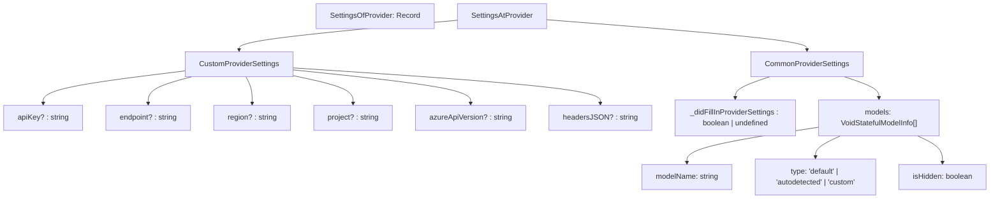

- Each provider's settings include a mix of custom fields unique to that provider (like API keys or endpoints) and common fields such as the current list of models and a flag `_didFillInProviderSettings` that reflects whether required fields have been filled in.
- The `_didFillInProviderSettings` boolean is primarily used to control whether the provider and its models are enabled and visible in the UI.
- Models within a provider are tracked as an array of `VoidStatefulModelInfo` entries, tagging each model by type (`default`, `autodetected`, or `custom`) and visibility (`isHidden`).
- This structure is defined and used in [voidSettingsTypes.ts:21-50](), and validation logic around filling settings is in [voidSettingsService.ts:151-165]().

### Provider Settings UI

The `SettingsForProvider` component renders a UI panel for each provider settings section:

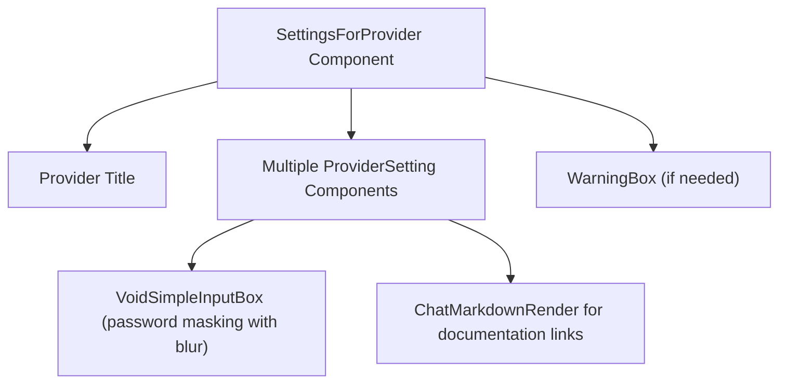

- Each setting is rendered with appropriate input controls respecting sensitive values (e.g., API keys are masked and only shown on blur).
- Documentation links help users understand which keys or endpoints are required.
- A warning may be shown if models depend on settings not filled in.
- Implementation is in [Settings.tsx:613-646]() and [Settings.tsx:694-744]().

**Sources:** [src/vs/workbench/contrib/void/common/voidSettingsTypes.ts:16-50](), [src/vs/workbench/contrib/void/browser/react/src/void-settings-tsx/Settings.tsx:613-646](), [src/vs/workbench/contrib/void/common/voidSettingsService.ts:151-165]()

---

## Model Management

Void organizes models per provider with three source categories:

- **Default models:** Hardcoded known models shipped with the app (`defaultModelsOfProvider`)
- **Autodetected models:** Models discovered dynamically from local endpoints or special providers (`ollama`, `vLLM`)
- **Custom models:** User-added models managed through the UI

### Model Types and Capabilities

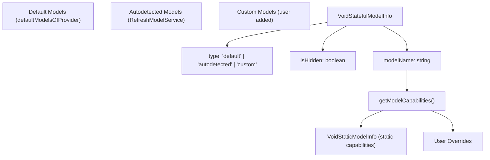

- Models carry minimal metadata for visibility and source.
- `getModelCapabilities()` fetches full capability metadata combining static info and user overrides.
- Static data is defined in `modelCapabilities.ts`, including token limits, system message support, tool calling format, fill-in-middle (FIM) availability, reasoning capabilities, and cost estimates.
- User overrides allow manually correcting or enhancing model metadata.

### Model Capabilities Lookup Algorithm

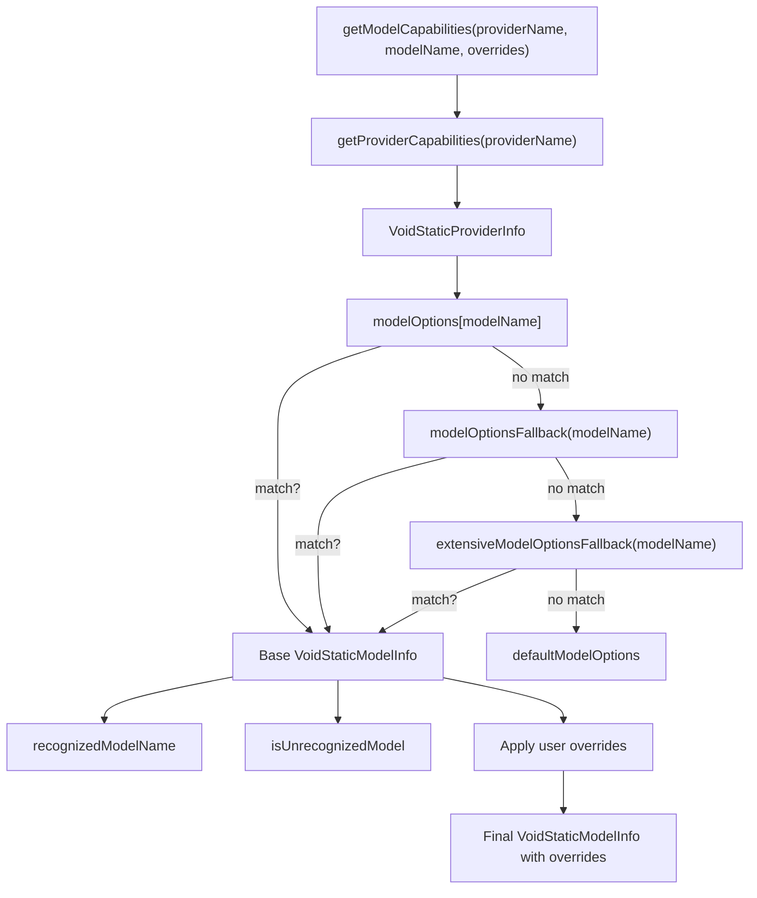

- The function attempts to find the model capabilities progressively:
  - Direct lookup
  - Provider-specific pattern fallback
  - Extensive fallback matching
  - Default fallback
- Overrides are then merged to produce final capabilities.
- This lookup enables supporting unknown or dynamically added models.

### Model Overrides UI

- The `SimpleModelSettingsDialog` component allows users to edit model override JSON for any model, including unknown ones.
- Overrides include keys like `contextWindow`, `supportsSystemMessage`, `reasoningCapabilities` and more.
- Overrides are stored immutably inside the `overridesOfModel` state object.
- The dialog validates JSON input before saving or clearing.
- This flow is visualized below:

```mermaid
graph LR
    Dialog["SimpleModelSettingsDialog"]
    Dialog --> TextArea["JSON TextArea (model override)"]
    TextArea --> SaveButton["Save overrides"]
    SaveButton --> setOverrides["setOverridesOfModel(providerName, modelName, overrides)"]
    setOverrides --> overridesState["overridesOfModel"]
    overridesState --> getModelCapabilities["getModelCapabilities(providerName, modelName, overridesOfModel)"]
    getModelCapabilities --> ApplyOverrides["Override applied on base capabilities"]
```

**Sources:** [src/vs/workbench/contrib/void/common/modelCapabilities.ts:208-221](), [src/vs/workbench/contrib/void/browser/react/src/void-settings-tsx/Settings.tsx:208-369](), [src/vs/workbench/contrib/void/common/voidSettingsService.ts:68-69]()

### Model Management Methods

- The settings service exposes methods to:
  - Add a custom model: `addModel(providerName, modelName)`
  - Remove a custom model: `deleteModel(providerName, modelName)`
  - Toggle visibility (show/hide) a model: `toggleModelHidden(providerName, modelName)`
  - Update the list of autodetected models: `setAutodetectedModels(providerName, modelNames)`

- When autodetected models set, the system replaces previous autodetected models keeping custom/default ones and preserves hidden flags. (`_modelsWithSwappedInNewModels()`)

- Model management maintains consistency by preserving user changes while updating dynamic info.

**Sources:** [src/vs/workbench/contrib/void/common/voidSettingsService.ts:87-104](), [src/vs/workbench/contrib/void/common/voidSettingsService.ts:394-464]()

---

## Per-Feature Model Selection

Void supports multiple AI-powered features, each potentially using different LLM models based on requirements or preferences.

### Features and Model Selection Mapping

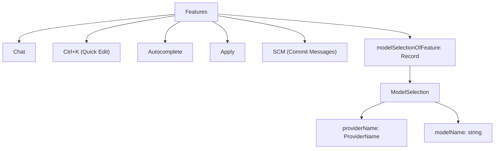

- Each feature can have a model selected independently.
- The selections are stored in `modelSelectionOfFeature`.
- Features include Chat, Quick Edit (Ctrl+K), Autocomplete, Apply, and SCM.

### Model Requirement Filters per Feature

```typescript
export const modelFilterOfFeatureName = {
  Autocomplete: {
    filter: (o, opts) => getModelCapabilities(o.providerName, o.modelName, opts.overridesOfModel).supportsFIM,
    emptyMessage: { message: 'No models support FIM', priority: 'always' }
  },
  Chat: { filter: () => true, emptyMessage: null },
  CtrlK: { filter: () => true, emptyMessage: null },
  Apply: { filter: () => true, emptyMessage: null },
  SCM: { filter: () => true, emptyMessage: null },
}
```

- The Autocomplete feature requires models supporting fill-in-middle (FIM).
- Other features accept all models.
- The filters ensure only compatible models are shown for selection in the UI.

### Model Options Computation

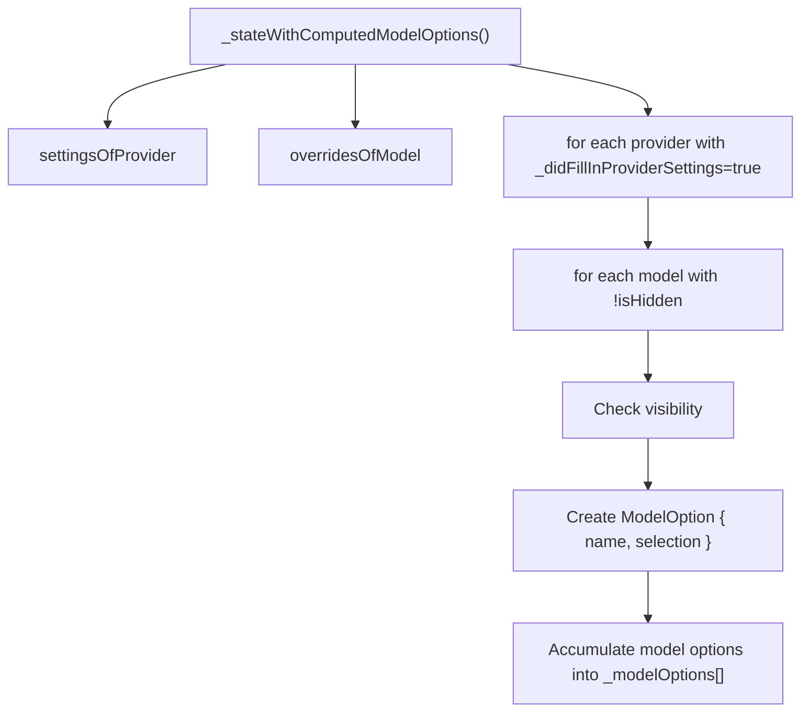

- Computes a flat array of selectable models (`ModelOption[]`) combining all enabled providers and visible models.
- Used by dropdown components for model selection.
- Applies filters on `isHidden` and provider enabled state.

**Sources:** [src/vs/workbench/contrib/void/common/voidSettingsService.ts:107-121](), [src/vs/workbench/contrib/void/common/voidSettingsService.ts:181-212](), [src/vs/workbench/contrib/void/common/voidSettingsTypes.ts:365-367]()

---

## Settings UI

### Settings Component and Tabs

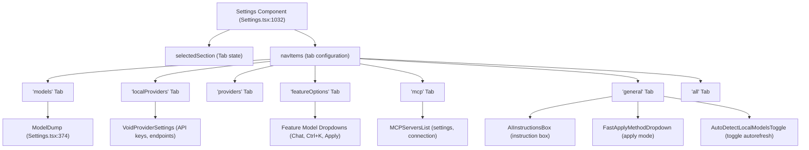

- The `Settings` React component manages multiple tabs, each rendering different controls.
- Tab navigation is controlled by `selectedSection` state and `navItems` array ([Settings.tsx:1032-1046]()).
- Each tab displays related subcomponents, e.g., `ModelDump` shows models and management buttons, `VoidProviderSettings` shows provider credentials.
- `FeatureModelDropdowns` allows per-feature model selection via the `ModelDropdown` component.
- Auto-detect toggle controls refreshing local models on startup.

**Sources:** [src/vs/workbench/contrib/void/browser/react/src/void-settings-tsx/Settings.tsx:1032-1046](), [src/vs/workbench/contrib/void/browser/react/src/void-settings-tsx/Settings.tsx:1047-1528]()

### ModelDump Component

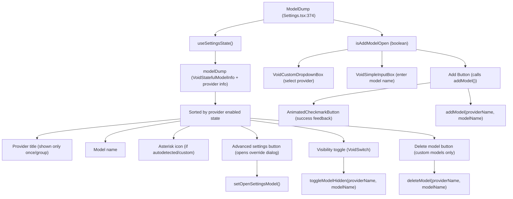

- Displays all models grouped by provider.
- Allows toggling visibility without deletion.
- Custom models can be deleted.
- Add Model form is toggled and allows adding new custom models.
- Advanced settings open the `SimpleModelSettingsDialog` for overrides.

**Sources:** [src/vs/workbench/contrib/void/browser/react/src/void-settings-tsx/Settings.tsx:374-607]()

### ModelDropdown Component

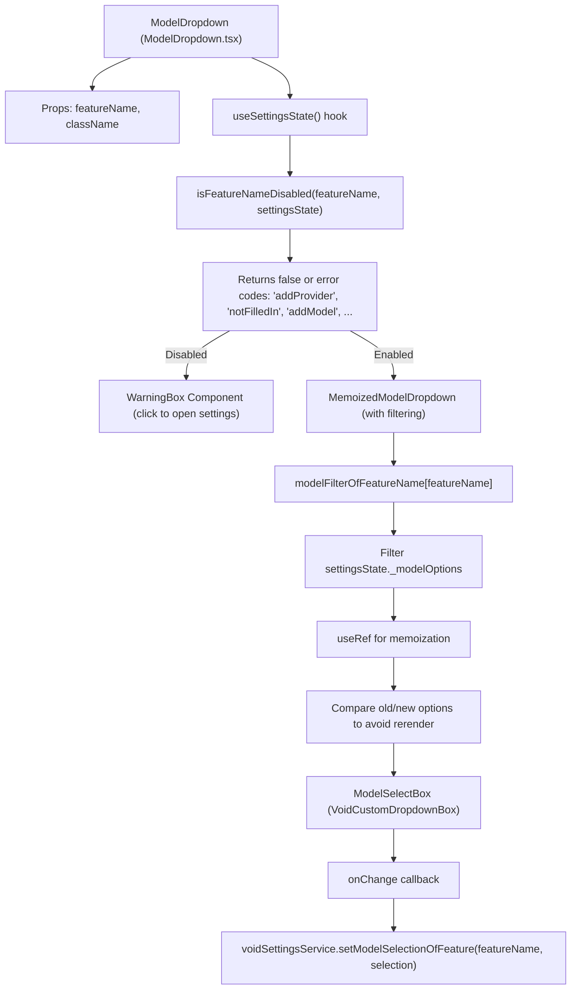

- Filters model options based on feature requirements.
- Prevents selecting models if providers or models are missing or disabled.
- Memoizes filtered list to avoid unnecessary UI re-renders.
- Shows warnings prompting user action when a feature is disabled due to missing configuration.

**Sources:** [src/vs/workbench/contrib/void/browser/react/src/void-settings-tsx/ModelDropdown.tsx:25-99](), [src/vs/workbench/contrib/void/common/voidSettingsService.ts:107-121]()

---

## Refreshing Local Provider Models

Local providers such as Ollama, vLLM, and LM Studio can auto-detect available models.

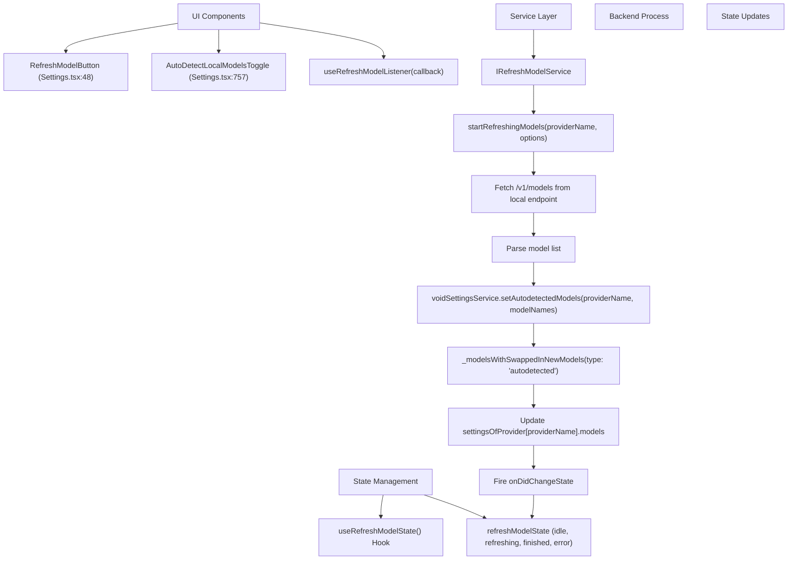

- Refresh button triggers a fetch to local provider's `/v1/models` endpoint.
- Model list returned is parsed and integrated via `setAutodetectedModels`.
- Autodetect toggle controls autosync on startup.
- State transitions show feedback during long-running refreshes.

**Sources:** [src/vs/workbench/contrib/void/browser/react/src/void-settings-tsx/Settings.tsx:48-96](), [src/vs/workbench/contrib/void/browser/react/src/void-settings-tsx/Settings.tsx:757-782](), [src/vs/workbench/contrib/void/common/voidSettingsService.ts:394-414]()

---

## Settings Persistence and Validation

Settings are loaded/saved using VS Code's `IStorageService` and encrypted with `IEncryptionService`.

### Persistence Flow

```mermaid
graph TB
    Startup["On Startup"]
    Startup --> constructor["VoidSettingsService constructor"]
    constructor --> loadStorage["loadStateFromStorage()"]
    loadStorage --> decryptKeys["decryptApiKeys(encryptedStorage)"]
    decryptKeys --> validateState["_validatedModelState()"]
    validateState --> mergeDefaults["_stateWithMergedDefaultModels()"]
    mergeDefaults --> resolveInit["_resolver() - resolves waitForInitState"]
    resolveInit --> fireChange["fire onDidChangeState event"]
    
    Change["On Settings Change"]
    Change --> userAction["User calls setter e.g. setSettingOfProvider"]
    userAction --> updateState["Create new VoidSettingsState (immutable spread)"]
    updateState --> revalidate["_validatedModelState()"]
    revalidate --> saveStorage["saveStateToStorage()"]
    saveStorage --> encryptKeysSave["encryptApiKeys(toSaveState)"]
    encryptKeysSave --> storageSet["storageService.store()"]
    storageSet --> fireChangeUpdate["fire onDidChangeState"]
```

- On startup, stored settings are decrypted and validated, filling in default models.
- On change, the entire state is immutably replaced, validated, encrypted, and saved.
- Event `onDidChangeState` notifies the UI and listeners.

### Validation Pipeline

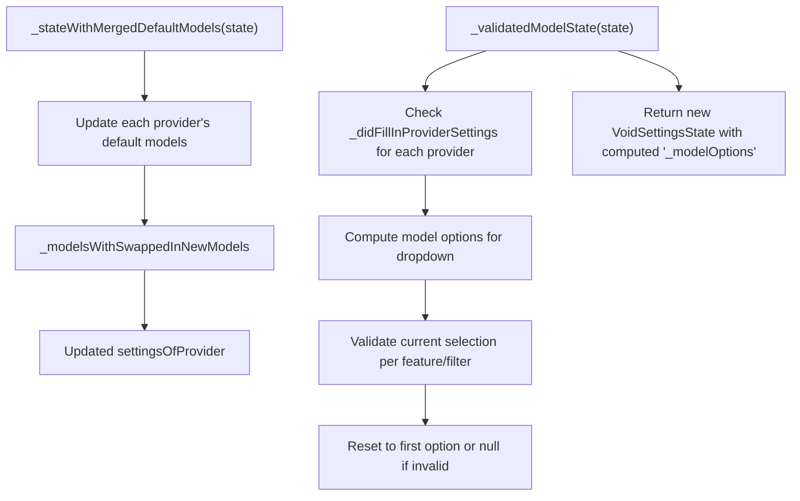

- Merges default models with current models, preserving hidden state.
- Validates required provider fields are filled.
- Computes model options for UI consumption.
- Ensures feature-specific model selections are valid; otherwise resets to fallback.
- Maintains data consistency and enforces UI constraints.

### Immutable Setting Updates

State changes follow immutable update patterns:

```typescript
const newState = {
  ...state,
  settingsOfProvider: {
    ...state.settingsOfProvider,
    [providerName]: {
      ...state.settingsOfProvider[providerName],
      [settingName]: newValue
    }
  }
};
```

This allows React hooks to detect changes efficiently and avoid redundant re-renders.

**Sources:** [src/vs/workbench/contrib/void/common/voidSettingsService.ts:264-392](), [src/vs/workbench/contrib/void/common/voidSettingsService.ts:214-262](), [src/vs/workbench/contrib/void/common/voidSettingsService.ts:466-542](), [src/vs/workbench/contrib/void/common/storageKeys.ts:8]()

---

## Model Selection Options

Beyond provider and model selection, features can customize detailed options per model selection.

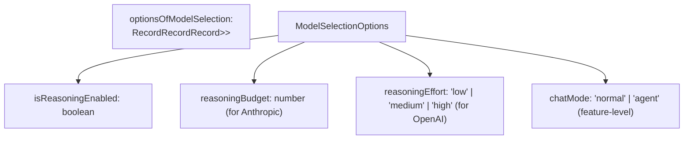

- Model selection options track flags like reasoning activation, budget or effort levels, and chat mode variants.
- These options influence how LLM calls are constructed.
- They are persisted with the rest of the settings and controlled from UI components.

**Sources:** [src/vs/workbench/contrib/void/common/voidSettingsTypes.ts:463-493](), [src/vs/workbench/contrib/void/common/sendLLMMessage.impl.ts:273-289]()

---

## Onboarding Flow

The onboarding flow implemented in `VoidOnboarding.tsx` guides new users through initial configuration steps, including:

- Selecting a provider and entering API keys or endpoints.
- Selecting initial default models for features.
- Understanding feature-specific model requirements.

In the `VoidOnboarding` component:

- State is synchronized with `VoidSettingsService`.
- Navigation between onboarding steps adapts to the user's configuration state.
- Offers quick links to open the full Settings UI for further customization.

This ensures a smooth first-run experience to reduce configuration complexity.

**Sources:** [src/vs/workbench/contrib/void/browser/react/src/void-settings-tsx/VoidOnboarding.tsx:1-154]()

---

## Summary

The settings and model selection system in Void is a robust and extensible architecture that includes:

- **Centralized immutable state management** with `VoidSettingsService`.
- **Provider configuration support** for 17+ AI providers with specific required fields.
- **Model lifecycle management** supporting default, autodetected, and custom models.
- **Comprehensive model capabilities system** with cascading fallbacks and user overrides.
- **Per-feature model selection** enforcing capability-based filtering.
- **Rich UI components** including multi-tab settings pages and dropdown selectors.
- **Secure encrypted persistence** using VS Code storage and encryption services.
- **A refresh mechanism** to dynamically detect local models.
- **An onboarding system** to assist first-time setup.

This modular design allows Void to support diverse AI models and provider ecosystems, providing granular control to users over model choice per feature.

---

# References

- `voidSettingsService.ts` lines 40-82, 107-212, 214-392, 394-464, 466-542
- `modelCapabilities.ts` lines 12-158, 208-221, 1160-1242
- `voidSettingsTypes.ts` lines 16-50, 358-367, 389-390, 411-464, 463-493
- `Settings.tsx` lines 48-96, 208-369, 374-607, 613-646, 694-744, 757-782, 1032-1528
- `ModelDropdown.tsx` lines 25-99
- `VoidOnboarding.tsx` lines 1-154
- `storageKeys.ts` line 8

**Sources:**  
[src/vs/workbench/contrib/void/common/voidSettingsService.ts](),  
[src/vs/workbench/contrib/void/common/modelCapabilities.ts](),  
[src/vs/workbench/contrib/void/common/voidSettingsTypes.ts](),  
[src/vs/workbench/contrib/void/browser/react/src/void-settings-tsx/Settings.tsx](),  
[src/vs/workbench/contrib/void/browser/react/src/void-settings-tsx/ModelDropdown.tsx](),  
[src/vs/workbench/contrib/void/browser/react/src/void-settings-tsx/VoidOnboarding.tsx](),  
[src/vs/workbench/contrib/void/common/storageKeys.ts]()