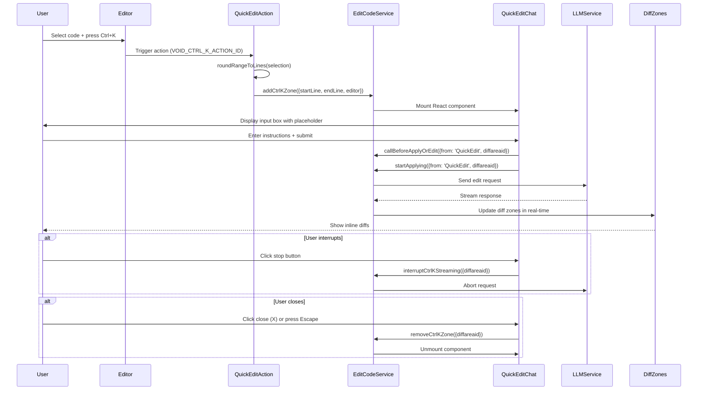
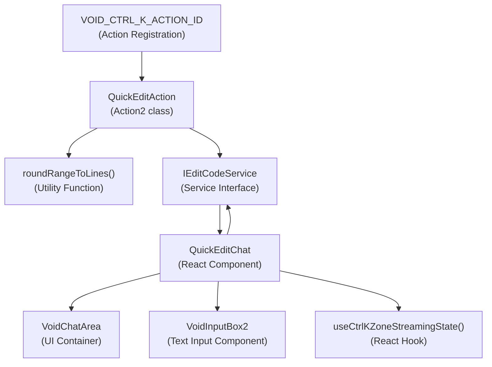
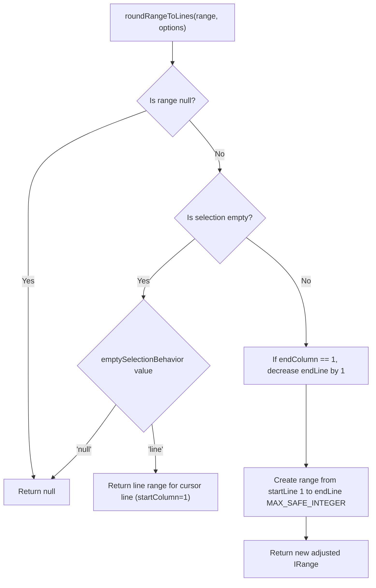
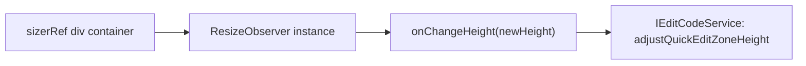
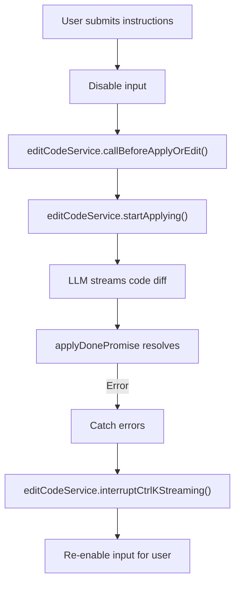
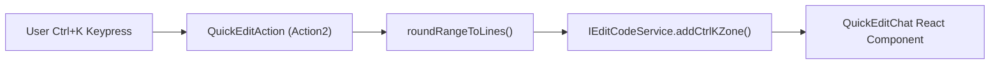
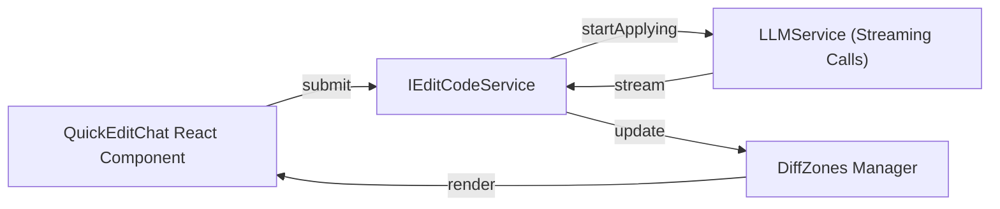

# Quick Edit (Ctrl+K)

<details>
<summary>Relevant source files</summary>

The following files were used as context for generating this wiki page:

- [.voidrules](.voidrules)

</details>


## Purpose and Scope

Quick Edit (Ctrl+K) is an inline code modification feature that allows users to select code segments and supply natural language instructions to modify that code directly within the editor. Activating Ctrl+K opens an embedded chat interface aligned to the selected lines, facilitating rapid AI-assisted code transformations without interrupting the coding workflow.

This page covers the implementation and usage of the Quick Edit feature, describing its activation, UI components, data flow, and integration with the broader code editing service pipeline. It focuses on key source files: `quickEditActions.ts` (activation and action logic), `QuickEditChat.tsx` (React UI component), and their interaction with the `IEditCodeService`.

For related features such as diff navigation and code applying strategies, see [Command Bar and Diff Navigation](#2.4) and [Code Editing and Apply System](#2.5).

---

## Activation and User Interface

### Triggering Quick Edit

Quick Edit is triggered by the keybinding **Ctrl+K** (Cmd+K on macOS) when the editor is focused. The steps performed on activation are:

1. Capture the current selection or cursor position in the editor.
2. Normalize the selection to entire lines using the `roundRangeToLines` utility.
3. Call the service method `IEditCodeService.addCtrlKZone()` to create an inline edit zone at the computed lines.

During activation, a usage metric event `'Ctrl+K'` is captured for analytics.

```typescript
// Inside quickEditActions.ts (lines 35-69)
action.run = (accessor) => {
    const editor = ...; // get active editor
    const selection = editor.getSelection();
    const range = roundRangeToLines(selection, { emptySelectionBehavior: 'line' });
    if (!range) return;
    const editCodeService = accessor.get(IEditCodeService);
    editCodeService.addCtrlKZone({ startLineNumber: range.startLineNumber, endLineNumber: range.endLineNumber, editor });
    metricsService.capture('Ctrl+K', {});
}
```

This logic ensures that the Quick Edit zone always covers full lines, consistent with the inline editing UI concept.

**Sources:** [src/vs/workbench/contrib/void/browser/quickEditActions.ts:35-69]()

### Quick Edit Chat Interface

The inline UI is rendered by the `QuickEditChat` React component. This component provides:

| UI Element       | Description                                                                                  |
|------------------|----------------------------------------------------------------------------------------------|
| **Input Box**    | A multi-line text area (`VoidInputBox2`) for user natural language instructions to modify code. |
| **Submit Button** | Starts the code edit request. Disabled if input is empty or feature is disabled by settings. |
| **Stop Button**   | Interrupts ongoing streaming of AI code generation response.                                |
| **Close Button (X)**| Closes and removes the inline edit zone without applying changes.                          |
| **Loading Indicator** | Spinner shown while the AI model is generating a response.                               |

The component is wrapped in `VoidChatArea` for consistent UI styling with other chat features.

It uses the React hook `useCtrlKZoneStreamingState(diffareaid)` to subscribe to streaming events specific to that inline edit zone.

**Sources:** [src/vs/workbench/contrib/void/browser/react/src/quick-edit-tsx/QuickEditChat.tsx:18-138]()

---

## Interaction Flow



This sequence diagram outlines the user interaction and event flow from activation through the edit application or cancellation processes.

**Sources:** [src/vs/workbench/contrib/void/browser/quickEditActions.ts:50-68](), [src/vs/workbench/contrib/void/browser/react/src/quick-edit-tsx/QuickEditChat.tsx:63-92]()

---

## Architecture and Code Entities

### Component and Service Relationships



This graph highlights the layered structure:

- **Action Layer:** handles keyboard binding and initial logic.
- **Service Layer:** `IEditCodeService` manages inline zones, streaming, and apply operations.
- **UI Layer:** React components render the chat interface and interact with services/hooks.

**Sources:** [src/vs/workbench/contrib/void/browser/quickEditActions.ts:1-69](), [src/vs/workbench/contrib/void/browser/react/src/quick-edit-tsx/QuickEditChat.tsx:1-138]()

### Key Code Entities

| Entity                      | Type               | Location                                         | Role                                                    |
|-----------------------------|--------------------|-------------------------------------------------|---------------------------------------------------------|
| `VOID_CTRL_K_ACTION_ID`      | Constant Action ID  | [quickEditActions.ts:39]()                       | Identifier binding Ctrl+K shortcut                       |
| `QuickEditAction`            | Class (Action2)     | [quickEditActions.ts:35-69]()                    | Handles activation logic, keybinding                    |
| `roundRangeToLines()`        | Function           | [sidebarActions.ts:29-50]()                       | Normalizes editor selection to full lines                |
| `QuickEditChat`              | React Component     | [QuickEditChat.tsx:18-138]()                      | Renders inline chat UI, manages input and controls      |
| `useCtrlKZoneStreamingState` | React Hook          | (Imported by QuickEditChat)                       | Subscribes to streaming state for a specific inline zone|
| `IEditCodeService`           | Service Interface   | (External Service used across files)             | Manages inline edit zones, submitting and streaming edits|
| `VoidInputBox2`              | React Component     | (UI library component)                            | Multi-line input box used by QuickEditChat               |
| `VoidChatArea`               | React Component     | (UI library wrapper)                              | UI container for chat-like interaction                   |

**Sources:** [src/vs/workbench/contrib/void/browser/quickEditActions.ts:1-69](), [src/vs/workbench/contrib/void/browser/react/src/quick-edit-tsx/QuickEditChat.tsx:1-138](), [src/vs/workbench/contrib/void/browser/sidebarActions.ts:29-50]()

---

## Implementation Details

### Selection Rounding Logic (`roundRangeToLines`)

The function `roundRangeToLines` ensures the code selection for Quick Edit aligns to full lines:



Key behaviors:

- If the selection is empty, and `emptySelectionBehavior` is `'line'`, the single cursor line is returned as a full-line range.
- If the selection spans multiple lines and the ending column is 1 (start of next line), the end line is adjusted down.
- The returned range always spans from column 1 to the maximum possible column to capture entire lines.

**Sources:** [src/vs/workbench/contrib/void/browser/sidebarActions.ts:29-50]()

### React Component `QuickEditChat`

#### State and References

- Maintains input text state for instructions.
- Uses `useRef` for textarea DOM ref and function refs to enable/disable input.
- Subscribes via `useCtrlKZoneStreamingState(diffareaid)` to know whether streaming is ongoing.
- Uses `ResizeObserver` attached to a div container (`sizerRef`) to track height changes dynamically.

#### Keyboard Handling

| Key            | Action                               |
|----------------|------------------------------------|
| Enter          | Submit instructions (if Shift not pressed) |
| Shift + Enter  | Insert newline                     |
| Escape         | Close the inline edit zone         |

#### Disabled Submit Conditions

Submission button is disabled if:

- Instructions input box is empty.
- The Ctrl+K feature is disabled in settings (checked via `isFeatureNameDisabled('Ctrl+K', settings)`).

#### Dynamic Height Adjustment

A `ResizeObserver` listens on the hidden `sizerRef` container, which mirrors input content size, then calls back into `IEditCodeService` to resize the editor inline zone, ensuring UI consistency as the user types.



**Sources:** [src/vs/workbench/contrib/void/browser/react/src/quick-edit-tsx/QuickEditChat.tsx:18-138]()

### Edit Application Flow

Upon instruction submission in `QuickEditChat`:

1. The textarea is disabled to prevent further input during processing.
2. Calls `editCodeService.callBeforeApplyOrEdit()` with `{ from: 'QuickEdit', diffareaid, startBehavior: 'keep-conflicts' }` to prepare for edit.
3. Calls `editCodeService.startApplying()` initiating the code edit request.
4. The promise returned (`applyDonePromise`) is monitored for completion or error.
5. On error, the streaming is interrupted with `interruptCtrlKStreaming()`, and the input re-enabled for retry.



**Sources:** [src/vs/workbench/contrib/void/browser/react/src/quick-edit-tsx/QuickEditChat.tsx:63-80]()

---

## Integration with Edit Pipeline

Every Quick Edit inline zone is assigned a unique identifier `diffareaid` that tracks the state and streaming status throughout the lifecycle:

- Enables binding of UI streaming state via the React hook `useCtrlKZoneStreamingState(diffareaid)`.
- Routes streaming LLM responses to the correct inline zone.
- Allows selective interruption or removal of inline zones.

This identifier flows from `quickEditActions.ts` through to the `IEditCodeService` and the React components.

**Sources:** [src/vs/workbench/contrib/void/browser/react/src/quick-edit-tsx/QuickEditChat.tsx:19](), [src/vs/workbench/contrib/void/browser/quickEditActions.ts:18-24]()

---

## Service Access Pattern

`QuickEditChat` obtains VS Code/ Void services using the `useAccessor` hook, which provides access to dependency-injected services from the VS Code extension host environment:

```typescript
const accessor = useAccessor();
const editCodeService = accessor.get(IEditCodeService);
const keybindingService = accessor.get(IKeybindingService);
```

This pattern bridges VS Code’s service-based architecture with React component logic, and is a consistent pattern used across Void's React UI components.

**Sources:** [src/vs/workbench/contrib/void/browser/react/src/quick-edit-tsx/QuickEditChat.tsx:26-27](), [src/vs/workbench/contrib/void/browser/react/src/util/services.tsx:247-253]()

---

## Keyboard and Error Handling

- **Keyboard Shortcuts** are implemented to enhance UX:
  - **Enter** submits the instructions unless Shift is pressed.
  - **Shift+Enter** inserts a newline.
  - **Escape** closes the Quick Edit zone.

- **Error Handling** ensures graceful recovery from LLM call failures during applying:
  - The `applyDonePromise` from calling `startApplying()` is caught.
  - If an error occurs, `interruptCtrlKStreaming()` aborts the streaming.
  - The instruction input box is re-enabled for retry or editing.

**Sources:** [src/vs/workbench/contrib/void/browser/react/src/quick-edit-tsx/QuickEditChat.tsx:74-77](), [src/vs/workbench/contrib/void/browser/react/src/quick-edit-tsx/QuickEditChat.tsx:115-131]()

---

# Summary

The Quick Edit feature (Ctrl+K) in Void provides an inline, AI-powered code editing interface accessible directly inside the editor. It leverages the `IEditCodeService` to manage inline edit zones, streaming of edits from large language models, and applies diffs in a manner integrated with the editor.

Key files defining this feature include:

- `quickEditActions.ts`: Handles keyboard shortcut binding, selection normalization, and zone creation.
- `QuickEditChat.tsx`: React UI for chat input, submission, streaming state, and display.
- Supporting utilities like `roundRangeToLines()` handle selection logic.

This tight coupling with services and input/output UI components offers a seamless and efficient AI editing experience embedded in Void's VS Code fork.

---

# References for Diagram Mapping: Natural Language Space to Code Entities

### Diagram 1: Feature Activation to UI Rendering



### Diagram 2: User Instruction Submission Flow



**Sources:** [src/vs/workbench/contrib/void/browser/quickEditActions.ts](), [src/vs/workbench/contrib/void/browser/react/src/quick-edit-tsx/QuickEditChat.tsx](), [src/vs/workbench/contrib/void/browser/sidebarActions.ts]()