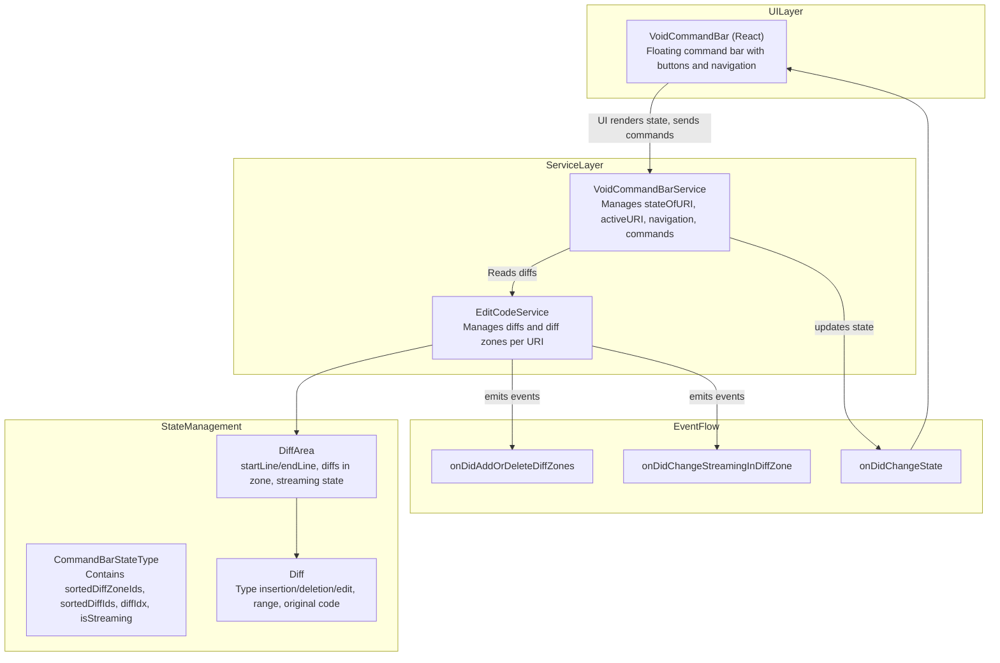
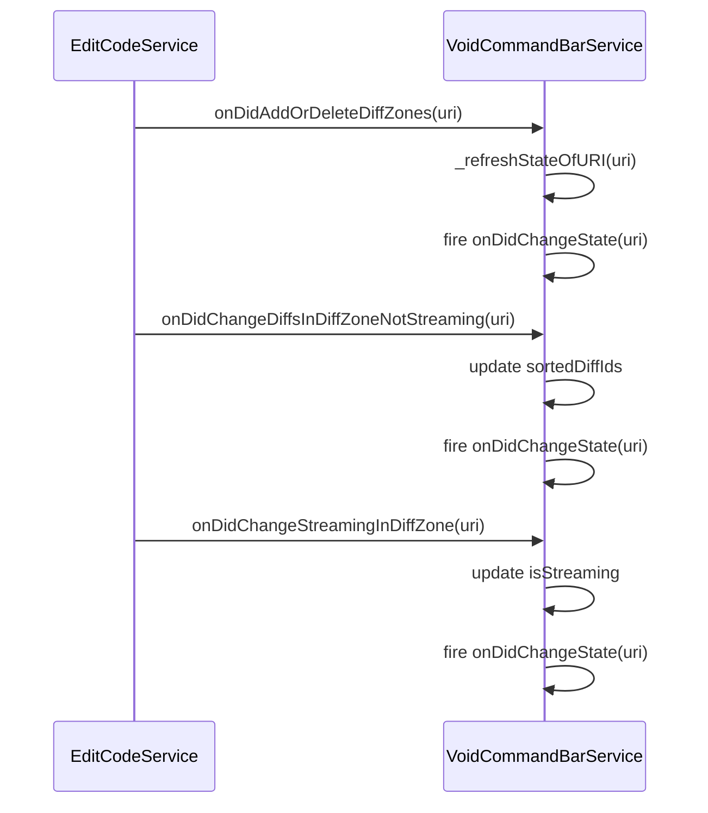
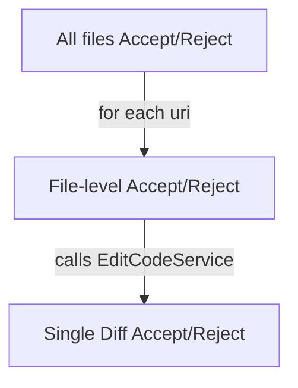
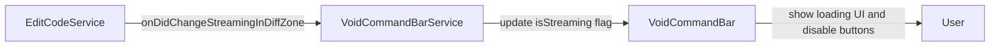
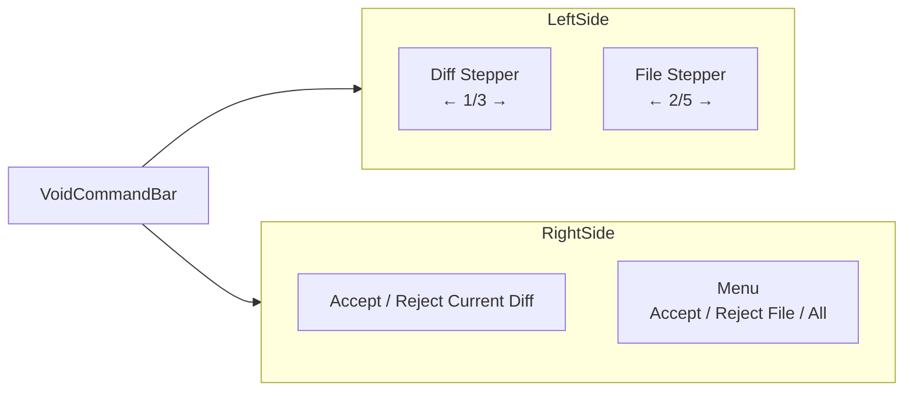
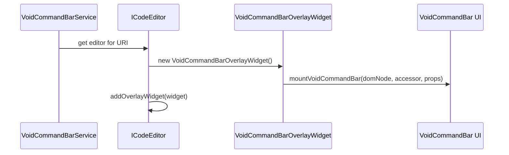
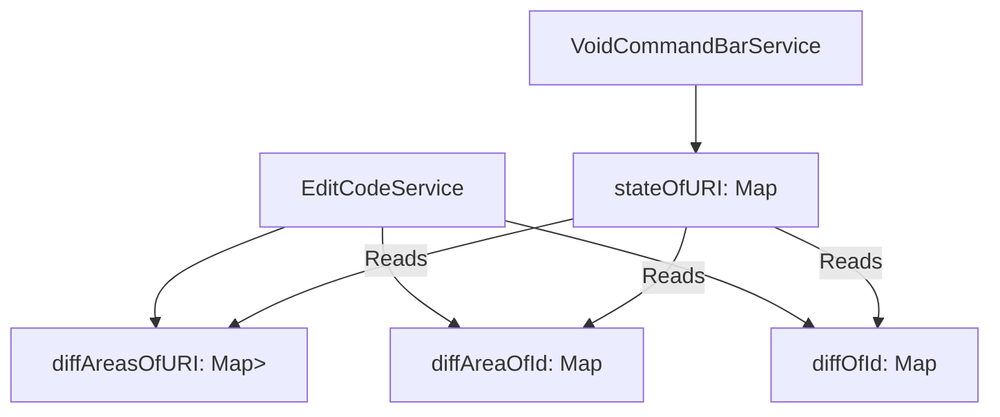

# Command Bar and Diff Navigation

<details>
<summary>Relevant source files</summary>

The following files were used as context for generating this wiki page:

- [.voidrules](.voidrules)

</details>


## Purpose and Scope

This document explains the **Command Bar** system in Void, implemented as a floating UI widget that appears in the editor when AI-generated diffs (code changes) are present in a file. The command bar allows users to:

- Navigate between diff changes within the current file
- Navigate between files with pending diffs
- Accept or reject diffs individually, per file, or all at once

The system integrates closely with the diff and edit management provided by the `EditCodeService`. It tracks the diffs per URI, updates UI state for streaming or applying diffs, and handles user commands via button clicks or keyboard shortcuts.

This page covers the technical implementation details in `VoidCommandBar.tsx` (React UI component) and `voidCommandBarService.ts` (service managing state, navigation, and commands).

For context on how diffs are produced and applied, see the [Code Editing and Apply System](#2.5) documentation. For usage of Ctrl+K Quick Edit, see [Quick Edit (Ctrl+K)](#2.3).

---

## System Architecture Overview

The command bar system sits atop the Void editing environment and interacts with several key entities:



- `VoidCommandBar` is a React component rendering the floating widget with navigation stepper controls and accept/reject buttons.
- `VoidCommandBarService` maintains per-URI command bar state, synchronizes with `EditCodeService`, and executes operations on diffs.
- `EditCodeService` manages the underlying diffs, grouped into "diff zones" (`DiffArea`). Diff zones indicate sections of changed lines, which may be streaming.
- Events from `EditCodeService` (diff additions/removals, streaming changes) propagate to `VoidCommandBarService` which updates UI state.

**Sources:**  
- [src/vs/workbench/contrib/void/browser/voidCommandBarService.ts:1-600]()  
- [src/vs/workbench/contrib/void/browser/react/src/void-editor-widgets-tsx/VoidCommandBar.tsx:1-200]()  
- [src/vs/workbench/contrib/void/browser/editCodeService.ts:157-180]()

---

## VoidCommandBarService: Command Bar State and Logic

### Core State Structures

The command bar service tracks state per URI with active diffs via:

- `stateOfURI: Record<string, CommandBarStateType>`  
  Maps file URIs (as strings) to their command bar state.

- `sortedURIs: URI[]`  
  Sorted array of URIs currently containing diffs, ordered by the first diff line.

- `activeURI: URI | null`  
  The currently focused/open file URI in the editor, relevant for UI context.

Each `CommandBarStateType` contains:

```typescript
interface CommandBarStateType {
  sortedDiffZoneIds: string[];   // IDs of diff zones in ascending line order
  sortedDiffIds: string[];       // IDs of all individual diffs in ascending order
  isStreaming: boolean;          // True if any diff zone in file is streaming
  diffIdx: number | null;        // Index of currently selected diff in sortedDiffIds
}
```

This structure enables the command bar to display position information, handle navigation, and reflect streaming status.

**Sources:**  
- [src/vs/workbench/contrib/void/browser/voidCommandBarService.ts:60-96]()

### State Synchronization with EditCodeService

The service watches `EditCodeService` events for updates:

- `onDidAddOrDeleteDiffZones`  
  When diff zones are added or removed in a file, `VoidCommandBarService` recomputes sorting of diff zones and diffs, validates `diffIdx`, and adjusts `stateOfURI` accordingly.

- `onDidChangeDiffsInDiffZoneNotStreaming`  
  When diffs change but no streaming occurs, updates `sortedDiffIds` in `stateOfURI`.

- `onDidChangeStreamingInDiffZone`  
  Updates `isStreaming` flag in `stateOfURI` when diff zones start or stop streaming.

This event-driven approach ensures the command bar UI always reflects the current diff landscape.



**Sources:**  
- [src/vs/workbench/contrib/void/browser/voidCommandBarService.ts:141-240]()

### Navigation Methods

The service implements navigation methods:

- `goToDiffIdx(diffIdx: number)`  
  Moves selection inside the current file to the `diffIdx`-th diff, scrolling the editor to that diff's location.

- `goToURIIdx(uriIdx: number)`  
  Switches the editor to open the file at `sortedURIs[uriIdx]` and navigates to the first diff.

These methods perform bounds checks, handle wrap-around navigation, and dispatch necessary commands via VS Code.

**Sources:**  
- [src/vs/workbench/contrib/void/browser/voidCommandBarService.ts:318-410]()

### Accept/Reject Commands

The core accept/reject actions delegate to `EditCodeService`:

- Single Diff: `acceptDiff({ diffid })` or `rejectDiff({ diffid })`
- All Diffs in File: `acceptOrRejectAllDiffAreas({ uri, behavior: 'accept' | 'reject' })`
- All Files: Iterates all URIs and calls above

The command bar service tracks state changes post-operation to update the UI.

**Operation scopes diagram:**



**Sources:**  
- [src/vs/workbench/contrib/void/browser/voidCommandBarService.ts:291-316]()  
- [src/vs/workbench/contrib/void/browser/editCodeService.ts:1396-1450]()  
- [src/vs/workbench/contrib/void/browser/voidCommandBarService.ts:163-176]()

### Streaming State Detection

The service maintains streaming state per URI to disable controls when diffs are being generated:

- `getStreamState(uri)` returns `'streaming' | 'idle-has-changes' | 'idle-no-changes'`
- Streaming blocks interaction until complete



**Sources:**  
- [src/vs/workbench/contrib/void/browser/voidCommandBarService.ts:268-289]()

---

## VoidCommandBar.tsx: UI Component

### Component Overview

`VoidCommandBar` is a React functional component responsible for rendering the floating command bar overlay:

- Shows navigation steppers for diffs and files (e.g., "3/7 diffs", "2/5 files")
- Accept/Reject buttons for current diff
- Drop-down menu for file-level and global accept/reject
- Updates its visual state based on streaming and command bar state

### Layout and Controls



- Position indicators allow keyboard and button navigation within and across files.
- Accept/Reject buttons perform single diff operations.
- Menu provides bulk accept/reject for current file or all files.

**Sources:**  
- [src/vs/workbench/contrib/void/browser/react/src/void-editor-widgets-tsx/VoidCommandBar.tsx:86-200]()  
- [src/vs/workbench/contrib/void/browser/react/src/void-editor-widgets-tsx/VoidCommandBar.tsx:14-24]()  

### State Binding and Navigation Indicators

Component reads:

- `diffIdx`, `sortedDiffIds.length` for diff position `1/3`
- `activeURI` and `sortedURIs` for file position `2/5`
- `isStreaming` disables controls and shows a loading spinner

Example selector logic snippet:

```typescript
const diffIdx = state?.diffIdx ?? null;
const numDiffs = state?.sortedDiffIds.length ?? 0;
const currFileIdx = sortedCommandBarURIs.findIndex(e => e.fsPath === uri?.fsPath);
```

**Sources:**  
- [src/vs/workbench/contrib/void/browser/react/src/void-editor-widgets-tsx/VoidCommandBar.tsx:99-130]()  

### Button Actions and Keybindings

Buttons invoke commands identified by constants like:

| Button Label           | Command ID                       |
|-----------------------|---------------------------------|
| Previous Diff         | `VOID_GOTO_PREV_DIFF_ACTION_ID` |
| Next Diff             | `VOID_GOTO_NEXT_DIFF_ACTION_ID` |
| Previous File         | `VOID_GOTO_PREV_URI_ACTION_ID`  |
| Next File             | `VOID_GOTO_NEXT_URI_ACTION_ID`  |
| Accept Current Diff   | `VOID_ACCEPT_DIFF_ACTION_ID`    |
| Reject Current Diff   | `VOID_REJECT_DIFF_ACTION_ID`    |
| Accept Current File   | `VOID_ACCEPT_FILE_ACTION_ID`    |
| Reject Current File   | `VOID_REJECT_FILE_ACTION_ID`    |
| Accept All Files      | `VOID_ACCEPT_ALL_DIFFS_ACTION_ID`|
| Reject All Files      | `VOID_REJECT_ALL_DIFFS_ACTION_ID`|

Keyboard shortcuts are registered for many commands for quick access.

**Sources:**  
- [src/vs/workbench/contrib/void/browser/react/src/void-editor-widgets-tsx/VoidCommandBar.tsx:170-250]()  
- [src/vs/workbench/contrib/void/browser/voidCommandBarService.ts:492-700]()  

---

## Command Bar Widget Mounting and Lifecycle

### Overlay Widget Implementation

The command bar UI is mounted on the active editor as an overlay widget:

- `VoidCommandBarOverlayWidget` implements `IOverlayWidget`
- Positioned in the editor's top-right corner using `OverlayWidgetPositionPreference.TOP_RIGHT_CORNER`
- On mount, creates a DOM container for the React component, renders it with props from the service



**Sources:**  
- [src/vs/workbench/contrib/void/browser/voidCommandBarService.ts:119-139]()  
- [src/vs/workbench/contrib/void/browser/voidCommandBarService.ts:412-490]()  

### Widget Lifecycle

- Widget is created and mounted lazily when diffs exist in the active file.
- If diffs are removed, the widget updates state to hide or disable controls.
- Maintains synchronization with command bar state via events.

**Sources:**  
- [src/vs/workbench/contrib/void/browser/voidCommandBarService.ts:242-266]()  

---

## Integration with EditCodeService: Data Flow

The command bar service reads from, but does not directly modify, the diff data managed by `EditCodeService`. The flow of data is:



All changes to diffs are invoked via public methods on `EditCodeService` and observed by `VoidCommandBarService` through events:

- `acceptDiff`, `rejectDiff`
- `acceptOrRejectAllDiffAreas`
- Events like `onDidAddOrDeleteDiffZones`

This separation ensures single source of truth and consistent state updates.

**Sources:**  
- [src/vs/workbench/contrib/void/browser/voidCommandBarService.ts:141-240]()  
- [src/vs/workbench/contrib/void/browser/editCodeService.ts:160-180]()  

---

## Summary

The Command Bar and Diff Navigation system in Void provides a tightly integrated floating widget for reviewing and managing AI-generated diffs. It is composed of:

- **VoidCommandBarService**: Central service tracking command bar state per file, synchronizing with edits and streaming status, and performing navigation and accept/reject actions.
- **VoidCommandBar (React)**: UI component rendering navigation steppers and controls with keyboard and mouse interactivity.
- **Integration with EditCodeService**: The source of truth for diff data and the entrypoint for applying or rejecting changes.
- **Overlay Widget**: The UI is attached to the editor as an overlay widget positioned in the top-right corner.

This system provides users an efficient and clear mechanism to review code changes generated or suggested by Void's AI features, enhancing the editing workflow.

---

**Sources:**  
- [src/vs/workbench/contrib/void/browser/voidCommandBarService.ts:1-600]()  
- [src/vs/workbench/contrib/void/browser/react/src/void-editor-widgets-tsx/VoidCommandBar.tsx:1-200]()  
- [src/vs/workbench/contrib/void/browser/editCodeService.ts:157-180]()