# Code Editing and Apply System

<details>
<summary>Relevant source files</summary>

The following files were used as context for generating this wiki page:

- [.voidrules](.voidrules)

</details>


## Purpose and Scope

This document provides an in-depth technical explanation of Void's Apply system for code editing, which applies AI-generated code modifications safely and efficiently. The system supports dual modes of operation:

- **Fast Apply**: Incremental search-and-replace block application
- **Slow Apply**: Full file rewrite

Additionally, there's an **Instant Apply** mode used by trusted tools to apply changes without user interaction.

Key components include:

- `editCodeService.ts`: Core service managing edits, diffs, streaming, snapshotting, and user interaction.
- `findDiffs.ts`: Utility for performing line-based diff computation between original and new code.
- `extractCodeFromResult.ts`: Parser for extracting search/replace blocks from AI-generated results.

This page details these components, application modes, data flow, diff management, streaming, undo snapshotting, and integration points.

---

## System Architecture

### Main Service and Responsibilities

The core editing orchestration is performed by the `EditCodeService` class, which implements the `IEditCodeService` interface. It manages:

- Applying code edits (Fast/Slow/Instant)
- Tracking and displaying diff zones within files
- Providing accept/reject operations for changes
- Streaming AI-generated edits incrementally
- Snapshotting file state for undo/redo integration

Additional supporting services it interacts with are:

- `IConsistentItemService`: For persistent UI elements in editors (view zones)
- `IVoidCommandBarService`: Command bar integration for diff navigation
- `IUndoRedoService`: Undo/redo history management
- `IVoidModelService`: Accessing and writing file models

#### Overall Service Overview

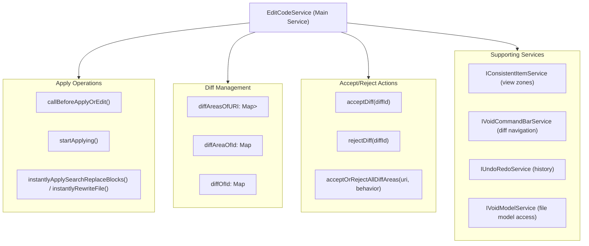

**Sources:** [editCodeService.ts:157-245](), [editCodeServiceInterface.ts:40-78]()

---

### Data Structures

Void tracks edits within hierarchical data structures to represent all active changes:

| Key Name           | Type                                  | Description                                 |
|--------------------|-------------------------------------|---------------------------------------------|
| `diffAreasOfURI`   | `Record<string, Set<string>>`       | Maps file URI to a set of active diff area IDs |
| `diffAreaOfId`     | `Record<string, DiffArea>`           | DiffArea contains a group of related diffs or editing zones |
| `diffOfId`         | `Record<string, Diff>`               | Individual diffs with line ranges and changes |

#### DiffArea Subtypes

There are three primary `DiffArea` subtypes:

```mermaid
graph TB
    DiffArea["DiffArea (base)"]

    DiffZone["DiffZone (visual diff display)"]
    CtrlKZone["CtrlKZone (Ctrl+K inline input)"]
    TrackingZone["TrackingZone (instant apply tracking)"]

    DiffArea --> DiffZone
    DiffArea --> CtrlKZone
    DiffArea --> TrackingZone

    DiffZone --> "_diffOfId (map of Diff objects)"
    DiffZone --> "_streamState (StreamLocationMutable)"
    DiffZone --> "originalCode (string)"

    CtrlKZone --> "_linkedStreamingDiffZone (DiffZone|null)"
    CtrlKZone --> "_mountInfo (UI mount metadata)"

    TrackingZone --> "No UI, used for Instant Apply"
```

- **DiffZone**: Represents a visual editing session with line highlights and decorations. Maintains original code snapshot and streaming state.
- **CtrlKZone**: Special inline input for quick edit feature (`Ctrl+K`), linked to a DiffZone that streams updates.
- **TrackingZone**: Invisible zone used internally for Instant Apply (no UI).

**Sources:** [editCodeServiceTypes.ts:1-100](), [editCodeService.ts:160-164]()

---

## Apply Modes

Void supports three main modes of applying code edits, chosen based on the nature of the AI output and user context:

---

### Mode Initialization And Validation

When a request to apply code edits is received (from chat "Apply" button, quick edit, or tool call), the service performs pre-checks via:

- `callBeforeApplyOrEdit()`: Validates current diff state, confirms behavior on conflicting diffs.
- `startApplying()`: Dispatches to Fast or Slow Apply modes.
- `instantlyApplySearchReplaceBlocks()` / `instantlyRewriteFile()`: For Instant Apply (no UI).

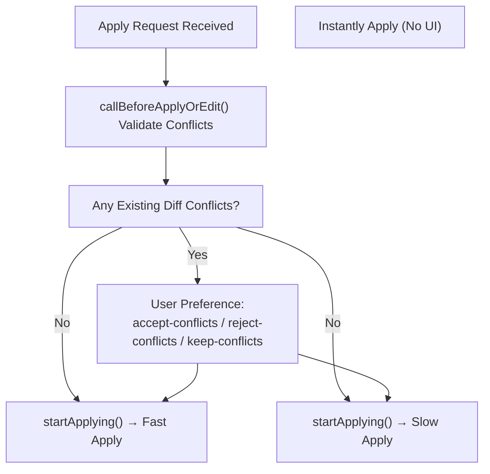

**Sources:** [editCodeService.ts:808-882]()

---

### Fast Apply (Search/Replace Blocks)

Fast Apply targets AI responses formatted as multiple search/replace blocks indicating what exact code to find and replace in the file.

#### Search/Replace Block Format

Void expects blocks of this form, using prompt delimiters defined in `prompts.ts`:

```text
<<<<<<< ORIGINAL
// Code to find as-is in the file
=======
/* Replacement code */
>>>>>>> UPDATED
```

Multiple such blocks may be concatenated in the AI response.

#### Processing Steps

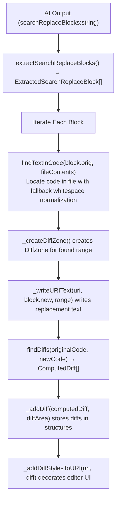

#### Key Functions

- **`extractSearchReplaceBlocks()`**: Parses AI result string into `{orig, new}` tuples using delimiters [extractCodeFromResult.ts:141-231]()
- **`findTextInCode(orig, fileContents)`**: Tries exact and whitespace-normalized match for original code block [editCodeService.ts:113-148]()
- **`_startStreamFastApply()`**: Processes each block sequentially, streams code writes [editCodeService.ts:1031-1180]()
- **`_createDiffZone()`**: Creates a `DiffZone` object with original code snapshot and managing streaming metadata [editCodeService.ts:1348-1395]()

**Sources:** [editCodeService.ts:1031-1180](), [extractCodeFromResult.ts:141-231](), [prompts.ts:38-40](), [editCodeService.ts:113-148](), [editCodeService.ts:1348-1395]()

---

### Slow Apply (Rewrite File)

Used when AI returns full rewritten file content (no search/replace blocks). Creates one large DiffZone spanning the entire region.

#### Processing Pipeline

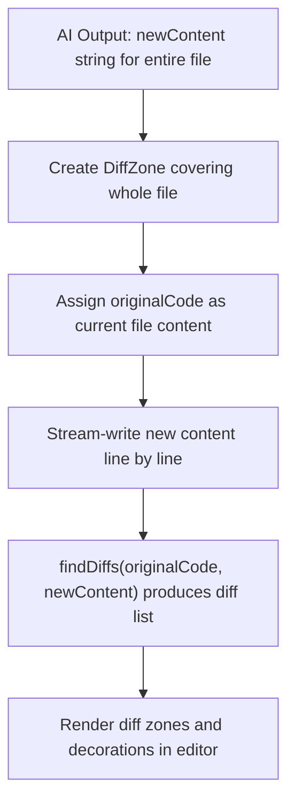

#### Key Functions

- **`_startStreamSlowApply()`**: Coordinates full rewrite streaming [editCodeService.ts:1182-1278]()
- **`_writeURIText()`**: Applies edits to document while maintaining streaming state [editCodeService.ts:626-659]()

**Sources:** [editCodeService.ts:1182-1278](), [editCodeService.ts:626-659]()

---

### Instant Apply (No UI)

Used by tools or auto-approved edits to immediately apply without tracking diffs or UI.

Characteristics:

- No DiffZone / visual decorations created (uses `TrackingZone`)
- Edits applied immediately to file
- Returns lint errors as output if any
- Bypasses user approval flow

Entry points:

- `instantlyApplySearchReplaceBlocks()` for `edit_file` tool [editCodeService.ts:884-917]()
- `instantlyRewriteFile()` for `rewrite_file` tool [editCodeService.ts:919-935]()

**Sources:** [editCodeService.ts:884-935]()

---

## Diff Computation and Rendering

### Diff Computation

Diff computation uses `findDiffs(originalCode, newCode)` from `findDiffs.ts` to produce a list of line-level diffs.

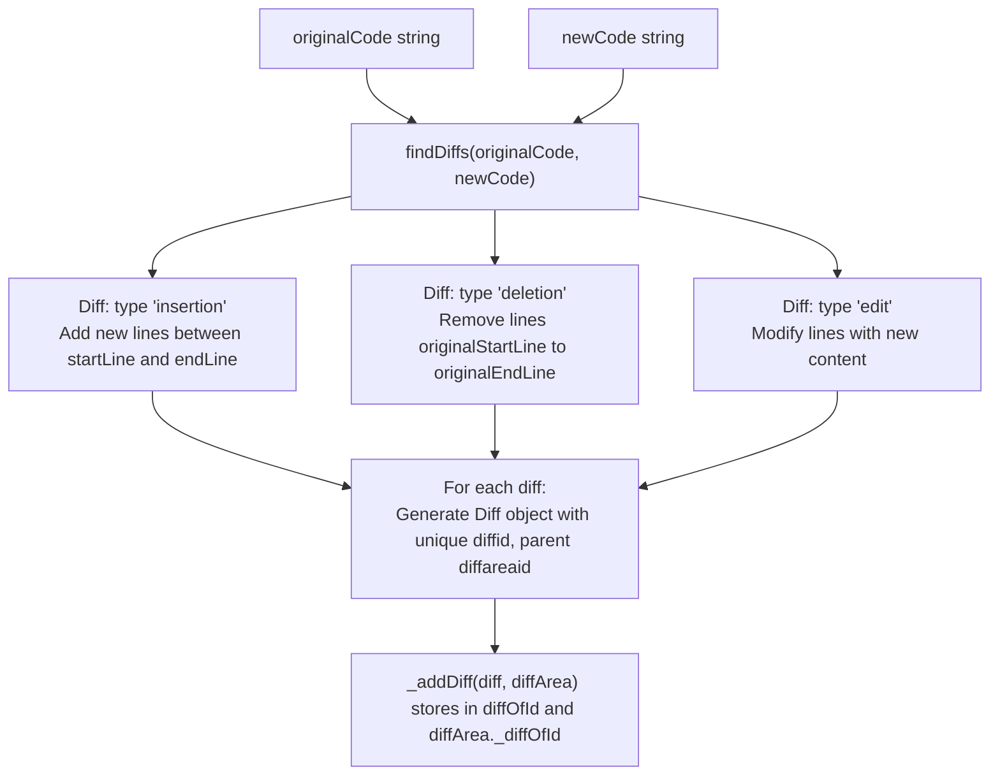

**Diff Object Properties:**

| Property          | Description                                 |
|-------------------|---------------------------------------------|
| `type`            | Kind of diff: `'insertion' | 'deletion' | 'edit'`  |
| `startLine`       | For insert/edit: starting (1-based) line     |
| `endLine`         | For insert/edit: ending (1-based) line       |
| `originalStartLine`| For deletions: original starting line        |
| `originalEndLine` | For deletions: original ending line          |
| `originalCode`    | Text from original file for edits/deletions |
| `diffid`          | Unique identifier for this diff               |
| `diffareaid`      | Parent DiffArea ID                            |

**Sources:** [editCodeServiceTypes.ts:32-50](), [findDiffs.ts:1-200]()

---

### Visual Rendering

Diffs are rendered in the editor via decorations and view zones:

- **Insertions/Edits:** Green background decorations on added/changed lines.
- **Deletions:** Red background view zone inserted to show removed lines.
- **Accept/Reject UI:** Inline overlay widgets with buttons to accept/reject per diff.

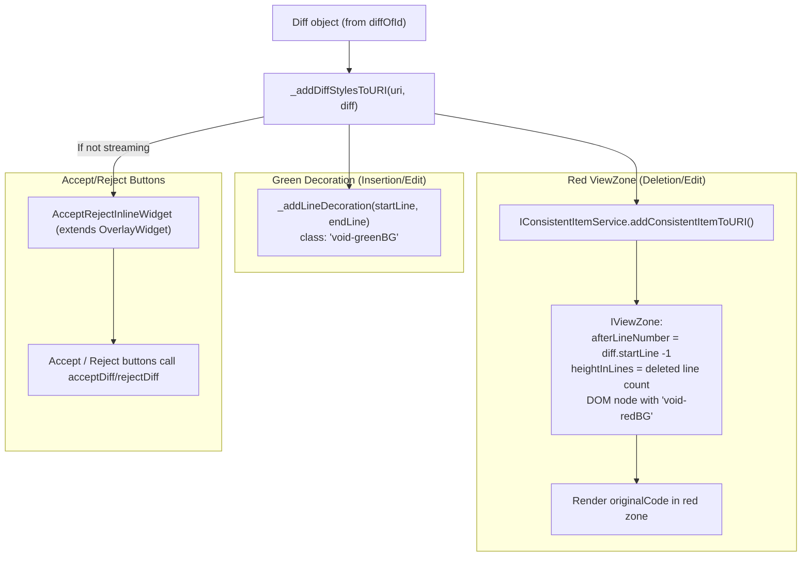

Key functions and components:

- `_addDiffStylesToURI()`: Creates the editor decorations and view zones for diffs [editCodeService.ts:475-613]()
- `_addLineDecoration()`: Adds inline green decorations for insertions and edits [editCodeService.ts:300-314]()
- `AcceptRejectInlineWidget`: Overlay widget with buttons [editCodeService.ts:1510-1627]()
- `IConsistentItemService`: Ensures view zones persist over document changes [editCodeService.ts:494-558]()

**Sources:** [editCodeService.ts:475-613](), [editCodeService.ts:300-314](), [editCodeService.ts:1510-1627](), [editCodeService.ts:494-558]()

---

## Streaming System

Code edits from the LLM are applied to files incrementally as streams of text data arrive.

### Streaming State

Each active `DiffZone` maintains a mutable streaming state:

- `isStreaming`: boolean flag if streaming is active
- `line` / `col`: current streaming insertion position
- `addedSplitYet`: Tracks if a partial line split was added
- `originalCodeStartLine`: Line offset to original code

An interrupt reference `_interruptStreamingRef` stores a function to abort streaming when user edits intervene or apply is canceled.

### Streaming Flow

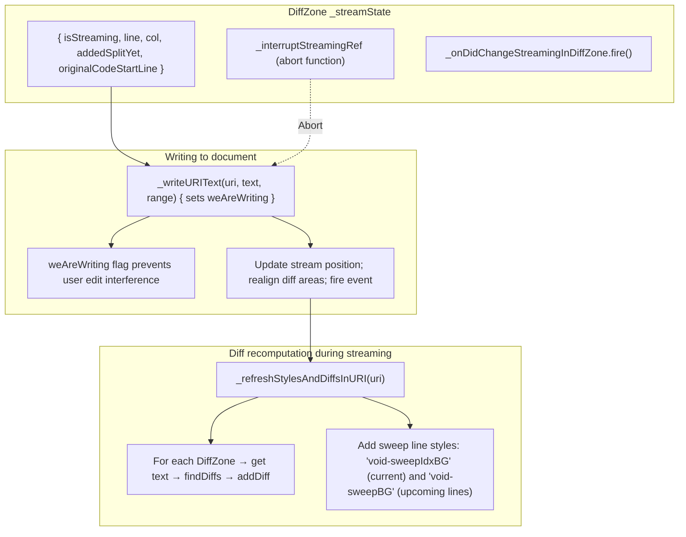

### Streaming State Machine

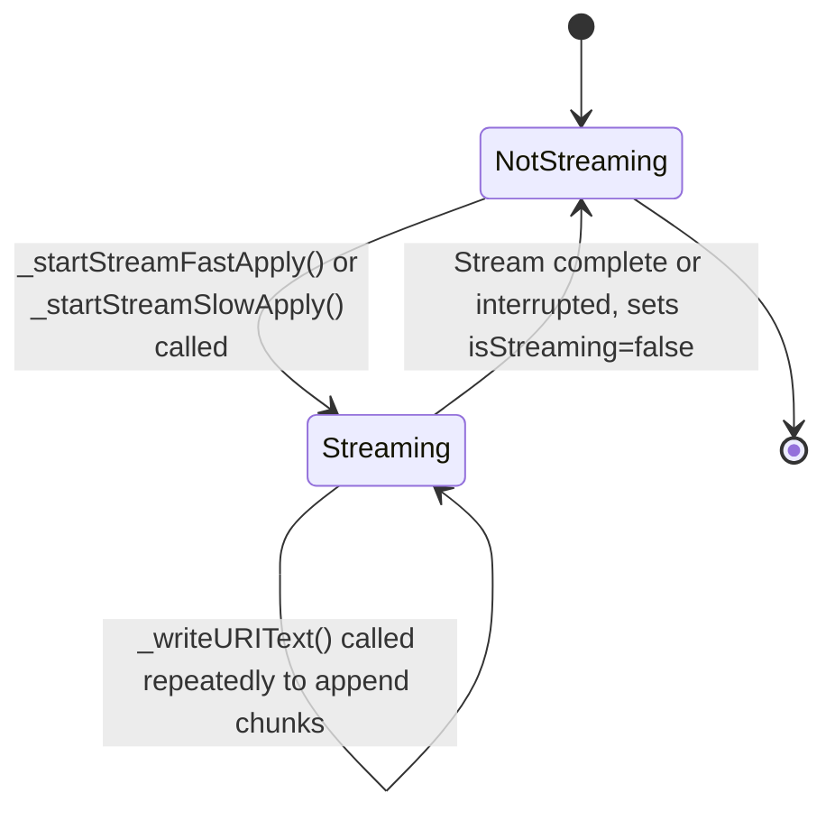

**Important Notes:**

- The service-level `weAreWriting` flag suppresses user edits during streaming to avoid inconsistency.
- Streaming interrupts on user typing or explicit cancel.
- Sweep line styles visually indicate the streaming position within the diff areas.

**Sources:** [editCodeService.ts:626-685](), [editCodeService.ts:322-343](), [editCodeServiceTypes.ts:52-63]()

---

## Snapshot and Undo System

The editing system integrates deeply with VS Code's undo stack by snapshotting file states.

### Snapshot Structure

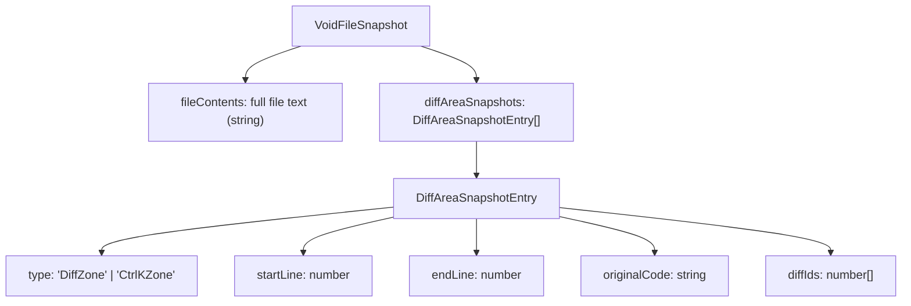

The snapshot captures:

- Complete file text at the time
- All diff areas and their relevant metadata
- All diffs within each area
- Original code of each DiffArea

Streaming state is not restored on undo; streaming always stops when snapshot is restored.

### Snapshot Operations and Undo Integration

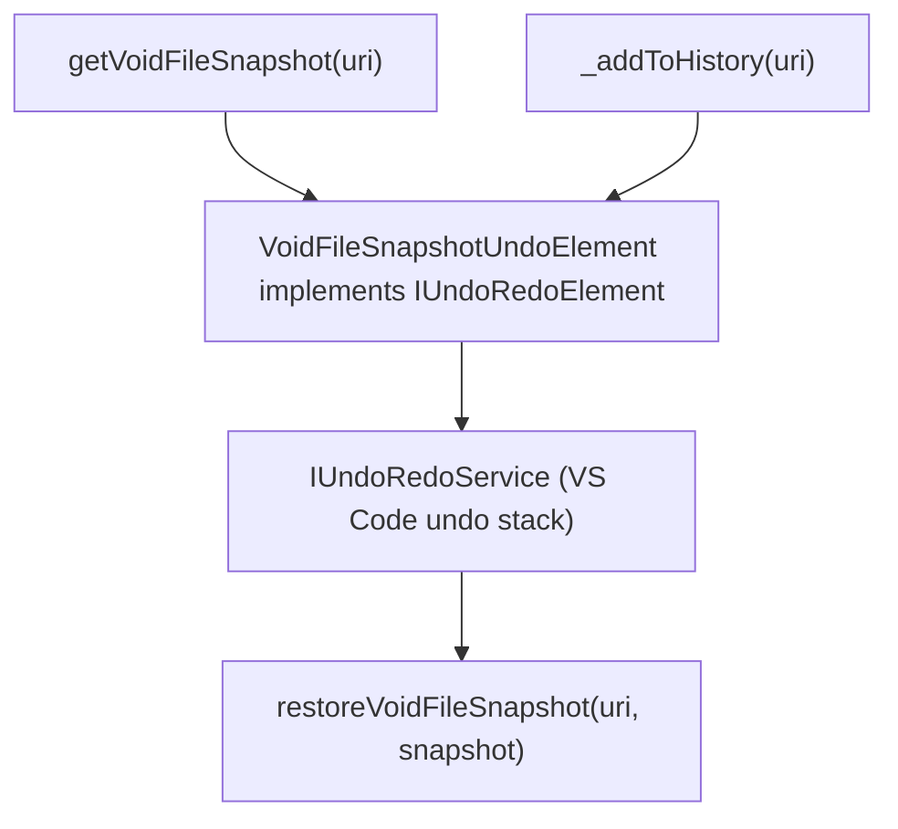

- `getVoidFileSnapshot()`: Creates snapshot capturing current file and diffs [editCodeService.ts:1397-1445]()
- `restoreVoidFileSnapshot()`: Restores snapshot state, replacing file contents and diffs [editCodeService.ts:1447-1494]()
- `_addToHistory()`: Creates undo element and adds to VS Code’s undo stack [editCodeService.ts:1629-1668]()

**Sources:** [editCodeService.ts:1397-1494](), [editCodeService.ts:1629-1668](), [editCodeServiceTypes.ts:65-88]()

---

## Entry Points and Integration

Void's editing system is triggered from various user and tool interactions:

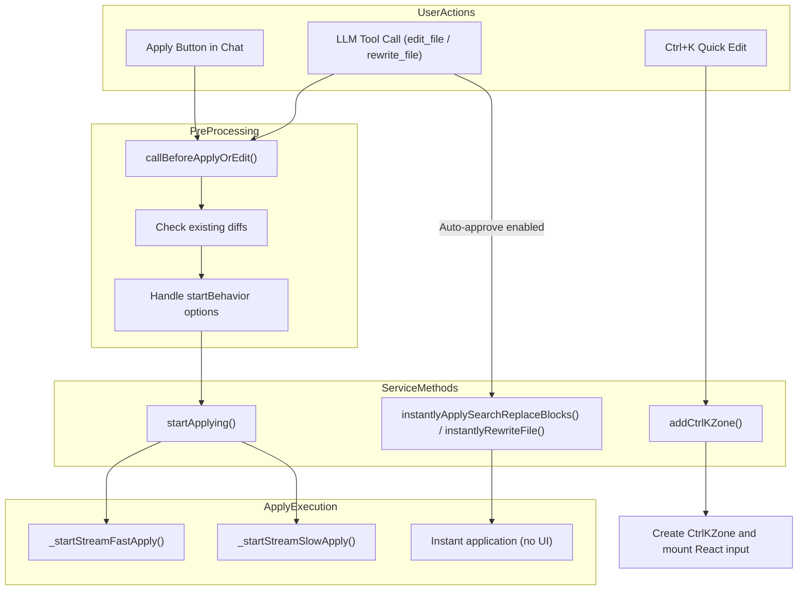

- **Ctrl+K Quick Edit** invokes `addCtrlKZone()` to create inline input area, handled by React component mounting. User instructions trigger LLM streaming edits via Fast or Slow apply modes.
- **Apply button** dispatches edits through `callBeforeApplyOrEdit()` and `startApplying()`.
- **LLM Tool calls** (`edit_file` / `rewrite_file`) verify parameters and, if auto-approved, directly invoke Instant Apply.

**Sources:** [editCodeService.ts:937-1029](), [editCodeService.ts:808-882](), [quickEditActions.ts:35-69](), [toolsService.ts:259-410](), [chatThreadService.ts:605-727]()

---

## Accept and Reject Operations

Users can accept or reject single diffs or all diffs in a file.

### Workflow

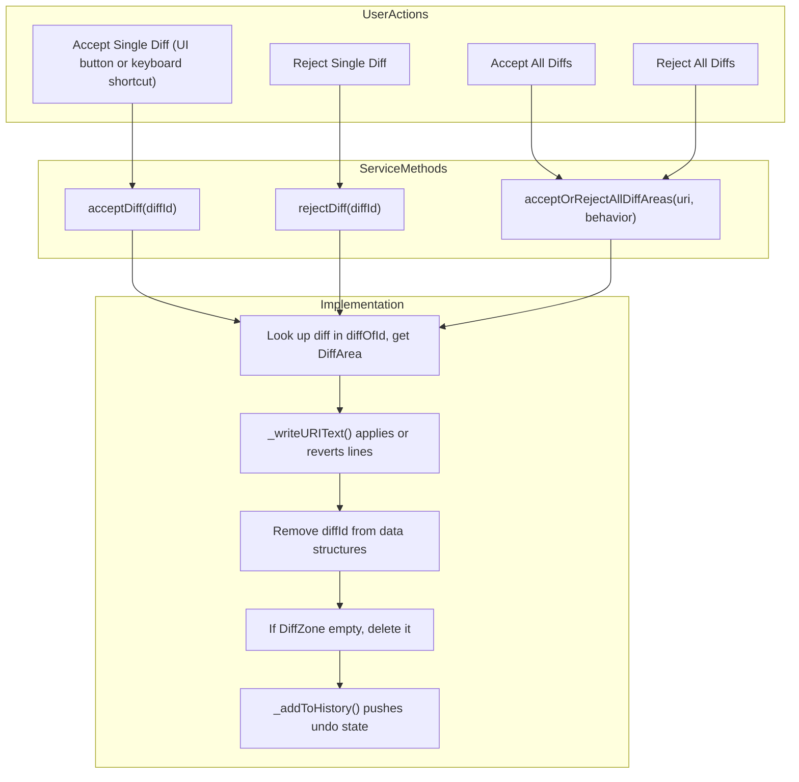

### Behavior By Operation

| Operation       | Effect on File               | Diff Cleanup            |
|-----------------|------------------------------|-------------------------|
| Accept Insertion | Keeps new inserted lines     | Diff removed            |
| Accept Deletion | Removes lines from original  | Diff removed            |
| Accept Edit     | Keeps replacement lines      | Diff removed            |
| Reject Insertion | Removes inserted lines       | Diff removed            |
| Reject Deletion | Restores original lines      | Diff removed            |
| Reject Edit     | Reverts to original lines    | Diff removed            |

If a DiffZone contains zero diffs after accept/reject, it is deleted automatically, disposing decorations and view zones.

**Sources:** [editCodeService.ts:685-771](), [editCodeService.ts:256-267]()

---

## Line Realignment System

When user edits or streaming writes change the document, diff areas and diffs must be realigned:

### Realignment Flow

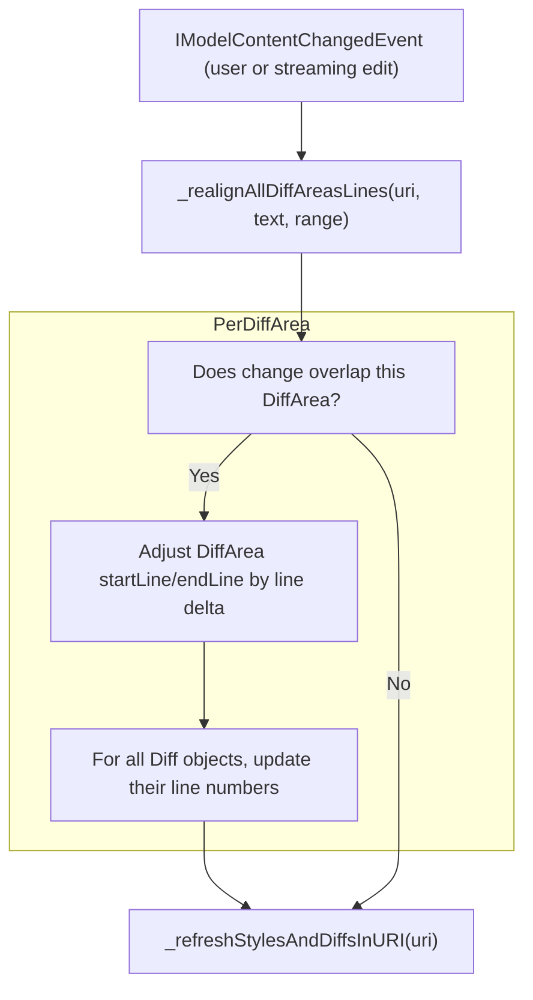

### Line Adjustment Logic

```typescript
const numLinesAdded = newText.split('\n').length;
const numLinesDeleted = range.endLineNumber - range.startLineNumber + 1;
const lineDelta = numLinesAdded - numLinesDeleted;

if (changeStartLine <= diffArea.startLine) {
    diffArea.startLine += lineDelta;
    diffArea.endLine += lineDelta;
} else if (changeStartLine <= diffArea.endLine) {
    diffArea.endLine += lineDelta;
}

// Similarly update all diffs inside diffArea
```

**Sources:** [editCodeService.ts:1280-1346](), [editCodeService.ts:248-269]()

---

## Command Bar Integration

The command bar (`IVoidCommandBarService`) allows keyboard navigation and execution of accept/reject actions on diffs.

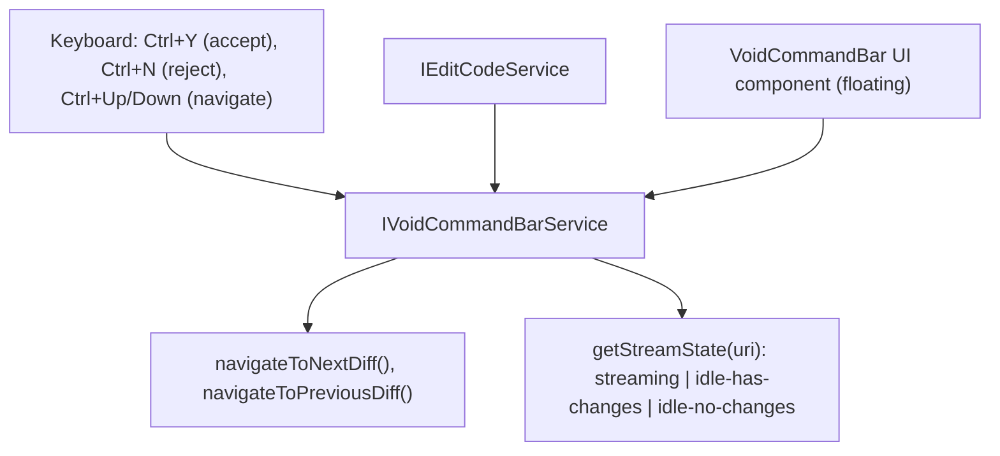

The command bar maintains state about:

- Current diff position in the file
- Overall diff count
- Streaming status

to facilitate rapid code review and application.

**Sources:** [voidCommandBarService.ts:1-500](), [editCodeService.ts:183-196]()

---

# Summary

The Void Apply system offers a robust multi-mode editing pipeline integrated with visual diff zones, streaming incremental text patches, undo snapshots, and user accept/reject workflows. It efficiently bridges AI-generated responses from natural language outputs into concrete code entity operations, coordinated primarily by `editCodeService.ts`. Diff computation and incremental rendering ensure clear feedback, and the snapshot system guarantees reliable undo/redo capabilities.

This design allows Void to safely apply AI code suggestions with good user control and transparency.

---

# Diagrams Bridging Natural Language to Code Entities

### 1. Natural Language "Apply" Request to Code Entities Flow

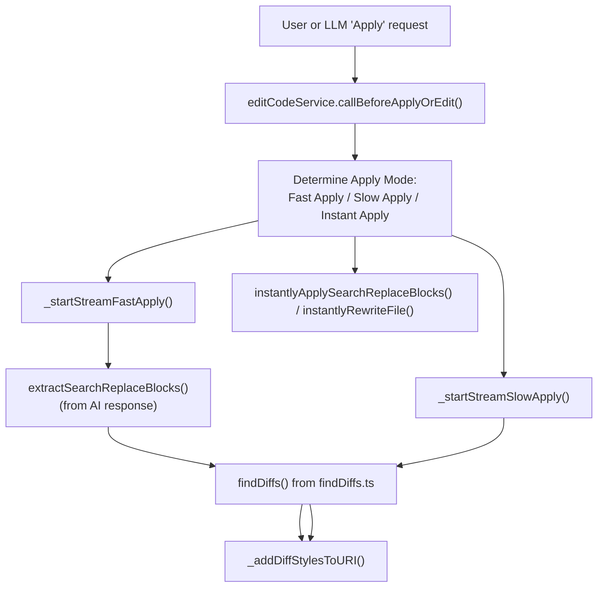

### 2. Data Structure Associations for Edits and Diffs

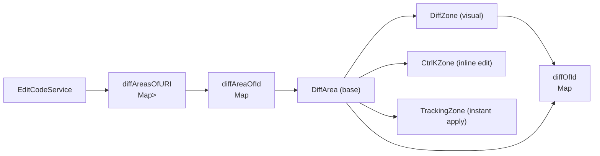

---

# Citation of Sources

- `editCodeService.ts` lines: 1-200, 248-269, 300-314, 322-343, 475-613, 626-659, 661-685, 685-771, 808-882, 884-935, 937-1029, 1031-1180, 1182-1278, 1280-1346, 1348-1395, 1397-1494, 1510-1627, 1629-1668, 183-196
- `editCodeServiceInterface.ts` lines: 40-78
- `editCodeServiceTypes.ts` lines: 1-100, 32-50, 52-63, 65-88
- `extractCodeFromResult.ts` lines: 141-231
- `findDiffs.ts` lines: 1-200
- `prompts.ts` lines: 38-40
- `quickEditActions.ts` lines: 35-69
- `toolsService.ts` lines: 259-410
- `chatThreadService.ts` lines: 605-727
- `ApplyBlockHoverButtons.tsx` lines: 318-444
- `voidCommandBarService.ts` lines: 1-500

---

This concludes the detailed technical documentation of Void's Code Editing and Apply System.