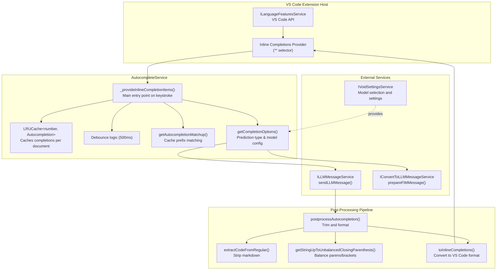
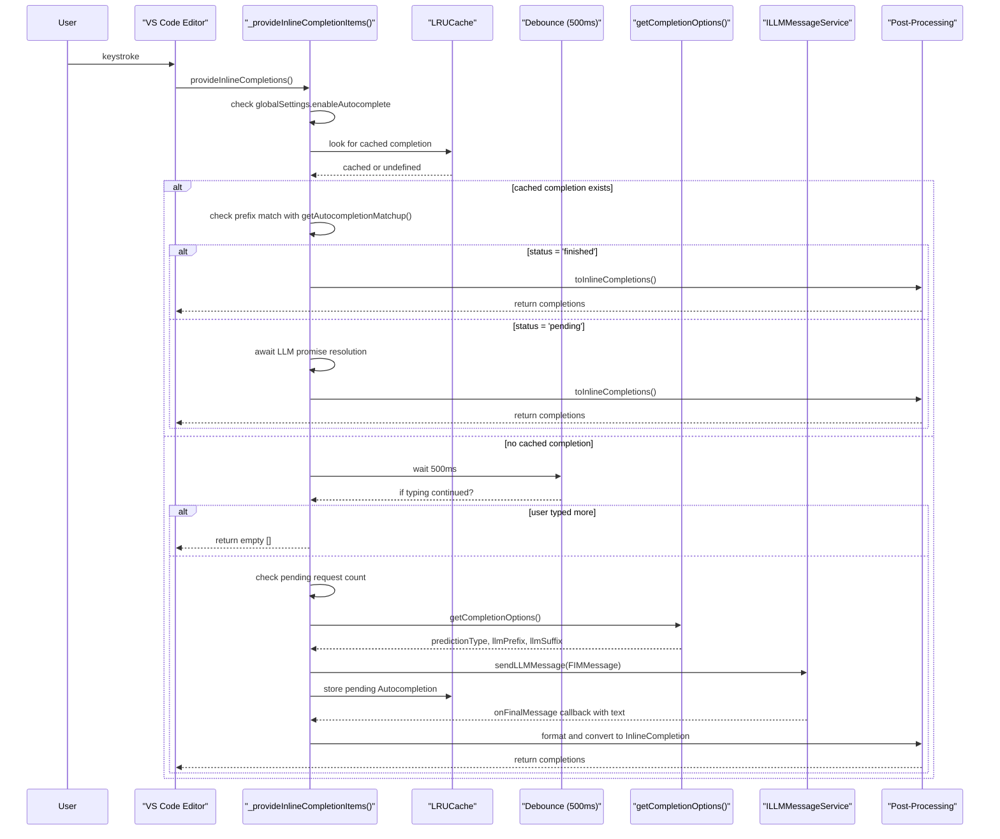
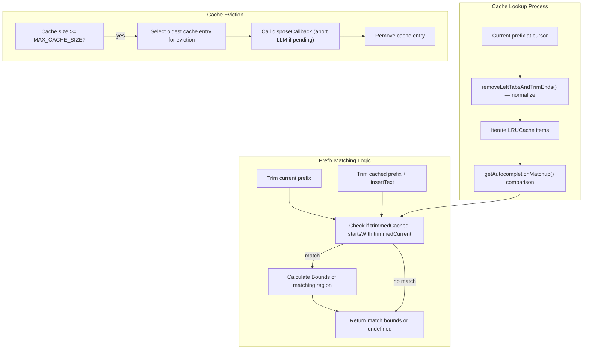
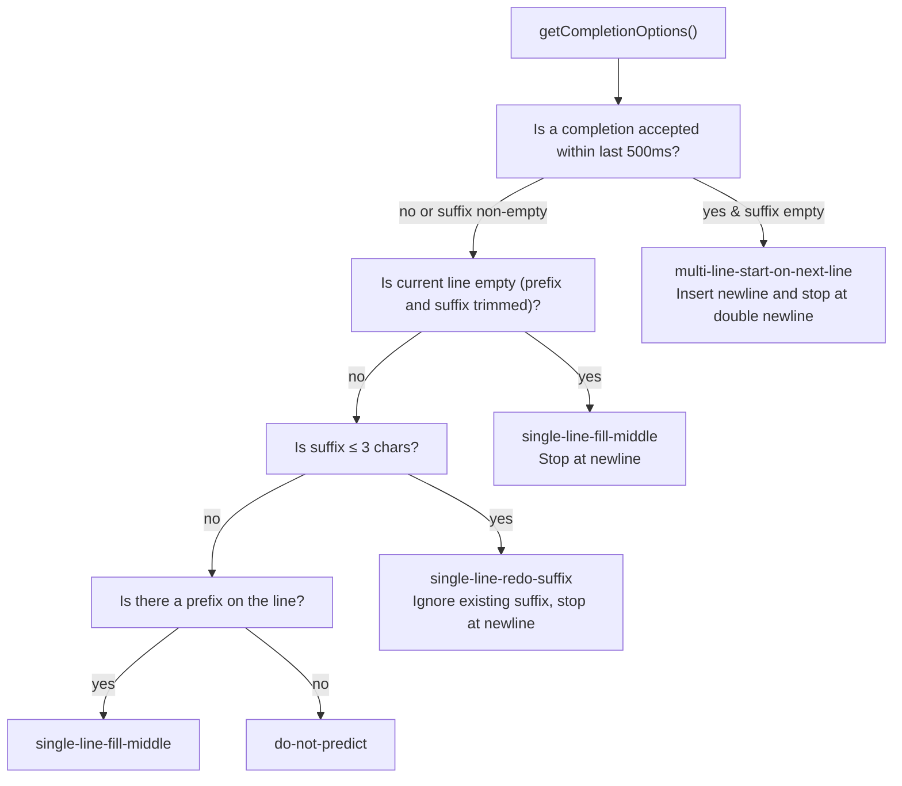
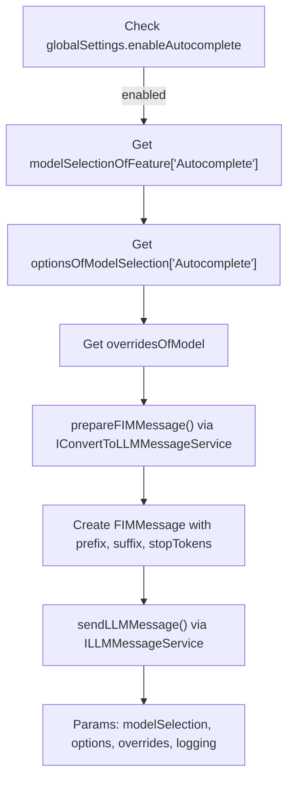
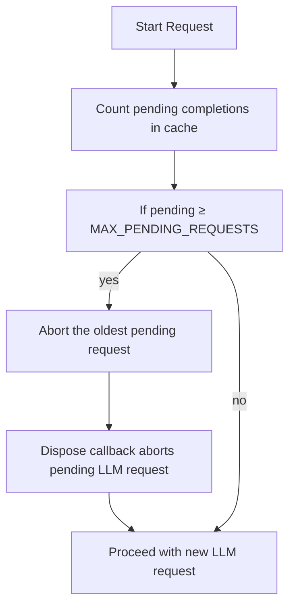

# Autocomplete and Inline Suggestions

<details>
<summary>Relevant source files</summary>

The following files were used as context for generating this wiki page:

- [.voidrules](.voidrules)

</details>


This document describes Void's AI-powered autocomplete system, which provides inline code suggestions dynamically as the user types. The system leverages Fill-In-the-Middle (FIM) capable language models to generate contextually relevant completions, enhancing coding efficiency and accuracy.

**Scope**: This page covers the internal architecture of the autocomplete service, including caching, debouncing, completion type determination, concurrency controls, Fill-In-the-Middle (FIM) message construction, and the post-processing pipeline. For broader AI integration details, consult [LLM Integration](#4). For how models are selected and configured, see [Settings and Model Selection](#2.2).

---

## Architecture Overview

The core of Void's autocomplete feature is the `AutocompleteService` implemented in `autocompleteService.ts`. It integrates tightly with VS Code's language feature APIs by registering as an inline completions provider for all languages (`'*'` selector). The service manages:

- **Caching**: An LRUCache keyed by numerical IDs stores in-progress and completed completions per document, enabling quick re-display and abort handling.
- **Debouncing**: User input is debounced with a 500ms delay to avoid excessive LLM calls.
- **FIM Support**: Uses the Fill-In-the-Middle message format to supply prefix and suffix context effectively.
- **Post-processing**: Cleans and formats raw LLM output before converting to VS Code inline completions.

### Autocomplete System Architecture Diagram



**Sources:** [src/vs/workbench/contrib/void/browser/autocompleteService.ts:618-947]()

---

## Service Registration and Lifecycle

`AutocompleteService` is registered as a workbench contribution during the `BlockRestore` startup phase, ensuring availability early in the extension lifecycle.

**Key registration points:**

| Component                                      | Purpose                            | Code Reference                                           |
|------------------------------------------------|----------------------------------|----------------------------------------------------------|
| `registerWorkbenchContribution2(AutocompleteService, LifecyclePhase.BlockRestore)` | Register service on startup       | [autocompleteService.ts:947]()                            |
| `ILanguageFeaturesService.inlineCompletionsProvider.register({ selector: '*' })` | Register provider for all languages | [autocompleteService.ts:902]()                            |
| `provideInlineCompletions()`                   | VS Code callback for completions | Calls internal `_provideInlineCompletionItems()`         |
| `freeInlineCompletions()`                       | Called on completion acceptance  | Removes from cache and triggers follow-up completions    |

The service receives dependencies via constructor injection from VS Code's dependency injection framework:

```typescript
constructor(
    @ILanguageFeaturesService private _langFeatureService: ILanguageFeaturesService,
    @ILLMMessageService private readonly _llmMessageService: ILLMMessageService,
    @IEditorService private readonly _editorService: IEditorService,
    @IModelService private readonly _modelService: IModelService,
    @IVoidSettingsService private readonly _settingsService: IVoidSettingsService,
    @IConvertToLLMMessageService private readonly _convertToLLMMessageService: IConvertToLLMMessageService,
)
```

**Sources:** [src/vs/workbench/contrib/void/browser/autocompleteService.ts:891-947]()

---

## Completion Request Flow

When the user types, VS Code calls the `provideInlineCompletions()` method, which forwards to `_provideInlineCompletionItems()`. This method manages the autocomplete lifecycle with caching, debouncing, and LLM calls if needed.

### Completion Flow Sequence Diagram



### Key Constants Controlling Behavior

| Constant           | Value      | Purpose                         |
|--------------------|------------|--------------------------------|
| `DEBOUNCE_TIME`    | 500 ms     | Wait time before invoking LLM  |
| `TIMEOUT_TIME`     | 60000 ms   | Max wait time for LLM response |
| `MAX_CACHE_SIZE`   | 20         | Max cached completions per doc |
| `MAX_PENDING_REQUESTS` | 2      | Max concurrent LLM requests    |

**Sources:** [src/vs/workbench/contrib/void/browser/autocompleteService.ts:633-889](), [src/vs/workbench/contrib/void/browser/autocompleteService.ts:169-172]()

---

## Caching Strategy and Prefix Matching

The service maintains an LRU cache of `Autocompletion` entries per document to quickly reuse completions when the prefix and suffix align with cached entries.

### Autocompletion Object Structure

```typescript
type Autocompletion = {
    id: number,
    prefix: string,              // Prefix when completion was requested
    suffix: string,              // Suffix when completion was requested
    llmPrefix: string,           // Prefix sent to LLM (may be trimmed)
    llmSuffix: string,           // Suffix sent to LLM (may be trimmed)
    startTime: number,
    endTime: number | undefined,
    status: 'pending' | 'finished' | 'error',
    type: AutocompletionPredictionType,
    llmPromise: Promise<string> | undefined,
    insertText: string,          // Completion text generated by LLM
    requestId: string | null,    // ID for aborting requests via LLM service
    _newlineCount: number,       // Number of newlines in completion for stats
}
```

### Cache Lookup and Prefix Matching Mechanism

To determine whether a cached completion matches the current prefix at the cursor, the system removes leading tabs and trims suffixes, then compares prefixes with the cached ones extended by the insertText.



### Cache Operations Summary

| Operation          | Purpose                                                      | Reference                             |
|--------------------|--------------------------------------------------------------|---------------------------------------|
| `set(key, value)`  | Stores new completion; evicts least-recently-used if full     | [autocompleteService.ts:84-106]()     |
| `delete(key)`      | Removes completion and triggers dispose callback (abort LLM) | [autocompleteService.ts:108-123]()    |
| `clear()`          | Clears all completions and aborts pending requests            | [autocompleteService.ts:125-135]()    |
| Dispose Callback   | Aborts pending LLM requests using stored `requestId`         | [autocompleteService.ts:653-656]()    |

### Prefix Normalization

The function `removeLeftTabsAndTrimEnds()` normalizes prefixes for better cache hit rates by:

1. Removing all leading whitespace from each line.
2. Ensuring only a single trailing newline remains.

This leniency lets the cache match completions even if indentation or trailing whitespace changes slightly.

**Sources:** [src/vs/workbench/contrib/void/browser/autocompleteService.ts:69-144](), [src/vs/workbench/contrib/void/browser/autocompleteService.ts:460-526](), [src/vs/workbench/contrib/void/browser/autocompleteService.ts:666-676]()

---

## Prediction Types and LLM Request Parameters

`getCompletionOptions()` determines the type of prediction to request from the LLM based on the cursor context and recent user actions.

### Prediction Type Decision Flow



### Prediction Types Summary

| Type                       | Description                                       | LLM Prefix               | LLM Suffix             | Stop Tokens            |
|----------------------------|-------------------------------------------------|--------------------------|------------------------|------------------------|
| `single-line-fill-middle`   | Fill in middle on a line with prefix and suffix  | `prefix`                 | `suffix`               | `['\r\n', '\n']`       |
| `single-line-redo-suffix`   | For very short suffixes, redo suffix ignoring it | `prefix`                 | suffix without current line | `['\r\n', '\n']`   |
| `multi-line-start-on-next-line` | After acceptance, start on next line with newline | `prefix + '\n'`          | `suffix`               | `['\n\n']` (double newline) |
| `do-not-predict`            | Don't generate completions if no line prefix      | N/A                      | N/A                    | N/A                    |

The selected prediction type controls how FIM messages are created and the LLM's stop tokens, shaping generation boundaries effectively.

**Sources:** [src/vs/workbench/contrib/void/browser/autocompleteService.ts:146-151](), [src/vs/workbench/contrib/void/browser/autocompleteService.ts:536-610]()

---

## Post-Processing Pipeline

Raw LLM-generated completions are post-processed extensively to improve usability and avoid disruptive editing.

### Post-Processing Steps Diagram


### Important Post-Processing Functions

- **`extractCodeFromRegular()`** removes markdown fences (e.g., triple backticks), isolating pure code text.  
  Source: [autocompleteService.ts:180]()

- **`processStartAndEndSpaces()`** trims all spaces except allowing single leading/trailing spaces to avoid whitespace spam.  
  Source: [autocompleteService.ts:175-189]()

- **`postprocessAutocompletion()`** applies heuristics:  
  - Removes leading spaces if user typed space to avoid doubling.  
  - Removes start newlines when on blank line to avoid jumping.  
  - Stops completions at suffix match chars for single-line types.  
  - Stops on newlines if no suffix for single-line fills.  
  Source: [autocompleteService.ts:271-363]()

- **`getStringUpToUnbalancedClosingParenthesis()`** balances brackets and parentheses, truncating output at the first unbalanced closing bracket to avoid broken syntax completions.  
  Source: [autocompleteService.ts:234-267]()

- **`toInlineCompletions()`** converts cleaned strings into VS Code `InlineCompletion[]`, with logic to handle replacement ranges and suffix matching for redo suffix completions.  
  Source: [autocompleteService.ts:366-401]()

- **`getIsSubsequence()`** checks whether the new suffix is a subsequence of the old, critical for deciding when to reuse suffix in redo-suffix predictions.  
  Source: [autocompleteService.ts:213-231]()

**Sources:** [src/vs/workbench/contrib/void/browser/autocompleteService.ts:175-401]()

---

## Integration with Model Selection and FIM Message Preparation

Autocomplete depends on Fill-In-the-Middle (FIM) capable models, with model selection managed via the `IVoidSettingsService`.

### Model Selection and Message Preparation Flow



### Construction of LLM Request

```typescript
const requestId = this._llmMessageService.sendLLMMessage({
    messagesType: 'FIMMessage',
    messages: this._convertToLLMMessageService.prepareFIMMessage({
        messages: {
            prefix: llmPrefix,
            suffix: llmSuffix,
            stopTokens: stopTokens,
        }
    }),
    modelSelection,
    modelSelectionOptions,
    overridesOfModel,
    logging: { loggingName: 'Autocomplete' },
    onText: () => { },             // Not used for FIM
    onFinalMessage: ({ fullText }) => { /* process result */ },
    onError: ({ message }) => { /* handle error */ },
    onAbort: () => { /* handle abort */ },
})
```

The `prepareFIMMessage()` builds the provider-specific FIM format, e.g., wrapping the prefix/suffix with special tokens or system prompts depending on the provider's requirements.

**Sources:** [src/vs/workbench/contrib/void/browser/autocompleteService.ts:792-858]()

---

## Completion Acceptance and Follow-Up

When the user accepts a completion (typically by pressing Tab), VS Code calls `freeInlineCompletions()`, which:

1. Identifies the accepted completion by comparing the typed prefix to cached completions ignoring whitespace differences.  
2. Records the accept time `_lastCompletionAccept = Date.now()`.  
3. Removes the accepted completion from the cache to free memory and avoid stale re-showing.  
4. On the next typing event, triggers a `multi-line-start-on-next-line` prediction to continue the completion with a newline-aware completion.

### Acceptance Flow Snippet

```typescript
const matchup = removeAllWhitespace(prefix) === removeAllWhitespace(autocompletion.prefix + autocompletion.insertText);
if (matchup) {
    this._lastCompletionAccept = Date.now();
    this._cache.delete(autocompletion.id);
}
```

**Rationale**:

- Removing accepted completions avoids confusing stale suggestions if users undo changes.
- Initiates follow-up suggestions for multi-line completions to assist after acceptance.

**Sources:** [src/vs/workbench/contrib/void/browser/autocompleteService.ts:909-941](), [src/vs/workbench/contrib/void/browser/autocompleteService.ts:557-566]()

---

## Concurrent LLM Request Management

To avoid flooding the LLM API and degrade UX, the autocomplete system limits the number of concurrent LLM requests to `MAX_PENDING_REQUESTS = 2`.

### Concurrency Control Diagram



### Request Abortion Details

- Pending completions store a `requestId` returned from `sendLLMMessage()`.
- When entries are evicted from the cache, the dispose callback calls `this._llmMessageService.abort(requestId)` to cancel the LLM request if still pending.
- If an LLM request times out after `TIMEOUT_TIME` ms, it is rejected and the cache entry status is set to `'error'`.

**Sources:** [src/vs/workbench/contrib/void/browser/autocompleteService.ts:738-753](), [src/vs/workbench/contrib/void/browser/autocompleteService.ts:651-657](), [src/vs/workbench/contrib/void/browser/autocompleteService.ts:858-867]()

---

## Implementation Details and Utilities

### PrefixAndSuffixInfo Type

Captures document text context around the cursor:

```typescript
type PrefixAndSuffixInfo = {
    prefix: string,                // Text before cursor, full document
    suffix: string,                // Text after cursor
    prefixLines: string[],         // prefix split by lines
    suffixLines: string[],         // suffix split by lines
    prefixToTheLeftOfCursor: string,    // current line prefix before cursor
    suffixToTheRightOfCursor: string,   // current line suffix after cursor
}
```

### Helper Functions

| Function                    | Description                              | Code Location                              |
|-----------------------------|------------------------------------------|--------------------------------------------|
| `getPrefixAndSuffixInfo()`  | Extract prefix/suffix lines at cursor    | [autocompleteService.ts:426-443]()         |
| `getIndex()`                | Convert line/char to offset index        | [autocompleteService.ts:445-447]()         |
| `getLastLine()`             | Extract last line from string             | [autocompleteService.ts:448-451]()         |
| `removeAllWhitespace()`     | Strips all whitespace from a string      | [autocompleteService.ts:209]()              |
| `getIsSubsequence()`        | Checks if one string is subsequence of another | [autocompleteService.ts:213-231]()    |

### Cross-Platform Line Breaks

The system differentiates Windows (`\r\n`) and Linux (`\n`) line breaks for better compatibility:

```typescript
const allLinebreakSymbols = ['\r\n', '\n'];
const _ln = isWindows ? allLinebreakSymbols[0] : allLinebreakSymbols[1];
```

**Sources:** [src/vs/workbench/contrib/void/browser/autocompleteService.ts:28-29](), [src/vs/workbench/contrib/void/browser/autocompleteService.ts:209-451]()

---

# Concluding Notes

The autocomplete system in Void is a complex integration leveraging VS Code's inline completion infrastructure, advanced caching and prefix handling, and sophisticated LLM interactions using Fill-In-the-Middle models. It is engineered for latency reduction through caching and debouncing, user experience improvement via layered post-processing, and API efficiency by request concurrency controls.

---

**Sources:**  
[src/vs/workbench/contrib/void/browser/autocompleteService.ts]()