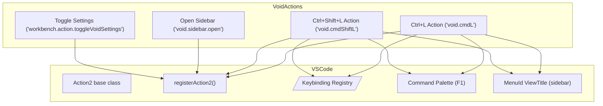
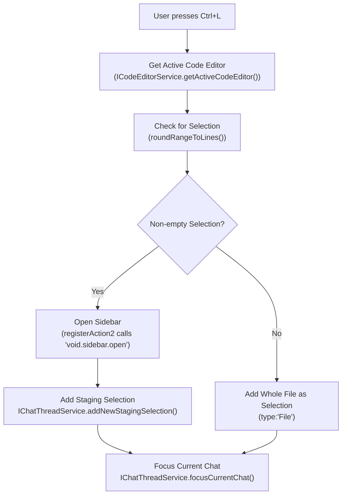
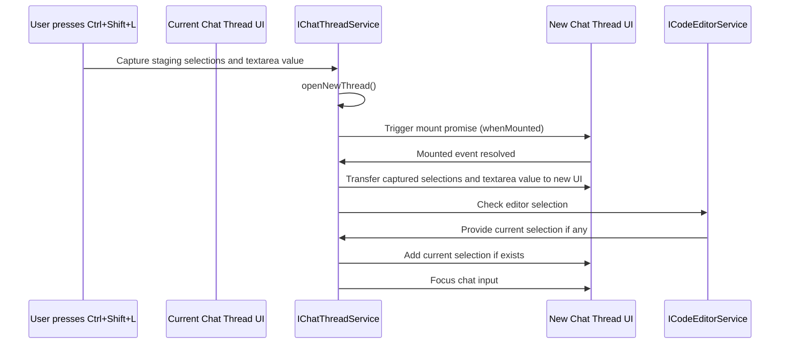
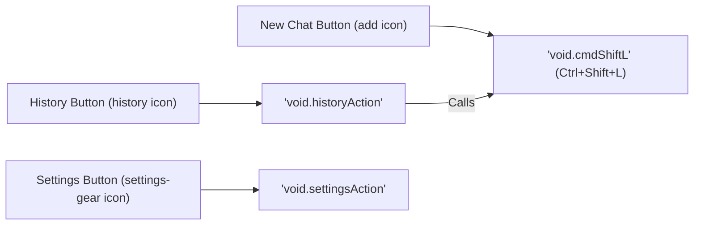
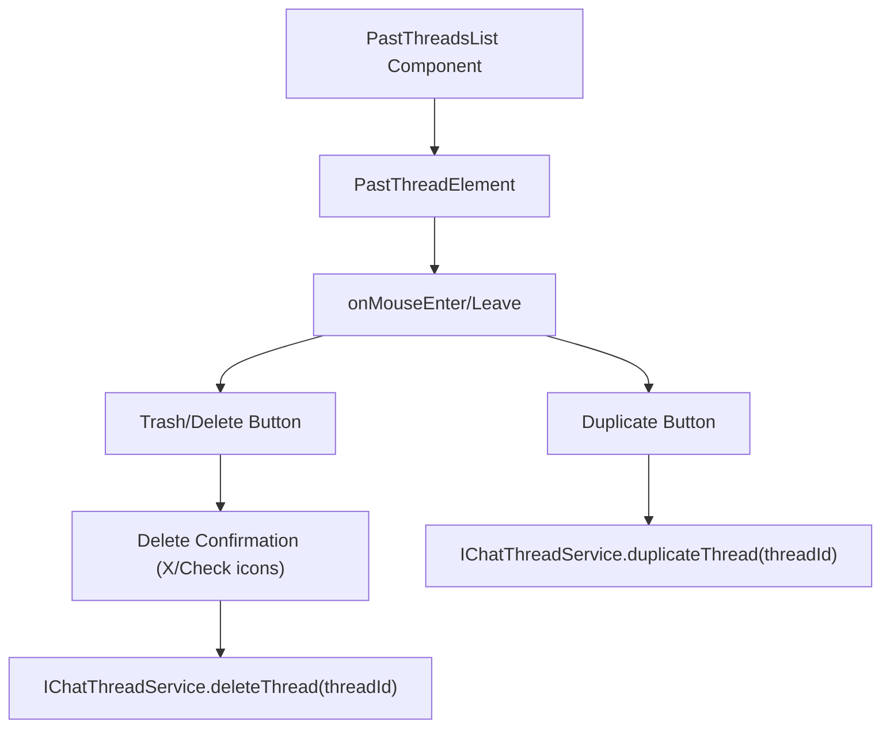

# Sidebar Actions and Keybindings

<details>
<summary>Relevant source files</summary>

The following files were used as context for generating this wiki page:

- [.voidrules](.voidrules)
- [.vscode/launch.json](.vscode/launch.json)

</details>


This page documents the user-facing actions and keybindings that control sidebar interactions in Void. These actions enable users to add code selections to chat, create new chat threads, and manage chat history through keyboard shortcuts and sidebar menu buttons.

For details about the sidebar UI components (chat list, thread management, etc.), refer to [Sidebar Chat and Thread Management (2.1)]. For settings pane usage, see [Settings and Model Selection (2.2)].

---

## Overview

Void integrates with VS Code's command and keybinding system by registering a set of core commands that facilitate interaction with the sidebar chat feature. The key bindings and actions covered here include:

- **Ctrl+L**: Adds the current code selection (or entire file if none) to the active chat thread as a staging selection.
- **Ctrl+Shift+L**: Opens a new chat thread, preserving current staging selections and input text.
- **Sidebar Title Bar Buttons**: Includes New Chat, History, and Settings buttons, wired to corresponding commands.
- **Thread Actions**: Per-thread duplicate and delete buttons presented on hover in the thread list.

The actions and their implementations centrally reside in `sidebarActions.ts` and are identified by constants declared in `actionIDs.ts`.

Sources: [src/vs/workbench/contrib/void/browser/sidebarActions.ts:1-281](), [src/vs/workbench/contrib/void/browser/actionIDs.ts:1-20]()

---

## Action Registration System

Void leverages VS Code's `Action2` class and the `registerAction2()` helper to declare actions with metadata, keybindings, and menu placements. Each action:

- Has a unique **ID** string.
- Declares a **title** for command palette display.
- Specifies **keybindings**, using the `KeybindingWeight.VoidExtension` weight to override VS Code defaults.
- Registers in menus (e.g., sidebar view title bar) where applicable.
- May specify an icon for menu UI.

The relevant action IDs are declared as constants in `actionIDs.ts`:

| Constant                      | Command ID String          | Description                           |
|-------------------------------|---------------------------|-------------------------------------|
| `VOID_OPEN_SIDEBAR_ACTION_ID` | `'void.sidebar.open'`      | Command to open and focus sidebar   |
| `VOID_CTRL_L_ACTION_ID`        | `'void.cmdL'`              | Add selection to chat (Ctrl+L)      |
| `VOID_CMD_SHIFT_L_ACTION_ID`   | `'void.cmdShiftL'`         | New chat thread (Ctrl+Shift+L)      |
| `VOID_TOGGLE_SETTINGS_ACTION_ID` | `'workbench.action.toggleVoidSettings'` | Toggle settings pane             |

Actions are registered using calls to `registerAction2()` that instantiate classes extending `Action2`. These classes implement the action's behavior within their `run(accessor)` methods by accessing VS Code services via the `ServicesAccessor`.



Sources: [src/vs/workbench/contrib/void/browser/sidebarActions.ts:64-75](), [src/vs/workbench/contrib/void/browser/sidebarActions.ts:79-143](), [src/vs/workbench/contrib/void/browser/sidebarActions.ts:147-206](), [src/vs/workbench/contrib/void/browser/actionIDs.ts:1-20]()

---

## Ctrl+L Keybinding: Add Selection to Chat

Pressing **Ctrl+L** adds the user's current editor selection as a staging selection to the active chat thread. If no text is selected, it adds the entire current file instead.

### Detailed Flow



### Implementation Specifics

- **Selection rounding**: The helper function `roundRangeToLines()` rounds any partial text selection to full line spans, starting from column 1 through to `Number.MAX_SAFE_INTEGER`. It ensures entire lines are added, which is useful for coherent code context.

- **No selection behavior**: If the user has no selection (empty cursor), the action adds the entire current file as a `File` type staging selection.

- **Sidebar visibility**: The sidebar view container is opened automatically if it is closed.

- **Focus**: After adding the staging selection, the chat sidebar is focused so the user can continue interaction.

- **Metrics**: The action captures usage metrics such as the type "Add Selection" to aggregate user behavior data.

---

### The `roundRangeToLines()` utility function

This function converts editor selections (line and column based) into full line selections. It handles:

- Empty selections: Returns `null` when the `emptySelectionBehavior` is `'null'`.
- Single line selections: Returns the full line starting column 1, up to max column, effectively selecting the entire line.
- Multi-line selections: Adjusts the end line if the end column is 1 (which can occur from triple-clicks selecting whole lines).
- Always sets `startColumn = 1` and `endColumn = MAX_SAFE_INTEGER` for broad coverage.

```typescript
function roundRangeToLines(range: IRange, emptySelectionBehavior: 'null' | 'line' = 'null'): IRange | null {
  if (range.isEmpty()) {
    if (emptySelectionBehavior === 'null') return null;
    return { startLineNumber: range.startLineNumber, startColumn: 1, endLineNumber: range.startLineNumber, endColumn: Number.MAX_SAFE_INTEGER };
  }
  const startLineNumber = range.startLineNumber;
  let endLineNumber = range.endLineNumber;
  if (range.endColumn === 1 && endLineNumber > startLineNumber) {
    endLineNumber--;
  }
  return {
    startLineNumber,
    startColumn: 1,
    endLineNumber,
    endColumn: Number.MAX_SAFE_INTEGER
  };
}
```

Sources: [src/vs/workbench/contrib/void/browser/sidebarActions.ts:29-50](), [src/vs/workbench/contrib/void/browser/sidebarActions.ts:79-143]()

---

## Ctrl+Shift+L Keybinding: New Chat Thread

Pressing **Ctrl+Shift+L** creates a new chat thread while preserving any staging selections and input text from the current chat.

### Detailed Flow



### Implementation Details

- The action accesses the current chat thread's UI component via a stored React ref (`mountedUIRef`) to extract the current state:
  - `stagingSelections`
  - Text area content (`textAreaRef.current.value`)
  
- It calls `openNewThread()` from the `IChatThreadService` to instantiate a new chat thread.

- The action waits for the `whenMounted` promise on the new thread's UI to ensure it's ready before transferring state.

- After transfer, if the user has a code selection in the editor, it adds it to the new thread's staging selections.

- Finally, it focuses the chat input in the new thread.

This workflow preserves user context across thread creation, improving efficiency when starting new conversations related to the current work.

Sources: [src/vs/workbench/contrib/void/browser/sidebarActions.ts:147-206]()

---

## Sidebar Title Bar Menu Buttons

Void also registers three menu actions in the sidebar title bar (`MenuId.ViewTitle`) which render as buttons with icons:



### New Chat Button

- Acts identically to the Ctrl+Shift+L action (create new chat thread).
- Registered with a condition showing only for the Void sidebar view.
- Reports usage metrics as "Chat Navigation / Start New Chat".

### History Button

- Shows the chat history (past conversations).
- Maps to a command `'void.historyAction'`.
- Calls `'void.cmdShiftL'` internally to prompt a fresh chat thread.
- Protection logic prevents accidental clearing if current thread has no messages.

### Settings Button

- Toggles the settings pane open/close.
- Executes `VOID_TOGGLE_SETTINGS_ACTION_ID` command (`'workbench.action.toggleVoidSettings'`).

Sources: [src/vs/workbench/contrib/void/browser/sidebarActions.ts:209-252]()

---

## Thread List Actions: Duplicate and Delete

Within the sidebar's past thread list, each thread item displays duplicate and delete controls upon hover, enabling thread management.

### Interaction Flow



### Duplicate Thread Button

- Displays a small 11px `Copy` icon.
- When clicked, invokes `duplicateThread(threadId)` on the `IChatThreadService`.
- Allows quick creation of an identical thread for branching the conversation.

### Delete Thread Button

- Displays a `Trash2` icon by default.
- Clicking the trash icon toggles a two-step confirmation UI:
  - Shows 'X' (cancel) and 'Check' (confirm) icons.
  - Confirming triggers thread deletion via `deleteThread(threadId)`.
  - cancelling restores the default trash icon state.
- Guards against accidental deletion.

### Additional Thread UI Features

- Displays the first user message truncated as the thread's label.
- Shows a tooltip with message counts.
- Displays last-modified dates in relative terms (Today, Yesterday, or MMM DD).
- Visual indicators for threads in running or waiting states.
- Allows switching threads by clicking on the thread row.
- Implements "Show N more/less" expansion for long thread lists.

Sources: [src/vs/workbench/contrib/void/browser/react/src/sidebar-tsx/SidebarThreadSelector.tsx:16-278]()

---

## Service Integration and Key Interfaces

All sidebar keybindings and menu actions rely heavily on service objects accessed via VS Code's dependency injection system. These are passed through the `ServicesAccessor` interface in action handlers.

| Service Name            | Interface / Role                                   | Purpose in Sidebar Actions                                            |
|------------------------|--------------------------------------------------|---------------------------------------------------------------------|
| Chat Thread Service     | `IChatThreadService`                              | Manage threads, add/delete/duplicate staging selections, focus chat |
| Code Editor Service     | `ICodeEditorService`                              | Access active editor, get current selection and document info       |
| Views Service          | `IViewsService`                                   | Open/close sidebar containers                                        |
| Commands Service       | `ICommandService`                                 | Execute commands such as toggling settings                           |
| Metrics Service        | `IMetricsService`                                 | Capture telemetry events for analytics                               |
| Keybinding Service     | `IKeybindingService`                              | Lookup of keybinding labels for UI displays                         |

React-based sidebar components use the custom `useAccessor()` hook to retrieve these services similarly.

Example snippet from an action run method:

```typescript
async run(accessor: ServicesAccessor): Promise<void> {
  const chatThreadService = accessor.get(IChatThreadService);
  const editorService = accessor.get(ICodeEditorService);
  // use services...
}
```

Sources: [src/vs/workbench/contrib/void/browser/sidebarActions.ts:91-142](), [src/vs/workbench/contrib/void/browser/react/src/util/services.tsx:240-260]()

---

## Constants and Identifiers Reference

| Constant                     | Value/String                           | Usage                                                       |
|------------------------------|----------------------------------------|-------------------------------------------------------------|
| `VOID_OPEN_SIDEBAR_ACTION_ID` | `'void.sidebar.open'`                  | Command id to open sidebar and focus chat                   |
| `VOID_CTRL_L_ACTION_ID`       | `'void.cmdL'`                         | Ctrl+L add selection to chat                                |
| `VOID_CMD_SHIFT_L_ACTION_ID`  | `'void.cmdShiftL'`                    | Ctrl+Shift+L new chat thread                                |
| `VOID_TOGGLE_SETTINGS_ACTION_ID` | `'workbench.action.toggleVoidSettings'` | Toggle settings pane                                       |
| `VOID_VIEW_CONTAINER_ID`      | Sidebar container ID (defined in sidebarPane.ts) | Used with IViewsService to open sidebar             |
| `VOID_VIEW_ID`                | Sidebar view ID (defined in sidebarPane.ts)       | For menu item `when` clauses                               |
| `KeybindingWeight.VoidExtension` | Numeric weight constant             | Used to give Void keybindings precedence over defaults     |

These identifiers appear as keys throughout the action registration and invocation in `sidebarActions.ts`.

Sources: [src/vs/workbench/contrib/void/browser/sidebarActions.ts:17-21](), [src/vs/workbench/contrib/void/browser/actionIDs.ts:1-20](), [src/vs/workbench/contrib/void/browser/sidebarPane.ts:12-45]()

---

## Sidebar Actions and Keybindings: Code Entity Map

Below is a conceptual mermaid diagram bridging the domain concepts (user actions in the Natural Language Space) to the related code entities (classes, functions, constants).

```mermaid
graph TB
    subgraph "Natural Language Actions"
        NL_CtrlL["Press Ctrl+L to add selection to chat"]
        NL_CtrlShiftL["Press Ctrl+Shift+L to create new chat"]
        NL_NewChatBtn["Click New Chat button"]
        NL_HistoryBtn["Click History button"]
        NL_SettingsBtn["Click Settings gear button"]
        NL_DuplicateThread["Duplicate chat thread icon"]
        NL_DeleteThread["Delete chat thread icon"]
    end

    subgraph "Code Entities (sidebarActions.ts and related)"
        CA_registerAction2["registerAction2() calls\n(line 65, 79, 148, 209, 239)"]
        CA_CtrlLClass["class CmdLAction\n(line 79-143)"]
        CA_CtrlShiftLClass["class CmdShiftLAction\n(line 148-206)"]
        CA_roundRangeToLines["roundRangeToLines()\n(line 29-50)"]
        CA_openNewThread["IChatThreadService.openNewThread()"]
        CA_addNewStaging["IChatThreadService.addNewStagingSelection()"]
        CA_focusChat["IChatThreadService.focusCurrentChat()"]
        CA_duplicateThread["IChatThreadService.duplicateThread()"]
        CA_deleteThread["IChatThreadService.deleteThread()"]
        CA_sidebarViewID["VOID_VIEW_ID constant"]
        CA_actionIDs["Action ID Constants (actionIDs.ts)"]
    end

    NL_CtrlL --> CA_CtrlLClass
    NL_CtrlShiftL --> CA_CtrlShiftLClass
    NL_NewChatBtn --> CA_CtrlShiftLClass
    NL_HistoryBtn --> CA_registerAction2
    NL_SettingsBtn --> CA_registerAction2
    NL_DuplicateThread --> CA_duplicateThread
    NL_DeleteThread --> CA_deleteThread

    CA_CtrlLClass --> CA_roundRangeToLines
    CA_CtrlLClass --> CA_addNewStaging
    CA_CtrlLClass --> CA_focusChat
    CA_CtrlShiftLClass --> CA_openNewThread
    CA_CtrlShiftLClass --> CA_addNewStaging
```



Sources: [src/vs/workbench/contrib/void/browser/sidebarActions.ts:1-281](), [src/vs/workbench/contrib/void/browser/react/src/sidebar-tsx/SidebarThreadSelector.tsx:16-278](), [src/vs/workbench/contrib/void/browser/actionIDs.ts:1-20]()

---

## Summary

This page detailed Void's sidebar keybindings and user actions:

- How **Ctrl+L** collects current editor selections or whole files into chat staging areas.
- How **Ctrl+Shift+L** creates new chat threads preserving user staging data.
- Menu button contributions and their mappings to commands.
- Thread management UI features for duplicating and deleting chat threads with confirmation flows.
- Service layer integration using VS Code's extensibility APIs.
- Core utility functions like `roundRangeToLines()` for selection processing.

Together, these actions unify Void's user experience, allowing fluid transition between code and AI-powered chat interactions within the sidebar.

---

# References and Sources

- `src/vs/workbench/contrib/void/browser/sidebarActions.ts:1-282`  
- `src/vs/workbench/contrib/void/browser/react/src/sidebar-tsx/SidebarThreadSelector.tsx:16-279`  
- `src/vs/workbench/contrib/void/browser/actionIDs.ts:1-20`  
- `src/vs/workbench/contrib/void/browser/sidebarPane.ts:12-45`  
- `src/vs/workbench/contrib/void/browser/react/src/util/services.tsx:240-260`