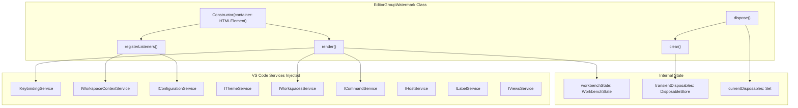
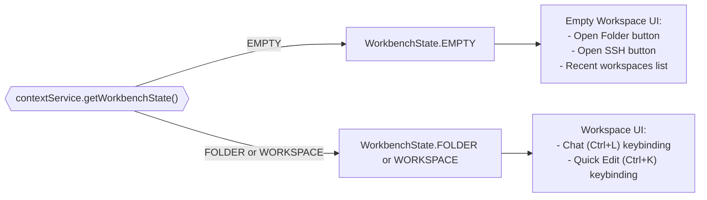
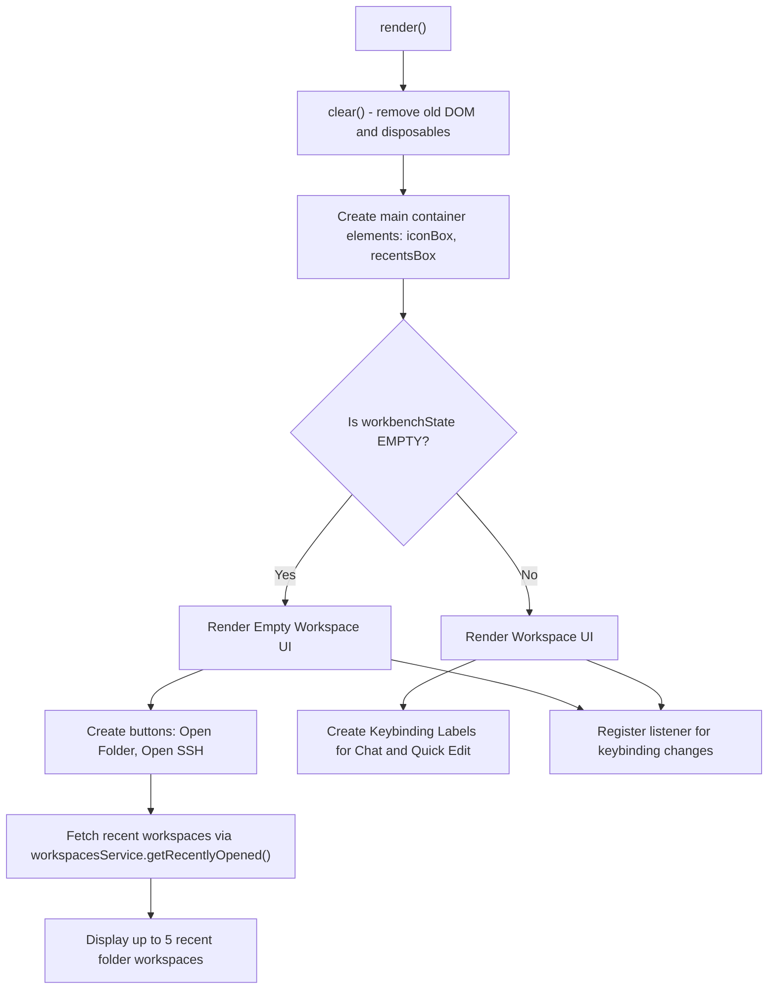
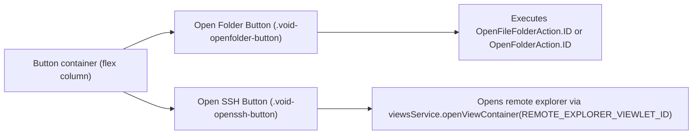
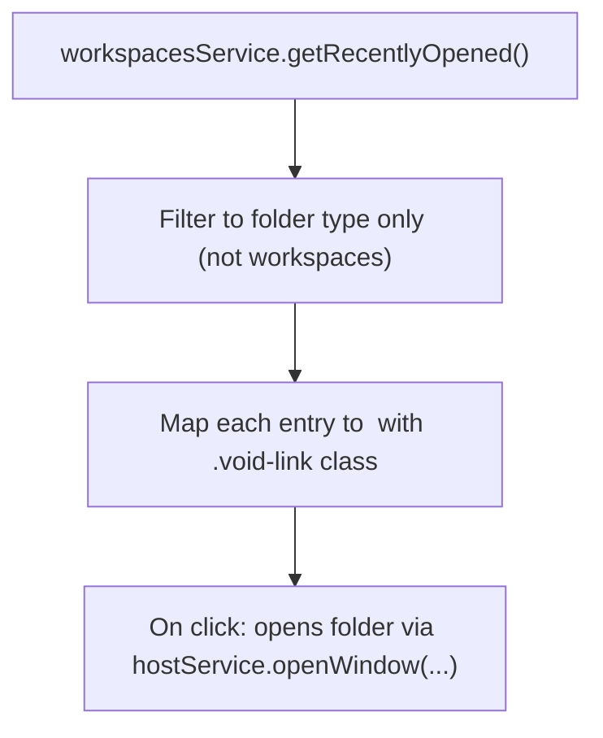
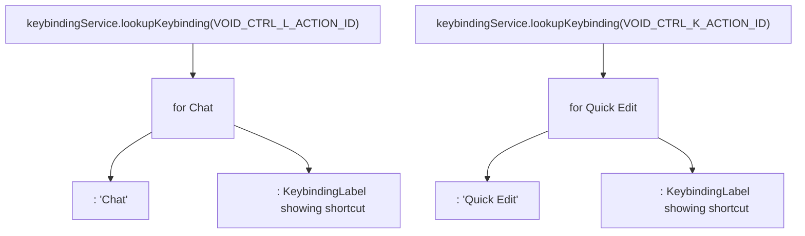
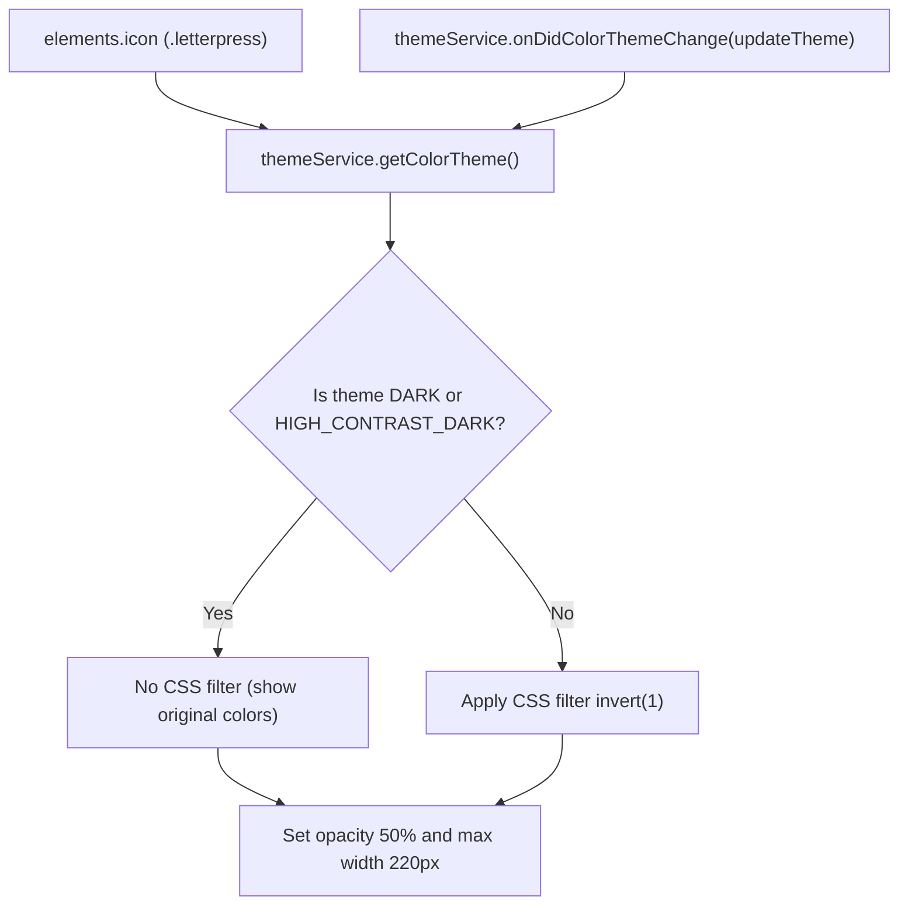
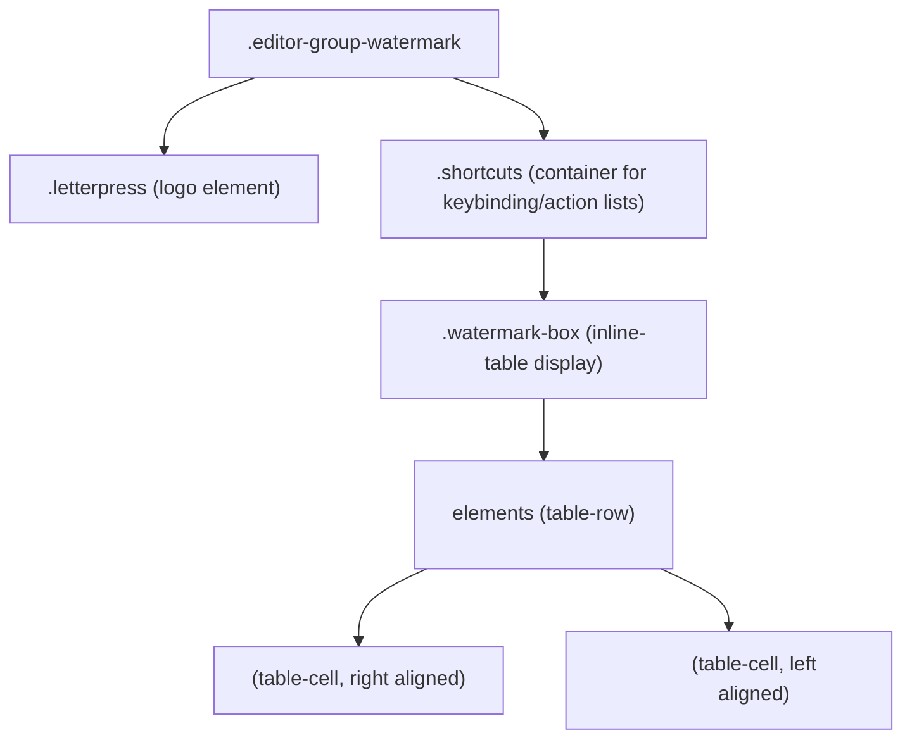
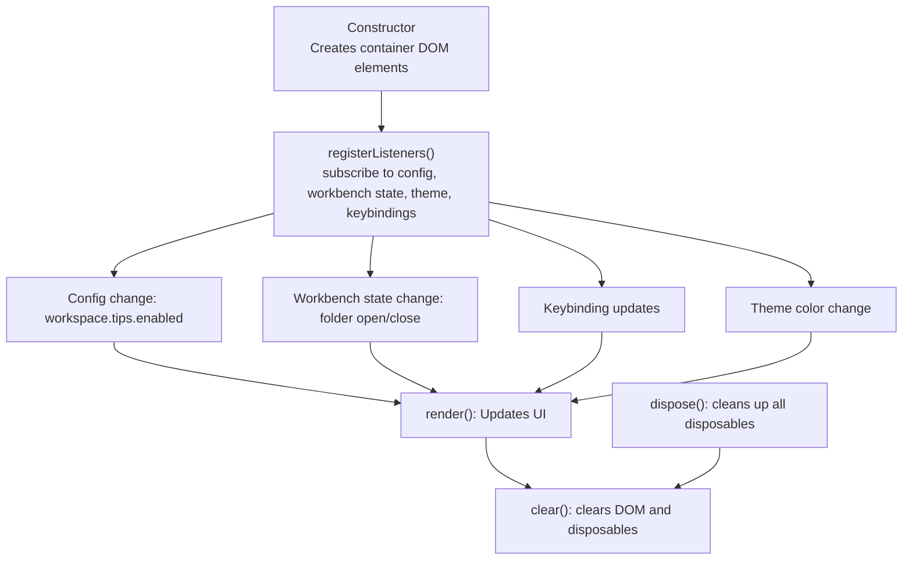
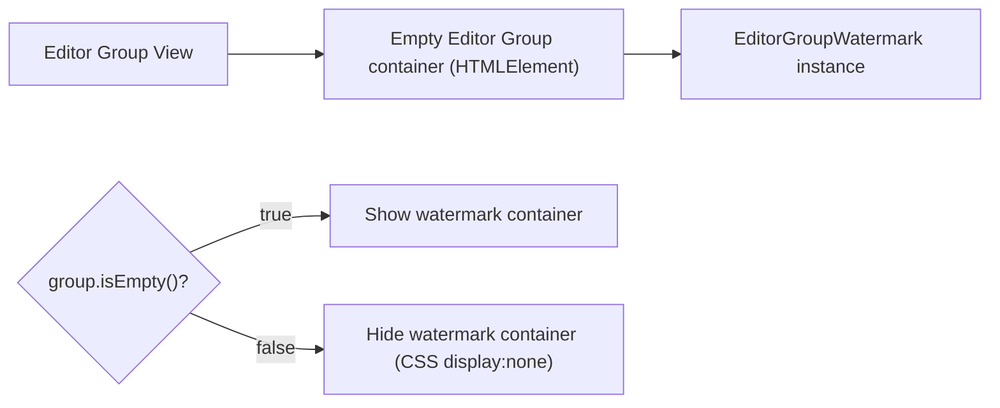

# Editor Watermark and Welcome Screen

<details>
<summary>Relevant source files</summary>

The following files were used as context for generating this wiki page:

- [.voidrules](.voidrules)

</details>


## Purpose and Scope

This document describes the Editor Watermark and Welcome Screen feature in Void, a fork of VS Code enhanced with AI-powered capabilities. This feature displays a custom welcome screen with Void branding and quick actions in empty editor groups. The content adapts dynamically based on the workbench state, offering contextual entry points such as workspace shortcuts when a folder is open, or welcome actions when no folder is open.

This page focuses on the implementation details located primarily in `editorGroupWatermark.ts` and relevant contributions in `miscWorkbenchContrib.ts`. For related UI and action details, see also [Sidebar Actions and Keybindings](#2.7) and [Settings and Model Selection](#2.2).

---

## System Overview

Void replaces the default VS Code empty editor watermark with a branded welcome screen shown inside empty editor groups. The screen displays the Void logo along with:

- When no workspace/folder is open: buttons for opening a folder, connecting via SSH, and a list of recent folders.
- When a workspace/folder is open: keybindings for core actions like "Chat" (Ctrl+L) and "Quick Edit" (Ctrl+K).

The welcome screen responds to configuration changes, theme switches, and dynamic keybinding updates.

### Roles and Responsibilities

| Aspect                 | Description                                                 |
|------------------------|-------------------------------------------------------------|
| Branding               | Renders Void logo in empty editor groups                    |
| Context Detection      | Reads workbench state to determine which UI to display     |
| Quick Actions          | Adds buttons/links for open folder, SSH, recent workspaces |
| Keyboard Shortcut Hints| Shows relevant keybindings for user guidance               |
| Theme Awareness        | Adapts logo styling based on color theme                    |
| Lifecycle Management   | Listens for events and disposes cleanly                     |

Sources: [src/vs/workbench/browser/parts/editor/editorGroupWatermark.ts:1-342](), [src/vs/workbench/contrib/void/browser/miscWorkbenchContrib.ts:20-55]()

---

## Component Architecture

The core component is the `EditorGroupWatermark` class. It manages the DOM container for watermark content and responds to workspace state changes, keybinding updates, configuration updates, and theme changes.



- The class extends `Disposable` for lifecycle management.
- `transientDisposables` track temporary listeners cleared every render.
- `currentDisposables` track keybinding label disposables to clean on render/dispose.
- The main entry point `render()` builds the UI based on `workbenchState` and keybindings.
- Listeners react to configuration, context, theme, and keybinding changes to trigger re-renders.

Sources: [src/vs/workbench/browser/parts/editor/editorGroupWatermark.ts:84-131](), [src/vs/workbench/browser/parts/editor/editorGroupWatermark.ts:332-341]()

---

## Workbench State Detection and Adaptation

The watermark adapts its rendering based on the workbench's current workspace state, retrieved via `contextService.getWorkbenchState()` which returns a `WorkbenchState` enum: `EMPTY`, `FOLDER`, or `WORKSPACE`.



- When empty, the UI encourages opening a folder or remote connection and shows recent folders.
- When a folder/workspace is open, keybindings are shown for two main features.
- The system automatically re-renders when workbench state or relevant settings change.

Sources: [src/vs/workbench/browser/parts/editor/editorGroupWatermark.ts:129-157]()

---

## Rendering Pipeline

The main `render()` method drives the entire painting process of the watermark:



- It first clears the existing UI and disposables.
- Creates containers for logo and actionable items.
- Depending on state, renders either empty workspace UI or workspace UI.
- Registers listeners to update keybindings dynamically.

Sources: [src/vs/workbench/browser/parts/editor/editorGroupWatermark.ts:161-330]()

---

## Empty Workspace UI Components

This state shows two main buttons and a list of recent workspaces.

### Open Folder and Open SSH Buttons



- The Open Folder button triggers platform-specific commands to open folder picker.
- Open SSH button opens the remote explorer view for SSH connections.
- CSS classes define button styling consistent with Void branding.

Sources: [src/vs/workbench/browser/parts/editor/editorGroupWatermark.ts:187-223](), [src/vs/workbench/contrib/void/browser/media/void.css:28-95]()

### Recent Workspaces List



- Retrieves recent workspaces asynchronously.
- Filters out non-folder entries.
- Displays max 5 entries with clickable folder names and parent paths.
- Ctrl/Cmd + click opens the folder in a new window.

Sources: [src/vs/workbench/browser/parts/editor/editorGroupWatermark.ts:171-281]()

---

## Workspace UI Components (Folder/Workspace Open)

When a folder or workspace is open, the watermark displays keybindings to guide usage.



- Utilizes `<dl>` lists with `<dt>` for label and `<dd>` for keybinding.
- `KeybindingLabel` renders dynamic keybinding for the user's platform.
- The two action IDs are `VOID_CTRL_L_ACTION_ID` for Chat and `VOID_CTRL_K_ACTION_ID` for Quick Edit.
- These labels update automatically when user changes keybindings.

Sources: [src/vs/workbench/browser/parts/editor/editorGroupWatermark.ts:287-306](), [src/vs/workbench/contrib/void/browser/actionIDs.js:28-29]()

---

## Icon and Theme Integration

The Void logo is implemented as a DOM element with a background image `void_cube_noshadow.png`.



- Dark themes show the logo image normally.
- Light themes invert colors to visually blend with light background.
- Opacity is set to 50% for subtle branding presence.
- Style updates automatically on theme changes.

Sources: [src/vs/workbench/browser/parts/editor/editorGroupWatermark.ts:115-125](), [src/vs/workbench/browser/parts/editor/media/editorgroupview.css:53-77]()

---

## CSS Styling and Layout

### Core Watermark Layout



| Selector                  | CSS Properties                                                     | Purpose                              |
|---------------------------|------------------------------------------------------------------|------------------------------------|
| `.editor-group-watermark` | `display:flex; flex-direction: column; align-items:center; justify-content:center; height:100%; max-width:290px;` | Centers content vertically/horizontally |
| `.letterpress`            | `aspect-ratio: 1/1; max-height: 100%; background-image: url(...)` | Void logo background image          |
| `.watermark-box`           | `display: inline-table; border-spacing: 11px 17px;`              | Contains `<dl>` as table rows       |
| `dl`                      | `display: table-row; opacity: 0.8;`                              | Each action + keybinding row        |
| `dt`                      | `display: table-cell; text-align: right; opacity: 0.6;`          | Label cell                         |
| `dd`                      | `display: table-cell; text-align: left;`                         | Keybinding cell                   |

Sources: [src/vs/workbench/browser/parts/editor/media/editorgroupview.css:32-112]()

### Button and Link Styles

| Element/Class                | Style Details                                           |
|-----------------------------|---------------------------------------------------------|
| `.void-openfolder-button`    | Background: #306dce, width: 124px, border-radius: 4px   |
| `.void-openssh-button`       | Background: #656565, width: 124px, border-radius: 4px   |
| `.void-openfolder-button:hover` | Background changes to #2563eb                            |
| `.void-openssh-button:hover` | Background changes to #474747                            |
| `.void-link`                 | Color: #3b82f6 (blue), cursor:pointer, opacity:0.8 hover|

Sources: [src/vs/workbench/contrib/void/browser/media/void.css:28-95]()

---

## Lifecycle and Disposal Management

The `EditorGroupWatermark` uses multiple disposable stores to manage listeners and UI elements cleanly.



- Listeners trigger re-renders on state or config changes.
- `transientDisposables` only live for a single render cycle.
- `currentDisposables` store `KeybindingLabel` disposables between renders.
- The base `_register()` method manages permanent listeners cleared on dispose.

Sources: [src/vs/workbench/browser/parts/editor/editorGroupWatermark.ts:86-90](), [src/vs/workbench/browser/parts/editor/editorGroupWatermark.ts:332-341]()

---

## Integration with Editor Groups

Watermark is instantiated for each editor group container when empty.



- The watermark container is only visible when the editor group has class `.empty`.
- CSS ensures it's hidden otherwise.
- Maximum width adjusts based on editor layout (single or multiple groups).
- Height adjusts for additional UI chrome or editor group headers.

Sources: [src/vs/workbench/browser/parts/editor/media/editorgroupview.css:42-50]()

---

## Color Registration

The watermark declares a custom color token `editorWatermark.foreground` to style the labels.

```typescript
registerColor(
  'editorWatermark.foreground',
  {
    dark: transparent(editorForeground, 0.6),
    light: transparent(editorForeground, 0.68),
    hcDark: editorForeground,
    hcLight: editorForeground
  },
  'Foreground color for the labels in the editor watermark.'
)
```

- Uses transparency to blend with editor foreground color.
- Adjusted opacity for light and dark themes.
- Sets full opacity for high contrast themes.

Sources: [src/vs/workbench/browser/parts/editor/editorGroupWatermark.ts:344]()

---

## Summary

The Editor Watermark and Welcome Screen feature in Void presents an adaptive, branded UI inside empty editor groups comprising:

- The Void logo with theme-adaptive styling.
- Clear user calls-to-action when no workspace is open: open folder, SSH, recent folders.
- Keybinding guidance on core Void commands (Chat, Quick Edit) when a workspace is open.
- Responsive layout and dynamic reactivity via a well-managed lifecycle.
- Integration with VS Code’s services for workspace state, configuration, commands, keybindings, and theming.
- Clean unsecured resource management through multiple disposable stores.

Together, these components provide a smooth onboarding and ongoing contextual UI experience, gently encouraging users to leverage Void’s AI-powered editing features from their first blank editor.

---

# Additional Mermaid Diagram: Mapping Domain Names to Code Entities

```mermaid
graph LR
    "Editor Watermark and Welcome Screen" --> "EditorGroupWatermark (Class)"
    "EditorGroupWatermark" --> "render() (Method)"
    "EditorGroupWatermark" --> "registerListeners() (Method)"
    "VS Code Services" --> "IKeybindingService"
    "VS Code Services" --> "IWorkspaceContextService"
    "VS Code Services" --> "IConfigurationService"
    "EditorGroupWatermark" --> "IKeybindingService (Injected)"
    "EditorGroupWatermark" --> "contextService.getWorkbenchState()"
    "render()" --> "KeybindingLabel (Component)"
    "render()" --> "commandService.executeCommand()"
    "Open Folder Button" --> "OpenFileFolderAction.ID / OpenFolderAction.ID"
    "Open SSH Button" --> "viewsService.openViewContainer(REMOTE_EXPLORER_VIEWLET_ID)"
    "Keybinding Labels" --> "VOID_CTRL_L_ACTION_ID"
    "Keybinding Labels" --> "VOID_CTRL_K_ACTION_ID"
```

---

Sources:  
- [src/vs/workbench/browser/parts/editor/editorGroupWatermark.ts:1-342]()  
- [src/vs/workbench/contrib/void/browser/miscWorkbenchContrib.ts:20-55]()  
- [src/vs/workbench/contrib/void/browser/actionIDs.js:28-29]()  
- [src/vs/workbench/browser/parts/editor/media/editorgroupview.css:32-112]()  
- [src/vs/workbench/contrib/void/browser/media/void.css:28-95]()  
- [src/vs/workbench/browser/parts/editor/editorGroupWatermark.ts:344]()