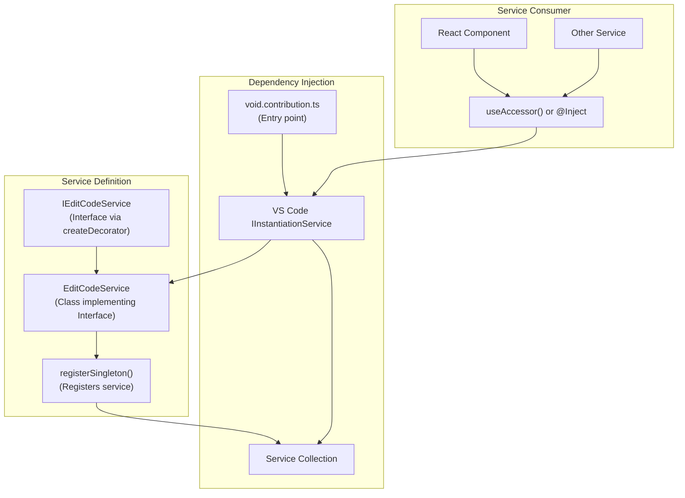
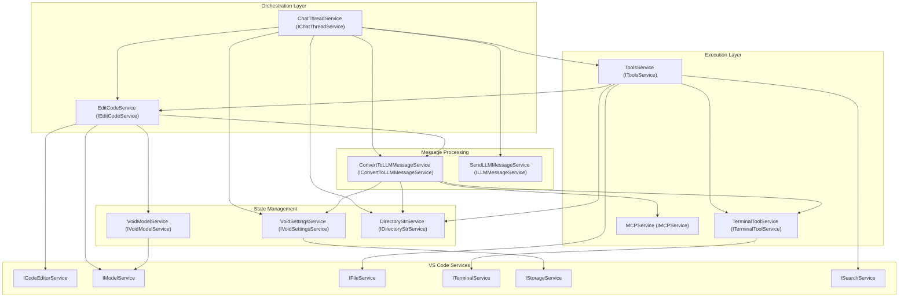
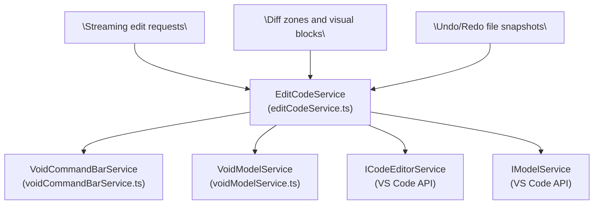
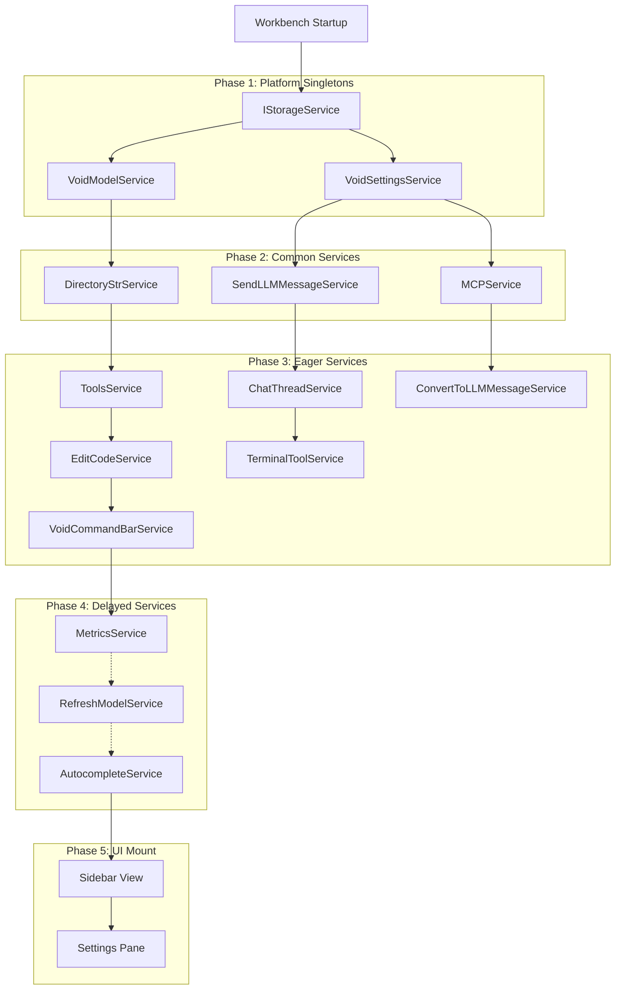

# Core Services and Architecture

<details>
<summary>Relevant source files</summary>

The following files were used as context for generating this wiki page:

- [.eslint-plugin-local/code-declare-service-brand.ts](.eslint-plugin-local/code-declare-service-brand.ts)
- [.voidrules](.voidrules)

</details>


## Purpose and Scope

This page provides a deep dive into Void's core service layer architecture, explaining how essential functionality is implemented as singleton services. It outlines the service registration and dependency injection patterns, inter-service communication, state management, lifecycle, and the responsibilities of major services powering Void's AI-assisted code editing features.

Each key service is documented in dedicated child pages for detailed exploration. This page bridges the natural language feature spaces (chat, editing, tools) with the underlying code entities implementing them.

**Related pages:**
- For user-facing features built on these services, see [Core Features](#2)
- For detailed service implementations, see sub-pages [Chat Thread Service and Orchestration](#3.1) to [Settings Service and State Management](#3.8)
- For LLM provider integration, see [LLM Integration](#4)
- For VS Code integration patterns, see [VS Code Integration Patterns](#5.4)

---

## Service Architecture Overview

Void extends the VS Code dependency injection system to register and manage singleton services implementing core functionality. Services use a TypeScript interface and class pattern with identifiers created by `createDecorator<T>()` and registered as singletons for global injection.

### Service Registration Pattern



Services declare their interfaces with `_serviceBrand` for typing, implement logic in classes extending `Disposable` for lifecycle management, and register themselves for injection. Consumers obtain service instances in React components or other services.

**Sources:** [src/vs/workbench/contrib/void/browser/editCodeService.ts:157-245](), [src/vs/platform/instantiation/common/instantiation.ts]()

---

## Core Services Registry

The table below lists Void's primary services, their instantiation scope, and their main responsibilities. Each is covered in more depth in child pages:

| Service Interface | Implementation | Instantiation | Responsibility |
|-------------------|----------------|---------------|----------------|
| `IChatThreadService` | `ChatThreadService` | Eager | Manages chat conversations, LLM/tool orchestration, streaming, checkpoints |
| `IEditCodeService` | `EditCodeService` | Eager | Manages diff zones, streaming edits, undo/redo, Diff UI coordination |
| `IVoidSettingsService` | `VoidSettingsService` | Platform Singleton | Central management of settings, provider configs, model selections |
| `IToolsService` | `ToolsService` | Eager | Runs built-in tools, validation, terminal integration |
| `ITerminalToolService` | `TerminalToolService` | Eager | Terminal lifecycle and command execution |
| `ILLMMessageService` | `SendLLMMessageService` | Common | IPC proxy for main process LLM calls |
| `IConvertToLLMMessageService` | `ConvertToLLMMessageService` | Eager | Converts internal chat message formats to provider formats |
| `IMCPService` | `MCPService` | Common | MCP server management, tool discovery, RPC |
| `IVoidModelService` | `VoidModelService` | Platform Singleton | Manages text model references and disposal tracking |
| `IVoidCommandBarService` | `VoidCommandBarService` | Eager | Floating command bar for diff navigation |
| `IDirectoryStrService` | `DirectoryStrService` | Common | Builds directory context trees |
| `IMetricsService` | `MetricsService` | Delayed | Telemetry and usage analytics |
| `IRefreshModelService` | `RefreshModelService` | Delayed | Local model autodetection |
| `IAutocompleteService` | `AutocompleteService` | Delayed | Caching, debouncing, and FIM-based autocomplete |

**Sources:** [src/vs/workbench/contrib/void/browser/void.contribution.ts](), [src/vs/platform/instantiation/common/extensions.ts]()

---

## Core Service Dependency Graph

The graph below shows core Void services and their dependencies, illustrating the layered architecture from orchestration through message processing to state and VS Code native services:



**Sources:** [src/vs/workbench/contrib/void/browser/chatThreadService.ts:315-330](), [src/vs/workbench/contrib/void/browser/editCodeService.ts:183-199](), [src/vs/workbench/contrib/void/browser/toolsService.ts:144-156]()

---

## Mapping Natural Language Spaces to Code Entities

The next two diagrams map key user-facing concepts to specific code entities, bridging the gap from natural language feature domains (Chat, Edit, Tools) to the core services providing these features.

### 1. Chat Thread Space → ChatThreadService and LLM Services

```mermaid
graph TB
    UserChat["\"User Messages: addUserMessageAndStreamResponse()\""]
    AssistantResp["\"Assistant Responses\""]
    ToolCalls["\"Tool Calls / Approvals\""]
    
    ChatThread["ChatThreadService<br/>(src/vs/workbench/contrib/void/browser/chatThreadService.ts)"]
    ConvertLLM["ConvertToLLMMessageService<br/>(convertToLLMMessageService.ts)"]
    LLMMsgService["SendLLMMessageService (IPC Proxy)<br/>(sendLLMMessageService.ts)"]
    ToolsSvc["ToolsService<br/>(toolsService.ts)"]
    
    UserChat --> ChatThread
    AssistantResp --> ChatThread
    ToolCalls --> ChatThread

    ChatThread --> ConvertLLM
    ChatThread --> LLMMsgService
    ChatThread --> ToolsSvc
```

- The `IChatThreadService` is the orchestration hub for managing conversations, streaming LLM responses, handling tool execution loops, and maintaining persistent state.
- It calls into `IConvertToLLMMessageService` to format chat messages per provider.
- IPC-based `ILLMMessageService` sends messages to the main process LLM handler.
- Tools invoked via `IToolsService` provide actions like file editing, terminal interaction, or MCP tools.

**Sources:** [src/vs/workbench/contrib/void/browser/chatThreadService.ts:230-294](), [src/vs/workbench/contrib/void/browser/convertToLLMMessageService.ts](), [src/vs/workbench/contrib/void/common/sendLLMMessageService.ts](), [src/vs/workbench/contrib/void/browser/toolsService.ts]()

---

### 2. Edit Code Space → EditCodeService and Command Bar



- `IEditCodeService` manages code changes with line-level diffing, streaming code modifications, and cursor tracking.
- It interacts with `IVoidModelService` to handle stable references to editor models.
- Collaborates with `IVoidCommandBarService` to provide UI for navigating and accepting/rejecting diffs.
- Relies on VS Code’s native editor and model services for text manipulation.

**Sources:** [src/vs/workbench/contrib/void/browser/editCodeService.ts](), [src/vs/workbench/contrib/void/browser/voidCommandBarService.ts](), [src/vs/workbench/contrib/void/browser/voidModelService.ts]()

---

## Service Communication Patterns

Void services use these main communication patterns:

1. **Direct Method Calls:** Synchronous/asynchronous calls on injected service instances for coordinated logic sequences.

2. **Event Emitters:** Services expose VS Code-style `Emitter` events for reactive inter-service or UI updates.

3. **IPC Proxy Channels:** Renderer services acting as clients proxy calls to main process services over IPC for privileged or long-running operations (e.g. LLM APIs).

Example of IPC proxy pattern for LLM messages:

```typescript
export class SendLLMMessageService implements ILLMMessageService {
    private readonly proxy: ILLMMessageService;

    constructor(@IMainProcessService mainProcessService: IMainProcessService) {
        this.proxy = ProxyChannel.toService<ILLMMessageService>(
            mainProcessService.getChannel('llmMessage')
        );
    }

    sendLLMMessage(params: ServiceSendLLMMessageParams): void {
        return this.proxy.sendLLMMessage(params);
    }
}
```

**Sources:** [src/vs/workbench/contrib/void/common/sendLLMMessageService.ts](), [src/vs/workbench/contrib/void/browser/chatThreadService.ts:678-682](), [src/vs/workbench/contrib/void/browser/editCodeService.ts:173-176]()

---

## Service Lifecycle and State Management

Services follow VS Code’s `Disposable` pattern, automatically cleaning up event listeners, timers, and resources when disposed.

### Example: Disposable Registration in EditCodeService

```typescript
class EditCodeService extends Disposable implements IEditCodeService {
    constructor(/* injected deps */) {
        super();
        this._register(
            model.onDidChangeContent(e => { this._onUserChangeContent(uri, e); })
        );
        this._register(
            this._codeEditorService.onCodeEditorAdd(editor => this.initializeEditor(editor))
        );
    }
}
```

Key service state is stored in-memory, with persistence as needed via `IStorageService`. For example:

- **ChatThreadService:** stores chat threads and streaming states, persists in storage.
- **EditCodeService:** manages mappings of diff zones and diff objects by URI and ID.
- **VoidSettingsService:** maintains settings state with encrypted storage per provider.

These state objects emit change events consumed by UI layers to update displays.

**Sources:** [src/vs/workbench/contrib/void/browser/editCodeService.ts:203-244](), [src/vs/workbench/contrib/void/browser/chatThreadService.ts:151-206](), [src/vs/workbench/contrib/void/common/voidSettingsService.ts]()

---

## Service Initialization Flow

The following diagram illustrates the initialization order of core services during startup:



This phased startup ensures platform-level services and storage are ready before dependent messaging, chat, and editing services initialize. UI components mount only after core services are active.

**Sources:** [src/vs/workbench/contrib/void/browser/void.contribution.ts](), [src/vs/platform/instantiation/common/extensions.ts]()

---

## Summary

Void's core services form a layered and well-structured system supported by VS Code's dependency injection and eventing patterns. The orchestration layer coordinates AI-powered chat and tools, the edit layer manages code diffs and streaming, and underlying message services handle LLM communication with platform abstraction. This framework enables Void to deliver seamless, streaming AI-enhanced code assistance integrated tightly with VS Code.

For detailed breakdowns of each core service and their implementation, please refer to the dedicated child pages:

- [Chat Thread Service and Orchestration](#3.1)
- [Edit Code Service and Diff Management](#3.2)
- [LLM Message Service and Provider Abstraction](#3.3)
- [Tools Service and Terminal Integration](#3.4)
- [Autocomplete Service](#3.5)
- [Model Context Protocol (MCP) Service](#3.6)
- [Update Service and Release Management](#3.7)
- [Settings Service and State Management](#3.8)

---

**Sources:**  
[src/vs/workbench/contrib/void/browser/editCodeService.ts](),  
[src/vs/workbench/contrib/void/browser/chatThreadService.ts](),  
[src/vs/workbench/contrib/void/browser/toolsService.ts](),  
[src/vs/workbench/contrib/void/browser/void.contribution.ts](),  
[src/vs/workbench/contrib/void/common/sendLLMMessageService.ts](),  
[src/vs/workbench/contrib/void/browser/convertToLLMMessageService.ts](),  
[src/vs/workbench/contrib/void/browser/voidSettingsService.ts](),  
[src/vs/workbench/contrib/void/browser/terminalToolService.ts](),  
[src/vs/platform/instantiation/common/instantiation.ts](),  
[src/vs/platform/instantiation/common/extensions.ts]()