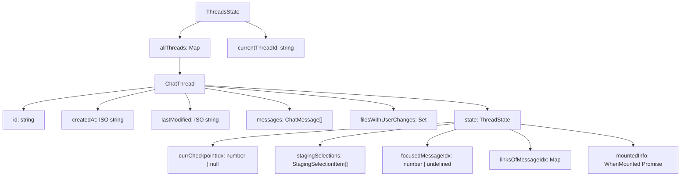
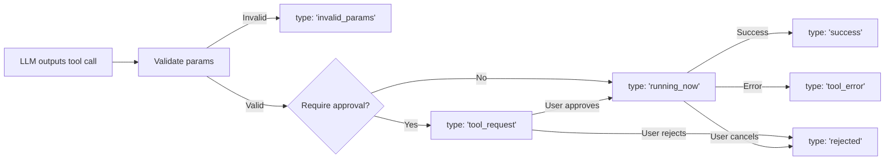
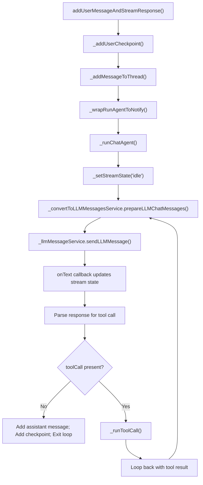
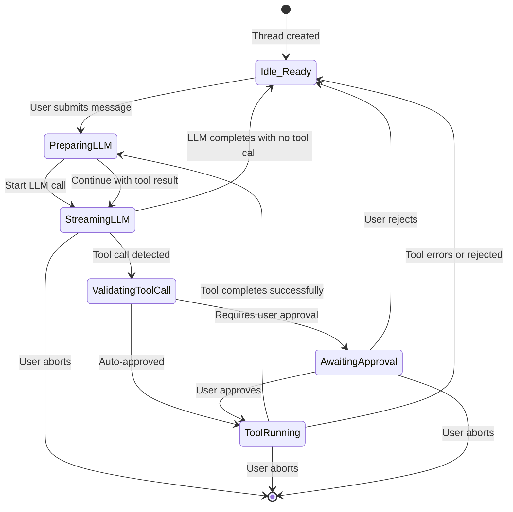
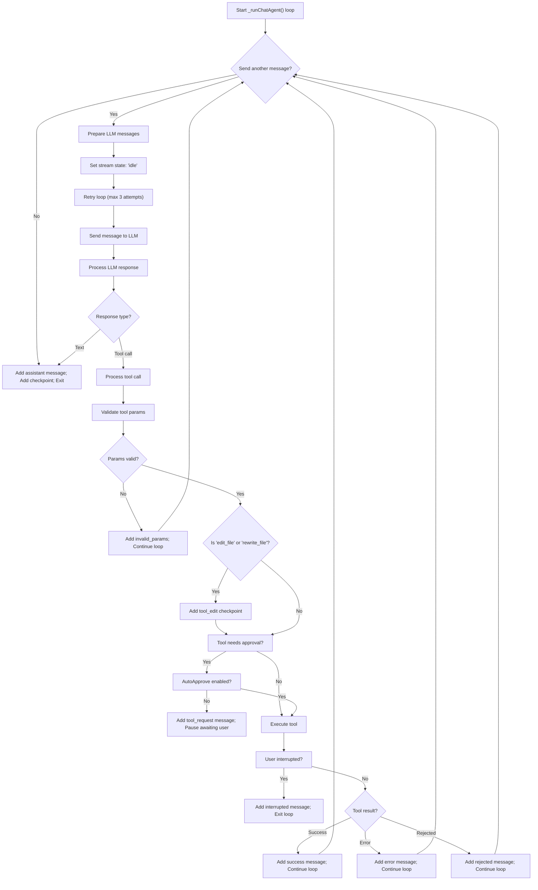
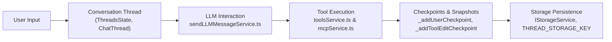
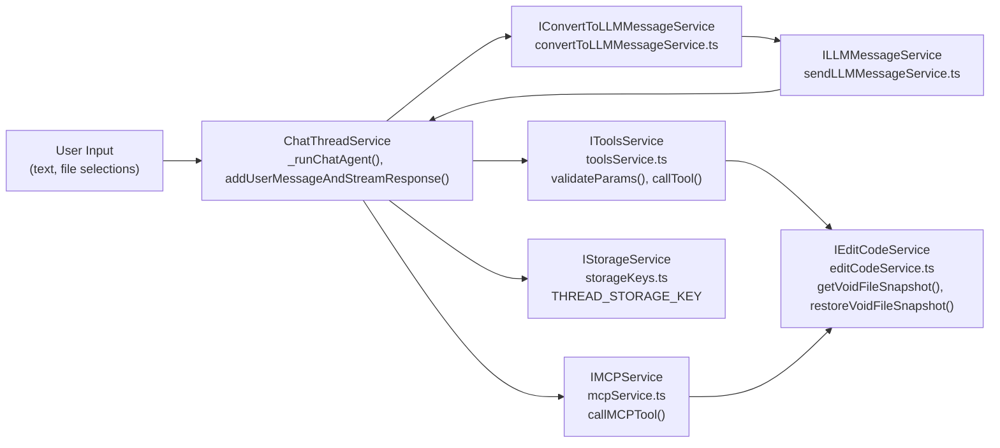
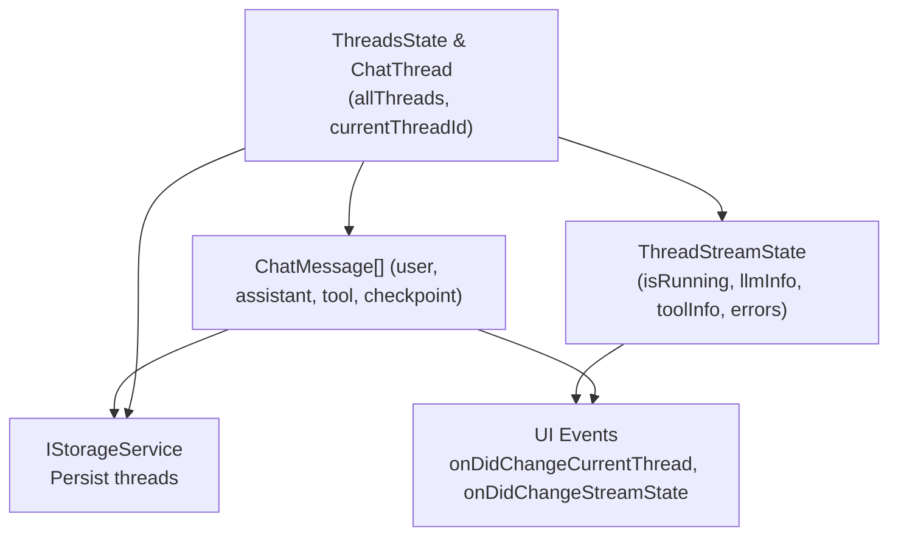

# Chat Thread Service and Orchestration

<details>
<summary>Relevant source files</summary>

The following files were used as context for generating this wiki page:

- [.voidrules](.voidrules)

</details>


## Purpose and Scope

`IChatThreadService` is the core service that manages conversations (chat threads) within Void. It orchestrates the entire chat experience by:

- Managing multiple conversation threads and their message histories.
- Coordinating calls to Large Language Models (LLMs) through IPC.
- Executing built-in and external tools based on LLM output.
- Maintaining checkpoints capturing file snapshots for undo/redo and state restoration.
- Persisting thread state and messages via the `IStorageService`.
- Managing streaming states and interruption/abort mechanics during LLM interactions and tool executions.

The main implementation is the `ChatThreadService` class found in `src/vs/workbench/contrib/void/browser/chatThreadService.ts` [lines 297-1293](). It exposes a rich public API as defined by the `IChatThreadService` interface to allow UI and other components to interact with conversation threads and message flows.

**Related pages:**

- Sidebar chat UI and thread management ([Sidebar Chat and Thread Management](#2.1))
- Tools and terminal integration ([Tools Service and Terminal Integration](#3.4))
- LLM message sending and provider abstraction ([LLM Message Service and Provider Abstraction](#3.3))
- Message format conversion ([Message Format Conversion](#4.5))

---

## Core Data Structures

### Thread State Model

Conversations are modeled as threads contained in an overarching application state structure:



Each `ChatThread` stores metadata, a message array, sets of files modified by the user, and a mutable `state` object for UI-related information such as the currently focused message, staging selections (for code/files to include with messages), codespan links for symbol navigation, and a mounting promise that tracks UI readiness.

Threads are instantiated via `newThreadObject()` which generates a UUID and timestamps the creation and last modification [src/vs/workbench/contrib/void/browser/chatThreadService.ts:208-223]().

**Sources:** [chatThreadService.ts:114-144](), [chatThreadService.ts:208-223]()

### Message Types

The conversation messages are represented by the discriminated union type `ChatMessage` with the following variants:

| Message Type            | Role        | Key Fields                      | Description                                   |
|------------------------|-------------|--------------------------------|-----------------------------------------------|
| `user` Message         | `'user'`    | `content`, `displayContent`, `selections` | User prompt input                             |
| `assistant` Message    | `'assistant'` | `displayContent`, `reasoning`, `anthropicReasoning` | LLM-generated response, possibly with reasoning info |
| `tool` Message         | `'tool'`    | `type` (e.g. `tool_request`, `running_now`), `name`, `params`, `result`, `id`, `rawParams` | Execution lifecycle of a tool, progressing through validation, approval, running, success, error, or cancellation |
| `checkpoint` Entry     | `'checkpoint'` | `type` (`user_edit` or `tool_edit`), `voidFileSnapshotOfURI`, and `userModifications` | File snapshots to allow restoration of workspace state |
| `interrupted_streaming_tool` | `'interrupted_streaming_tool'` | `name`, `mcpServerName` | Marker message when tool execution was aborted |

Tool message states transition through a state machine reflecting the execution lifecycle:



This lifecycle is encoded in `ToolMessage<T>` [src/vs/workbench/contrib/void/common/chatThreadServiceTypes.ts:11-28]().

**Sources:** [chatThreadServiceTypes.ts:11-69]()

---

## Thread Lifecycle Management

### Creating and Switching Threads

Threads can be created and switched via these key methods:

- `openNewThread()` creates a new thread with fresh ID and timestamps and makes it current.
- `switchToThread(threadId)` sets the current active thread and handles transient streaming state resets.

The creation and switching flow:

```mermaid
sequenceDiagram
    participant User
    participant Service as ChatThreadService
    participant Storage as IStorageService
    participant UI as ReactUI

    User->>Service: openNewThread()
    Service->>Service: newThreadObject() generates UUID and timestamps
    Service->>Service: _setState() updates allThreads + currentThreadId
    Service->>Storage: _storeAllThreads(allThreads)
    Service->>UI: _onDidChangeCurrentThread.fire()
    
    User->>Service: switchToThread(threadId)
    Service->>Service: _setState({currentThreadId: threadId})
    Service->>Service: Handle last message streaming state:
     - Switch to 'awaiting_user' if tool_request
     - Mark 'rejected' if running_now tool (handles restart scenario)
    Service->>Service: Create new mountedInfo promise
    Service->>UI: _onDidChangeCurrentThread.fire()
```

`switchToThread` also resets streaming state according to the last message to ensure consistent UI state [chatThreadService.ts:427-479](), [chatThreadService.ts:461-476]().

**Sources:** [chatThreadService.ts:208-223](), [chatThreadService.ts:241](), [chatThreadService.ts:427-479](), [chatThreadService.ts:461-476]()

### Persistence and Restoration

Thread data is persisted in `IStorageService` under the key `THREAD_STORAGE_KEY` [storageKeys.ts:33](). Since threads contain URIs, the service handles custom serialization/deserialization logic converting URIs to/from JSON:

```typescript
JSON.parse(threadsStr, (key, value) => {
    if (value && typeof value === 'object' && value.$mid === 1) {
        return URI.from(value); // Deserialize URI
    }
    return value;
});
```

The service methods `_readAllThreads()` and `_storeAllThreads()` handle reading from and writing to storage respectively [chatThreadService.ts:405-423]().

This persistent storage ensures conversations survive restarts and are restored on activation.

**Sources:** [chatThreadService.ts:396-423](), [storageKeys.ts]()

---

## Message Flow and Orchestration

### From User Input to LLM Response and Tool Execution

The core operation feeding user input to the LLM and processing responses is initiated by these entry points:

| Method                              | Purpose                          |
|-----------------------------------|---------------------------------|
| `addUserMessageAndStreamResponse` | Handle new user messages and start streaming response |
| `editUserMessageAndStreamResponse`| Handle edits to existing messages |

A high-level message flow diagram illustrates the orchestration:



This flow demonstrates how newly added user messages trigger the agent loop allowing LLM calls and tool executions iteratively until completion.

**Services involved:**

- `IConvertToLLMMessageService` for converting internal messages to provider-specific formats.
- `ILLMMessageService` for IPC-based communication with the LLM process.
- `IToolsService` and `IMCPService` for executing built-in and MCP tools.

**Sources:** [chatThreadService.ts:856-914](), [chatThreadService.ts:732-850](), [chatThreadService.ts:605-727]()

---

## Streaming State Management

### Tracking Execution State

Aside from the persistent thread message state, a separate transient streaming state maintains ongoing activity info for each thread, captured by the `ThreadStreamState` type:

```typescript
type ThreadStreamState = {
    [threadId: string]: {
        isRunning: 'LLM';
        llmInfo: {
            displayContentSoFar: string;
            reasoningSoFar: string;
            toolCallSoFar: RawToolCallObj | null;
        };
        interrupt: Promise<() => void>;
    } | {
        isRunning: 'tool';
        toolInfo: {
            toolName: ToolName;
            toolParams: ToolCallParams<ToolName>;
            id: string;
            content: string;
            rawParams: RawToolParamsObj;
            mcpServerName?: string;
        };
        interrupt: Promise<() => void>;
    } | {
        isRunning: 'awaiting_user';
    } | {
        isRunning: 'idle';
        interrupt: 'not_needed' | Promise<() => void>;
    } | {
        isRunning: undefined;
        error?: { message: string, fullError: Error | null };
    }
}
```

This state includes:

- **LLM streaming** info, partial text, reasoning, and partial tool calls while streamed.
- **Tool execution** info, accumulating tool output during execution.
- **Awaiting user** flag indicates the system is paused awaiting tool approval.
- **Idle** state denotes pauses between LLM-tool iterations.
- **Error** state captures terminal failures.

The service updates this state with `_setStreamState(threadId, newState)` which triggers events to notify the UI.

**Sources:** [chatThreadService.ts:163-206](), [chatThreadService.ts:482-485]()

### State Transitions

The state machine governing transitions during chat interactions:



**Sources:** [chatThreadService.ts:557-590](), [chatThreadService.ts:482-485]()

---

## Tool Execution Loop

### Agent Loop Logic

The heart of the orchestration is `_runChatAgent()` which repeatedly sends messages, handles LLM responses, detects tool calls, and executes tools until completion or user interruption:



Key implementations:

- Retries up to 3 times on transient LLM errors with backoff delays.
- Before tool execution via `_runToolCall()`, validates parameters using `IToolsService.validateParams`.
- Adds checkpoints on file edit tool calls.
- Checks tool approval requirements and auto-approval settings.
- Executes tools with `_toolsService.callTool()` or `_mcpService.callMCPTool()`.
- Handles interruptions via `interrupt` promises that abort current execution.
- Updates thread messages reflecting tool execution lifecycle.

**Sources:** [chatThreadService.ts:45-46](), [chatThreadService.ts:732-850](), [chatThreadService.ts:605-727]()

### Tool Call Execution

The `_runToolCall()` method handles a single tool call life cycle:

| Phase         | Details                                                                                                     | Location                         |
|---------------|-------------------------------------------------------------------------------------------------------------|---------------------------------|
| Validation    | Calls `IToolsService.validateParams[toolName]` and bails with `invalid_params` message if errors.          | [chatThreadService.ts:622-637]() |
| Checkpoint    | If tool edits files (`edit_file` or `rewrite_file`), adds a `tool_edit` checkpoint capturing prior state.  | [chatThreadService.ts:639-640]() |
| Approval      | Checks `approvalTypeOfBuiltinToolName` and user settings. Pauses if manual approval needed.                 | [chatThreadService.ts:644-652]() |
| Execution    | Calls tool execution method, either built-in or MCP.                                                        | [chatThreadService.ts:677-696]() |
| Stringify     | Converts result to string for chat display.                                                                 | [chatThreadService.ts:710-722]() |
| Update       | Adds final tool message to thread and updates stream state accordingly.                                      | [chatThreadService.ts:725]() |

This method coordinates the validation, approval, execution, and messaging related to tool calls within the chat flow.

**Sources:** [chatThreadService.ts:605-727]()

---

## Checkpoint System

### File Snapshots for Time Travel

The checkpoint system stores complete file snapshots mapped by file path. The `CheckpointEntry` messages store:

| Property                  | Description                                   |
|---------------------------|-----------------------------------------------|
| `role` ('checkpoint')     | Message discriminator                         |
| `type` (`user_edit`/`tool_edit`) | Checkpoint category (manual user edit or tool-generated edit) |
| `voidFileSnapshotOfURI`   | Pre-edit snapshot of file contents and diffs |
| `userModifications`       | Updated snapshot after user manual changes   |

Checkpoints are created in two key places:

- `_addUserCheckpoint()` before and after user message submission to snapshot the workspace [chatThreadService.ts:1024-1079]()
- `_addToolEditCheckpoint()` before tool executions that modify files [chatThreadService.ts:1081-1119]()

The `VoidFileSnapshot` type captures full text, diffs, cursor zones, and streaming state — facilitating perfect restoration of editor state, including accept/reject diff areas [editCodeServiceTypes.ts]().

**Sources:** [chatThreadServiceTypes.ts:38-46](), [chatThreadService.ts:1024-1119]()

### Maintaining Checkpoint Invariant

A critical program invariant is that every user message is preceded by a `user_edit` checkpoint and every LLM-triggered file edit tool call is preceded by a `tool_edit` checkpoint. This invariant enables:

- Jumping back in conversation history at any point and restoring the exact workspace state.
- Auditing how files evolved based on chat messages and tool calls.

Example structure in conversation history:

```
[Checkpoint: user_edit]  <-- Initial empty workspace
User: "Create a React component"
[Checkpoint: user_edit]  <-- Pre-LLM response state
Assistant: "Created component files..."
[Checkpoint: tool_edit]  <-- Before 'create_file_or_folder' tool call
Tool: create_file_or_folder (files)
[Checkpoint: tool_edit]  <-- Before 'rewrite_file' tool call
Tool: rewrite_file (Component.tsx)
[Checkpoint: user_edit]  <-- After LLM completes
User: "Add a title prop"
...
```

This invariant is enforced by explicit calls to checkpoint creation at message and tool execution points.

**Sources:** [chatThreadService.ts:76-95](), [chatThreadService.ts:1024-1119]()

### Jumping to Checkpoints

The `jumpToCheckpointBeforeMessageIdx()` enables restoring the workspace state to any checkpoint preceding a message index:

```typescript
jumpToCheckpointBeforeMessageIdx(opts: {
    threadId: string;
    messageIdx: number;
    jumpToUserModified: boolean;
}): void
```

Execution flow:

1. Finds the last checkpoint at or before `messageIdx`.
2. Selects file snapshots:
   - `voidFileSnapshotOfURI` for original snapshot (if `jumpToUserModified === false`)
   - `userModifications.voidFileSnapshotOfURI` for user-modified snapshot (if `true`)
3. Calls `_editCodeService.restoreVoidFileSnapshot` per file to restore exact editor state.
4. Sets `currCheckpointIdx` in thread state.

This permits toggling between exact pre-edit and post-edit file states along the timeline.

**Sources:** [chatThreadService.ts:1121-1156]()

---

## Integration Points

### Service Dependencies

`ChatThreadService` depends on multiple interfaces to modularize concerns:

```mermaid
graph TB
    ChatThreadService["ChatThreadService (chatThreadService.ts)"]
    
    Storage["IStorageService\n(Persists thread data)"]
    LLMService["ILLMMessageService\n(Sends messages to LLM)"]
    ConvertService["IConvertToLLMMessageService\n(Formats messages)"]
    ToolsService["IToolsService\n(Validates & runs built-in tools)"]
    EditCodeService["IEditCodeService\n(Manages diffs & file snapshots)"]
    SettingsService["IVoidSettingsService\n(Stores model/provider settings)"]
    MCPService["IMCPService\n(Handles MCP tool execution)"]
    MetricsService["IMetricsService\n(Captures metrics/logs)"]
    NotificationService["INotificationService\n(Displays errors & notifications)"]
    
    ChatThreadService --> Storage
    ChatThreadService --> LLMService
    ChatThreadService --> ConvertService
    ChatThreadService --> ToolsService
    ChatThreadService --> EditCodeService
    ChatThreadService --> SettingsService
    ChatThreadService --> MCPService
    ChatThreadService --> MetricsService
    ChatThreadService --> NotificationService
```



Each dependency isolates a domain responsibility allowing the chat thread service to focus on orchestration.

**Sources:** [chatThreadService.ts:315-330]()

### Natural Language to Code Entity Mapping

This diagram bridges user-facing system terms with code artifacts in `ChatThreadService`:



This depicts the flow from user typing input, how the chat thread relates to LLM calls, tool runs, checkpoint creation, and storage.

**Sources:** [chatThreadService.ts:800-900](), [chatThreadService.ts:1024-1119]()

---

## Public API Surface of `IChatThreadService`

| Method                         | Description                                      | Returns/Effect                           |
|-------------------------------|------------------------------------------------|----------------------------------------|
| `getCurrentThread()`            | Retrieves the current active conversation thread | `ThreadType`                          |
| `openNewThread()`               | Creates and switches to a new thread           | `void`                                 |
| `switchToThread(threadId: string)` | Switches current thread                        | `void`                                 |
| `deleteThread(threadId: string)`| Deletes named thread                            | `void`                                 |
| `duplicateThread(threadId: string)` | Clones thread as new                           | `void`                                 |
| `addUserMessageAndStreamResponse(params)` | Adds new user message and starts response streaming | `Promise<void>`                    |
| `editUserMessageAndStreamResponse(params)`| Edits existing user message and streams response| `Promise<void>`                    |
| `abortRunning(threadId: string)`| Aborts current LLM or tool streaming             | `Promise<void>`                        |
| `dismissStreamError(threadId: string)`| Clears error from stream state                  | `void`                                 |
| `approveLatestToolRequest(threadId: string)` | Approves pending tool request                  | `void`                                 |
| `rejectLatestToolRequest(threadId: string)` | Rejects pending tool request                   | `void`                                 |
| `addNewStagingSelection(newSelection)` | Adds file or selection to staging (next msg)  | `void`                                 |
| `popStagingSelections(numPops?: number)` | Removes staging selections                     | `void`                                 |
| `jumpToCheckpointBeforeMessageIdx(opts)` | Restore state to checkpoint                      | `void`                                 |
| Event `onDidChangeCurrentThread` | Fired on thread switch or state/message change | Event payload: `void`                  |
| Event `onDidChangeStreamState`  | Fired on streaming state changes                | Event payload: `{ threadId: string }` |

The interface enables fine control over chat threads, messages, streaming state, tool approval flows, checkpoints, and UI state such as staging selections.

**Sources:** [chatThreadService.ts:230-294]()

---

## Implementation Highlights

### Adding and Updating Messages

Single source for adding messages is `_addMessageToThread(threadId, message)` which updates the thread's message array, last modified timestamp, persist state, and fires UI update events:

```typescript
private _addMessageToThread(threadId: string, message: ChatMessage) {
    const thread = this.state.allThreads[threadId];
    if (!thread) return;
    
    thread.messages.push(message);
    thread.lastModified = new Date().toISOString();
    
    this._storeAllThreads(this.state.allThreads);
    this._onDidChangeCurrentThread.fire();
}
```

For tool message lifecycle updates, helpers such as `_updateLatestTool()` and `_swapOutLatestStreamingToolWithResult()` maintain the last message consistency during streaming.

Streaming state updates are handled distinctly via `_setStreamState(threadId, newState)` that triggers `onDidChangeStreamState` events.

**Sources:** [chatThreadService.ts:1013-1023](), [chatThreadService.ts:482-485](), [chatThreadService.ts:502-518]()

### Error Handling and Retries

The agent loop implements retries (up to 3 by default) on LLM errors with delay and escalates to error states if retries fail.

Errors are surfaced via stream state's error object and can be dismissed by the user. Tool errors do not retry but add explicit error messages so the LLM can attempt corrections in subsequent messages.

**Sources:** [chatThreadService.ts:791-850](), [chatThreadService.ts:890-914]()

### Staging Selections and Ctrl+L Support

Staging selections allow users to add files or code excerpts to their next message (Ctrl+L). These selections are stored in:

- Thread state for new messages.
- Message state for message edits.

Key methods `addNewStagingSelection()`, `popStagingSelections()`, and `setCurrentlyFocusedMessageIdx()` allow managing these selections.

Message editing flow supports editing messages with attached staged selections leading to re-streaming LLM responses.

**Sources:** [chatThreadService.ts:939-1011](), [chatThreadServiceTypes.ts:73-89](), [SidebarChat.tsx:1020-1070]()

---

This service layer acts as the critical glue between user inputs, LLM reasoning, tool automation, and code modifications, providing a robust stateful conversation experience augmented with powerful developer tools and undo capabilities.

---

# Summary Diagrams

### Natural Language Conversation Orchestration Layer to Code Entity Mapping



### Chat Message and Thread State Flow



---

**Sources:**

- `src/vs/workbench/contrib/void/browser/chatThreadService.ts:297-1293`
- `src/vs/workbench/contrib/void/common/chatThreadServiceTypes.ts`
- `src/vs/workbench/contrib/void/browser/convertToLLMMessageService.ts`
- `src/vs/workbench/contrib/void/common/sendLLMMessageService.ts`
- `src/vs/workbench/contrib/void/browser/toolsService.ts`
- `src/vs/workbench/contrib/void/common/mcpService.ts`
- `src/vs/workbench/contrib/void/common/storageKeys.ts`
- `src/vs/workbench/contrib/void/browser/react/src/sidebar-tsx/SidebarChat.tsx`