# Edit Code Service and Diff Management

<details>
<summary>Relevant source files</summary>

The following files were used as context for generating this wiki page:

- [.voidrules](.voidrules)

</details>


## Purpose and Scope

The `IEditCodeService` is the core service responsible for managing AI-driven code modifications in Void. It handles:

- Multiple entry points for edits:
  - Ctrl+K Quick Edit zones
  - User-initiated Apply button clicks from chat suggestions
  - Direct tool calls (`edit_file` and `rewrite_file`) invoked by chat agents
- Coordinating three application modes:
  - **Fast Apply**: Incremental search/replace block application with streaming updates
  - **Slow Apply**: Full file rewrites streamed progressively
  - **Instant Apply**: Immediate application of tool-driven edits, without UI feedback
- Diff zone lifecycle and rendering of line-by-line diffs using VS Code model decorations, view zones, and widget overlays
- A snapshot system for full undo/redo support integrating with `IUndoRedoService`
- Streaming coordination to display incremental LLM-generated code changes
- Conflict detection and modal prompting to resolve overlapping diffs

This page details the architecture, data flow, key types, methods, and integration points of the service.

---

## System Architecture

The service orchestrates diff zone creation, diff computation, streaming edits, rendering, and snapshot management. Multiple subsystems enable reliable incremental application of AI code suggestions with rich UI feedback.

### High-Level Component Overview

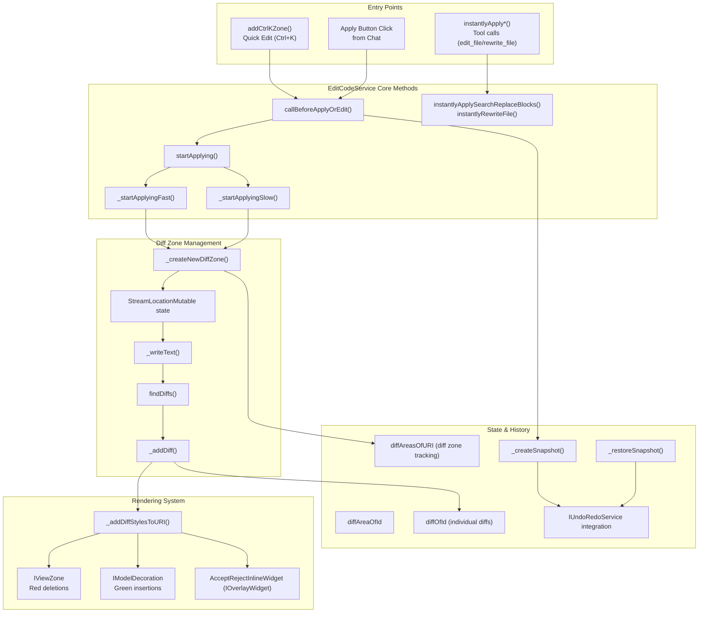

The service routes editing actions through pre-apply validation (`callBeforeApplyOrEdit`), then branches into Fast or Slow apply modes based on conflict resolution and parse success of search/replace blocks. Tool calls trigger instant applies directly.

Streaming API calls to the LLM progressively feed code text into diff zones. The `_writeText` method updates the text content, after which line diffs are computed via `findDiffs`. Diffs trigger updates to both the internal data structures and VS Code's rendering layers.

Undo/redo snapshots capture full file state before modifications and restore them on user demand.

Sources: [src/vs/workbench/contrib/void/browser/editCodeService.ts:157-1844](), [src/vs/workbench/contrib/void/browser/editCodeServiceInterface.ts:40-78]()

---

## Service Registration and Dependencies

`EditCodeService` is registered as a singleton provider and injected with numerous VS Code and Void-specific services:

| Service                         | Type                          | Purpose                                       |
|--------------------------------|-------------------------------|-----------------------------------------------|
| `ICodeEditorService`            | VS Code                       | Access to all editor instances                 |
| `IModelService`                 | VS Code                       | Track lifecycle and events of text models     |
| `IUndoRedoService`              | VS Code                       | Undo/redo stack management with custom edits  |
| `ILLMMessageService`            | Void                         | Interface for streaming LLM message content   |
| `IConsistentItemService`        | Void                         | Persistent UI decorations across editor splits|
| `IConsistentEditorItemService`  | Void                         | UI mounts for Ctrl+K zones                     |
| `IVoidModelService`             | Void                         | Safe model initialization wrapper             |
| `IConvertToLLMMessageService`  | Void                         | Convert internal messages to provider formats |
| `IInstantiationService`         | VS Code                       | Dependency injection for widgets               |
| `INotificationService`          | VS Code                       | User-facing notifications                      |
| `IVoidSettingsService`          | Void                         | Access to AI model selection and apply settings|

Sources: [src/vs/workbench/contrib/void/browser/editCodeService.ts:183-231](), [src/vs/workbench/contrib/void/browser/editCodeService.ts:2008-2009]()

---

## Core Data Structures

### DiffArea Hierarchy

`DiffArea` is the base type representing any tracked change area in a file. There are several subtypes:

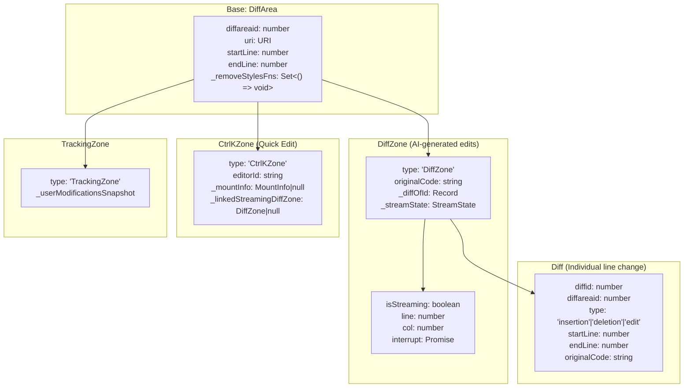

- **DiffZone** captures an active or completed AI-generated edit encompassing multiple diffs, with streaming progress and cancellation.
- **CtrlKZone** is the input area created when the user triggers quick edit (Ctrl+K), possibly linked to a streaming DiffZone showing real-time LLM output.
- **TrackingZone** can capture checkpoints for user modifications.
- Each `Diff` represents a single insertion, deletion, or combined edit, with precise line indexes and original content snapshots.

Sources: [src/vs/workbench/contrib/void/common/editCodeServiceTypes.ts:1-103]()

---

## Edit Apply Modes

### Entry Point Flow and Mode Selection

Entry points funnel into a common validation method that checks for conflicts with existing diff zones:

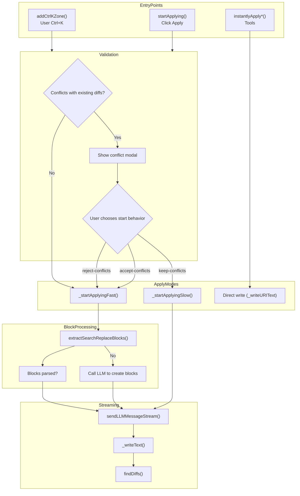

- Ctrl+K and Apply button calls pass through conflict checks that block overlapping edits.
- Fast Apply attempts to parse search-replace blocks from AI suggestions.
- If parsing fails, LLM is called to convert raw suggestions into proper blocks.
- Slow Apply streams a complete file rewrite.
- Tool calls directly apply edits immediately without UI intermediates.

Sources: [src/vs/workbench/contrib/void/browser/editCodeService.ts:652-1144]()

---

### Fast Apply Mode

Fast Apply manages incremental search/replace edits, updating diffs as the AI streams new content.

**Key Steps:**

1. **Parse blocks** with `extractSearchReplaceBlocks` parsing `<<<<<<< ORIGINAL...=======...>>>>>>> UPDATED` format.

2. **Locate** each `original` snippet in current file using `findTextInCode`:
   - Returns `[startLine, endLine]` if unique match found,
   - Otherwise, returns errors ('not found' or 'not unique').
   - Whitespace-stripped fallback for matching lines.

3. **Create DiffZone** anchored to located range with `_createNewDiffZone`.

4. **Stream replacement text** via `sendLLMMessageStream` with `searchReplaceGivenDescription_systemMessage`.

5. **On text receipt**, `_writeText(diffZone, fullText)` progressively updates content.

6. **Recompute diffs** in `_writeText` using `findDiffs(originalCode, newCode)`.

If parsing search/replace blocks fails initially, the system calls LLM with `createSearchReplaceBlocks_systemMessage` to get valid blocks before proceeding.

Sources: [src/vs/workbench/contrib/void/browser/editCodeService.ts:837-1015](), [src/vs/workbench/contrib/void/common/helpers/extractCodeFromResult.ts:103-207](), [src/vs/workbench/contrib/void/common/prompt/prompts.ts:60-125]()

---

### Slow Apply Mode

Slow Apply streams a full rewrite of the file, used when blocks cannot be reliably applied or user prefers to keep conflicting changes.

**Key steps:**

1. Create a DiffZone spanning the entire file ([line 1, last line]).

2. Send prompt using `rewriteCode_systemMessage` to instruct the LLM to generate new full file content.

3. Stream chunks via `sendLLMMessageStream`, calling `_writeText` to update zone content in real-time.

4. Each `_writeText` recomputes all diffs for the file versus original code.

5. Diffs replace previous ones by deleting old diffs within the zone and adding fresh diffs via `_addDiff`.

6. Final state marks streaming complete and triggers UI refresh.

Used when:
- Fast apply fails to locate blocks,
- User opts to keep conflicting diffs,
- Ambiguous or unparseable search-replace blocks.

Sources: [src/vs/workbench/contrib/void/browser/editCodeService.ts:1017-1144](), [src/vs/workbench/contrib/void/common/prompt/prompts.ts:601-632]()

---

### Instant Apply Mode

Instant apply is a non-interactive mode used by tools (`edit_file` and `rewrite_file`) invoked by the chat agent to immediately apply changes.

**Behavior:**

- No `DiffZone` or streaming state created.
- Parses search/replace blocks or replaces file content immediately.
- Calls `_writeURIText` to write all edits to the VS Code model atomically.
- Returns lint errors synchronously for reporting to tools.
- Used internally by the tools system but the user-facing chat UI can still re-apply with visual diffs.

**Main operations:**

- `instantlyApplySearchReplaceBlocks(params)` parses blocks, locates original snippets, and applies patches.
- `instantlyRewriteFile(params)` replaces complete file content.

If locate fails, the tool call stops with an error message so the chat agent can fallback.

Sources: [src/vs/workbench/contrib/void/browser/editCodeService.ts:1146-1254](), [src/vs/workbench/contrib/void/browser/toolsService.ts:296-360]()

---

## Diff Computation and Rendering

### Diff Computation: `findDiffs`

The line-based diff algorithm is based on Myers’ longest common subsequence and adapted from VS Code internal code.

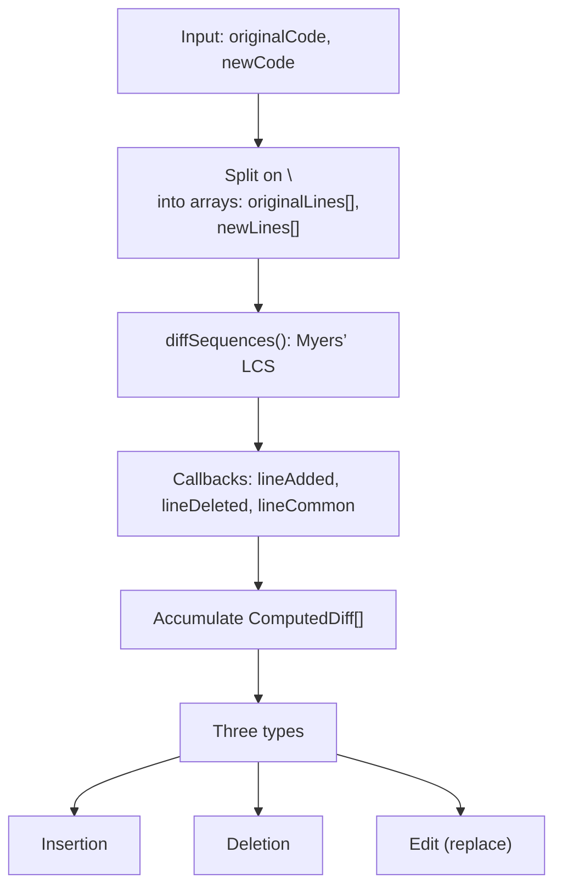

- Outputs an array of `ComputedDiff` objects with 1-indexed line ranges.
- Insertions represent lines only in new code (rendered green).
- Deletions represent lines only in original (rendered red).
- Edits represent replacements (combination of insertion and deletion).

Sources: [src/vs/workbench/contrib/void/browser/helpers/findDiffs.ts:1-183]()

---

### Rendering Pipeline

The service uses VS Code’s editor APIs to render diffs:

| Rendering Component           | VS Code API           | Purpose                                    |
|------------------------------|----------------------|--------------------------------------------|
| Green Insertion Highlight     | `IModelDecoration`   | Highlights lines inserted or edited (green background) |
| Red Deletion View Zone        | `IViewZone`          | Creates a red background for deleted lines in a separate view zone |
| Accept/Reject Inline Widget   | `IOverlayWidget`     | Shows inline buttons for user response on diffs |
| Sweep Line Decoration         | `IModelDecoration`   | Marks current line being streamed          |
| Minimap Gutter Markers        | `minimap` options    | Shows gutter markers for diffs' presence   |

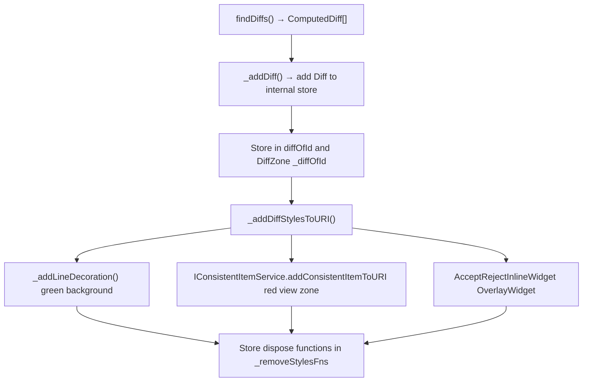

- Each `DiffArea` keeps a set of cleanup functions `_removeStylesFns` to dispose decorations when diffs are deleted or updated.

Sources: [src/vs/workbench/contrib/void/browser/editCodeService.ts:299-612](), [src/vs/workbench/contrib/void/browser/editCodeService.ts:2011-2127]()

---

## Snapshot and Undo System

### Snapshot Structure and Lifecycle

A snapshot records the complete state of one file, including all diff areas and their contained diffs, plus the full file text.

```mermaid
graph TB
    subgraph VoidFileSnapshot
      uri[uri: URI]
      fileText[fileText: string (full file contents)]
      numDiffZones[numDiffZones: number]
      diffAreaSnapshot["diffAreaSnapshotOfId: Record<string, DiffAreaSnapshotEntry>"]
    end
    
    subgraph DiffAreaSnapshotEntry
      startEnd["startLine, endLine"]
      type["type: 'DiffZone' | 'CtrlKZone' | 'TrackingZone'"]
      DZFields["For DiffZone: originalCode, diffOfIdSnapshot, streamStateSnapshot"]
      CKFields["For CtrlKZone: editorId, linkedDiffZoneId"]
    end
    
    VoidFileSnapshot --> diffAreaSnapshot
    diffAreaSnapshot --> startEnd
    diffAreaSnapshot --> type
    diffAreaSnapshot --> DZFields
    diffAreaSnapshot --> CKFields
```

- Created before any edit and after completion by `_createSnapshot()`.
- Wrapped into an `IUndoRedoElement` called `SnapshotElement` injected into `IUndoRedoService`.
- On undo/redo, the service calls `_restoreSnapshot()` to restore file contents and all diff/ctrlK zones.
- The restored state includes the streamed position and cancellations to resume interrupted edits.

### Undo/Redo Integration

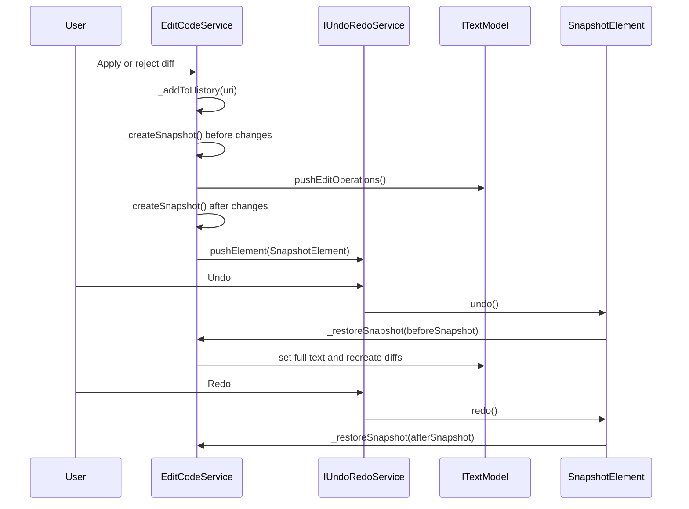

Sources: [src/vs/workbench/contrib/void/browser/editCodeService.ts:1554-1685]()

---

## Command Bar and Diff Navigation

The `VoidCommandBarService` manages a floating command bar UI overlay that enables:

- Navigating diffs and files with keyboard shortcuts (e.g., Alt+], Alt+[)
- Accepting/rejecting diffs at file or global scope
- Tracking streaming states for apply buttons

### State Model

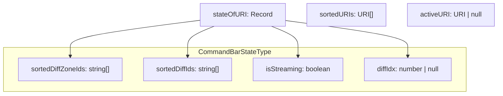

- The service listens to events from `EditCodeService` to update diff zone data and streaming status.
- Emits events for UI React hooks to consume and update button states.

Sources: [src/vs/workbench/contrib/void/browser/voidCommandBarService.ts:34-76]()

---

### State Computation Flow

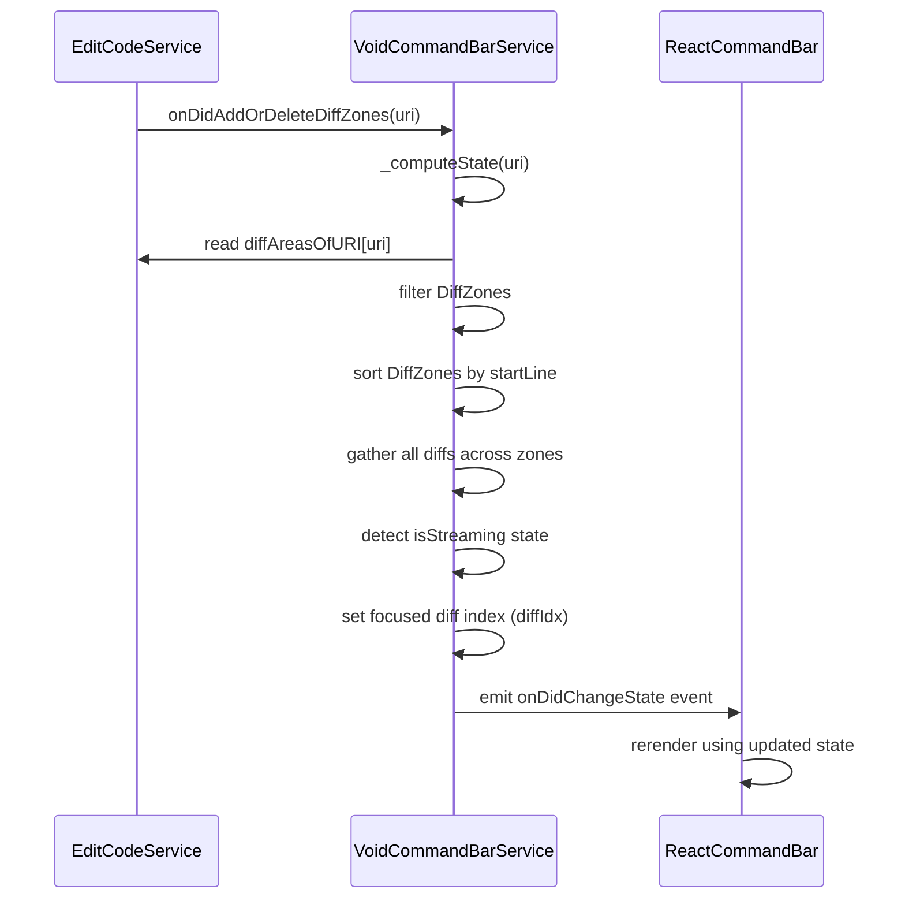

This flow ensures the command bar and UI components show consistent, navigable states of all diffs per file.

Sources: [src/vs/workbench/contrib/void/browser/voidCommandBarService.ts:128-274]()

---

## React UI Components and Streaming State

The service integrates with React UI components like `ApplyButtonsForEdit` and `StatusIndicatorForApplyButton`:

- Custom hook `useApplyStreamState` reads from `VoidCommandBarService` to determine streaming status (`idle-no-changes`, `streaming`, or `idle-has-changes`).
- `ApplyButtonsForEdit` components use this hook to display dynamic buttons and streaming indicators.
- Tool-driven edits show separate header buttons with accept/reject/undo, leveraging `AcceptRejectInlineWidget`.

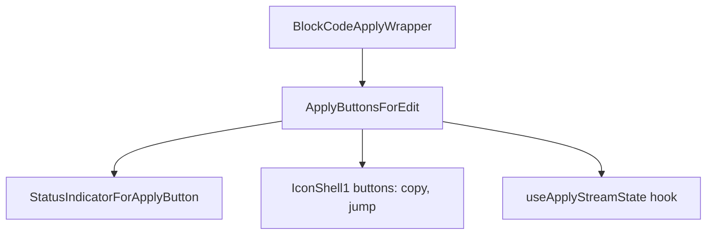

Sources: [src/vs/workbench/contrib/void/browser/react/src/markdown/ApplyBlockHoverButtons.tsx:73-424](), [src/vs/workbench/contrib/void/browser/react/src/markdown/ApplyBlockHoverButtons.tsx:134-239]() , [src/vs/workbench/contrib/void/browser/react/src/sidebar-tsx/SidebarChat.tsx:906-976]()

---

## Lifecycle and Events

### Model Initialization

When a text model is opened or added, `EditCodeService` initializes its state for that URI, sets up diff tracking, and listens to content changes.

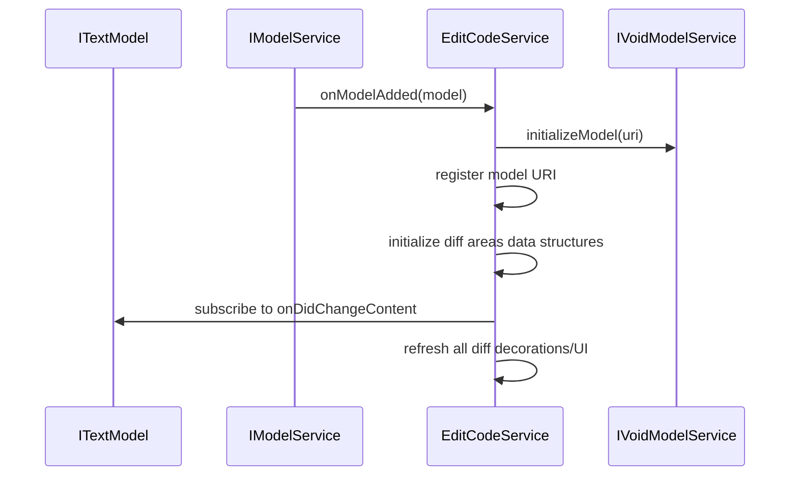

### Content Change Realignment

User edits trigger `_realignAllDiffAreasLines` to update positions of all affected diff zones and diffs.

- This maintains consistency of diff positions despite text insertions/deletions.
- After realignment, `_refreshStylesAndDiffsInURI` recomputes and redraws decorations.

```typescript
model.onDidChangeContent(e => {
  if (this.weAreWriting) return // skip self edits
  
  for (const change of e.changes) {
    this._realignAllDiffAreasLines(uri, change.text, change.range)
  }
  
  this._refreshStylesAndDiffsInURI(uri);
  
  // Remove empty diff zones after user edits
  for (const diffArea of emptyDiffZones) {
    this._deleteDiffZone(diffArea);
  }
})
```

### Event Emission

The service emits several events for other layers to react:

| Event Name                         | Trigger                                    | Listener Example             |
|-----------------------------------|--------------------------------------------|-----------------------------|
| `onDidAddOrDeleteDiffZones`       | Diff zones added or removed                 | CommandBarService            |
| `onDidChangeDiffsInDiffZoneNotStreaming` | Diffs recomputed after edits                 | VS Code React UI components  |
| `onDidChangeStreamingInDiffZone`  | Streaming state changes in diff zones       | Command bar, apply buttons   |
| `onDidChangeStreamingInCtrlKZone` | Streaming state in Ctrl+K quick edit zones  | Quick edit UI                |

Sources: [src/vs/workbench/contrib/void/browser/editCodeService.ts:166-180](), [src/vs/workbench/contrib/void/browser/editCodeService.ts:218-268]()

---

## Integration with Chat and Tools

### Tool Calls for Edits

When agents invoke tools with calls like `edit_file` or `rewrite_file`, the following flow occurs:

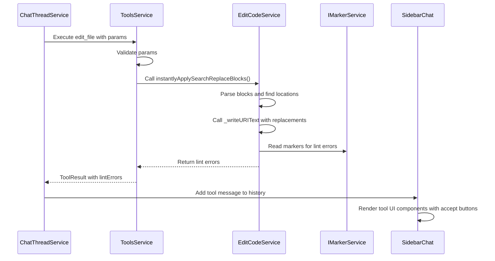

- Tool calls use instant apply mode with no UI feedback initially.
- The chat UI still provides an "Apply" button that triggers full fast/slow apply with streaming diffs.

Sources: [src/vs/workbench/contrib/void/browser/toolsService.ts:296-360](), [src/vs/workbench/contrib/void/browser/editCodeService.ts:1146-1254](), [src/vs/workbench/contrib/void/browser/react/src/sidebar-tsx/SidebarChat.tsx:906-976]()

---

### Apply from Chat Button

When a user clicks apply on a chat code suggestion:

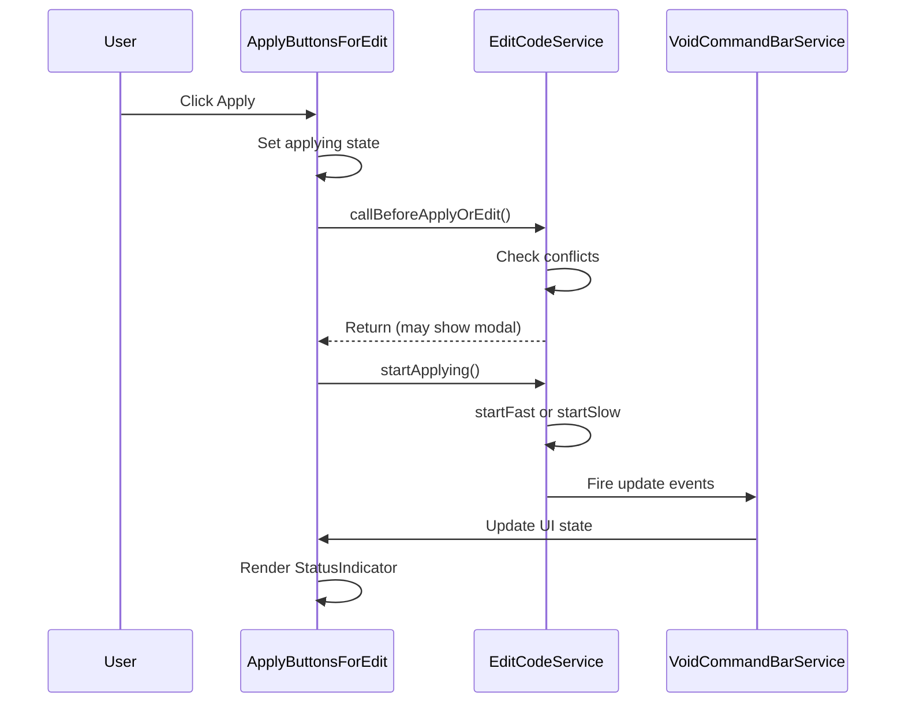

Sources: [src/vs/workbench/contrib/void/browser/react/src/markdown/ApplyBlockHoverButtons.tsx:318-424]()

---

## Summary Tables

### Key Classes and Interfaces

| Class/Interface              | Location                        | Line Range | Description                          |
|-----------------------------|--------------------------------|------------|------------------------------------|
| `EditCodeService`            | editCodeService.ts             | 157-1844   | Core service implementing IEditCodeService |
| `IEditCodeService`           | editCodeServiceInterface.ts     | 40-78      | Service interface definition         |
| `VoidCommandBarService`      | voidCommandBarService.ts         | 34-274     | Command bar for diff navigation and apply status |
| `IConsistentItemService`     | consistentItemService.ts          | 19-150     | UI persistence across editor splits  |
| `AcceptRejectInlineWidget`   | editCodeService.ts               | 2011-2127  | Inline accept/reject button widgets |
| `DiffZone` (type)            | editCodeServiceTypes.ts          | 12-31      | Streaming diff container             |
| `CtrlKZone` (type)           | editCodeServiceTypes.ts          | 33-48      | Quick edit input zone                |
| `TrackingZone` (type)        | editCodeServiceTypes.ts          | 50-54      | User checkpoint diff tracker        |
| `Diff` (type)                | editCodeServiceTypes.ts          | 56-67      | Individual atomic diff               |
| `VoidFileSnapshot` (type)    | editCodeServiceTypes.ts          | 69-74      | Snapshot for full undo/redo          |
| `findDiffs` (function)       | helpers/findDiffs.ts             | 1-183      | Line-diff computation                |

### Key Operations and Methods

| Operation                      | Location (Method / Line)        | Description                         |
|-------------------------------|--------------------------------|-----------------------------------|
| Fast Apply                    | `_startApplyingFast()` (837-1015) | Streaming search/replace blocks apply |
| Slow Apply                    | `_startApplyingSlow()` (1017-1144) | Streaming full file rewrite apply    |
| Instant Apply                | `instantlyApplySearchReplaceBlocks()` (1146-1230) | Immediate tool call application      |
| Instant Rewrite             | `instantlyRewriteFile()` (1232-1254) | Immediate full rewrite tool call      |
| Accept Diff                  | `acceptDiff()` (1256-1320)      | Accepts a single diff change         |
| Reject Diff                  | `rejectDiff()` (1321-1374)      | Rejects/discards a single diff       |
| Accept/Reject All            | `acceptOrRejectAllDiffAreas()` (1375-1388) | Accept or reject all diffs in file   |
| Create Snapshot             | `_createSnapshot()` (1590-1623) | Capture full file diff state         |
| Restore Snapshot            | `_restoreSnapshot()` (1625-1685) | Undo/redo restore of entire state   |

Sources: [src/vs/workbench/contrib/void/browser/editCodeService.ts:1-1844]()

---

This page documents the intricate role of `IEditCodeService` in Void as the pivotal engine managing AI-assisted code editing, diff computation, streaming real-time updates, rendering interactive UI overlays, and integrating with undo/redo and the command bar navigation. It provides both the technical foundation and developer insight needed to understand and extend the core code editing experience in Void.

# End of Section 3.2

Sources:  
- [src/vs/workbench/contrib/void/browser/editCodeService.ts:157-1844]()  
- [src/vs/workbench/contrib/void/browser/editCodeServiceInterface.ts:40-78]()  
- [src/vs/workbench/contrib/void/common/editCodeServiceTypes.ts:1-103]()  
- [src/vs/workbench/contrib/void/common/helpers/extractCodeFromResult.ts:103-207]()  
- [src/vs/workbench/contrib/void/common/prompt/prompts.ts:60-125]()  
- [src/vs/workbench/contrib/void/browser/helpers/findDiffs.ts:1-183]()  
- [src/vs/workbench/contrib/void/browser/voidCommandBarService.ts:34-274]()  
- [src/vs/workbench/contrib/void/browser/react/src/markdown/ApplyBlockHoverButtons.tsx:73-424]()  
- [src/vs/workbench/contrib/void/browser/toolsService.ts:296-360]()  
- [src/vs/workbench/contrib/void/browser/react/src/sidebar-tsx/SidebarChat.tsx:906-976]()