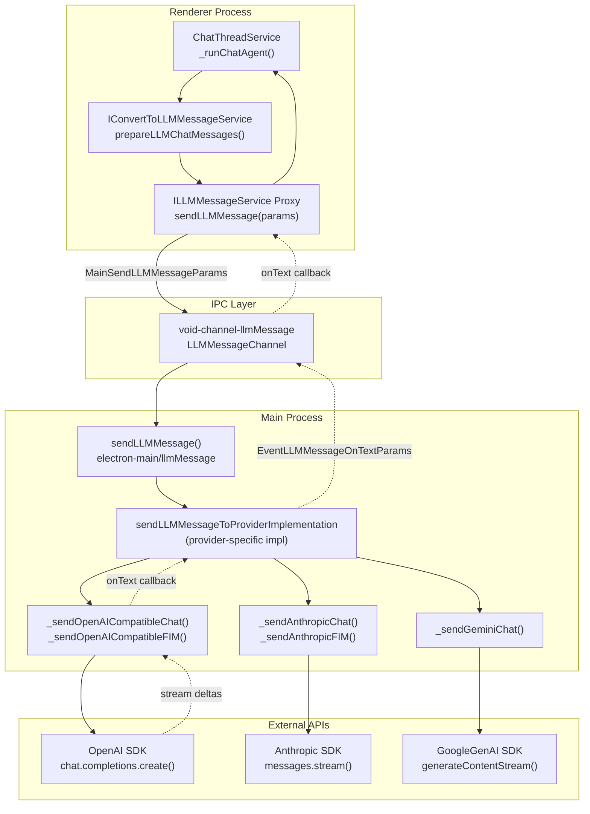
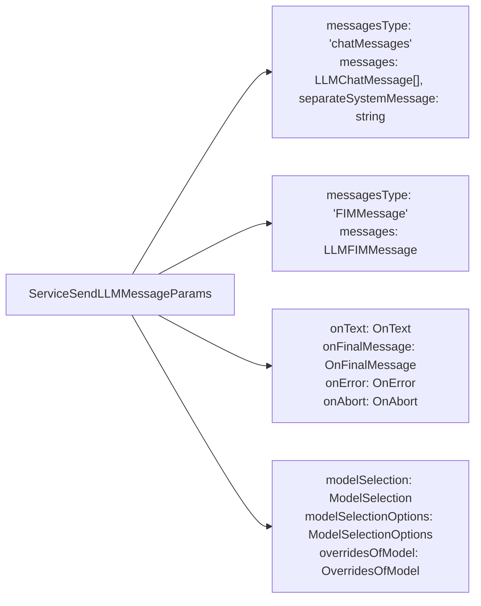
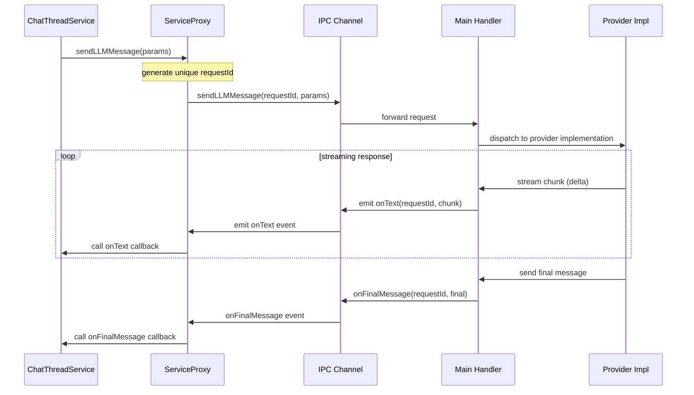
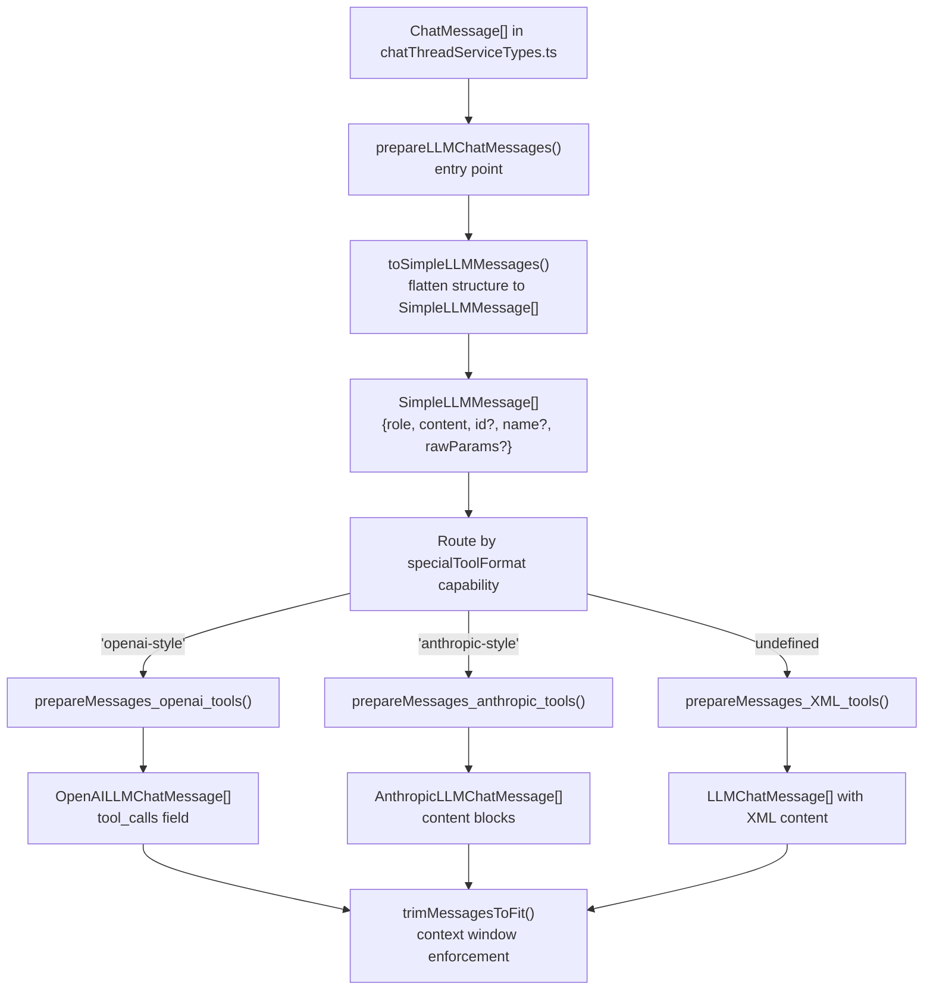
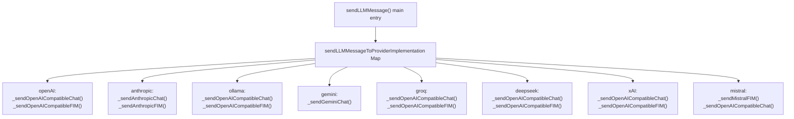
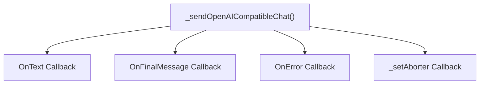
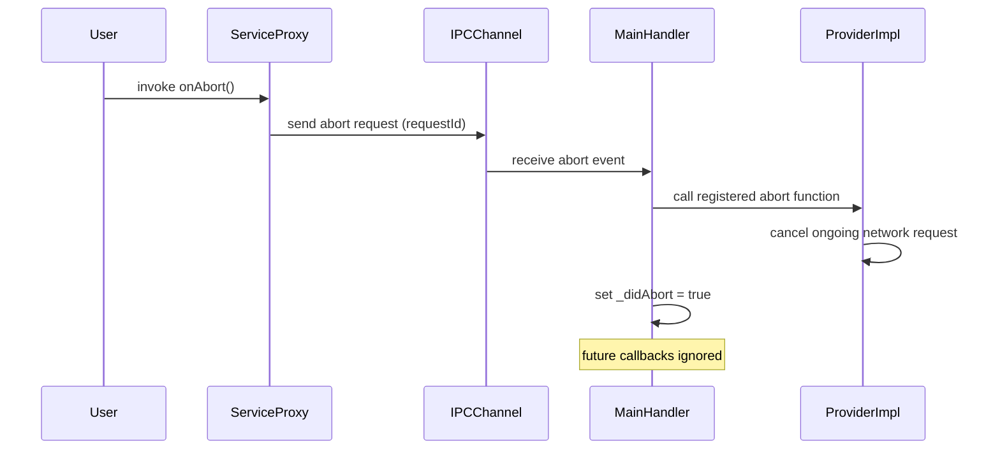
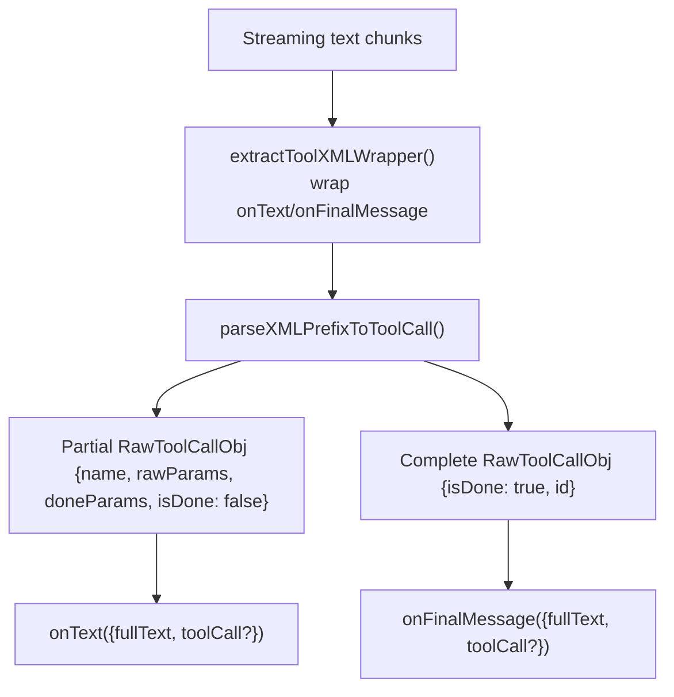
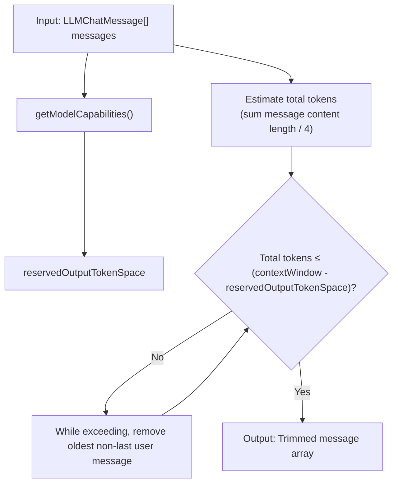
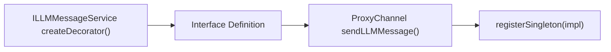

# LLM Message Service and Provider Abstraction

<details>
<summary>Relevant source files</summary>

The following files were used as context for generating this wiki page:

- [.voidrules](.voidrules)

</details>


## Purpose and Scope

This page documents the LLM Message Service in Void, which abstracts communication with various large language model (LLM) providers such as OpenAI, Anthropic, Ollama, Gemini, and others. It explains how Void implements an inter-process communication (IPC) based service layer (`sendLLMMessageService.ts` and `sendLLMMessageChannel.ts`) to handle LLM message sending, format conversion through the `IConvertToLLMMessageService` interface, and provider-specific dispatching. The goal of this service is to unify provider interactions behind a consistent API, support streaming responses, tool call handling, and enable integration from the renderer process to the main process.

For how chat threads interact with this service, see the [Chat Thread Service and Orchestration](#3.1) page. Model capability details are covered in [Model Capabilities and Configuration](#4.3).

---

## Architecture Overview

Void's LLM Message Service splits responsibilities between renderer and main Electron processes with IPC channels bridging them.



- In the renderer, chat threads prepare normalized chat messages via the `IConvertToLLMMessageService`.
- The `ILLMMessageService` interface is implemented by a Proxy which sends requests to the main process over an IPC channel titled `"void-channel-llmMessage"`.
- The main handler calls into provider-specific implementations (OpenAI, Anthropic, Gemini, etc.) that invoke third-party SDKs.
- Streaming and completion events propagate back from main to renderer via IPC events, invoking callbacks registered by the chat service.

**Sources:**  
[src/vs/workbench/contrib/void/electron-main/llmMessage/sendLLMMessage.ts:1-136](),  
[src/vs/workbench/contrib/void/electron-main/llmMessage/sendLLMMessage.impl.ts:1-967](),  
[src/vs/workbench/contrib/void/browser/chatThreadService.ts:732-854]()

---

## Service Interface

The core service interface `ILLMMessageService` exposes a single function: `sendLLMMessage()`. This function abstracts over message types and model selection, supporting both chat and fill-in-the-middle (FIM) style completions.

| Method           | Parameters                           | Returns         |
|------------------|------------------------------------|-----------------|
| `sendLLMMessage` | `ServiceSendLLMMessageParams`      | `Promise<void>` |

### Parameter Structure



- The `messagesType` discriminates one of two variants:
  - **Chat messages**: Array of `LLMChatMessage` — provider-specific chat message objects
  - **FIM messages**: A single FIM message with prefix and suffix for code completion context.

- Callbacks include streaming progress (`onText`), completion (`onFinalMessage`), error handling (`onError`), and abort notifications (`onAbort`).

**Sources:** [src/vs/workbench/contrib/void/common/sendLLMMessageTypes.ts:102-122]()

---

## Message Flow and IPC Communication

The IPC flow for an LLM message request and response streaming is:



### IPC Messages:

| Direction       | Message Type                   | Purpose                        |
|-----------------|-------------------------------|--------------------------------|
| Renderer → Main | `MainSendLLMMessageParams`    | Initial request with unique `requestId` |
| Main → Renderer | `EventLLMMessageOnTextParams` | Streamed incremental text chunks |
| Main → Renderer | `EventLLMMessageOnFinalMessageParams` | Final full message with metadata |
| Main → Renderer | `EventLLMMessageOnErrorParams` | Error details |
| Renderer → Main | `MainLLMMessageAbortParams`  | Abort request for specific `requestId` |

All streaming, final, and error events reference the requestId to correlate responses with requests.

**Sources:** [src/vs/workbench/contrib/void/common/sendLLMMessageTypes.ts:140-151]()

---

## Message Conversion Pipeline (`IConvertToLLMMessageService`)

Since different LLM providers expect messages in different formats, Void normalizes and converts internal chat messages (`ChatMessage[]`) into provider-specific variants.



### Conversion by Tool Format

| Provider(s)          | `specialToolFormat` | Conversion Function          | Tool Serialization Format                              |
|---------------------|---------------------|-----------------------------|--------------------------------------------------------|
| OpenAI, Groq, Deepseek | `'openai-style'`    | `prepareMessages_openai_tools()`   | `tool_calls` array, each with function call and args JSON |
| Anthropic            | `'anthropic-style'` | `prepareMessages_anthropic_tools()` | `content` block array with `type: 'tool_use'` objects |
| Gemini               | `'gemini-style'`    | Native Gemini format          | `functionCall` property with name, args                |
| Ollama, vLLM, others | `undefined`         | `prepareMessages_XML_tools()`       | XML embedded in content string                           |

### Conversion Highlights

- **OpenAI tools** use `tool_calls` arrays for function call information, with arguments JSON stringified.
- **Anthropic** encodes tool invocation as specialized content blocks with types like `tool_use` and `tool_result`.
- **XML snippet conversion** serializes tools to XML tags (e.g., `<toolName><param>value</param></toolName>`), allowing providers without native tool support to parse tool calls embedded within generated text.

For instance, `prepareMessages_openai_tools()` converts assistant messages with tool calls to:

```json
{
  "role": "assistant",
  "tool_calls": [
    {
      "type": "function",
      "function": {
        "name": "read_file",
        "arguments": "{\"uri\": \"/path/to/file\"}"
      },
      "id": "toolcall123"
    }
  ]
}
```

**Sources:** [src/vs/workbench/contrib/void/browser/convertToLLMMessageService.ts:72-105](),  
[src/vs/workbench/contrib/void/browser/convertToLLMMessageService.ts:141-196](),  
[src/vs/workbench/contrib/void/browser/convertToLLMMessageService.ts:199-239](),  
[src/vs/workbench/contrib/void/common/modelCapabilities.ts:169-171]()

---

## Provider Implementation Dispatch

The main process contains a routing map `sendLLMMessageToProviderImplementation` that dispatches LLM message requests to the appropriate function based on the configured provider name.



- Most providers share OpenAI-compatible implementations for chat and FIM messaging via `_sendOpenAICompatibleChat` and `_sendOpenAICompatibleFIM`.
- Anthropic and Gemini have custom tailored code due to SDK differences.
- Mistral supports a special FIM function.

The dispatch implementations take parameters combining common callback registration, model and provider selection, and messages to send.

**Sources:** [src/vs/workbench/contrib/void/electron-main/llmMessage/sendLLMMessage.impl.ts:35-172]()

---

## Streaming and Callbacks

The service leverages callback-driven streaming for efficient UX.

### Callback Types

| Callback          | Invoked When         | Parameters                                          |
|-------------------|----------------------|--------------------------------------------------|
| `OnText`          | Each streaming chunk | `{fullText: string, fullReasoning: string, toolCall?: RawToolCallObj}` |
| `OnFinalMessage`  | Completion           | `{fullText: string, fullReasoning: string, toolCall?: RawToolCallObj, anthropicReasoning: AnthropicReasoning[] | null}` |
| `OnError`         | Error encountered    | `{message: string, fullError: Error | null}`      |
| `_setAborter`     | Provider ready with abort handler | `(fn: () => void) => void`                    |



### Wrapping Callbacks

The main send function wraps callbacks to:

- Prevent firing after abort
- Capture telemetry metrics such as response length and time
- Log errors consistently

Pseudocode snippet for `onText` and `onFinalMessage` wrapping:

```typescript
let _didAbort = false;
let _fullTextSoFar = '';

const onText: OnText = params => {
  if (_didAbort) return;
  onText_(params);
  _fullTextSoFar = params.fullText;
};

const onFinalMessage: OnFinalMessage = params => {
  if (_didAbort) return;
  captureLLMEvent('LLM Response', {responseLength: params.fullText.length});
  onFinalMessage_(params);
};
```

### Streaming Examples

- **OpenAI-compatible streaming:** Uses SDK streaming iterator, accumulating deltas and tool calls, invoking `onText` with each partial update.

- **Anthropic streaming:** Uses event emitter to handle textual snapshot and specialized content blocks for reasoning, updating callbacks accordingly.

**Sources:** [src/vs/workbench/contrib/void/electron-main/llmMessage/sendLLMMessage.ts:55-85](), [src/vs/workbench/contrib/void/electron-main/llmMessage/sendLLMMessage.impl.ts:273-449](), [src/vs/workbench/contrib/void/electron-main/llmMessage/sendLLMMessage.impl.ts:643-795]()

---

## Error Handling and Abort Mechanism

### Abort Flow

The service supports cancellation via an abort callback. The flow is:



- The abort function is fire-and-forget, meaning no success confirmation.
- All streaming callbacks check `_didAbort` before invoking.
- Provider implementations expose cancel functions via `_setAborter`.

### Error Types and Handling

- Network failures with error messages enhanced to include endpoint information.
- Invalid provider names or unsupported features (e.g., FIM not supported by some providers) cause error callbacks.
- Parsing errors in tool messages do not fail whole requests but continue with partial data.

**Sources:** [src/vs/workbench/contrib/void/electron-main/llmMessage/sendLLMMessage.ts:78-93]()

---

## Tool Calling Support and Streaming Tool Extraction

For LLMs without native tool calling support, Void embeds tool call information via XML in the message stream and extracts it incrementally.



### RawToolCallObj Structure

```typescript
type RawToolCallObj = {
  name: ToolName;
  rawParams: Record<string, string>;
  doneParams: string[];
  id: string;           // UUID assigned when complete
  isDone: boolean;
};
```

### Parsing State Transitions

| Current State    | New Text              | Action                         | New State                          |
|------------------|-----------------------|--------------------------------|----------------------------------|
| No tool          | `<tool_name>`         | Create partial tool            | Tool with name, empty params, not done |
| Partial tool     | `<param>value</param>`| Add parameter                 | Update `rawParams`, `doneParams`    |
| Partial tool     | `</tool_name>`        | Mark tool done, assign id     | Tool complete, isDone = true        |

### Native Tool Calls

- **OpenAI**: Streaming deltas include `tool_calls` with function name and JSON-encoded args.
- **Anthropic**: Special content blocks with type `tool_use` in the stream are converted to `RawToolCallObj`.

Helper functions parse these streams into consistent `RawToolCallObj`.

### Key Parsing Functions

| Function                   | Location                      | Purpose                             |
|----------------------------|-------------------------------|-------------------------------------|
| `extractToolXMLWrapper()`  | extractGrammar.ts:145-260      | Wraps callbacks, parses XML tool tags live |
| `parseXMLPrefixToToolCall()` | extractGrammar.ts:70-143       | Parses XML chunk prefix into tool state |
| `rawToolCallObjOfParamsStr()` | sendLLMMessage.impl.ts:246-256 | Converts OpenAI tool call to `RawToolCallObj` |
| `rawToolCallObjOfAnthropicParams()` | sendLLMMessage.impl.ts:259-268 | Converts Anthropic block to `RawToolCallObj` |

**Sources:** [src/vs/workbench/contrib/void/electron-main/llmMessage/extractGrammar.ts:62-260](), [src/vs/workbench/contrib/void/electron-main/llmMessage/sendLLMMessage.impl.ts:246-268](), [src/vs/workbench/contrib/void/common/sendLLMMessageTypes.ts:84-90]()

---

## Context Window Management: Message Trimming

To ensure messages fit in model context windows, Void implements a trimming algorithm in `trimMessagesToFit()`.



### Algorithm Details

- Uses a conservative token estimate: 4 characters per token.
- Preserves:
  - The last user message (most relevant for context)
  - The system message if separate
  - Recent assistant messages as allowed by token budget
- Respects reasoning mode reserved tokens if enabled, via `getReservedOutputTokenSpace()`.

### Constants Used

| Constant       | Value | Description                      |
|----------------|-------|---------------------------------|
| `CHARS_PER_TOKEN` | 4     | Conservative character-to-token ratio |
| `TRIM_TO_LEN`  | 120   | Display length limit for trimmed content |

### Model Capability Context Limits Example

```typescript
{
  contextWindow: 200_000,
  reservedOutputTokenSpace: 8192,
  reasoningCapabilities: {
    reasoningReservedOutputTokenSpace: 8192,
    // ...
  }
}
```

**Sources:** [src/vs/workbench/contrib/void/browser/convertToLLMMessageService.ts:23-46](), [src/vs/workbench/contrib/void/browser/convertToLLMMessageService.ts:244-331](), [src/vs/workbench/contrib/void/common/modelCapabilities.ts:163-192]()

---

## Service Registration and Proxy Channel

Void registers the `ILLMMessageService` as a singleton service using VS Code’s dependency injection pattern, implemented with an IPC proxy on the renderer side and real implementation on the main side.



- Renderer code calls `ILLMMessageService.sendLLMMessage()` which uses the IPC proxy channel to send requests.
- Main process registers and runs the actual `sendLLMMessage()` implementation taking requests, dispatching to providers.

**Sources:** [src/vs/workbench/contrib/void/common/sendLLMMessageTypes.ts:1-215]()

---

## Key Code Entities Summary

| Entity/Function                   | Location                                             | Purpose                                                   |
|---------------------------------|-----------------------------------------------------|-----------------------------------------------------------|
| `ILLMMessageService`             | Common interfaces                                   | Service interface to send LLM messages                    |
| `sendLLMMessage()`               | electron-main/llmMessage/sendLLMMessage.ts          | Main dispatch function invoking provider implementations   |
| `sendLLMMessageToProviderImplementation` | electron-main/llmMessage/sendLLMMessage.impl.ts           | Map of provider names to implementations                   |
| `prepareLLMChatMessages()`       | browser/convertToLLMMessageService.ts               | Converts internal chat messages to provider-specific format |
| `prepareMessages_openai_tools()` | browser/convertToLLMMessageService.ts               | Converts messages to OpenAI tool call format               |
| `prepareMessages_anthropic_tools()` | browser/convertToLLMMessageService.ts               | Converts to Anthropic tool call format                      |
| `prepareMessages_XML_tools()`    | browser/convertToLLMMessageService.ts               | Converts tool calls to XML embedding                        |
| `extractToolXMLWrapper()`        | electron-main/llmMessage/extractGrammar.ts          | Wraps onText callbacks for XML tool call extraction        |
| `parseXMLPrefixToToolCall()`    | electron-main/llmMessage/extractGrammar.ts          | Parses XML content prefix to partial tool state            |
| `rawToolCallObjOfParamsStr()`   | electron-main/llmMessage/sendLLMMessage.impl.ts     | Converts OpenAI tool call params string to RawToolCallObj  |
| `rawToolCallObjOfAnthropicParams()` | electron-main/llmMessage/sendLLMMessage.impl.ts     | Converts Anthropic content block to RawToolCallObj         |

**Sources:**  
[src/vs/workbench/contrib/void/common/sendLLMMessageTypes.ts:1-215](),  
[src/vs/workbench/contrib/void/electron-main/llmMessage/sendLLMMessage.ts:1-136](),  
[src/vs/workbench/contrib/void/browser/convertToLLMMessageService.ts:1-663](),  
[src/vs/workbench/contrib/void/electron-main/llmMessage/sendLLMMessage.impl.ts:1-967](),  
[src/vs/workbench/contrib/void/electron-main/llmMessage/extractGrammar.ts:62-260]()

---

This page has fully detailed the design, key functions, data flow, and IPC mechanism behind Void’s LLM Message Service and provider abstraction layer, bridging natural language interactions in the UI to LLM provider calls in the main process with streaming, tool handling, and format conversion.