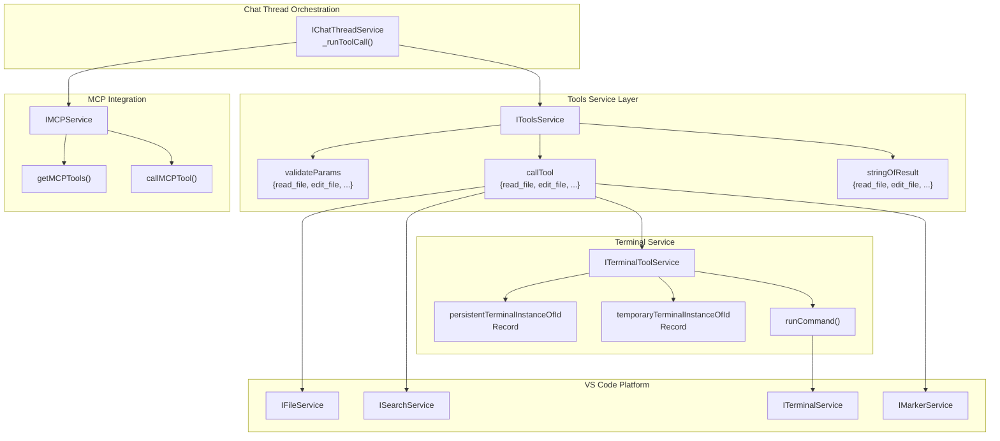
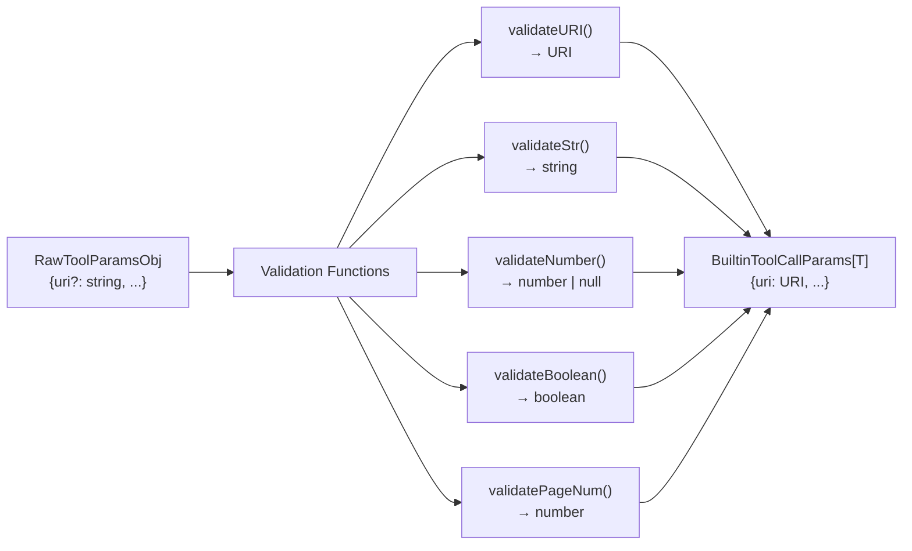
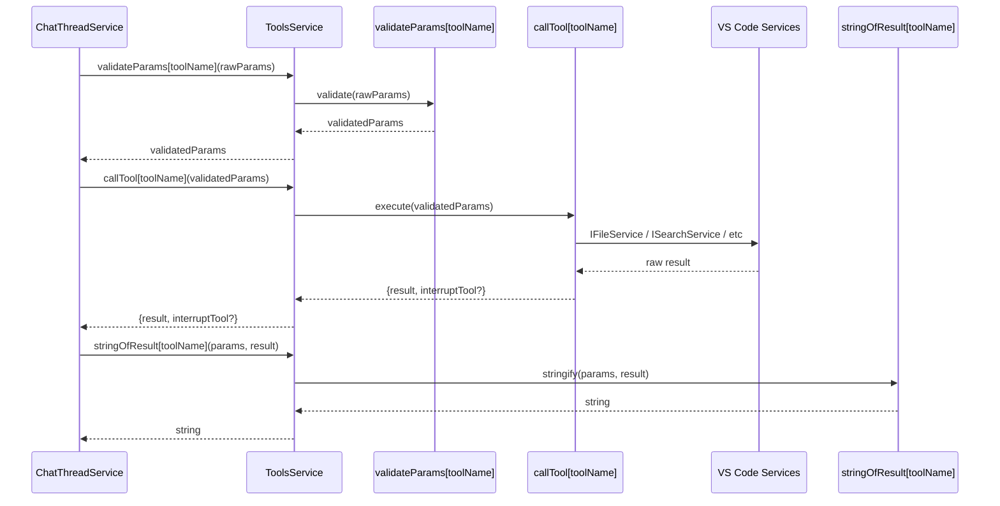
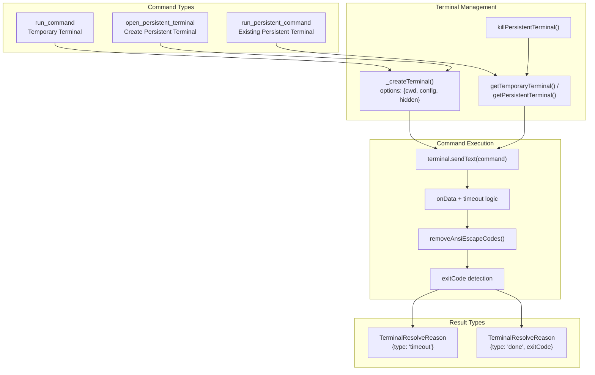
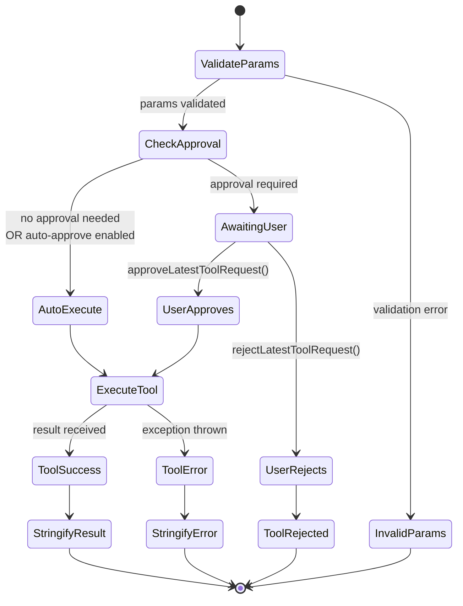
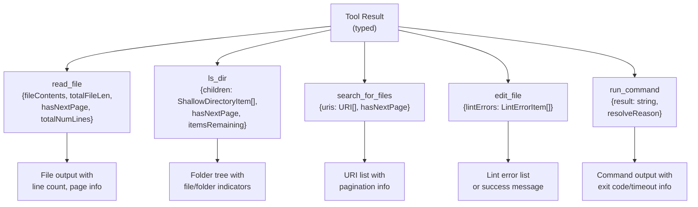
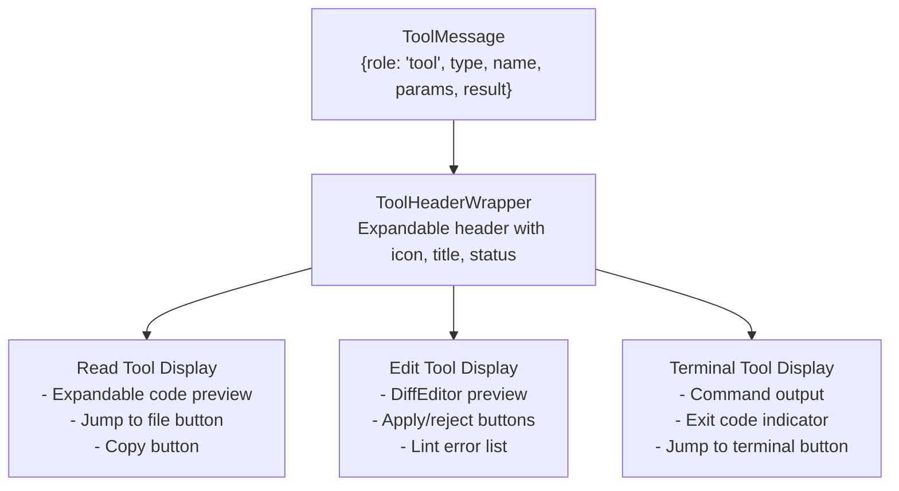
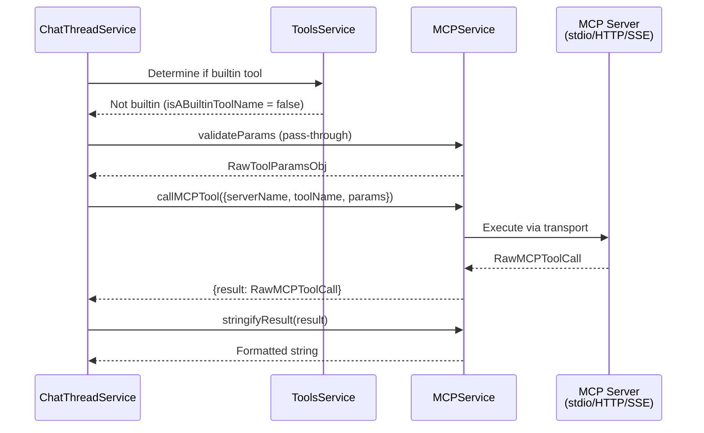

# Tools Service and Terminal Integration

<details>
<summary>Relevant source files</summary>

The following files were used as context for generating this wiki page:

- [.voidrules](.voidrules)

</details>


This document covers the tools system in Void, which enables AI agents to interact with the codebase through built-in tools (file operations, search, terminal commands) and external MCP (Model Context Protocol) servers. The system handles tool validation, execution, approval workflows, and terminal management.

For information about how tools are orchestrated within chat conversations, see [Chat Thread Service and Orchestration](#3.1). For MCP-specific implementation details, see [Model Context Protocol (MCP) Service](#3.6).

---

## Overview

The tools system provides two categories of capabilities:

**Built-in Tools**: Native operations implemented directly in Void:
- **Context gathering**: `read_file`, `ls_dir`, `get_dir_tree`, `search_pathnames_only`, `search_for_files`, `search_in_file`, `read_lint_errors`
- **File editing**: `create_file_or_folder`, `delete_file_or_folder`, `edit_file`, `rewrite_file`
- **Terminal operations**: `run_command`, `open_persistent_terminal`, `run_persistent_command`, `kill_persistent_terminal`

**MCP Tools**: External tools provided by MCP servers that extend Void's capabilities beyond built-in operations.

The system enforces approval policies for destructive operations (edits, terminal commands) and provides structured result formatting for LLM consumption.

Sources: [src/vs/workbench/contrib/void/browser/toolsService.ts:1-500](), [src/vs/workbench/contrib/void/common/prompt/prompts.ts:186-346](), [src/vs/workbench/contrib/void/common/toolsServiceTypes.ts:1-97]()

---

## Architecture Overview



**Architecture: Tools Service Component Relationships**

The tools system follows a three-phase pattern: validation → execution → stringification. `ChatThreadService` orchestrates tool calls by invoking `IToolsService` for built-in tools or `IMCPService` for MCP tools. Built-in tools are validated through type-safe parameter validators, executed via VS Code platform services, and their results are stringified for LLM consumption.

Sources: [src/vs/workbench/contrib/void/browser/toolsService.ts:127-156](), [src/vs/workbench/contrib/void/browser/chatThreadService.ts:605-727]()

---

## Built-in Tools Implementation

### Tool Service Interface

The `IToolsService` interface defines three core operations for each built-in tool:

| Operation | Type | Purpose |
|-----------|------|---------|
| `validateParams` | `ValidateBuiltinParams` | Validates and transforms raw LLM parameters into typed parameters |
| `callTool` | `CallBuiltinTool` | Executes the tool with validated parameters, returns result and optional interruptor |
| `stringOfResult` | `BuiltinToolResultToString` | Converts typed result into string format for LLM |

These operations are implemented as discriminated unions indexed by tool name, ensuring type safety across the validation → execution → stringification pipeline.

Sources: [src/vs/workbench/contrib/void/browser/toolsService.ts:127-143]()

### Parameter Validation



**Diagram: Parameter Validation Pipeline**

The validation layer transforms untyped LLM output into strongly-typed parameters. Key validators:

- **`validateURI()`**: Handles both local file paths (`/home/user/file.txt`) and remote URIs (`vscode-remote://ssh-remote+server/path`) by detecting the `://` scheme pattern [src/vs/workbench/contrib/void/browser/toolsService.ts:42-68]()
- **`validateStr()`**: Ensures non-null string values with error messages [src/vs/workbench/contrib/void/browser/toolsService.ts:34-38]()
- **`validateNumber()`**: Parses string or number inputs with fallback defaults [src/vs/workbench/contrib/void/browser/toolsService.ts:89-101]()
- **`validatePageNum()`**: Enforces integer page numbers ≥ 1 [src/vs/workbench/contrib/void/browser/toolsService.ts:81-87]()

Sources: [src/vs/workbench/contrib/void/browser/toolsService.ts:30-119]()

### Tool Execution Flow



**Sequence: Tool Execution Phases**

The execution flow separates concerns:
1. **Validation**: Throws on invalid parameters before execution begins
2. **Execution**: Returns Promise of result plus optional interrupt function for cancellation
3. **Stringification**: Formats results for LLM consumption, handling pagination and truncation

Sources: [src/vs/workbench/contrib/void/browser/chatThreadService.ts:622-727](), [src/vs/workbench/contrib/void/browser/toolsService.ts:296-593]()

---

## Terminal Integration

### Terminal Types

Void manages two distinct terminal types:

| Type | Lifetime | Visibility | Use Case | Implementation |
|------|----------|------------|----------|----------------|
| **Persistent** | User-controlled | Visible in panel | Long-running processes (dev servers) | `persistentTerminalInstanceOfId` |
| **Temporary** | Single command | Hidden | One-off commands | `temporaryTerminalInstanceOfId` |

Persistent terminals are named `"Void Agent"` or `"Void Agent (N)"` and remain open until explicitly killed. Temporary terminals auto-dispose after command completion.

Sources: [src/vs/workbench/contrib/void/browser/terminalToolService.ts:55-72](), [src/vs/workbench/contrib/void/browser/terminalToolService.ts:165-263]()

### Terminal Command Execution



**Diagram: Terminal Command Execution Flow**

Terminal command execution follows these steps:

1. **Terminal Acquisition**: Temporary commands create hidden terminals; persistent commands use existing terminals by ID
2. **Command Transmission**: `terminal.sendText(command, { shouldExecute: true })` sends command [src/vs/workbench/contrib/void/browser/terminalToolService.ts:266-301]()
3. **Output Capture**: Listens to `terminal.onData()` events, accumulating output with ANSI escape code removal [src/vs/workbench/contrib/void/browser/terminalToolService.ts:302-350]()
4. **Completion Detection**: 
   - **Timeout path**: Resolves after `MAX_TERMINAL_INACTIVE_TIME` (8 seconds) of no output [src/vs/workbench/contrib/void/common/prompt/prompts.ts:30]()
   - **Done path**: Detects completion marker from shell integration [src/vs/workbench/contrib/void/browser/terminalToolService.ts:334-339]()
5. **Result Truncation**: Limits output to `MAX_TERMINAL_CHARS` (100,000 characters) [src/vs/workbench/contrib/void/common/prompt/prompts.ts:29]()

Sources: [src/vs/workbench/contrib/void/browser/terminalToolService.ts:265-388]()

### Terminal Tool Definitions

```typescript
// Tool definitions from prompts.ts
run_command: {
  name: 'run_command',
  description: 'Runs a terminal command and waits for result (times out after 8s)',
  params: {
    command: { description: 'The terminal command to run.' },
    cwd: { description: 'Optional. The directory in which to run.' },
  }
}

run_persistent_command: {
  name: 'run_persistent_command',
  description: 'Runs command in persistent terminal (returns after 5s, continues in background)',
  params: {
    command: { description: 'The terminal command to run.' },
    persistent_terminal_id: { description: 'The ID from open_persistent_terminal.' }
  }
}

open_persistent_terminal: {
  name: 'open_persistent_terminal',
  description: 'Opens terminal for indefinite processes like dev servers',
  params: {
    cwd: { description: 'Optional. The directory for the terminal.' }
  }
}
```

Sources: [src/vs/workbench/contrib/void/common/prompt/prompts.ts:306-332]()

---

## Tool Approval System

### Approval Types

The approval system categorizes tools by their potential impact:

| Approval Type | Tools | Default Behavior | Purpose |
|---------------|-------|------------------|---------|
| **None** (auto-execute) | `read_file`, `ls_dir`, `search_*`, `read_lint_errors` | Always executes | Read-only operations |
| **`'edits'`** | `create_file_or_folder`, `delete_file_or_folder`, `edit_file`, `rewrite_file` | Requires approval | Destructive file operations |
| **`'terminal'`** | `run_command`, `run_persistent_command`, `open_persistent_terminal`, `kill_persistent_terminal` | Requires approval | Shell command execution |
| **`'MCP tools'`** | All MCP tools | Requires approval | External tool execution |

Users can configure auto-approval per category in settings: `globalSettings.autoApprove[approvalType]`

Sources: [src/vs/workbench/contrib/void/common/toolsServiceTypes.ts:21-39](), [src/vs/workbench/contrib/void/browser/chatThreadService.ts:640-652]()

### Approval Flow



**State Machine: Tool Approval and Execution**

The approval flow is managed in `ChatThreadService._runToolCall()`:

1. **Validation Phase**: Parameters validated, throws on error [src/vs/workbench/contrib/void/browser/chatThreadService.ts:623-637]()
2. **Checkpoint Phase**: For edit tools, creates checkpoint before execution [src/vs/workbench/contrib/void/browser/chatThreadService.ts:639-640]()
3. **Approval Check**: 
   - Determines `approvalType` from `approvalTypeOfBuiltinToolName` [src/vs/workbench/contrib/void/browser/chatThreadService.ts:644]()
   - Checks `autoApprove[approvalType]` setting [src/vs/workbench/contrib/void/browser/chatThreadService.ts:646]()
   - If not auto-approved, adds `tool_request` message and returns `{awaitingUserApproval: true}` [src/vs/workbench/contrib/void/browser/chatThreadService.ts:648-651]()
4. **Execution Phase**: Validated and approved tools execute with interrupt support [src/vs/workbench/contrib/void/browser/chatThreadService.ts:663-696]()

Sources: [src/vs/workbench/contrib/void/browser/chatThreadService.ts:605-727]()

---

## Tool Result Formatting

### Pagination System

Many tools support pagination to handle large result sets:

```typescript
// Pagination parameters (consistent across tools)
page_number: { description: 'Optional. The page number of the result. Default is 1.' }

// Result format includes pagination metadata
type PaginatedResult = {
  data: T[],
  hasNextPage: boolean,
  hasPrevPage?: boolean,
  itemsRemaining?: number
}
```

**Paginated Tools**:
- **`read_file`**: `MAX_FILE_CHARS_PAGE` = 500,000 chars per page [src/vs/workbench/contrib/void/common/prompt/prompts.ts:25]()
- **`ls_dir`**: `MAX_CHILDREN_URIs_PAGE` = 500 items per page [src/vs/workbench/contrib/void/common/prompt/prompts.ts:26]()
- **`search_pathnames_only`**, **`search_for_files`**: Paginate search results

Sources: [src/vs/workbench/contrib/void/common/prompt/prompts.ts:19-26](), [src/vs/workbench/contrib/void/browser/toolsService.ts:296-450]()

### Result String Formatting



**Diagram: Result Stringification by Tool Type**

The `stringOfResult` functions format typed results for LLM consumption:

**File Operations**:
- `read_file`: Includes line numbers, file length, and pagination indicators [src/vs/workbench/contrib/void/browser/toolsService.ts:593]()
- `ls_dir`: Formats as tree with `📁` (folders) and `📄` (files) indicators [src/vs/workbench/contrib/void/browser/toolsService.ts:593]()
- `search_pathnames_only` / `search_for_files`: Lists matching URIs with relative paths [src/vs/workbench/contrib/void/browser/toolsService.ts:593]()

**Edit Operations**:
- `edit_file` / `rewrite_file`: Returns lint errors if present, else success message [src/vs/workbench/contrib/void/browser/toolsService.ts:593]()

**Terminal Operations**:
- `run_command`: Includes output, exit code, and resolve reason (timeout/done) [src/vs/workbench/contrib/void/browser/toolsService.ts:593]()

Sources: [src/vs/workbench/contrib/void/browser/toolsService.ts:593]()

---

## Tool Result UI Display

### Tool Message Components

The UI renders tool results in the chat sidebar using specialized React components:



**Diagram: Tool Result UI Component Hierarchy**

Tool results are displayed in `SidebarChat.tsx` using a discriminated union pattern:

**Read Tools** (`read_file`, `ls_dir`, `search_*`):
- Collapsible code blocks with syntax highlighting [src/vs/workbench/contrib/void/browser/react/src/sidebar-tsx/SidebarChat.tsx:1261-1358]()
- "Jump to file" button for opening referenced files
- Copy buttons for code snippets

**Edit Tools** (`edit_file`, `rewrite_file`):
- Inline diff editor showing original → modified changes [src/vs/workbench/contrib/void/browser/react/src/sidebar-tsx/SidebarChat.tsx:906-976]()
- Apply/reject buttons with streaming state indicators
- Lint error display if validation fails [src/vs/workbench/contrib/void/browser/react/src/sidebar-tsx/SidebarChat.tsx:958-963]()

**Terminal Tools** (`run_command`, etc):
- Command string with shell icon
- Output display with ANSI code handling
- Exit code or timeout indicator [src/vs/workbench/contrib/void/browser/react/src/sidebar-tsx/SidebarChat.tsx:1359-1450]()

Sources: [src/vs/workbench/contrib/void/browser/react/src/sidebar-tsx/SidebarChat.tsx:906-1450]()

### Tool Status Indicators

```typescript
// Tool message types indicate execution state
type ToolMessage = 
  | {type: 'invalid_params', result: null}       // Validation failed
  | {type: 'tool_request', result: null}         // Awaiting approval
  | {type: 'running_now', result: null}          // Currently executing
  | {type: 'tool_error', result: string}         // Execution failed
  | {type: 'success', result: ToolResult}        // Completed successfully
  | {type: 'rejected', result: null}             // User rejected
```

UI indicators:
- **⚠️ Alert triangle**: Error state
- **🚫 Ban icon**: Rejected by user
- **⏳ Loading spinner**: Running now
- **✅ Success state**: Completed successfully

Sources: [src/vs/workbench/contrib/void/common/chatThreadServiceTypes.ts:11-28](), [src/vs/workbench/contrib/void/browser/react/src/sidebar-tsx/SidebarChat.tsx:781-902]()

---

## MCP Tool Integration

### MCP Tool Flow



**Sequence: MCP Tool Execution vs Built-in Tools**

MCP tools bypass the `ToolsService` validation/execution pipeline:

1. **Tool Detection**: `isABuiltinToolName()` determines routing [src/vs/workbench/contrib/void/common/prompt/prompts.ts:352-355]()
2. **Parameter Handling**: MCP tools receive raw parameters without validation [src/vs/workbench/contrib/void/browser/chatThreadService.ts:629-630]()
3. **Execution**: `IMCPService.callMCPTool()` handles transport-specific communication [src/vs/workbench/contrib/void/browser/chatThreadService.ts:691-695]()
4. **Result Formatting**: `stringifyResult()` handles text, images, and embedded resources [src/vs/workbench/contrib/void/browser/toolsService.ts:593]()

MCP tools automatically require approval (classified as `'MCP tools'` approval type).

Sources: [src/vs/workbench/contrib/void/browser/chatThreadService.ts:619-726](), [src/vs/workbench/contrib/void/browser/toolsService.ts:593]()

### Tool Definition Format

Tools are defined using a unified format for both built-in and MCP tools:

```typescript
type InternalToolInfo = {
  name: string,
  description: string,
  params: {
    [paramName: string]: { description: string }
  },
  mcpServerName?: string  // Only for MCP tools
}

// Built-in tool example
const read_file: InternalToolInfo = {
  name: 'read_file',
  description: 'Returns full contents of a given file.',
  params: {
    uri: { description: 'The FULL path to the file.' },
    start_line: { description: 'Optional. Defaults to beginning of file.' },
    end_line: { description: 'Optional. Defaults to end of file.' },
    page_number: { description: 'Optional. The page number. Default is 1.' }
  }
}
```

The `availableTools()` function merges built-in and MCP tools based on chat mode:
- **`'normal'`**: No tools
- **`'gather'`**: Read-only built-in tools (no edit/terminal)
- **`'agent'`**: All built-in tools + all MCP tools

Sources: [src/vs/workbench/contrib/void/common/prompt/prompts.ts:144-378]()

---

## Summary Table: Natural Language Concepts and Code Entities

| Concept                         | Code Entity / Symbol                          | File / Location                               |
|--------------------------------|----------------------------------------------|-----------------------------------------------|
| Tool validation                | `validateParams[toolName]`, `ValidateBuiltinParams` | `toolsService.ts:127-156`                      |
| Tool execution                 | `callTool[toolName]`, `CallBuiltinTool`       | `toolsService.ts:300-600`                       |
| Result stringification         | `stringOfResult[toolName]`, `BuiltinToolResultToString` | `toolsService.ts:601-900`                      |
| Terminal management            | `ITerminalToolService`, `TerminalToolService`, persistent and temporary terminal maps | `terminalToolService.ts:40-300`              |
| Terminal command execution    | `runCommand()`, `_createTerminal()`, `terminal.sendText` | `terminalToolService.ts:210-350`              |
| Tool approval flow             | `_runToolCall()`, `approvalTypeOfBuiltinToolName`       | `chatThreadService.ts:605-727`                 |
| MCP tool integration           | `IMCPService`, `callMCPTool()`, `getMCPTools()`          | `chatThreadService.ts:619-726`, `prompts.ts`  |
| Tool definitions               | `builtinTools: Record<string, InternalToolInfo>`         | `prompts.ts:140-370`                           |

---

Sources:  
[src/vs/workbench/contrib/void/browser/toolsService.ts:1-593](),  
[src/vs/workbench/contrib/void/browser/terminalToolService.ts:1-388](),  
[src/vs/workbench/contrib/void/common/toolsServiceTypes.ts:1-97](),  
[src/vs/workbench/contrib/void/common/prompt/prompts.ts:1-600](),  
[src/vs/workbench/contrib/void/browser/chatThreadService.ts:605-727](),  
[src/vs/workbench/contrib/void/browser/react/src/sidebar-tsx/SidebarChat.tsx:780-1450]()