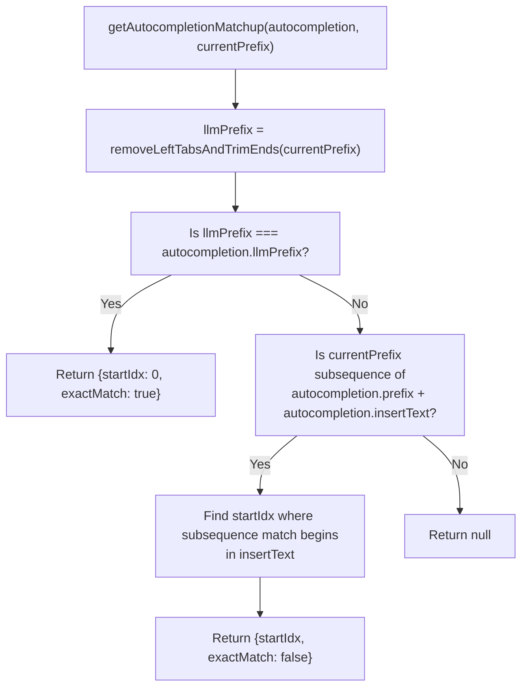
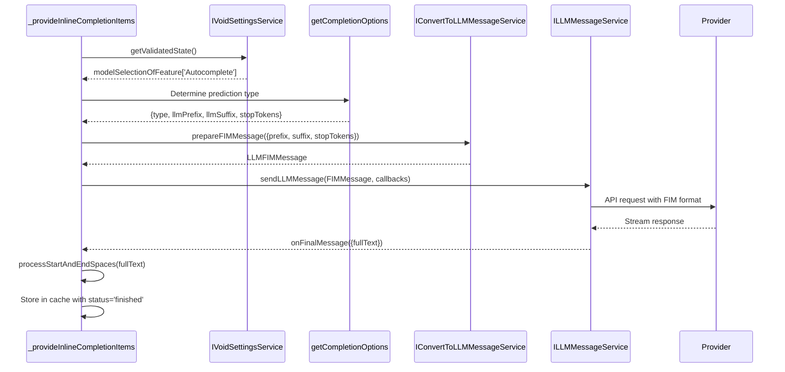
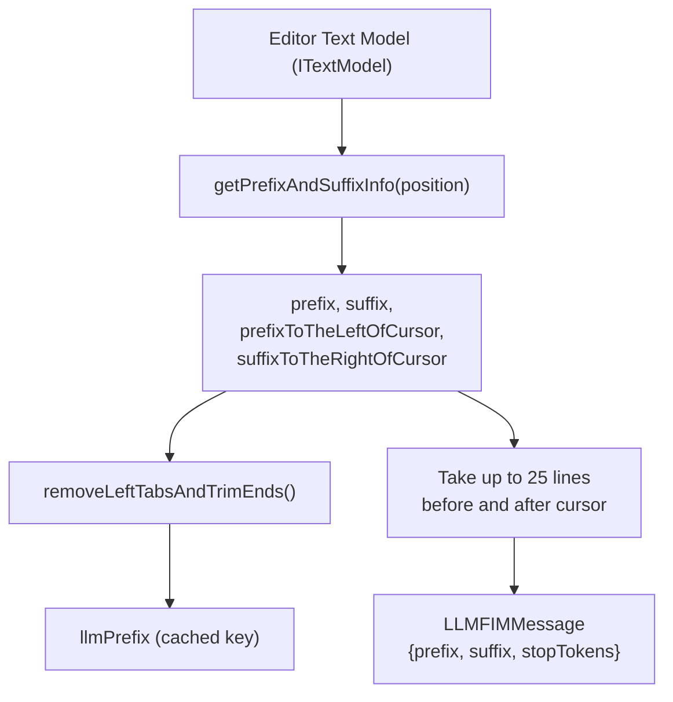
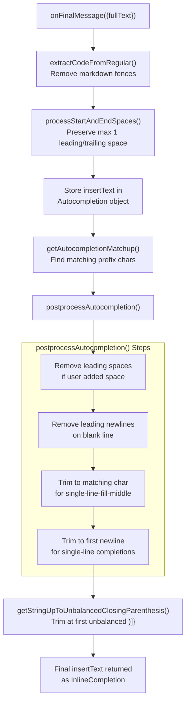
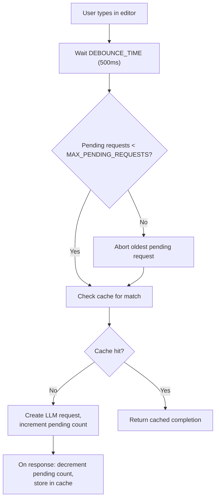

# Autocomplete Service

<details>
<summary>Relevant source files</summary>

The following files were used as context for generating this wiki page:

- [.voidrules](.voidrules)

</details>


## Purpose and Scope

The Autocomplete Service provides inline, AI-powered code completions via the editor's native inline completions API. It generates suggestions using Fill-in-the-Middle (FIM) prompts sent to LLM providers, implements an LRU cache per document to reduce redundant requests, and applies extensive preprocessing and postprocessing to improve suggestion quality. The service operates with a 500ms debounce and limits concurrent requests per document to avoid overloading the LLM.

Related pages:
- For user-triggered edits, see page 2.3 (Quick Edit)
- For LLM provider integration, see page 4 (LLM Integration)
- For model selection and configuration, see page 2.2 (Settings and Model Selection)

**Sources:**  
[src/vs/workbench/contrib/void/browser/autocompleteService.ts:1-947]()

## System Architecture

The `AutocompleteService` class implements `IAutocompleteService` and is registered as a workbench contribution at `WorkbenchPhase.BlockRestore` [src/vs/workbench/contrib/void/browser/autocompleteService.ts:947](). It registers an inline completions provider via `ILanguageFeaturesService` for all languages (`'*'` selector) [src/vs/workbench/contrib/void/browser/autocompleteService.ts:635-644]().

**Code Entity Architecture**

```mermaid
graph TB
    subgraph "VS Code Integration Layer"
        ILanguageFeaturesService["ILanguageFeaturesService"]
        inlineCompletionsProvider["inlineCompletionsProvider.register('*', ...)"]
    end

    subgraph "AutocompleteService Class"
        constructor["constructor()"]
        _provideInlineCompletionItems["_provideInlineCompletionItems()"]
        _autocompletionsOfDocument["_autocompletionsOfDocument:<br/>Map<uri, LRUCache>"]
        _autocompletionId["_autocompletionId: number"]
    end

    subgraph "Caching and Matching"
        LRUCache["LRUCache<number, Autocompletion>"]
        getAutocompletionMatchup["getAutocompletionMatchup()"]
        removeLeftTabsAndTrimEnds["removeLeftTabsAndTrimEnds()"]
    end

    subgraph "Prediction Logic"
        getCompletionOptions["getCompletionOptions()"]
        AutocompletionPredictionType["AutocompletionPredictionType"]
    end

    subgraph "Postprocessing"
        postprocessAutocompletion["postprocessAutocompletion()"]
        processStartAndEndSpaces["processStartAndEndSpaces()"]
        getStringUpToUnbalancedClosingParenthesis["getStringUpToUnbalancedClosingParenthesis()"]
    end

    subgraph "Service Dependencies"
        ILLMMessageService["ILLMMessageService"]
        IConvertToLLMMessageService["IConvertToLLMMessageService"]
        IVoidSettingsService["IVoidSettingsService"]
    end

    constructor --> inlineCompletionsProvider
    inlineCompletionsProvider --> _provideInlineCompletionItems
    _provideInlineCompletionItems --> _autocompletionsOfDocument
    _provideInlineCompletionItems --> getAutocompletionMatchup
    _provideInlineCompletionItems --> getCompletionOptions
    _provideInlineCompletionItems --> ILLMMessageService
    _autocompletionsOfDocument --> LRUCache
    LRUCache --> getAutocompletionMatchup
    getAutocompletionMatchup --> removeLeftTabsAndTrimEnds
    getCompletionOptions --> AutocompletionPredictionType
    _provideInlineCompletionItems --> postprocessAutocompletion
    postprocessAutocompletion --> processStartAndEndSpaces
    postprocessAutocompletion --> getStringUpToUnbalancedClosingParenthesis
    ILLMMessageService --> IConvertToLLMMessageService
    _provideInlineCompletionItems --> IVoidSettingsService
```

**Sources:**  
[src/vs/workbench/contrib/void/browser/autocompleteService.ts:618-663](), [src/vs/workbench/contrib/void/browser/autocompleteService.ts:902-942](), [src/vs/workbench/contrib/void/browser/autocompleteService.ts:947]()

## Completion Types and Prediction Logic

The Autocomplete Service selects the completion strategy based on the cursor position and the surrounding code context. The main types are defined in `AutocompletionPredictionType` [src/vs/workbench/contrib/void/browser/autocompleteService.ts:146-151]().

| Completion Type                | Trigger Condition                                      | Description                        |
|-------------------------------|--------------------------------------------------------|------------------------------------|
| `single-line-fill-middle`      | Cursor in middle of line with prefix                   | Completes between existing code    |
| `single-line-redo-suffix`      | Suffix ≤ 3 chars, has prefix                          | Rewrites line ending               |
| `multi-line-start-on-next-line`| Just accepted completion, empty suffix                 | Continues on next line             |
| `do-not-predict`               | No prefix on line                                     | Skips completion                   |

**Prediction Type Selection Logic**

```mermaid
flowchart TD
    "START"["getCompletionOptions"]
    "ACCEPTED"{"justAcceptedAutocompletion && isLineSuffixEmpty"}
    "EMPTY"{"isLineEmpty"}
    "SHORT_SUFFIX"{"suffixToTheRightOfCursor.length <= 3"}
    "HAS_PREFIX"{"!isLinePrefixEmpty"}

    "MULTILINE"["multi-line-start-on-next-line"]
    "FILL_MIDDLE1"["single-line-fill-middle"]
    "REDO_SUFFIX"["single-line-redo-suffix"]
    "FILL_MIDDLE2"["single-line-fill-middle"]
    "NO_PREDICT"["do-not-predict"]

    "START" --> "ACCEPTED"
    "ACCEPTED" -- Yes --> "MULTILINE"
    "ACCEPTED" -- No --> "EMPTY"
    "EMPTY" -- Yes --> "FILL_MIDDLE1"
    "EMPTY" -- No --> "SHORT_SUFFIX"
    "SHORT_SUFFIX" -- Yes --> "REDO_SUFFIX"
    "SHORT_SUFFIX" -- No --> "HAS_PREFIX"
    "HAS_PREFIX" -- Yes --> "FILL_MIDDLE2"
    "HAS_PREFIX" -- No --> "NO_PREDICT"
```

**Sources:**  
[src/vs/workbench/contrib/void/browser/autocompleteService.ts:536-610](), [src/vs/workbench/contrib/void/browser/autocompleteService.ts:146-151]()

## Caching System

The Autocomplete Service uses a per-document `LRUCache` to store and reuse recent completions [src/vs/workbench/contrib/void/browser/autocompleteService.ts:627]().

### Cache Structure

```mermaid
classDiagram
    class "AutocompleteService" {
        -_autocompletionsOfDocument: Map<string, LRUCache<number, Autocompletion>>
        -_autocompletionId: number
        +MAX_CACHE_SIZE: 20
        +MAX_PENDING_REQUESTS: 2
    }
    class "LRUCache" {
        +items: Map<K, V>
        -keyOrder: K[]
        -maxSize: number
        -disposeCallback: function
        +set(key, value)
        +delete(key): boolean
        +clear()
        +has(key): boolean
    }
    class "Autocompletion" {
        +id: number
        +prefix: string
        +suffix: string
        +llmPrefix: string
        +llmSuffix: string
        +startTime: number
        +endTime: number | undefined
        +status: "pending" | "finished" | "error"
        +type: AutocompletionPredictionType
        +llmPromise: Promise<string> | undefined
        +insertText: string
        +requestId: string | null
    }

    "AutocompleteService" --> "LRUCache" : "per document"
    "LRUCache" --> "Autocompletion" : "stores"
```

### Cache Matching Algorithm

The `getAutocompletionMatchup` function determines if a cached completion can be reused for the current prefix [src/vs/workbench/contrib/void/browser/autocompleteService.ts:460-526](). It returns `AutocompletionMatchupBounds` indicating where in the cached `insertText` to begin displaying.

**Cache Matchup Logic**



**Subsequence Matching**

The function `getIsSubsequence` [src/vs/workbench/contrib/void/browser/autocompleteService.ts:213-231]() checks if `currentPrefix` is a subsequence of `storedPrefix + insertText`. This allows cache reuse even when the user has typed additional characters that appear later in the completion.

Example:
- Cached prefix: `"const x = "`
- Cached insertText: `"useState()"`
- Current prefix: `"const x = useS"`
- Result: Match found (subsequence), startIdx points to `"tate()"`

**Sources:**  
[src/vs/workbench/contrib/void/browser/autocompleteService.ts:460-526](), [src/vs/workbench/contrib/void/browser/autocompleteService.ts:213-231](), [src/vs/workbench/contrib/void/browser/autocompleteService.ts:627]()

## LLM Integration

The Autocomplete Service communicates with the LLM infrastructure to generate completions using Fill-in-the-Middle (FIM) prompting.

### FIM Message Construction and Flow

**Fill-in-the-Middle Request Sequence**



**FIM Message Structure**

The `LLMFIMMessage` contains:

| Field | Source | Processing |
|-------|--------|------------|
| `prefix` | Up to 25 lines before cursor | From `textModel.getValueInRange()` [src/vs/workbench/contrib/void/browser/autocompleteService.ts:800-812]() |
| `suffix` | Up to 25 lines after cursor | From `textModel.getValueInRange()` [src/vs/workbench/contrib/void/browser/autocompleteService.ts:800-812]() |
| `stopTokens` | Depends on prediction type | `['\n']` for single-line, `['\n\n']` for multi-line [src/vs/workbench/contrib/void/browser/autocompleteService.ts:536-610]() |

Stop tokens prevent the LLM from generating beyond the intended scope (e.g., stopping at first newline for single-line completions).

**Sources:**  
[src/vs/workbench/contrib/void/browser/autocompleteService.ts:792-867](), [src/vs/workbench/contrib/void/browser/autocompleteService.ts:800-812](), [src/vs/workbench/contrib/void/browser/autocompleteService.ts:536-610]()

## Text Processing Pipeline

The Autocomplete Service applies several preprocessing and postprocessing steps to improve completion quality.

### Preprocessing: From Editor State to FIM Message



The `removeLeftTabsAndTrimEnds` function [src/vs/workbench/contrib/void/browser/autocompleteService.ts:192-205]() serves two purposes:
1. Removes leading tabs from each line to improve cache hit rate.
2. Trims trailing whitespace except for a single trailing newline.

**Sources:**  
[src/vs/workbench/contrib/void/browser/autocompleteService.ts:192-205](), [src/vs/workbench/contrib/void/browser/autocompleteService.ts:800-812](), [src/vs/workbench/contrib/void/browser/autocompleteService.ts:536-610]()

### Postprocessing: From LLM Response to Insert Text



Key postprocessing algorithms:

| Function | Purpose | Example |
|----------|---------|---------|
| `extractCodeFromRegular` | Removes markdown code fences from LLM output [src/vs/workbench/contrib/void/browser/autocompleteService.ts:174-189]() | ` ```js\ncode\n``` ` → `code` |
| `processStartAndEndSpaces` | Normalizes whitespace to at most 1 leading/trailing space [src/vs/workbench/contrib/void/browser/autocompleteService.ts:234-267]() | `"  text  "` → `" text "` |
| `getStringUpToUnbalancedClosingParenthesis` | Prevents suggesting unmatched closing brackets [src/vs/workbench/contrib/void/browser/autocompleteService.ts:365-394]() | `"foo())bar"` with prefix `"fn("` → `"foo()"` |
| `postprocessAutocompletion` | Context-aware trimming based on cursor position and prediction type [src/vs/workbench/contrib/void/browser/autocompleteService.ts:270-363]() | Stops at matching chars, removes blank-line newlines |

**Sources:**  
[src/vs/workbench/contrib/void/browser/autocompleteService.ts:174-189](), [src/vs/workbench/contrib/void/browser/autocompleteService.ts:234-267](), [src/vs/workbench/contrib/void/browser/autocompleteService.ts:270-363](), [src/vs/workbench/contrib/void/browser/autocompleteService.ts:365-394]()

## Editor Integration and Lifecycle

The Autocomplete Service is registered as a workbench contribution and integrates with the editor's inline completion system [src/vs/workbench/contrib/void/browser/autocompleteService.ts:947]().

### Registration and Callbacks

```mermaid
graph TB
    "registerWorkbenchContribution2"["registerWorkbenchContribution2(AutocompleteService.ID, AutocompleteService, WorkbenchPhase.BlockRestore)"]
    "AutocompleteServiceConstructor"["AutocompleteService constructor"]
    "inlineCompletionsProvider.register"["inlineCompletionsProvider.register('*', { provideInlineCompletions, freeInlineCompletions })"]
    "provideInlineCompletions"["provideInlineCompletions → _provideInlineCompletionItems"]
    "freeInlineCompletions"["freeInlineCompletions → cache cleanup"]

    "registerWorkbenchContribution2" --> "AutocompleteServiceConstructor"
    "AutocompleteServiceConstructor" --> "inlineCompletionsProvider.register"
    "inlineCompletionsProvider.register" --> "provideInlineCompletions"
    "inlineCompletionsProvider.register" --> "freeInlineCompletions"
```

### Debouncing, Request Limiting, and Abort Handling

**Performance Constants**

| Constant | Value | Purpose |
|----------|-------|---------|
| `DEBOUNCE_TIME` | 500ms | Delay before triggering completion request after user stops typing [src/vs/workbench/contrib/void/browser/autocompleteService.ts:169]() |
| `MAX_PENDING_REQUESTS` | 2 | Maximum concurrent LLM requests per document [src/vs/workbench/contrib/void/browser/autocompleteService.ts:171]() |
| `TIMEOUT_TIME` | 60000ms | Maximum wait time for LLM response before aborting [src/vs/workbench/contrib/void/browser/autocompleteService.ts:170]() |
| `MAX_CACHE_SIZE` | 20 | Maximum cached completions per document [src/vs/workbench/contrib/void/browser/autocompleteService.ts:172]() |

**Request Flow Control**



**Abort Mechanisms**

1. **User-triggered**: Typing or navigating while completion is pending calls `freeInlineCompletions`, which aborts requests via `requestId` [src/vs/workbench/contrib/void/browser/autocompleteService.ts:902-942]().
2. **Request limit**: When pending requests exceed `MAX_PENDING_REQUESTS`, the oldest request is aborted [src/vs/workbench/contrib/void/browser/autocompleteService.ts:817-832]().
3. **Document close**: Cache disposal calls abort callbacks for all pending completions [src/vs/workbench/contrib/void/browser/autocompleteService.ts:902-942]().

The `_setAborter` callback passed to `sendLLMMessage` enables request cancellation at the provider level [src/vs/workbench/contrib/void/browser/autocompleteService.ts:834-836]().

**Sources:**  
[src/vs/workbench/contrib/void/browser/autocompleteService.ts:169-172](), [src/vs/workbench/contrib/void/browser/autocompleteService.ts:721-754](), [src/vs/workbench/contrib/void/browser/autocompleteService.ts:817-867](), [src/vs/workbench/contrib/void/browser/autocompleteService.ts:902-942]()

## Configuration

The autocomplete service respects user settings through the `IVoidSettingsService`:

- **Global Toggle**: `enableAutocomplete` setting controls service availability [src/vs/workbench/contrib/void/browser/autocompleteService.ts:638-639]().
- **Model Selection**: Uses the 'Autocomplete' feature name for model selection [src/vs/workbench/contrib/void/browser/autocompleteService.ts:792-795]().
- **Provider Options**: Supports model-specific configuration overrides.

**Sources:** [src/vs/workbench/contrib/void/browser/autocompleteService.ts:638-639](), [src/vs/workbench/contrib/void/browser/autocompleteService.ts:792-795]()