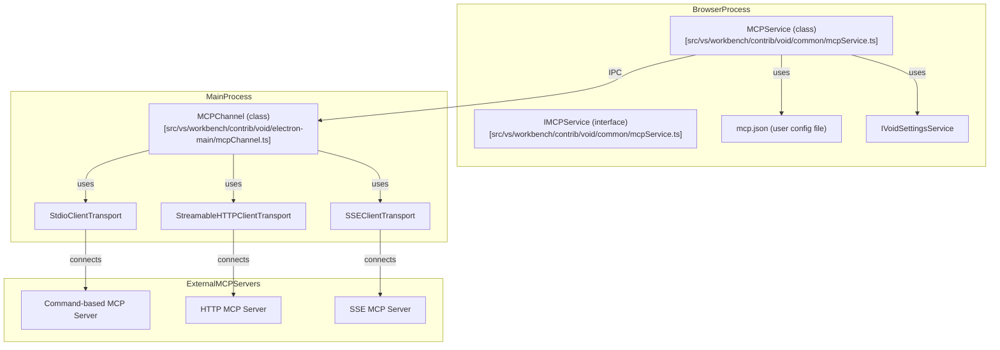
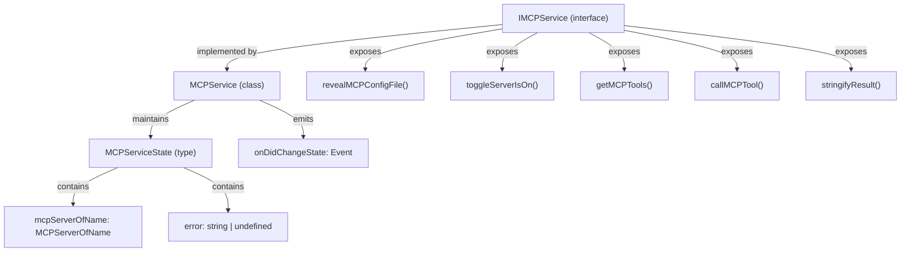
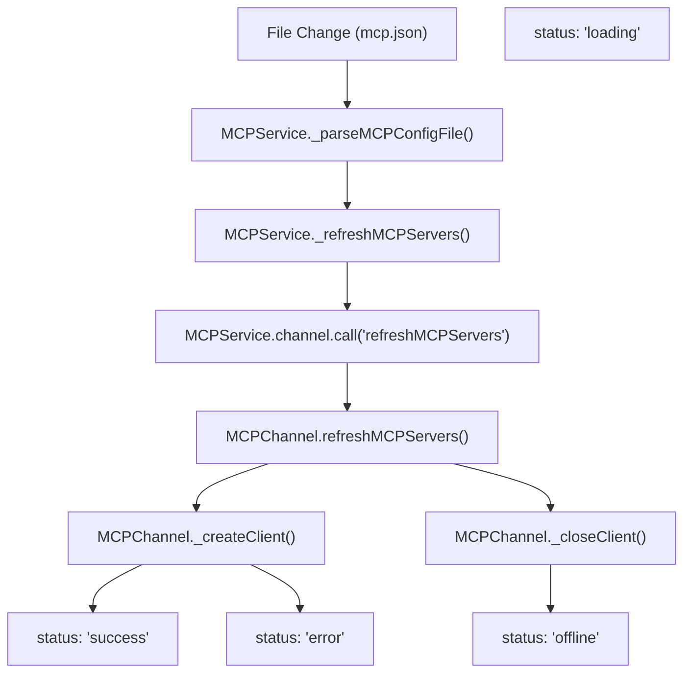
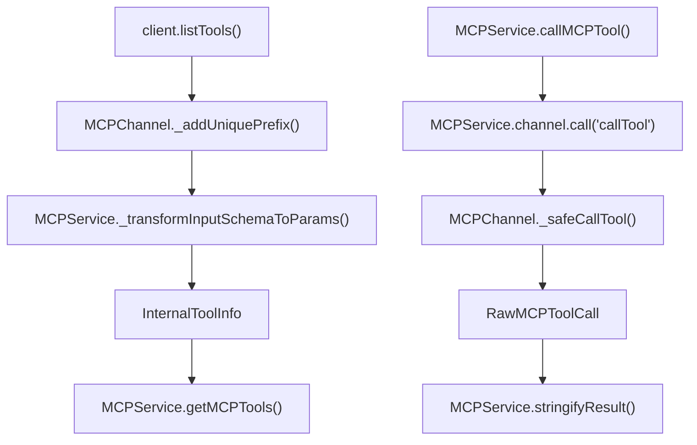
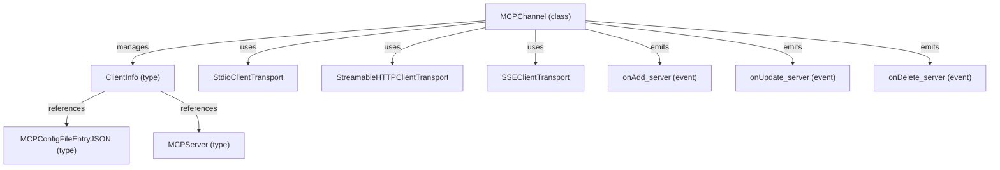
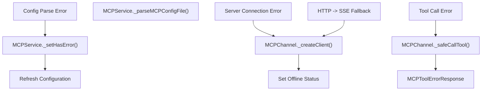
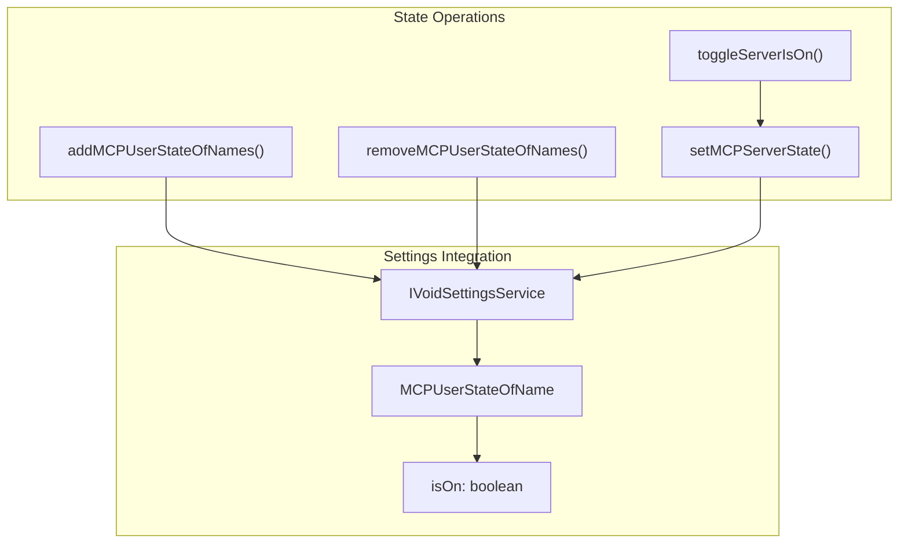

# Model Context Protocol (MCP) Service

Relevant source files

The following files were used as context for generating this wiki page:

- [.voidrules](.voidrules)

The Model Context Protocol (MCP) Service (`IMCPService` and its implementation) is responsible for integrating Void with external MCP servers. These servers expose tools and capabilities that can be invoked by the editor or by AI models, enabling extensible, protocol-driven tool integration.

The MCP Service manages:
- Discovery and configuration of MCP servers via a user-editable `mcp.json` file.
- Lifecycle and state of each MCP server (loading, online, offline, error).
- Tool discovery and invocation, exposing external tools to the rest of the system.
- Communication between the browser process (where the UI and most services run) and the main process (which manages actual MCP server connections).

For built-in tools, see page [3.4](). For LLM integration, see page [4]().

## System Architecture and Code Entity Mapping

The MCP Service is split between the browser and main processes, with clear code entity boundaries.

**Diagram: "MCP Service System and Code Entities"**

**Sources:** [src/vs/workbench/contrib/void/common/mcpService.ts:1-360](), [src/vs/workbench/contrib/void/electron-main/mcpChannel.ts:1-395]()

## Service Interface and State Management

The `IMCPService` interface defines the contract for all MCP-related operations. The implementation (`MCPService`) maintains a transient state object and exposes events for state changes.

**Diagram: "IMCPService Interface and State"**

| Method / Property         | Purpose                                                      |
|--------------------------|--------------------------------------------------------------|
| `revealMCPConfigFile()`  | Opens the MCP config file in the editor                      |
| `toggleServerIsOn()`     | Enables/disables a specific MCP server                       |
| `getMCPTools()`          | Returns all discovered tools from all active MCP servers      |
| `callMCPTool()`          | Invokes a tool on a specific MCP server                      |
| `stringifyResult()`      | Formats a tool call result for display                       |
| `state`                  | Current MCP server state and error info (not persisted)       |
| `onDidChangeState`       | Event fired on any state change                              |

**Sources:** [src/vs/workbench/contrib/void/common/mcpService.ts:29-40](), [src/vs/workbench/contrib/void/common/mcpService.ts:59-98]()

## MCP Server Configuration File (`mcp.json`)

The MCP Service manages a user-editable configuration file, `mcp.json`, which defines all available MCP servers. This file is created automatically if it does not exist.

**Key code entities:**
- `MCP_CONFIG_FILE_NAME` (constant): `'mcp.json'` [src/vs/workbench/contrib/void/common/mcpService.ts:46-46]()
- `_getMCPConfigFilePath()`: Determines the config file path, typically `~/[appName]/mcp.json` [src/vs/workbench/contrib/void/common/mcpService.ts:226-231]()
- `_createMCPConfigFile()`: Creates the file with a default structure if missing [src/vs/workbench/contrib/void/common/mcpService.ts:233-241]()
- `_addMCPConfigFileWatcher()`: Watches for changes and triggers reloads [src/vs/workbench/contrib/void/common/mcpService.ts:243-259]()

**Configuration structure (`MCPConfigFileEntryJSON`):**

| Field      | Type                        | Description                        |
|------------|-----------------------------|------------------------------------|
| `command`  | `string` (optional)         | Command to launch a local server   |
| `args`     | `string[]` (optional)       | Arguments for the command          |
| `env`      | `Record<string, string>`    | Environment variables              |
| `url`      | `URL` (optional)            | URL for HTTP/SSE server            |
| `headers`  | `Record<string, string>`    | HTTP headers for server            |

**Sources:** [src/vs/workbench/contrib/void/common/mcpService.ts:46-48](), [src/vs/workbench/contrib/void/common/mcpServiceTypes.ts:119-128]()

## Server Lifecycle and State Transitions

The MCP Service manages the lifecycle of each MCP server using event-driven updates and state transitions. Server state is tracked in-memory and updated in response to configuration changes, user actions, or server events.

**Diagram: "MCP Server Lifecycle and State Transitions"**

**State values (`MCPServer.status`):**
- `'loading'`: Server is being (re)initialized [src/vs/workbench/contrib/void/common/mcpServiceTypes.ts:145-145]()
- `'success'`: Server is online and tools are available [src/vs/workbench/contrib/void/common/mcpServiceTypes.ts:146-146]()
- `'offline'`: Server is intentionally disabled [src/vs/workbench/contrib/void/common/mcpServiceTypes.ts:147-147]()
- `'error'`: Server failed to connect or initialize [src/vs/workbench/contrib/void/common/mcpServiceTypes.ts:148-148]()

**Sources:** [src/vs/workbench/contrib/void/common/mcpService.ts:262-298](), [src/vs/workbench/contrib/void/electron-main/mcpChannel.ts:115-162]()

## Tool Discovery and Invocation

MCP servers expose tools, which are discovered and made available to the rest of the system. The MCP Service transforms tool schemas and manages tool invocation.

**Diagram: "Tool Discovery and Invocation Code Flow"**

**Schema transformation:**

| MCP Tool Schema Field         | Internal Representation (InternalToolInfo) |
|------------------------------|--------------------------------------------|
| `inputSchema.properties`     | `params: { [paramName]: { description } }` |
| `tool.name`                  | `name` (with unique prefix)                |
| `tool.description`           | `description`                              |
| Server context               | `mcpServerName`                            |

**Sources:** [src/vs/workbench/contrib/void/common/mcpService.ts:186-224](), [src/vs/workbench/contrib/void/common/mcpService.ts:325-331](), [src/vs/workbench/contrib/void/electron-main/mcpChannel.ts:297-313]()

## Main Process: MCPChannel and Transport Handling

The `MCPChannel` class in the main process manages all connections to MCP servers. It supports multiple transport types and emits events for server state changes.

**Diagram: "MCPChannel Code Entities and Event Flow"**

**Transport fallback logic:**
- For URL-based servers: try HTTP first, then fall back to SSE if HTTP fails [src/vs/workbench/contrib/void/electron-main/mcpChannel.ts:192-228]().
- For command-based servers: use Stdio transport [src/vs/workbench/contrib/void/electron-main/mcpChannel.ts:175-189]().

**Sources:** [src/vs/workbench/contrib/void/electron-main/mcpChannel.ts:164-230](), [src/vs/workbench/contrib/void/electron-main/mcpChannel.ts:34-46]()

## Error Handling and Recovery

The MCP Service and MCPChannel implement error handling at multiple layers, standardizing error reporting and supporting recovery actions.

**Diagram: "Error Handling and Recovery Code Flow"**

| Error Scenario         | Response Type           | Recovery Action                |
|-----------------------|------------------------|-------------------------------|
| Config parse error    | `error` in `state`     | Show error, reload config      |
| Server connection     | `status: 'error'`      | Retry, set offline            |
| Tool call failure     | `RawMCPToolCall`       | Surface error to user         |
| HTTP transport fail   | Fallback to SSE        | Try alternative transport      |

All tool call errors are wrapped in the `RawMCPToolCall` type, ensuring consistent error handling [src/vs/workbench/contrib/void/common/mcpServiceTypes.ts:222-231]().

**Sources:** [src/vs/workbench/contrib/void/common/mcpService.ts:141-147](), [src/vs/workbench/contrib/void/electron-main/mcpChannel.ts:351-392](), [src/vs/workbench/contrib/void/common/mcpServiceTypes.ts:182-231]()

## User State Synchronization

The service coordinates with `IVoidSettingsService` to persist user preferences like whether a server is enabled.

**Sources:** [src/vs/workbench/contrib/void/common/mcpService.ts:278-283](), [src/vs/workbench/contrib/void/common/mcpService.ts:317-322]()