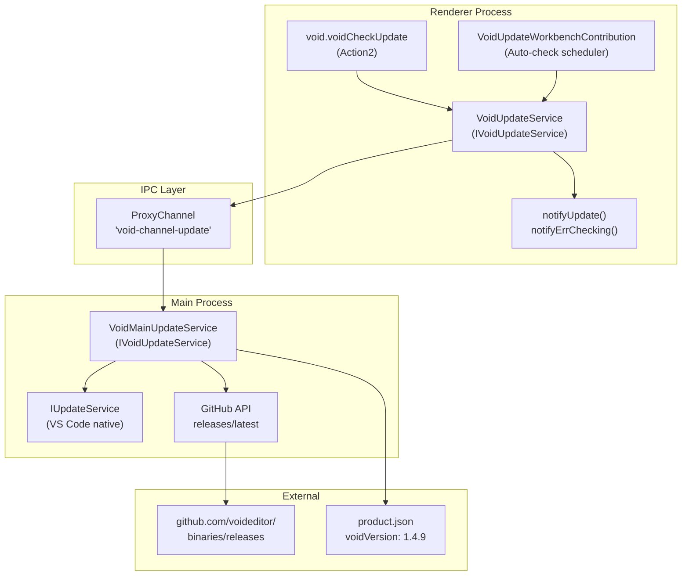
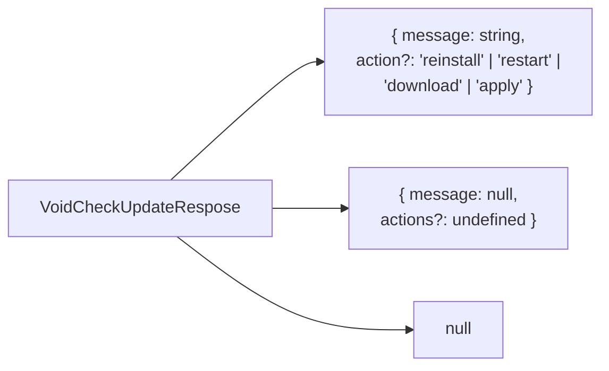
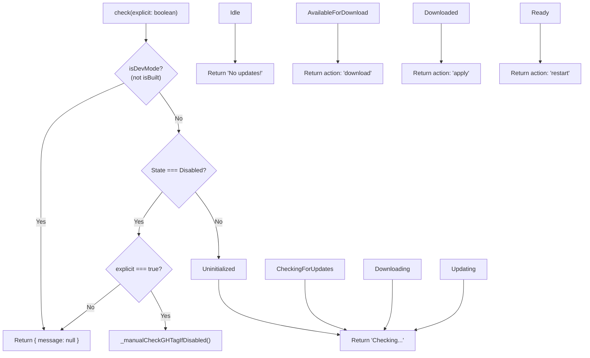
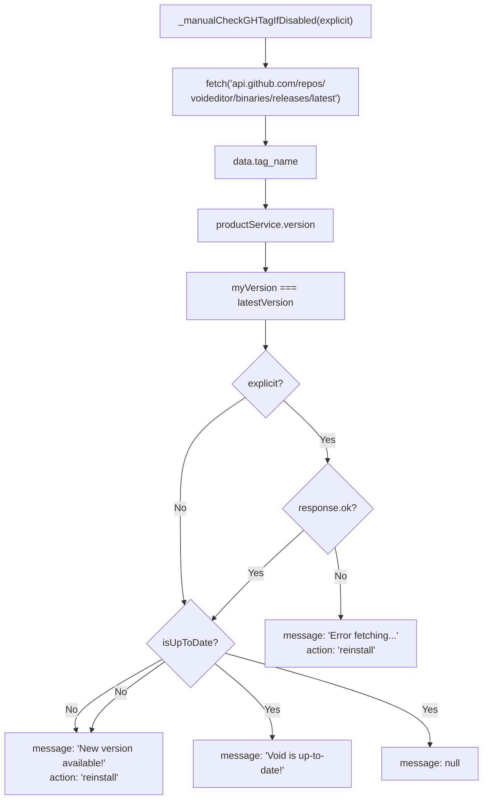
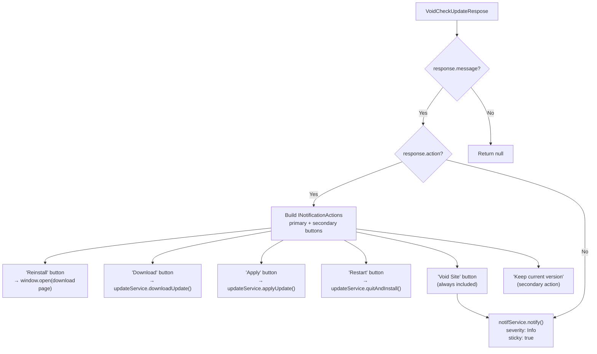
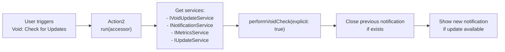
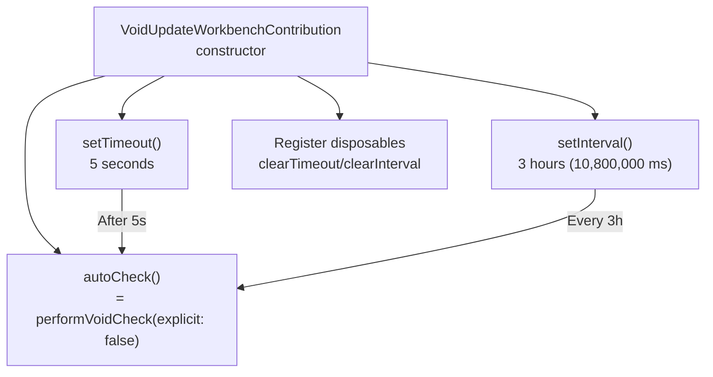
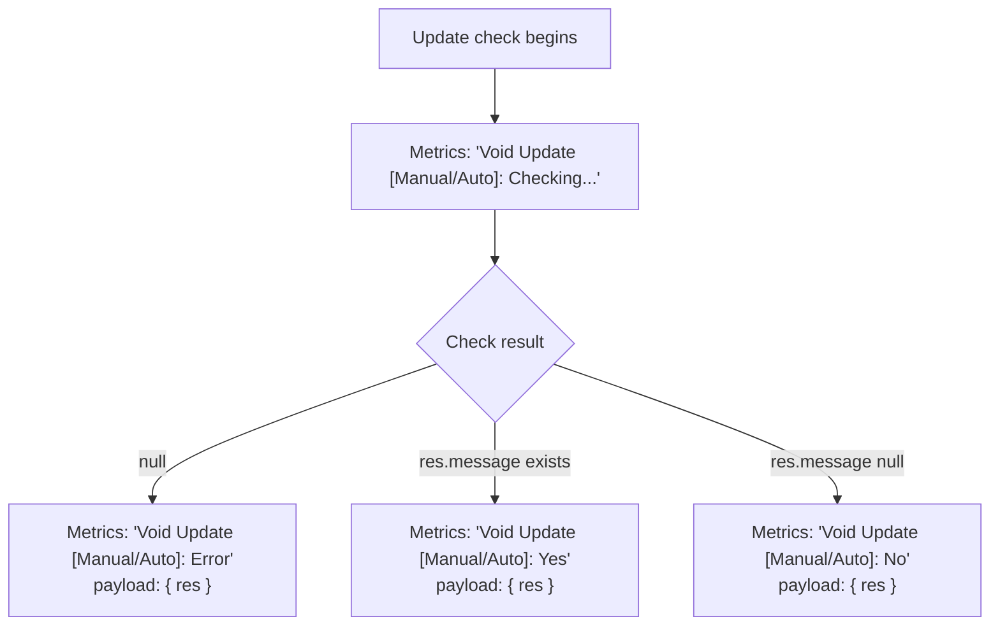

# Update Service and Release Management

<details>
<summary>Relevant source files</summary>

The following files were used as context for generating this wiki page:

- [.voidrules](.voidrules)

</details>


This document describes Void's update checking system, which monitors for new releases and provides users with update notifications. The system integrates with VS Code's native `IUpdateService` for automatic updates on supported platforms (Windows, macOS) and falls back to GitHub API polling when native updates are disabled (Linux, development builds). The service handles both automatic background checks and manual user-initiated checks.

---

## Purpose and Scope

The Update Service is responsible for:

- **Version checking**: Determining if a newer version of Void is available [src/vs/workbench/contrib/void/electron-main/voidUpdateMainService.ts:27-89]().
- **Platform-specific handling**: Using VS Code's native update service on Windows/macOS, falling back to GitHub API on Linux [src/vs/workbench/contrib/void/electron-main/voidUpdateMainService.ts:32-43]().
- **User notification**: Displaying update availability with appropriate actions [src/vs/workbench/contrib/void/browser/voidUpdateActions.ts:23-128]().
- **Automatic scheduling**: Performing background checks on startup and periodic intervals [src/vs/workbench/contrib/void/browser/voidUpdateActions.ts:210-221]().
- **Manual checking**: Providing a command for users to explicitly check for updates [src/vs/workbench/contrib/void/browser/voidUpdateActions.ts:175-198]().

**Sources:** [src/vs/workbench/contrib/void/electron-main/voidUpdateMainService.ts:1-151](), [src/vs/workbench/contrib/void/browser/voidUpdateActions.ts:1-228]()

---

## Architecture Overview

The update system follows Void's standard IPC architecture pattern, with a proxy service in the renderer process delegating to a main process implementation.

### Component Structure

Update System Component Map


**Sources:** [src/vs/workbench/contrib/void/common/voidUpdateService.ts:1-46](), [src/vs/workbench/contrib/void/electron-main/voidUpdateMainService.ts:1-151](), [src/vs/workbench/contrib/void/browser/voidUpdateActions.ts:1-228]()

---

## Service Interface

### IVoidUpdateService

The service exposes a single method for checking updates, defined in the common layer [src/vs/workbench/contrib/void/common/voidUpdateService.ts:14-17]().

```typescript
interface IVoidUpdateService {
  readonly _serviceBrand: undefined;
  check: (explicit: boolean) => Promise<VoidCheckUpdateRespose>;
}
```

The `explicit` parameter distinguishes between:
- **Manual checks** (`explicit: true`): User-initiated via command, always shows result [src/vs/workbench/contrib/void/browser/voidUpdateActions.ts:175-198]().
- **Automatic checks** (`explicit: false`): Background checks, only shows notifications if update found [src/vs/workbench/contrib/void/browser/voidUpdateActions.ts:210-221]().

**Sources:** [src/vs/workbench/contrib/void/common/voidUpdateService.ts:14-17](), [src/vs/workbench/contrib/void/browser/voidUpdateActions.ts:175-228]()

---

## Update Check Response Types

The response from the update service determines what the UI displays to the user [src/vs/workbench/contrib/void/common/voidUpdateServiceTypes.ts:1-14]().

Response Type Structure


| Response Type | When Used | Example Message |
|---------------|-----------|-----------------|
| `{ message: string, action }` | Update available or status info | "A new update is available!" |
| `{ message: null }` | No update, automatic check | (no notification shown) |
| `null` | Error occurred | Falls back to error notification |

**Action Types:**

| Action | Trigger | User Flow |
|--------|---------|-----------|
| `reinstall` | Manual install required (Linux/disabled updates) | Opens download page [src/vs/workbench/contrib/void/browser/voidUpdateActions.ts:40-45]() |
| `download` | Update available for download | Calls `updateService.downloadUpdate()` [src/vs/workbench/contrib/void/browser/voidUpdateActions.ts:54-58]() |
| `apply` | Update downloaded, ready to apply | Calls `updateService.applyUpdate()` [src/vs/workbench/contrib/void/browser/voidUpdateActions.ts:68-72]() |
| `restart` | Update ready, needs restart | Calls `updateService.quitAndInstall()` [src/vs/workbench/contrib/void/browser/voidUpdateActions.ts:82-86]() |

**Sources:** [src/vs/workbench/contrib/void/common/voidUpdateServiceTypes.ts:1-14](), [src/vs/workbench/contrib/void/browser/voidUpdateActions.ts:28-109]()

---

## Update Check Flow

### Main Process Implementation

The `VoidMainUpdateService.check()` method in the main process implements a decision tree based on the build state and VS Code's native update state [src/vs/workbench/contrib/void/electron-main/voidUpdateMainService.ts:27-89]().

Main Process Logic Flow


**Sources:** [src/vs/workbench/contrib/void/electron-main/voidUpdateMainService.ts:27-89]()

---

## VS Code IUpdateService Integration

The update service delegates to VS Code's platform-specific update mechanism by checking `IUpdateService.state` [src/vs/workbench/contrib/void/electron-main/voidUpdateMainService.ts:45-83]().

The service calls `updateService.checkForUpdates(false)` to trigger a check [src/vs/workbench/contrib/void/electron-main/voidUpdateMainService.ts:42](), then reads the state to determine the appropriate response.

**State Mapping Table:**

| VS Code State | Explicit Check Message | Automatic Check | Action |
|---------------|------------------------|-----------------|--------|
| `Uninitialized` | "Checking for updates soon..." | null | `reinstall` |
| `Idle` | "No updates found!" | null | `reinstall` |
| `CheckingForUpdates` | "Checking for updates..." | null | none |
| `AvailableForDownload` | "A new update is available!" | (shown) | `download` |
| `Downloading` | "Currently downloading update..." | null | none |
| `Downloaded` | "An update is ready to be applied!" | null | `apply` |
| `Updating` | "Applying update..." | null | none |
| `Ready` | "Restart Void to update!" | (shown) | `restart` |
| `Disabled` | (GitHub fallback) | (GitHub fallback) | varies |

**Sources:** [src/vs/workbench/contrib/void/electron-main/voidUpdateMainService.ts:45-83]()

---

## GitHub API Fallback

When native updates are disabled (primarily on Linux or specific build configurations), the service falls back to comparing versions via GitHub's releases API [src/vs/workbench/contrib/void/electron-main/voidUpdateMainService.ts:96-150]().

### Fallback Implementation

GitHub Version Check Logic


**API Endpoint:** `https://api.github.com/repos/voideditor/binaries/releases/latest` [src/vs/workbench/contrib/void/electron-main/voidUpdateMainService.ts:102]()

**Version Comparison:**
- Current version: `productService.version` (from [product.json:4]())
- Latest version: `data.tag_name` from GitHub response [src/vs/workbench/contrib/void/electron-main/voidUpdateMainService.ts:124]()
- Simple string equality check [src/vs/workbench/contrib/void/electron-main/voidUpdateMainService.ts:127]()

**Sources:** [src/vs/workbench/contrib/void/electron-main/voidUpdateMainService.ts:96-150]()

---

## Notification System

### Notification Display Logic

The renderer process receives update check results and displays notifications via `INotificationService` [src/vs/workbench/contrib/void/browser/voidUpdateActions.ts:23-128]().

Notification Creation Flow


**Sources:** [src/vs/workbench/contrib/void/browser/voidUpdateActions.ts:23-128]()

---

## Notification Action Handlers

Each notification action button maps to a specific handler in the renderer process [src/vs/workbench/contrib/void/browser/voidUpdateActions.ts:28-109]().

| Action Type | Button Label | Handler Code | Behavior |
|-------------|--------------|--------------|----------|
| `reinstall` | "Reinstall" | `window.open('https://voideditor.com/download-beta')` | Opens download page |
| `download` | "Download" | `updateService.downloadUpdate()` | Triggers VS Code's download |
| `apply` | "Apply" | `updateService.applyUpdate()` | Applies downloaded update |
| `restart` | "Restart" | `updateService.quitAndInstall()` | Quits and installs update |
| (always) | "Void Site" | `window.open('https://voideditor.com/')` | Opens main site |
| (secondary) | "Keep current version" | `notifController.close()` | Dismisses notification |

**Sources:** [src/vs/workbench/contrib/void/browser/voidUpdateActions.ts:28-109]()

---

## Manual Update Check Command

Users can manually trigger an update check via the command palette using the `void.voidCheckUpdate` command [src/vs/workbench/contrib/void/browser/voidUpdateActions.ts:175-198]().

Manual Check Command Flow


**Sources:** [src/vs/workbench/contrib/void/browser/voidUpdateActions.ts:175-198]()

---

## Automatic Update Checking

The `VoidUpdateWorkbenchContribution` class schedules automatic background checks during the workbench lifecycle [src/vs/workbench/contrib/void/browser/voidUpdateActions.ts:201-228]().

Background Scheduling


**Timing Configuration:**

| Check Type | Timing | Explicit Flag | Purpose |
|------------|--------|---------------|---------|
| Initial | 5 seconds after startup | `false` | Check for updates after app initialization [src/vs/workbench/contrib/void/browser/voidUpdateActions.ts:210]() |
| Periodic | Every 3 hours | `false` | Ongoing background monitoring [src/vs/workbench/contrib/void/browser/voidUpdateActions.ts:215]() |
| Manual | User-triggered | `true` | On-demand check with guaranteed feedback |

**Sources:** [src/vs/workbench/contrib/void/browser/voidUpdateActions.ts:201-228]()

---

## Metrics Collection

The update system emits metrics via `IMetricsService` to monitor update check behavior [src/vs/workbench/contrib/void/browser/voidUpdateActions.ts:140-168]().

Update Metrics Logic


**Sources:** [src/vs/workbench/contrib/void/browser/voidUpdateActions.ts:140-168]()

---

## Version Information

The current version is stored in `product.json` [product.json:1-46]().

| Field | Purpose | Example |
|-------|---------|---------|
| `voidVersion` | Semantic version number | `"1.4.9"` |
| `voidRelease` | Internal release identifier | `"0044"` |

**Sources:** [product.json:1-46]()

---

## Error Handling

When an error occurs during the update check (e.g., network failure or API error), the system displays a fallback notification via `notifyErrChecking` [src/vs/workbench/contrib/void/browser/voidUpdateActions.ts:129-137]().

**Error Scenarios:**

| Scenario | Detection | User Experience |
|----------|-----------|-----------------|
| GitHub API timeout | `fetch()` throws [src/vs/workbench/contrib/void/electron-main/voidUpdateMainService.ts:144]() | Error notification with reinstall link |
| GitHub API rate limit | `response.ok === false` [src/vs/workbench/contrib/void/electron-main/voidUpdateMainService.ts:113]() | Error message, try again in 5 minutes |
| Service unavailable | `res === null` [src/vs/workbench/contrib/void/browser/voidUpdateActions.ts:162]() | Generic error notification |

**Sources:** [src/vs/workbench/contrib/void/browser/voidUpdateActions.ts:129-137](), [src/vs/workbench/contrib/void/electron-main/voidUpdateMainService.ts:110-150]()