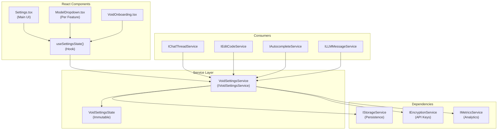
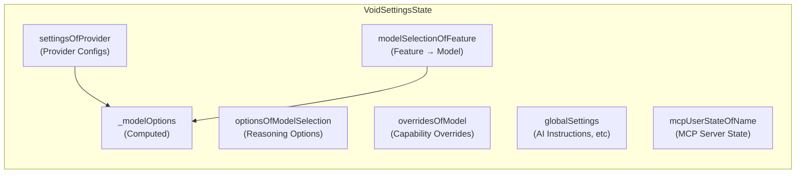
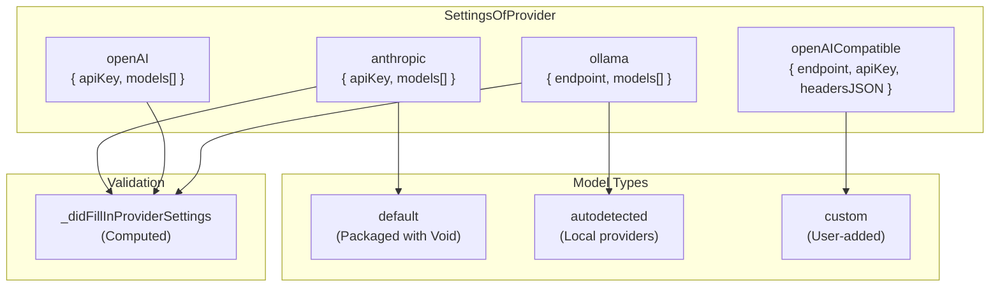
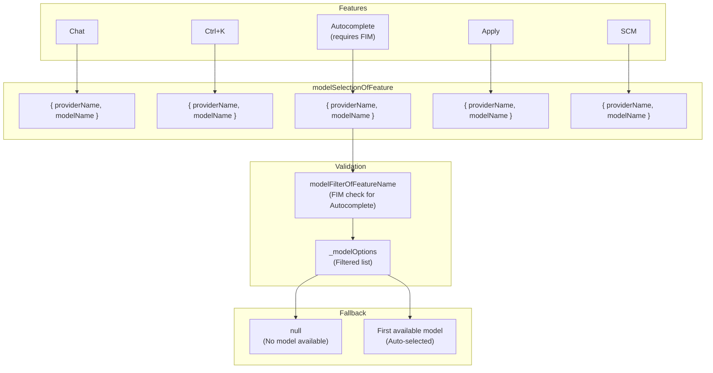
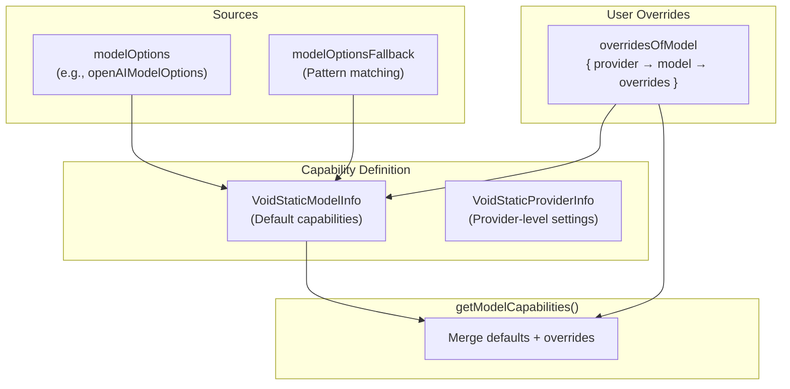
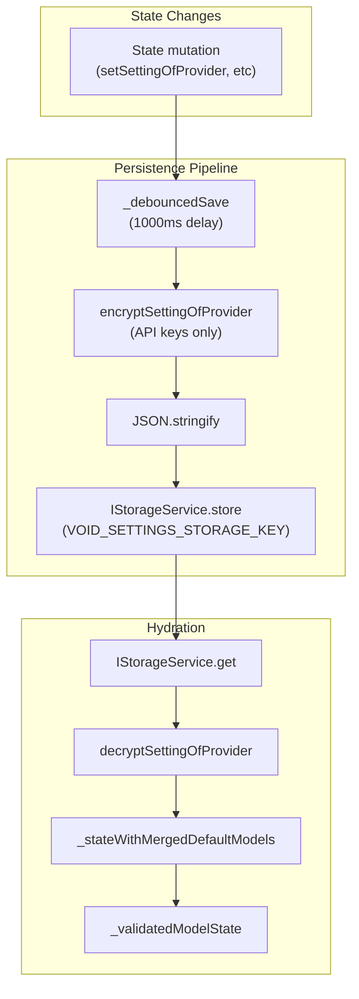
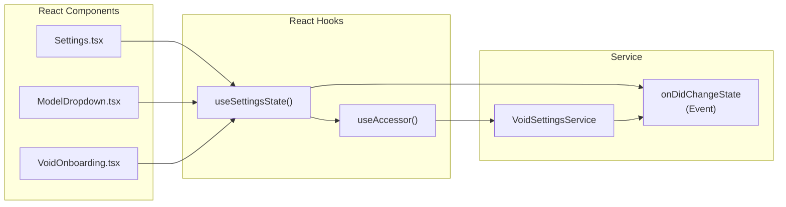

# Settings Service and State Management

<details>
<summary>Relevant source files</summary>

The following files were used as context for generating this wiki page:

- [.voidrules](.voidrules)

</details>


## Purpose and Scope

This document describes `IVoidSettingsService`, the central service responsible for managing all configuration state in Void. It handles provider credentials (API keys, endpoints), model selections per feature, model capability overrides, global settings, and MCP server states. The service provides a reactive state management system with persistence, encryption, validation, and synchronization.

For information about the Settings UI and user interactions, see [Settings and Model Selection](#2.2). For details about how model capabilities are defined and used in LLM communication, see [Model Capabilities and Configuration](#4.3).

---

## Service Architecture

`IVoidSettingsService` is a singleton service that maintains a single source of truth for all Void settings. It exposes an immutable `state` object and emits events when state changes, enabling reactive UI updates.



**Sources:** [src/vs/workbench/contrib/void/common/voidSettingsService.ts:21-65](), [src/vs/workbench/contrib/void/common/voidSettingsTypes.ts:400-480]()

---

## State Structure

`VoidSettingsState` contains several top-level properties that together define all configuration in Void:



**Sources:** [src/vs/workbench/contrib/void/common/voidSettingsService.ts:212-230]()

### State Properties

| Property | Type | Purpose |
|----------|------|---------|
| `settingsOfProvider` | `SettingsOfProvider` | API keys, endpoints, model lists per provider |
| `modelSelectionOfFeature` | `ModelSelectionOfFeature` | Which model is selected for each feature (Chat, Ctrl+K, etc) |
| `optionsOfModelSelection` | `OptionsOfModelSelection` | Per-feature reasoning options (budget/effort) |
| `overridesOfModel` | `OverridesOfModel` | User-defined capability overrides per model |
| `globalSettings` | `GlobalSettings` | AI instructions, auto-refresh, enable fast apply, etc |
| `mcpUserStateOfName` | `MCPUserStateOfName` | Which MCP servers are enabled/disabled |
| `_modelOptions` | `ModelOption[]` | Computed list of available models (for dropdowns) |

**Sources:** [src/vs/workbench/contrib/void/common/voidSettingsService.ts:212-230](), [src/vs/workbench/contrib/void/common/voidSettingsTypes.ts:400-480]()

---

## Provider Settings Management

Each provider (Anthropic, OpenAI, Ollama, etc.) has its own settings structure defined in `defaultProviderSettings`. The service tracks provider-specific credentials, endpoints, and model lists.



**Sources:** [src/vs/workbench/contrib/void/common/modelCapabilities.ts:12-69](), [src/vs/workbench/contrib/void/common/voidSettingsTypes.ts:200-350]()

### Provider Settings Structure

Each provider has custom settings and common fields:

```typescript
// Custom settings (vary per provider)
type SettingsAtProvider<providerName> = {
  // Custom fields like apiKey, endpoint, region, etc
  apiKey?: string;
  endpoint?: string;
  // ...
  
  // Common fields
  _didFillInProviderSettings: boolean | undefined;
  models: VoidStatefulModelInfo[];
}
```

The `_didFillInProviderSettings` flag is computed by checking if all required fields are non-empty. This determines whether a provider is "enabled" for model selection.

**Sources:** [src/vs/workbench/contrib/void/common/voidSettingsTypes.ts:200-350](), [src/vs/workbench/contrib/void/common/voidSettingsService.ts:146-165]()

### Model Lists

Each provider maintains a list of models with three types:

- **default**: Models packaged with Void (from `defaultModelsOfProvider`)
- **autodetected**: Models discovered from local providers (Ollama, vLLM, LM Studio)
- **custom**: Models manually added by the user

Each model has an `isHidden` flag to control visibility in dropdowns.

**Sources:** [src/vs/workbench/contrib/void/common/voidSettingsTypes.ts:32-36](), [src/vs/workbench/contrib/void/common/modelCapabilities.ts:74-158]()

---

## Model Selection and Validation

The service maintains a `ModelSelection` (provider + model name) for each feature. Model selection is validated against feature requirements and available models.



**Sources:** [src/vs/workbench/contrib/void/common/voidSettingsService.ts:107-121](), [src/vs/workbench/contrib/void/common/voidSettingsService.ts:180-197]()

### Feature Filters

The `modelFilterOfFeatureName` object defines requirements per feature. For example, `Autocomplete` requires models with FIM (Fill-In-Middle) support.

**Sources:** [src/vs/workbench/contrib/void/common/voidSettingsService.ts:107-121]()

### Validation Logic

The `_validatedModelState` function runs after any state change:

1. **Recompute `_didFillInProviderSettings`**: Check if all required provider fields are filled [src/vs/workbench/contrib/void/common/voidSettingsService.ts:146-165]().
2. **Build `_modelOptions`**: Create filtered list of available models (excluding hidden models from disabled providers) [src/vs/workbench/contrib/void/common/voidSettingsService.ts:167-178]().
3. **Validate selections**: For each feature, check if the selected model is still in `_modelOptions`. If not, fallback to the first available model or `null` [src/vs/workbench/contrib/void/common/voidSettingsService.ts:180-197]().

---

## Model Capabilities and Overrides

Model capabilities define properties like context window, tool format, FIM support, and reasoning support. These are defined in `modelCapabilities.ts` with fallback logic for unrecognized models.



**Sources:** [src/vs/workbench/contrib/void/common/modelCapabilities.ts:162-222](), [src/vs/workbench/contrib/void/common/modelCapabilities.ts:236-240]()

### Capability Properties

Key properties in `VoidStaticModelInfo` include `contextWindow`, `supportsSystemMessage`, `specialToolFormat`, `supportsFIM`, and `reasoningCapabilities`.

**Sources:** [src/vs/workbench/contrib/void/common/modelCapabilities.ts:162-204]()

### User Overrides

Users can override default capabilities via the Settings UI. The `overridesOfModel` state stores these overrides per provider and model name.

**Sources:** [src/vs/workbench/contrib/void/common/modelCapabilities.ts:208-221](), [src/vs/workbench/contrib/void/browser/react/src/void-settings-tsx/Settings.tsx:208-369]()

---

## Persistence and Encryption

Settings are persisted to disk using `IStorageService` with encryption for sensitive data like API keys. The service debounces writes to avoid excessive disk I/O.



**Sources:** [src/vs/workbench/contrib/void/common/voidSettingsService.ts:246-334](), [src/vs/workbench/contrib/void/common/voidSettingsService.ts:379-435]()

### Encryption Strategy

Sensitive fields (API keys) are encrypted before saving using `IEncryptionService.encrypt`. During hydration, they are decrypted back to plaintext.

**Sources:** [src/vs/workbench/contrib/void/common/voidSettingsService.ts:379-397]()

### Storage Key

All settings are stored under the key `VOID_SETTINGS_STORAGE_KEY` (defined as `'void-settings-3'`) with `StorageScope.APPLICATION` and `StorageTarget.MACHINE`.

**Sources:** [src/vs/workbench/contrib/void/common/storageKeys.ts:7-9](), [src/vs/workbench/contrib/void/common/voidSettingsService.ts:246-260]()

---

## React Integration

React components consume settings via the `useSettingsState()` hook, which subscribes to `onDidChangeState` events.



**Sources:** [src/vs/workbench/contrib/void/browser/react/src/util/services.ts:1-100]()

---

## Service Methods

`IVoidSettingsService` exposes methods for mutating state. All methods trigger validation and a debounced save.

| Method | Description |
|--------|-------------|
| `setSettingOfProvider` | Updates a provider-specific setting (e.g., API key) [src/vs/workbench/contrib/void/common/voidSettingsService.ts:55-57]() |
| `setModelSelectionOfFeature` | Changes the active model for a feature [src/vs/workbench/contrib/void/common/voidSettingsService.ts:60-62]() |
| `setGlobalSetting` | Updates a global configuration value [src/vs/workbench/contrib/void/common/voidSettingsService.ts:74-76]() |
| `setOverridesOfModel` | Persists user-defined capability overrides [src/vs/workbench/contrib/void/common/voidSettingsService.ts:71-73]() |
| `setAutodetectedModels` | Updates models discovered from local providers [src/vs/workbench/contrib/void/common/voidSettingsService.ts:87-104]() |

---

## State Initialization

On service instantiation, the state is hydrated from storage in a multi-step process:

```mermaid
graph TB
    Start["Service constructor"]
    
    subgraph "Load from Storage"
        Load["IStorageService.get<br/>(VOID_SETTINGS_STORAGE_KEY)"]
        Parse["JSON.parse"]
        Decrypt["decryptSettingOfProvider<br/>(API keys)"]
    end
    
    subgraph "Merge Defaults"
        MergeDefaults["_stateWithMergedDefaultModels<br/>(Add new default models)"]
    end
    
    subgraph "Validate"
        Validate["_validatedModelState<br/>(Compute derived state)"]
    end
    
    subgraph "Ready"
        Resolve["waitForInitState.resolve()"]
        Fire["_onDidChangeState.fire()"]
    end
    
    Start --> Load
    Load --> Parse
    Parse --> Decrypt
    Decrypt --> MergeDefaults
    MergeDefaults --> Validate
    Validate --> Resolve
    Validate --> Fire
```

**Sources:** [src/vs/workbench/contrib/void/common/voidSettingsService.ts:246-334]()

### Default Merging

The `_stateWithMergedDefaultModels` step ensures that new default models added to Void are automatically included in the user's state, preventing users from missing new model options after updates.

**Sources:** [src/vs/workbench/contrib/void/common/voidSettingsService.ts:123-144]()

### waitForInitState

The service exposes a `waitForInitState` promise that resolves after the initial hydration completes. Consumers that need a valid state immediately should await this promise.

**Sources:** [src/vs/workbench/contrib/void/common/voidSettingsService.ts:239](), [src/vs/workbench/contrib/void/common/voidSettingsService.ts:323]()